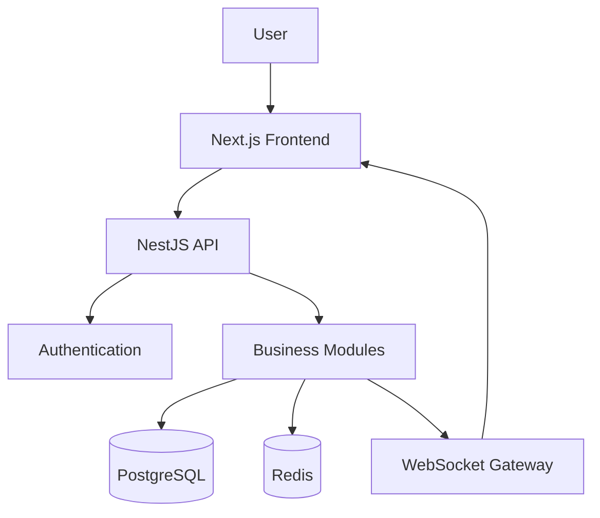
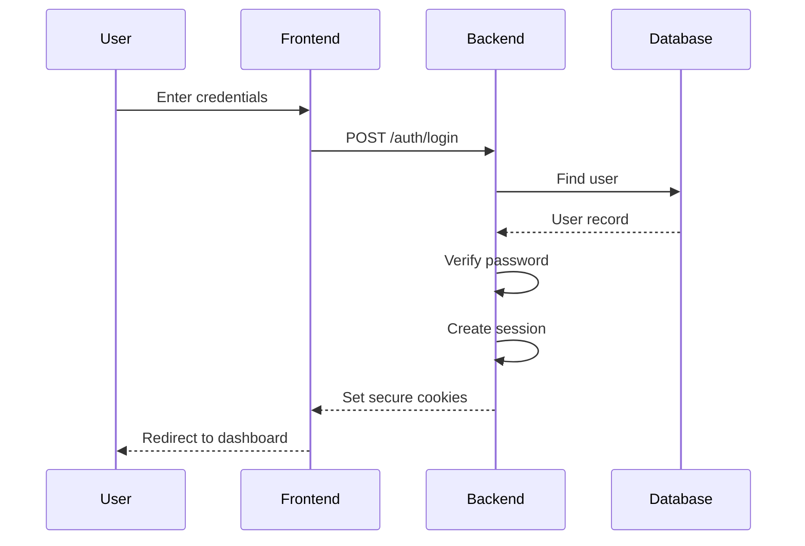

# TeamFlow — Software Development Project Brief

**[Client specification]** **[Version 1.0]**

**From:** Client / Product Owner  
**To:** Hamza Jemli — Full-Stack Software Developer  
**Project:** TeamFlow  
**Project type:** Multi-tenant SaaS Project Management Platform  
**Delivery expectation:** Production-quality portfolio project  
**Primary objective:** Build a complete, documented, tested and deployable software product.

---

Hamza, I'm hiring you to develop TeamFlow, a project management platform that allows companies and teams to organize their work, collaborate, track progress and manage projects from one central application.

I don't want a simple Trello clone or a tutorial application.

I want a properly engineered SaaS product that could realistically be offered to businesses.

You have full responsibility for the technical implementation, including:

- Product architecture.
- Frontend and backend development.
- Database architecture.
- API design.
- Authentication and authorization.
- Infrastructure and deployment.
- Testing and quality assurance.
- Security.
- Technical documentation.
- AI-assisted development workflow.

You are allowed to use AI coding agents to assist you, but you remain responsible for the quality, correctness and maintainability of everything delivered.

**One additional requirement:** This project is also an engineering learning exercise. Every major implementation must be accompanied by detailed educational documentation explaining what was built, why it was built that way, and how it works internally.

I expect you to be able to explain every important part of the application during a technical interview.

---

# 1. Product vision

> 🖼️ **UI/Design References:**
> - *Linear project management SaaS dashboard dark mode interface*
> - *modern project management kanban board clean UI*
> - *modern project management team analytics dashboard interface*

TeamFlow is a multi-tenant project management SaaS platform.

Businesses can register, create organizations, invite employees, create projects, assign tasks, track progress and collaborate.

Think of a combination of:

- Linear: clean project management experience.
- Trello: visual Kanban boards.
- Asana: task organization and collaboration.
- Slack: notifications and real-time communication (limited to project collaboration).

We are not trying to reproduce all these products. We want a focused, polished application with a coherent set of features.

### Product objectives

1. Allow businesses to manage multiple projects.
2. Allow employees to collaborate within their organizations.
3. Make task management simple and efficient.
4. Provide visibility into project progress.
5. Keep users informed through notifications.
6. Protect business data through proper tenant isolation.
7. Provide a foundation that can grow into a commercial SaaS.

### Target users

- Small and medium-sized businesses.
- Software development teams.
- Marketing agencies.
- Freelancers working with teams.
- Project managers.
- Remote teams.

# 2. Product scope and user roles

The application must support multiple independent organizations.

For example:

- Company A registers and creates an organization.
- Company A invites five employees.
- Company B independently registers and creates its own organization.
- Company B invites ten employees.
- Both companies use the same application and infrastructure.
- Company A must never be able to access Company B's projects, tasks, users or files.

This is one of the most important requirements of the entire project.

### User roles

| Role | Permissions |
|---|---|
| Platform Admin | Manages the SaaS platform and organizations |
| Organization Owner | Controls the organization and its members |
| Organization Admin | Manages members, projects and settings |
| Project Manager | Manages assigned projects and project members |
| Member | Works on assigned tasks and participates in projects |

A user can belong to multiple organizations with different roles in each.

For example, a user might be an Admin in one organization and a Member in another.

**Important:** Authorization must be enforced by the backend, not just by hiding frontend buttons.

# 3. Functional requirements

These are the features I expect in the product.

## Module A — Authentication and account management

> 🖼️ **UI/Design Reference:** *modern SaaS login signup authentication interface clean minimal design*

Users must be able to:

- Register using email and password.
- Log in and log out.
- Verify their email.
- Request a password reset.
- Change their password.
- View and update their profile.
- Upload a profile picture.
- Manage active sessions.
- Revoke sessions from other devices.

Technical requirements:

- Secure password hashing using Argon2id or an appropriate secure password-hashing algorithm.
- Access and refresh token handling.
- Secure token storage.
- Authentication guards.
- Rate limiting on sensitive authentication endpoints.
- Email verification tokens with expiration.
- Password reset tokens with single-use behavior.

The system must prevent users from accessing protected resources without valid authorization.

## Module B — Organization and multi-tenancy

> 🖼️ **UI/Design Reference:** *SaaS organization workspace switcher team members management interface*

Users must be able to:

- Create an organization.
- Set organization name and logo.
- Switch between organizations.
- Invite employees by email.
- Accept or reject invitations.
- Remove members.
- Change member roles.
- View organization members.
- Update organization settings.

Business rules:

- The creator becomes the Organization Owner.
- An organization must always have at least one owner.
- Only authorized users can invite members.
- Invitations expire.
- A user cannot accept an invitation for an account they do not control.
- Users must not access organizations they do not belong to.

We also need an invitation status system:

`PENDING → ACCEPTED / EXPIRED / REVOKED`

## Module C — Project management

> 🖼️ **UI/Design Reference:** *modern SaaS project management project overview dashboard with progress status team members*

Users with appropriate permissions can:

- Create projects.
- Edit project information.
- Archive projects.
- Delete projects according to retention rules.
- Assign project managers.
- Add and remove project members.
- Set project start and end dates.
- Define project descriptions.
- Set project statuses.
- View project progress.
- Filter and search projects.

Project statuses:

- PLANNING
- ACTIVE
- ON_HOLD
- COMPLETED
- ARCHIVED

Every project belongs to exactly one organization.

Project membership must be separate from organization membership so that not every employee automatically sees every project.

## Module D — Task management

> 🖼️ **UI/Design References:**
> - *modern kanban task management board clean UI*
> - *modern task details side panel task management SaaS*
> - *project management task list table interface*

This is the core of the application.

Users must be able to:

- Create tasks.
- Edit task details.
- Assign tasks to one or multiple members.
- Set priorities.
- Set due dates.
- Add labels.
- Add descriptions.
- Add subtasks.
- Create dependencies between tasks.
- Add attachments.
- Comment on tasks.
- Track status changes.
- Search and filter tasks.

Task statuses:

- BACKLOG
- TODO
- IN_PROGRESS
- IN_REVIEW
- DONE
- CANCELLED

Task priorities:

- LOW
- MEDIUM
- HIGH
- URGENT

Each task must contain:

- Title.
- Description.
- Project ID.
- Organization ID.
- Status.
- Priority.
- Creator.
- Assignees.
- Due date.
- Creation date.
- Updated date.

Business rules:

- A task must belong to a project.
- A task cannot be assigned to someone who is not a member of its project.
- Only authorized users can modify tasks.
- A task status change must be recorded.
- Completed tasks must retain their history.
- Task dependencies must not introduce circular dependencies.

## Module E — Kanban board

The user should be able to see tasks organized into columns according to their status.

Required interactions:

- Drag and drop tasks between columns.
- Reorder tasks within a column.
- Update task status when moved.
- Optimistically update the interface.
- Reconcile the interface if the server rejects the change.
- Filter by assignee, priority and label.

The ordering must persist after refreshing the page.

This is a good opportunity to learn optimistic updates and concurrent modification handling.

## Module F — Comments and collaboration

Users must be able to:

- Comment on tasks.
- Edit their own comments.
- Delete their own comments.
- Mention other members.
- View comment history.
- Receive notifications when mentioned.

Comments should update in real time when other authorized users add them.

## Module G — Notifications

> 🖼️ **UI/Design Reference:** *modern SaaS notification center dropdown interface clean design*

The application should support:

- Task assignments.
- Task mentions.
- Comments on assigned tasks.
- Project invitations.
- Project updates.
- Upcoming deadlines.

Users must be able to:

- View notifications.
- Mark notifications as read.
- Mark all as read.
- Navigate to the relevant task or project.
- Configure notification preferences.

Use WebSockets for real-time delivery, but persist notifications in PostgreSQL so users can retrieve them when offline.

## Module H — Dashboard and analytics

> 🖼️ **UI/Design Reference:** *modern project management analytics dashboard charts KPI cards task completion team performance*

Organization dashboard:

- Total projects.
- Active projects.
- Completed projects.
- Total tasks.
- Pending tasks.
- Overdue tasks.
- Task completion rate.
- Recent activity.

Project dashboard:

- Project progress.
- Task distribution by status.
- Tasks by priority.
- Overdue tasks.
- Member assignments.
- Upcoming deadlines.

The figures must be calculated from actual database records, not hardcoded sample values.

## Module I — Search and filtering

Users should be able to search for:

- Projects.
- Tasks.
- Members.
- Comments where authorized.

Filtering options:

- Status.
- Priority.
- Assignee.
- Due date.
- Labels.
- Project.

Implement pagination and sorting on the backend.

---

## Module J — Activity logs and audit trail

Every important action should be recorded.

Examples:

- User created a project.
- User invited a member.
- User changed a task status.
- User reassigned a task.
- User changed organization settings.
- User archived a project.

Each activity record should include:

- Actor.
- Organization.
- Action type.
- Entity type.
- Entity ID.
- Timestamp.
- Relevant metadata.

Users should be able to view recent activity within their authorized organization and projects.

Audit records should not be editable by ordinary users.

## Module K — File and attachment management

Users should be able to upload files to:

- Tasks.
- Comments (optional).
- Project resources.

Requirements:

- Validate file type and size.
- Generate unique storage keys.
- Store file metadata in PostgreSQL.
- Use object storage for file contents.
- Enforce access permissions when downloading.
- Support deletion and orphaned-file cleanup.
- Never expose private storage credentials.

For local development, use MinIO or local object storage. For production, support S3-compatible storage.

## Module L — Organization settings

Organization administrators should be able to manage:

- Organization name and logo.
- Members.
- Invitations.
- Roles.
- Default settings.
- Notification preferences.
- Organization activity.

Advanced settings such as subscription billing and usage limits can be added later.

# 4. User interface and application pages

I expect a modern, professional SaaS interface.

The design should be clean, responsive, minimal and easy to navigate.

Think Linear rather than an overloaded enterprise dashboard.

> 🖼️ **UI/Design References:**
> - *Linear app interface dark sidebar project management*
> - *modern SaaS kanban board minimal light theme*
> - *modern project task detail panel interface*
> - *minimal SaaS project analytics dashboard*

### Required pages

| Page | Purpose |
|---|---|
| `/login` | User authentication |
| `/register` | Account registration |
| `/forgot-password` | Password recovery |
| `/verify-email` | Email verification |
| `/onboarding` | First-time setup |
| `/dashboard` | Organization overview |
| `/projects` | Project listing |
| `/projects/new` | Create project |
| `/projects/[id]` | Project overview |
| `/projects/[id]/board` | Kanban board |
| `/projects/[id]/tasks` | Task list |
| `/projects/[id]/settings` | Project settings |
| `/tasks/[id]` | Task details |
| `/team` | Organization members |
| `/invitations` | Manage invitations |
| `/notifications` | Notification center |
| `/settings/profile` | User profile |
| `/settings/organization` | Organization settings |

### Main application layout

> 🖼️ **UI/Design Reference:** *Linear inspired project management SaaS desktop application sidebar top navigation clean interface*

The main layout should contain:

**Sidebar**
- Organization switcher.
- Dashboard.
- Projects.
- My Tasks.
- Team.
- Settings.

**Top navigation**
- Breadcrumbs.
- Global search.
- Notifications.
- User profile.

**Main content**
- Page-specific content.
- Contextual actions.
- Filters and controls.

### Design requirements

- Desktop-first, but fully responsive on mobile.
- Light and dark themes.
- Consistent spacing and typography.
- Loading skeletons.
- Empty states.
- Error states.
- Confirmation dialogs for destructive actions.
- Toast notifications.
- Accessible keyboard navigation.
- Proper form validation.

Don't use fake functionality. Every visible button must perform its intended action or be explicitly marked as unavailable in the MVP.

---

# 5. Technical specifications

Now let's define how I expect you to engineer the application.

## 5.1 Technology stack

I am selecting the following stack for this project.

| Layer | Technology | Purpose |
|---|---|---|
| Frontend | Next.js + React | Web application |
| Language | TypeScript | Type safety |
| Styling | Tailwind CSS | UI styling |
| Components | shadcn/ui | Reusable UI components |
| Backend | NestJS | API and business logic |
| Database | PostgreSQL | Persistent relational data |
| ORM | Prisma | Database access and migrations |
| Cache | Redis | Caching and temporary data |
| Real-time | Socket.IO | Live updates |
| Validation | Zod / class-validator | Input validation |
| API docs | Swagger / OpenAPI | API documentation |
| Testing | Jest | Unit and integration tests |
| E2E testing | Playwright | Browser testing |
| Containers | Docker | Application containers |
| Orchestration | Docker Compose | Local infrastructure |
| CI/CD | GitHub Actions | Automated pipelines |
| Reverse proxy | Nginx | Routing and proxying |

Use compatible stable versions at implementation time. Record the versions in the project documentation.

## 5.2 Architecture

For version 1, I want a **modular monolith**, not microservices.

The backend should be one NestJS application, internally divided into independent business modules.

This provides good separation of concerns without introducing unnecessary distributed-system complexity.

### High-level architecture

> 🖼️ **UI/Design Reference:** *modular monolith architecture diagram Next.js NestJS PostgreSQL Redis Docker Nginx*

The application should work like this:

1. User accesses the Next.js application.
2. Next.js communicates with the NestJS API.
3. NestJS validates and authenticates the request.
4. Guards check permissions and organization access.
5. The appropriate business module processes the request.
6. Prisma communicates with PostgreSQL.
7. Redis handles caching and temporary data where appropriate.
8. WebSocket gateways deliver real-time events.
9. Notifications are persisted and delivered.
10. The frontend updates accordingly.

### Backend modules

Organize the backend into logical modules:

```text
src/
├── auth/
├── users/
├── organizations/
├── memberships/
├── invitations/
├── projects/
├── project-members/
├── tasks/
├── comments/
├── labels/
├── attachments/
├── notifications/
├── activity-logs/
├── dashboard/
├── search/
├── realtime/
├── storage/
├── mail/
├── common/
└── infrastructure/
```

Each module should have clear responsibilities.

For example:

```text
tasks/
├── tasks.module.ts
├── tasks.controller.ts
├── tasks.service.ts
├── tasks.repository.ts
├── dto/
├── entities/
├── policies/
└── tests/
```

You can adapt this structure as the application grows. Avoid creating unnecessary abstractions just to make folders look sophisticated.

## 5.3 Database architecture

The database is one of the most important deliverables.

I expect you to design the schema before implementing business logic.

### Required entities

| Entity | Responsibility |
|---|---|
| User | User accounts |
| Session | Active login sessions |
| Organization | Company workspaces |
| Membership | User-to-organization relationship |
| Invitation | Organization invitations |
| Project | Organization projects |
| ProjectMember | Project access and roles |
| Task | Project tasks |
| TaskAssignee | Task assignments |
| TaskDependency | Task dependencies |
| TaskLabel | Task-label relationship |
| Label | Project labels |
| Comment | Task comments |
| Attachment | Uploaded file metadata |
| Notification | User notifications |
| ActivityLog | Audit history |
| TaskStatusHistory | Task status changes |

You may introduce additional tables where justified.

### Important database relationships

  **Simplified relationship overview**

  
    **User**
  
  
    
  
  
    **Membership**
  
  
    
  
  
    **Organization**
  
  
    
  
  
    **Project**
  
  
    
  
  
    **Task**
  
  
    
      
        Comments
      
    
    
      
        Assignees
      
    
    
      
        Labels
      
    
  
  Conceptual overview, not the complete ERD. Your implementation must produce a detailed diagram with all foreign keys, cardinalities and constraints.

### Database requirements

The implementation must consider:

- Primary and foreign keys.
- Unique constraints.
- Composite indexes.
- Database normalization.
- Cascading delete behavior.
- Transactions.
- Soft deletion where appropriate.
- Timestamps.
- Database migrations.
- Referential integrity.

Every organization-owned record must have a clearly defined tenant ownership path.

The database design should also enforce important invariants where possible. For example, composite foreign keys can help ensure a task's project and organization belong together.

Do not rely exclusively on frontend validation or application-level assumptions for data integrity.

### Multi-tenancy requirement

I want organization data isolation to be treated as a security requirement.

For every organization-scoped request:

- Identify the authenticated user.
- Validate organization membership.
- Validate the required role and permissions.
- Validate project membership when applicable.
- Ensure all database operations are scoped to the authorized organization.

Write automated tests specifically attempting cross-organization access.

# 6. API specifications

All REST APIs should use a consistent prefix:

`/api/v1`

Use proper HTTP methods and status codes.

Examples:

| Method | Endpoint | Purpose |
|---|---|---|
| POST | `/auth/register` | Register |
| POST | `/auth/login` | Login |
| POST | `/auth/refresh` | Refresh session |
| POST | `/auth/logout` | Logout |
| GET | `/users/me` | Current user |
| POST | `/organizations` | Create organization |
| GET | `/organizations` | List organizations |
| POST | `/organizations/:id/invitations` | Invite member |
| GET | `/organizations/:id/members` | List members |
| POST | `/organizations/:id/projects` | Create project |
| GET | `/organizations/:id/projects` | List projects |
| GET | `/projects/:id` | Project details |
| POST | `/projects/:id/tasks` | Create task |
| GET | `/projects/:id/tasks` | List tasks |
| PATCH | `/tasks/:id` | Update task |
| PATCH | `/tasks/:id/status` | Change task status |
| POST | `/tasks/:id/comments` | Add comment |
| GET | `/tasks/:id/comments` | List comments |
| GET | `/notifications` | List notifications |
| PATCH | `/notifications/:id/read` | Mark as read |
| GET | `/organizations/:id/dashboard` | Dashboard statistics |

These are representative endpoints. You are responsible for designing the complete API contract.

### API standards

I expect:

- Request validation.
- Consistent response structures.
- Appropriate HTTP status codes.
- Consistent error handling.
- Pagination.
- Filtering.
- Sorting.
- API versioning.
- Swagger documentation.
- Authentication and authorization.
- Rate limiting.
- Idempotency for operations where duplicate execution would cause problems.

Example error response:

```json
{
  "statusCode": 403,
  "error": "FORBIDDEN",
  "message": "You do not have permission to access this resource",
  "timestamp": "2026-11-01T12:00:00Z",
  "path": "/api/v1/projects/123"
}
```

# 7. Non-functional requirements

These are requirements that affect the overall quality of the application.

| Category | Requirement |
|---|---|
| Security | OWASP-aligned security practices |
| Performance | Paginated queries and optimized database access |
| Reliability | Graceful error handling |
| Scalability | Stateless API design where practical |
| Maintainability | Modular architecture and clear boundaries |
| Accessibility | Keyboard navigation and semantic HTML |
| Responsiveness | Desktop, tablet and mobile |
| Observability | Structured logs and health checks |
| Data integrity | Transactions and database constraints |
| Testing | Automated tests for critical business logic |

### Security requirements

Pay special attention to:

- Broken access control.
- SQL injection.
- Cross-site scripting.
- CSRF.
- CORS configuration.
- Insecure file uploads.
- Password security.
- Session management.
- Secret management.
- Sensitive information in logs.
- Cross-tenant data exposure.

For authentication, document the selected token strategy and its threat model. For a browser application, prefer secure, HttpOnly cookies with appropriate SameSite and CSRF protections. Never put long-lived authentication secrets in localStorage.

### Performance requirements

Establish measurable performance targets and benchmark them.

Initial targets for a normal test environment:

- Common API read operations: p95 under 300 ms.
- Common API write operations: p95 under 500 ms.
- Dashboard queries should avoid loading unnecessary records.
- Large lists must use pagination.
- Avoid N+1 database queries.
- Optimize indexes based on actual query plans.

These are engineering targets, not guaranteed results. Document your testing environment and measured results.

---

# 8. Real-time architecture

Real-time functionality is important because TeamFlow is a collaborative application.

Use Socket.IO through NestJS.

### Events to support

| Event | Description |
|---|---|
| `task.created` | A task was created |
| `task.updated` | A task was updated |
| `task.status_changed` | Task status changed |
| `task.assigned` | A member was assigned |
| `comment.created` | A comment was added |
| `notification.created` | A notification was created |
| `project.updated` | Project information changed |

### Important implementation requirements

- Authenticate WebSocket connections.
- Authorize users before joining organization or project rooms.
- Prevent users from subscribing to another organization's events.
- Persist important events or their resulting state in PostgreSQL.
- Handle disconnected clients.
- Reconcile missed updates when users reconnect.
- Avoid duplicate notifications.
- Document event payloads.

Example:

```json
{
  "event": "task.status_changed",
  "data": {
    "taskId": "task_123",
    "projectId": "project_123",
    "oldStatus": "TODO",
    "newStatus": "IN_PROGRESS",
    "changedBy": "user_123"
  }
}
```

The example is illustrative; use your actual API and event contract.

# 9. Testing and quality assurance

I will not consider the project complete simply because the interface looks good.

I expect a proper testing strategy.

### Unit tests

Test individual business logic components:

- Authentication services.
- Permission checks.
- Task status transitions.
- Invitation expiration.
- Organization membership.
- Task assignment validation.
- Notification generation.

### Integration tests

Test interactions between components:

- API and database.
- Organization membership and authorization.
- Task creation and assignment.
- Invitation acceptance.
- Transactions.
- Notification persistence.

### End-to-end tests

Use Playwright to simulate actual users.

Example scenarios:

**Scenario 1 — New organization**

1. Register an account.
2. Verify email.
3. Create an organization.
4. Create a project.
5. Invite an employee.
6. Verify that the employee can join.

**Scenario 2 — Task collaboration**

1. Log in as a project manager.
2. Create a task.
3. Assign it to a member.
4. Log in as the member.
5. Change the task status.
6. Verify that the manager receives the update.

**Scenario 3 — Tenant isolation**

1. Register User A.
2. Create Organization A.
3. Register User B.
4. Create Organization B.
5. Attempt to access Organization A's projects using User B.
6. Verify access is rejected.

This third scenario is particularly important.

### Additional quality checks

- ESLint.
- Prettier.
- TypeScript strict mode.
- Dependency vulnerability scanning.
- Environment configuration validation.
- Database migration checks.
- Build verification.

I expect tests to cover critical business rules, not just achieve an arbitrary coverage percentage.

# 10. Docker and deployment requirements

The project must be containerized.

### Expected local architecture

> 🖼️ **UI/Design Reference:** *Docker compose architecture diagram Next.js NestJS PostgreSQL Redis Nginx containers*

Your Docker Compose environment should support:

| Container | Responsibility |
|---|---|
| frontend | Next.js |
| backend | NestJS |
| database | PostgreSQL |
| redis | Caching and temporary data |
| nginx | Reverse proxy |
| mail | Development email testing |
| storage | Optional MinIO for local files |

Requirements:

- Multi-stage Docker builds.
- Non-root application containers where practical.
- Persistent database volumes.
- Health checks.
- Internal Docker networking.
- Environment variables and secrets.
- Separate development and production configurations.
- Database migrations.
- Database backup and restoration scripts.

### CI/CD

Create a GitHub Actions pipeline.

On pull requests:

1. Install dependencies.
2. Run formatting checks.
3. Run linting.
4. Run type checking.
5. Run unit tests.
6. Run integration tests.
7. Build frontend and backend.
8. Scan dependencies.

On merges to the main branch:

1. Build production images.
2. Tag images.
3. Push images to a container registry.
4. Deploy to the target server.
5. Run health checks.
6. Report deployment success or failure.

Do not deploy automatically if critical checks fail.

### Production deployment

Deploy to a VPS or cloud provider.

The final deployment should have:

- HTTPS.
- Domain configuration.
- Reverse proxy.
- Secure environment variables.
- Database persistence.
- Backups.
- Monitoring.
- Logging.
- Health checks.
- A documented rollback procedure.

---

# 11. The most important part: Engineering learning documentation

This is an explicit client requirement, not an optional extra.

I want the AI agent to act as both a development assistant and a technical instructor.

Every important implementation must be explained in detail so that the developer understands what the agent has built.

I do not want an AI agent that generates 500 lines of code, tells you it is finished, and moves on.

I want an AI-assisted engineering workflow where implementation and learning happen together.

## Required documentation structure

Create a dedicated directory:

```text
docs/
│
├── 00-project-overview/
│   ├── project-vision.md
│   ├── requirements.md
│   ├── glossary.md
│   └── scope-and-roadmap.md
│
├── 01-architecture/
│   ├── system-overview.md
│   ├── architecture-diagram.md
│   ├── backend-architecture.md
│   ├── frontend-architecture.md
│   ├── request-lifecycle.md
│   └── architecture-decisions/
│
├── 02-database/
│   ├── database-overview.md
│   ├── er-diagram.md
│   ├── relationships.md
│   ├── indexes-and-optimization.md
│   ├── transactions.md
│   └── migrations.md
│
├── 03-backend/
│   ├── module-architecture.md
│   ├── authentication.md
│   ├── authorization.md
│   ├── api-design.md
│   ├── error-handling.md
│   ├── background-jobs.md
│   └── websocket-architecture.md
│
├── 04-frontend/
│   ├── application-architecture.md
│   ├── routing.md
│   ├── state-management.md
│   ├── api-communication.md
│   └── performance.md
│
├── 05-devops/
│   ├── docker-explained.md
│   ├── docker-compose.md
│   ├── networking.md
│   ├── nginx.md
│   ├── ci-cd.md
│   ├── deployment.md
│   └── backups-and-recovery.md
│
├── 06-security/
│   ├── security-overview.md
│   ├── threat-model.md
│   ├── authentication-security.md
│   ├── tenant-isolation.md
│   └── security-checklist.md
│
├── 07-testing/
│   ├── testing-strategy.md
│   ├── unit-testing.md
│   ├── integration-testing.md
│   └── e2e-testing.md
│
├── 08-learning-notes/
│   ├── concepts/
│   ├── implementation-explanations/
│   ├── code-examples/
│   ├── common-mistakes/
│   └── interview-questions/
│
└── 09-operations/
    ├── local-development.md
    ├── troubleshooting.md
    ├── monitoring.md
    └── production-runbook.md
```

## What every explanation document must contain

For each important feature or technical concept, the AI agent must explain:

1. **What:** What are we implementing?
2. **Why:** Why does the application need it?
3. **How:** How does it work internally?
4. **Architecture:** Where does it fit into the overall system?
5. **Data flow:** How does information move through the system?
6. **Code walkthrough:** Explain the important files, classes, functions and methods.
7. **Alternatives:** What other approaches could we have used?
8. **Trade-offs:** Why did we select this approach?
9. **Security:** What security risks should we consider?
10. **Performance:** What performance implications exist?
11. **Testing:** How do we verify that it works?
12. **Examples:** Give realistic request/response examples and code snippets.
13. **Common mistakes:** What should a developer avoid?
14. **Interview preparation:** What questions could an interviewer ask about this implementation?

### Diagrams are mandatory where they add explanatory value

I expect diagrams using Mermaid or another maintainable text-based diagram format.

Examples:

**System architecture diagram**



**Authentication sequence diagram**



**Database ER diagrams**

Show the entities, their relationships, primary keys and foreign keys.

**Request lifecycle diagrams**

Explain how an HTTP request travels through middleware, guards, controllers, services, repositories and the database.

**Docker networking diagrams**

Show how the frontend, backend, database and reverse proxy communicate.

### Examples must be practical

For example, when explaining database transactions, don't just define ACID.

Show an actual task assignment or inventory-like operation, explain what happens if one step fails, and show the relevant code and SQL.

When explaining Docker networking, show the difference between:

- `localhost` inside a container.
- A Docker service name.
- A host machine address.
- A published port.

I want to understand the real behavior, not memorize definitions.

---

# 12. AI agent development instructions

This section is especially important because you will be using an AI coding agent.

I want you to create a file at the root of the repository called:

`AGENTS.md`

This will be the persistent engineering instruction file for your AI coding agent.

It should contain the following instructions.

## 12.1 Copy this into `AGENTS.md`

This is the instruction contract I want your AI coding agent to follow throughout the project.

```markdown
# AGENTS.md — TeamFlow Engineering Instructions

## 1. Your Role

You are acting as a senior software engineer, software architect,
technical reviewer, and programming instructor.

You are assisting the developer in building TeamFlow, a production-quality,
multi-tenant SaaS project management platform.

Your responsibilities are:

- Design and implement maintainable software.
- Follow established engineering practices.
- Explain technical decisions.
- Teach the developer the concepts behind your implementation.
- Maintain accurate project documentation.
- Identify risks and potential problems.
- Never sacrifice correctness for implementation speed.

The developer is responsible for reviewing and understanding all code.

## 2. Critical Development Rules

1. Never implement features without understanding their requirements.
2. Never make large architectural decisions without documenting them.
3. Never introduce unnecessary complexity.
4. Never generate code that you cannot explain.
5. Never assume code works without testing it.
6. Never ignore security implications.
7. Never hardcode secrets or credentials.
8. Never bypass TypeScript type checking.
9. Never use `any` as a shortcut without justification.
10. Never modify unrelated functionality unnecessarily.
11. Never claim a test passed unless it was actually executed.
12. Never silently change existing database schemas or data.
13. Never expose sensitive information in logs or documentation.

Prefer simple, maintainable solutions over unnecessary abstractions.

## 3. Development Workflow

Work incrementally.

Before implementing a feature:

1. Read the relevant project documentation.
2. Inspect the existing codebase.
3. Understand the current architecture.
4. Identify dependencies.
5. Define the implementation plan.
6. Identify security and data integrity risks.
7. Explain the proposed approach to the developer.

Then implement the feature in small logical steps.

After implementation:

1. Review the code.
2. Run relevant tests.
3. Run linting and type checking.
4. Verify the feature's behavior.
5. Review security implications.
6. Update documentation.
7. Explain the implementation in detail.
8. Report any limitations or unfinished work.

Do not implement multiple unrelated features in one operation.

## 4. Mandatory Educational Explanations

The developer is using this project to develop professional
software engineering skills.

For every significant feature or architectural change, create
or update documentation inside:

docs/08-learning-notes/

Each explanation must include:

- What was implemented.
- Why it is necessary.
- The underlying technical concepts.
- How it works internally.
- Its position in the application architecture.
- The complete data flow.
- Important files and their responsibilities.
- Detailed explanations of important functions and classes.
- Practical code examples.
- Realistic input/output examples.
- Alternative implementation approaches.
- Advantages and disadvantages of the chosen approach.
- Security considerations.
- Performance considerations.
- Testing strategy.
- Common mistakes.
- Interview questions and answers.

Never provide explanations consisting only of generic definitions.

Use actual TeamFlow implementation examples.

## 5. Documentation and Diagrams

Keep documentation synchronized with the codebase.

Use Mermaid for diagrams where appropriate.

Create and maintain:

- System architecture diagrams.
- Database ER diagrams.
- Sequence diagrams.
- Request lifecycle diagrams.
- Authentication flow diagrams.
- Authorization flow diagrams.
- WebSocket event flow diagrams.
- Docker networking diagrams.
- CI/CD pipeline diagrams.

Every diagram must represent the actual implementation.

Never leave outdated diagrams after architectural changes.

## 6. Architecture Rules

The initial backend architecture is a modular monolith.

Use:

- Next.js and TypeScript for frontend.
- NestJS and TypeScript for backend.
- PostgreSQL for persistent data.
- Prisma for database access.
- Redis for caching and temporary data.
- Socket.IO for real-time communication.
- Docker and Docker Compose for containers.

Maintain clear module boundaries.

Separate:

- Controllers.
- Business services.
- Data access.
- DTOs and validation.
- Authorization policies.
- Infrastructure concerns.

Avoid putting business logic inside controllers.

Avoid unnecessary abstractions and premature microservices.

Document major architecture decisions as ADRs.

## 7. Database Rules

- Design relationships carefully.
- Use foreign keys and constraints.
- Use transactions when necessary.
- Consider indexes based on query patterns.
- Prevent N+1 queries.
- Use migrations.
- Protect tenant isolation.
- Document destructive migration risks.
- Preserve referential integrity.

Never change the database schema without explaining
the migration and its implications.

## 8. Security Rules

Treat security as a core requirement.

Always consider:

- Authentication.
- Authorization.
- Tenant isolation.
- Input validation.
- SQL injection.
- XSS.
- CSRF.
- CORS.
- Secure sessions.
- Password hashing.
- Rate limiting.
- File upload validation.
- Secrets management.
- Dependency vulnerabilities.

Every organization-scoped operation must verify
the authenticated user's access.

Never trust organization IDs supplied by the frontend.

Test cross-tenant access attempts.

## 9. Testing Rules

Write appropriate tests for every important feature.

Use:

- Jest for unit and integration tests.
- Playwright for end-to-end tests.

Prioritize:

- Authentication.
- Authorization.
- Tenant isolation.
- Organization membership.
- Project permissions.
- Task operations.
- Transactions.
- Real-time functionality.

Do not remove or weaken tests simply to make a build pass.

## 10. AI-Assisted Development Transparency

When using AI-generated code, explain:

- What was generated or changed.
- Why the implementation was selected.
- Which parts require developer review.
- What assumptions were made.
- What tests verify the implementation.

Never invent test results, performance measurements,
security guarantees or completed features.

## 11. Change Management

Before modifying existing functionality:

- Inspect existing implementation.
- Identify affected modules.
- Consider backward compatibility.
- Explain possible regressions.

Avoid destructive commands and data loss.

Ask for approval before performing destructive database
operations, deleting important files, or changing production
infrastructure.

## 12. Completion Criteria

A feature is not complete until:

- Its requirements are implemented.
- Its validation is implemented.
- Its authorization is verified.
- Its tests are written and executed.
- Its documentation is updated.
- Its limitations are documented.
- The developer receives a detailed explanation.

At the end of every implementation task, provide:

1. Summary of changes.
2. Files created or modified.
3. Technical decisions.
4. Explanation of how the feature works.
5. Tests executed and their actual results.
6. Security considerations.
7. Documentation created or updated.
8. Remaining issues.
9. Suggested next learning exercise.

Your ultimate objective is to help build excellent software
while developing the developer's independent engineering skills.
```

## 12.2 How I want you to interact with the AI agent

Don't ask the agent:

"Build the entire TeamFlow application."

That's a bad way to work. It can produce a huge amount of code that you don't understand.

Instead, give it one assignment at a time.

For example:

**Assignment 1: Analyze and plan the database**

```text
Read the TeamFlow project specification and AGENTS.md.

Your assignment is to design the complete PostgreSQL database.

Do not implement the database yet.

First:
1. Identify all entities.
2. Define their attributes.
3. Define primary and foreign keys.
4. Explain every relationship.
5. Identify normalization considerations.
6. Identify indexes and unique constraints.
7. Explain how multi-tenancy will work.
8. Identify possible data integrity problems.
9. Create a Mermaid ER diagram.
10. Document all decisions.

Create a detailed educational document explaining the
database design and the reasoning behind it.

Wait for my review before proceeding to implementation.
```

**Assignment 2: Review the architecture**

```text
Review the proposed database design.

Now design the complete application architecture.

Explain:
- Frontend architecture.
- Backend modular monolith.
- API communication.
- Authentication.
- Authorization.
- Database access.
- Redis.
- WebSockets.
- Docker networking.

Create system architecture and sequence diagrams.

Explain the request lifecycle with real examples.

Do not write implementation code yet.

Wait for approval.
```

**Assignment 3: Implement authentication**

```text
Implement the authentication module based on the approved
TeamFlow specification and architecture.

Work incrementally.

Before coding:
- Explain the authentication architecture.
- Explain the session strategy.
- Explain access and refresh token handling.
- Explain password hashing.
- Explain relevant security threats.

Then implement registration, login, logout and session
management.

Write unit and integration tests.

Update the relevant educational documentation.

At the end, explain every important file and the complete
authentication flow, including a practical example.

Do not proceed to the next module.
```

This workflow will force the agent to explain the decisions before and after writing code.

---

# 13. Project milestones and client acceptance criteria

As the client, I will consider the following milestones part of the delivery agreement.

| Milestone | Deliverable | Acceptance condition |
|---|---|---|
| M1 | Requirements and architecture | Approved specifications and diagrams |
| M2 | Database and backend foundation | Working schema, migrations and API foundation |
| M3 | Authentication and organizations | Secure accounts and tenant isolation |
| M4 | Projects and task management | Functional project and task operations |
| M5 | Collaboration | Kanban, comments and real-time updates |
| M6 | Dashboard and notifications | Functional analytics and notification center |
| M7 | Production engineering | Docker, CI/CD, tests and security review |
| M8 | Deployment and handover | Running application and complete documentation |

### Definition of done

A milestone is accepted only when:

- The feature works.
- Its business rules are enforced.
- Unauthorized access is rejected.
- Relevant automated tests pass.
- There are no known critical security issues.
- Documentation is updated.
- The implementation has been explained to the developer.

---

# 14. Final delivery package

At the end of the project, I expect the following deliverables.

  ### TeamFlow delivery checklist

  **1. Working application**
  - [ ] Functional Next.js frontend.
  - [ ] Functional NestJS backend.
  - [ ] PostgreSQL database.
  - [ ] Authentication and authorization.
  - [ ] Organization and multi-tenant management.
  - [ ] Projects and task management.
  - [ ] Kanban board.
  - [ ] Collaboration and notifications.
  - [ ] Analytics dashboard.
  - [ ] Responsive interface.

  
---

  **2. Engineering**
  - [ ] Modular backend architecture.
  - [ ] Proper database design.
  - [ ] REST API with Swagger.
  - [ ] Redis integration.
  - [ ] WebSocket implementation.
  - [ ] Automated tests.
  - [ ] Security review.
  - [ ] Performance testing.

  
---

  **3. DevOps**
  - [ ] Dockerfiles.
  - [ ] Docker Compose.
  - [ ] Nginx configuration.
  - [ ] GitHub Actions CI/CD.
  - [ ] Production deployment.
  - [ ] Database backup and recovery.
  - [ ] Monitoring and logging.

  
---

  **4. Educational documentation**
  - [ ] Complete README.
  - [ ] System architecture diagrams.
  - [ ] Database ER diagram.
  - [ ] API documentation.
  - [ ] Technical explanations.
  - [ ] Code walkthroughs.
  - [ ] Practical examples.
  - [ ] Architecture decision records.
  - [ ] Interview preparation notes.
  - [ ] Troubleshooting guides.

  
---

  **5. Portfolio presentation**
  - [ ] Public GitHub repository (where appropriate).
  - [ ] Live demo.
  - [ ] Screenshots.
  - [ ] Demo video.
  - [ ] Technical case study.
  - [ ] Measured performance results.

# 15. What we are NOT building in version 1

I want the product to be ambitious, but we must control scope.

These features can be future improvements:

- Paid subscriptions and billing.
- Advanced AI project assistants.
- Native mobile applications.
- Advanced project scheduling and Gantt charts.
- Microservices migration.
- Kubernetes production deployment.
- Advanced reporting.
- Enterprise SSO.
- Complex workflow automation.

We can experiment with some of these later, but the first release should be a complete, reliable modular monolith.

# 16. Your first assignment as the developer

Now, Hamza, here's what I want you to do.

**Do not start generating application code yet.**

First, create a GitHub repository:

`teamflow`

Set it up locally and give your AI coding agent two documents:

1. The complete client specification from this conversation.
2. The `AGENTS.md` instruction file above.

Then give the agent this first assignment:

  
    **Initial AI agent prompt**
    **[Copy and use]**
  
  You are starting a new software engineering project called TeamFlow.

  I have provided you with:
  - The complete client requirements and product specification.
  - AGENTS.md, which defines your development and educational responsibilities.

  Your first task is to analyze the entire specification and prepare a professional Software Requirements Specification (SRS).

  Do not write application code.

  Deliver:

  1. Product scope and objectives.
  2. Functional requirements with unique IDs.
  3. Non-functional requirements with measurable acceptance criteria.
  4. User roles and permissions matrix.
  5. Complete user journeys.
  6. Business rules.
  7. Edge cases and failure scenarios.
  8. Security requirements.
  9. MVP scope versus future features.
  10. Acceptance criteria for each major feature.
  11. Identified ambiguities and technical risks.

  Create the documentation under docs/00-project-overview/.

  Explain the software engineering concepts behind the SRS and why each requirement matters.

  Identify missing information rather than inventing business decisions.

  Once complete, present your findings and wait for my approval before moving to database design.
  

## One last thing: how I want you to approach this

I want you to think of yourself as the engineer responsible for delivering a product to a client.

The AI is your assistant, not your replacement.

Whenever it creates something, ask yourself:

- Do I understand what it did?
- Can I explain why it chose this approach?
- Can I reproduce the implementation without AI?
- Do I understand what happens when something goes wrong?
- Can I debug it?
- Can I justify the architecture during an interview?

If the answer is no, spend time learning that part before moving forward.

**The real objective isn't just to finish TeamFlow. It's to finish TeamFlow as a significantly better software engineer than you were when you started.**

---

If you want, I can:

- Detail AI-assisted development workflow deliverables
- Specify priority features and MVP scope
- Clarify deployment and infrastructure expectations