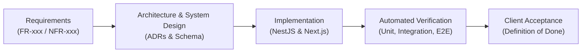
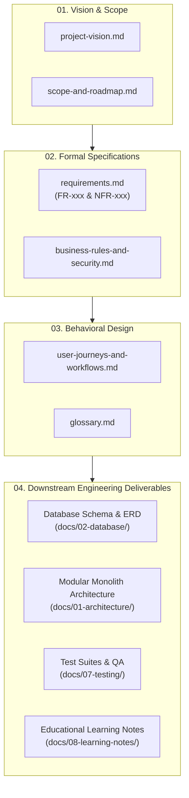

# TeamFlow — Project Overview & Requirements Specification

Welcome to the **TeamFlow** foundational requirements documentation. This directory (`docs/00-project-overview/`) contains the complete architectural requirements, functional decomposition, non-functional standards, role matrices, user workflows, and scope boundaries for TeamFlow.

---

## 1. What is an SRS and Why Does It Matter?

A **Software Requirements Specification (SRS)** is a formal, authoritative document that describes what the system will do, how it will behave, and the constraints under which it must operate. It establishes a binding technical and operational contract between the product owner (client) and the engineering team.

In professional software development, an SRS serves three vital functions:

1. **Alignment of Intent:** It guarantees that the developer and the client share an identical mental model of every feature, permission, and edge case before writing a single line of code.
2. **Defect Prevention at the Lowest Cost (Boehm's Curve):** According to Barry Boehm's classic software engineering research, the relative cost of correcting a defect increases exponentially as a project progresses through its lifecycle:
   - **Requirements Phase:** $1\times$ cost to fix (edit a paragraph).
   - **Architecture & Design Phase:** $5\times$ cost to fix (redesign models).
   - **Implementation Phase:** $10\times$ cost to fix (rewrite services and controllers).
   - **Testing / QA Phase:** $50\times$ cost to fix (re-run regressions, debug pipelines).
   - **Production Phase:** $100\times$ to $200\times+$ cost to fix (data migration, user downtime, security patches, reputation loss).
   
   Investing rigorous effort in the SRS prevents costly architectural rework later.
3. **Traceability Matrix Anchor:** Every database table, API endpoint, NestJS guard, React component, and automated test can be traced directly back to a specific requirement ID (`FR-xxx` or `NFR-xxx`). If a line of code cannot be traced to a requirement, it is either unnecessary complexity (gold plating) or an undocumented requirement.

---

## 2. Structure of this Directory

This directory is organized into focused, modular documents to ensure high maintainability and clarity:

| Document | Purpose & Key Contents |
|---|---|
| **[`project-vision.md`](./project-vision.md)** | Core product vision, target personas, problem statement, competitive positioning (Linear + Trello + Asana + Slack), and architectural north star. |
| **[`requirements.md`](./requirements.md)** | **The Authoritative SRS:** Complete functional requirements (`FR-001` to `FR-081`) across 12 modules, measurable non-functional requirements (`NFR-001` to `NFR-020`), role-permission matrix, acceptance criteria, and open architectural questions. |
| **[`user-journeys-and-workflows.md`](./user-journeys-and-workflows.md)** | Detailed end-to-end user journeys and state machine diagrams (Registration, Member Invites, Project Scoping, Kanban drag-and-drop, Real-Time Collaboration). |
| **[`business-rules-and-security.md`](./business-rules-and-security.md)** | Critical business invariants, tenant isolation guarantees, data ownership policies, edge cases, failure scenarios, and security threat models. |
| **[`scope-and-roadmap.md`](./scope-and-roadmap.md)** | MVP (Version 1.0) boundaries, explicit out-of-scope items (v2+), project milestones (M1 to M8), and formal Definition of Done. |
| **[`glossary.md`](./glossary.md)** | Complete technical and domain glossary defining SaaS multi-tenancy, RBAC, fractional indexing, optimistic UI, audit logs, and more. |

---

## 3. How Each Section Contributes to the Engineering Process

1. **Product Objectives & Personas (`project-vision.md`)**: Informs the user experience (UX) decisions, desktop-first responsiveness, and performance thresholds.
2. **Functional Requirements Breakdown (`requirements.md`)**: Informs backend module boundaries in NestJS (`auth`, `organizations`, `projects`, `tasks`, `realtime`) and frontend routing in Next.js.
3. **Non-Functional Requirements (`requirements.md`)**: Establishes non-negotiable quantitative standards for Argon2id hashing, p95 latencies (<200ms read, <400ms write), rate limiting, and test coverage (>=80%).
4. **Role-Permission Matrix (`requirements.md`)**: Directly drives the design of NestJS Guards, decorators (`@Roles()`, `@CheckPolicies()`), and Prisma query scopes.
5. **User Journeys & State Machines (`user-journeys-and-workflows.md`)**: Shapes frontend state management, optimistic UI interactions, and Socket.IO real-time event payloads.
6. **Business Rules & Threat Models (`business-rules-and-security.md`)**: Dictates database constraints (foreign keys, cascading rules, unique composite indexes) and integration test suites specifically designed to attempt cross-tenant data exfiltration.
7. **Scope & Milestones (`scope-and-roadmap.md`)**: Prevents scope creep, provides clear criteria for client milestone sign-off, and establishes the exact Definition of Done.
8. **Educational Foundation (`docs/08-learning-notes/`)**: Ensures that every architectural choice and implementation detail builds the developer's professional software engineering capabilities.

