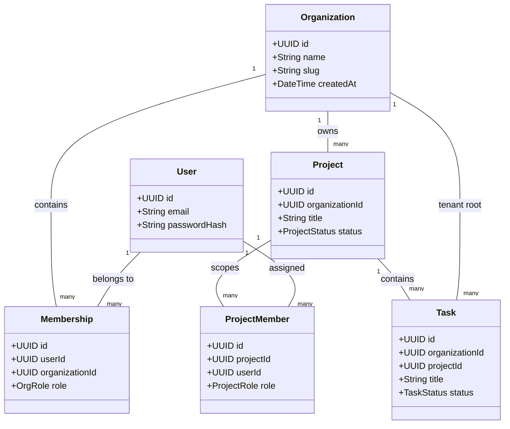
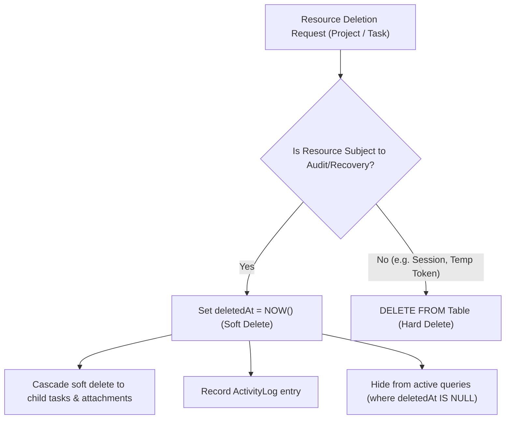
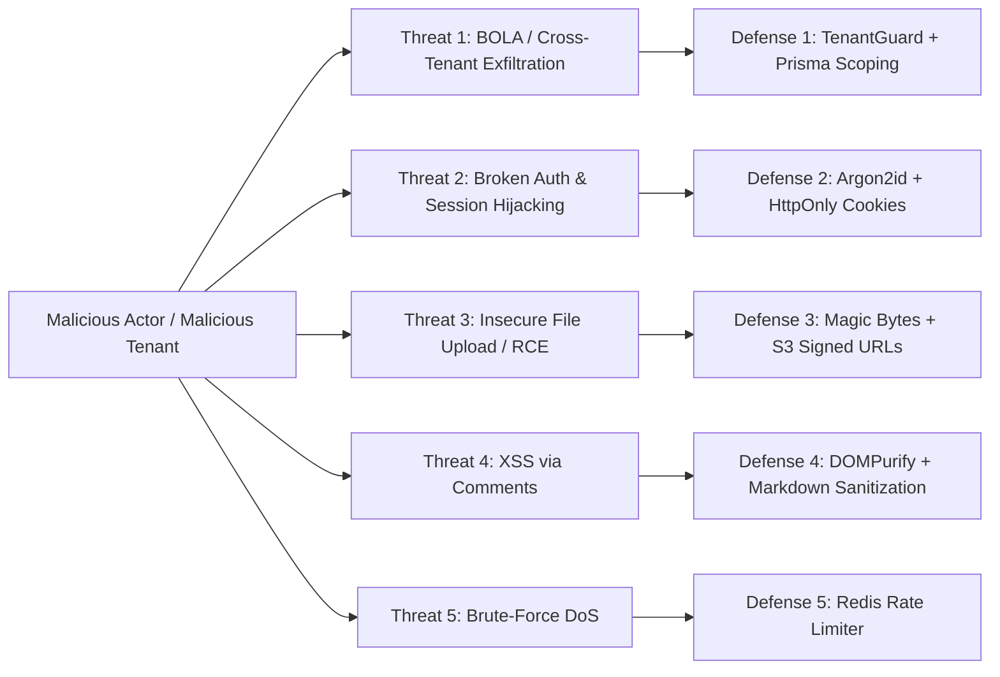

# TeamFlow — Business Rules, Security Architecture & Threat Model

This document establishes the inviolable business invariants, data ownership policies, security controls, and edge case failure handling for the **TeamFlow** platform.

---

## 1. Core Business Invariants

A business invariant is a condition that must remain true throughout the entire lifecycle of the application. Invariants are enforced not just in frontend controllers, but in database transactions, constraints, and backend domain services.

### Invariant 1: Universal Tenant Scoping
- **Rule:** Every domain record (Project, Task, Comment, Attachment, Label, ActivityLog, Notification) must resolve unambiguously to exactly one `organizationId`.
- **Enforcement:** Enforced via `NOT NULL` foreign keys at the database level and verified via NestJS `TenantGuard`. Direct cross-organization relationships are physically impossible in the schema.

### Invariant 2: Project Membership Access Barrier
- **Rule:** A user cannot view, create, or update tasks in a project unless they are an explicit `ProjectMember` of that project, OR they hold the role of `OWNER` or `ADMIN` in the parent Organization.
- **Enforcement:** Enforced in `ProjectPolicy` and `TaskPolicy` guards. A standard organization `MEMBER` has zero visibility into projects they have not been added to.

### Invariant 3: Single-Active-Organization Context
- **Rule:** While a single user account may belong to multiple organizations, any individual HTTP request or WebSocket subscription must execute strictly within the boundaries of an explicitly authenticated `activeOrganizationId`.
- **Enforcement:** The active organization context is resolved from an encrypted session cookie or header, checked against the user's active memberships, and injected into the execution context.

### Invariant 4: Sole Owner Invariant
- **Rule:** An organization must have at least one active `OWNER`. A workspace cannot exist without an owner.
- **Enforcement:** Attempting to demote or remove the last remaining `OWNER` of an organization triggers a transactional validation check that rejects the mutation with HTTP 400 (`LAST_OWNER_CANNOT_BE_REMOVED`). Ownership must be transferred to another member first.

### Invariant 5: Task Dependency Acyclicity (DAG Guarantee)
- **Rule:** Task dependencies must form a Directed Acyclic Graph (DAG). Task A cannot be blocked by Task B if Task B directly or transitively depends on Task A.
- **Enforcement:** Before inserting a `TaskDependency` record, the system executes a cycle-detection query (recursive CTE or depth-first search). Any detected cycle aborts the transaction with HTTP 400 (`CIRCULAR_DEPENDENCY_DETECTED`).

### Invariant 6: Assignee Project Membership Rule
- **Rule:** A task cannot be assigned to any user who is not an explicit member of the task's parent project.
- **Enforcement:** The task assignment service checks `ProjectMember` membership within an atomic database transaction. If any proposed assignee is missing from the project, the assignment is rejected with HTTP 400 (`ASSIGNEE_NOT_IN_PROJECT`).

### Invariant 7: Immutability of the Audit Trail
- **Rule:** Activity log records are append-only. Once an event is written, it cannot be modified or deleted by any user or administrator.
- **Enforcement:** The API layer exposes no `PATCH`, `PUT`, or `DELETE` endpoints for activity logs. Database user grants in production can enforce `SELECT` and `INSERT` privileges only.

---

## 2. Data Ownership & Lifecycle Management

### 2.1 Soft Deletion vs. Hard Deletion Policy

- **Soft Delete Entities:** `Organization`, `Project`, `Task`, `Comment`.
  - **Rationale:** Prevents accidental catastrophic data loss, allows 30-day recovery, and preserves referential integrity for historical activity logs and analytics.
- **Hard Delete Entities:** `Session`, `VerificationToken`, `PasswordResetToken`, `Notification` (after user dismissal).
  - **Rationale:** Security tokens and temporary transient records should not linger in storage after invalidation.

### 2.2 Account Deletion & Tenant Orphan Prevention
- When an individual user deletes their account:
  - If they are the sole `OWNER` of an organization with other members, deletion is **blocked** until ownership is transferred.
  - If they are the sole `OWNER` of an empty organization, the entire organization is soft-deleted.
  - Historical comments and activity logs retain the user's name as an archived snapshot (e.g., `"Former Member [Deleted]"`), but credentials and personal profile data are permanently erased (GDPR Right to Erasure).

---

## 3. Security Threat Model (OWASP Top 10 Alignment)

### Threat 1: Broken Object-Level Authorization (BOLA / IDOR)
- **Attack Scenario:** User A in Organization 1 modifies an API call to `PATCH /api/v1/tasks/uuid-of-org-2` to inspect or alter a competitor's confidential project.
- **Countermeasure:** Every data-access service requires both the entity ID and the caller's validated `organizationId`. Prisma queries explicitly include `where: { id: taskId, organizationId: activeOrgId }`. If no record matches, the API returns HTTP 404 (or 403), preventing existence leakage.

### Threat 2: Broken Authentication & Token Theft
- **Attack Scenario:** Malicious script executes in the browser and reads authentication tokens from `localStorage`.
- **Countermeasure:** Tokens are never exposed to JavaScript. Access tokens (15m) and rotated refresh tokens (7d) are stored exclusively in `HttpOnly`, `SameSite=Strict`, `Secure` cookies. Passwords are hashed using state-of-the-art Argon2id with memory cost 64MB ($m=65536, t=3, p=4$).

### Threat 3: Insecure File Uploads & Malware Execution
- **Attack Scenario:** Attacker uploads an executable `.php` or `.html` file disguised as an image to achieve Remote Code Execution (RCE) or stored XSS.
- **Countermeasure:**
  1. Files are validated using binary magic byte inspection (`file-type`), ignoring client-provided MIME headers.
  2. Files are stored on isolated S3/MinIO object storage, never on the web application server filesystem.
  3. Uploaded files are assigned random UUID storage keys (e.g., `s3://bucket/attachments/<uuid>`).
  4. Downloads are served via short-lived (15-minute) pre-signed URLs with `Content-Disposition: attachment`.

### Threat 4: Stored Cross-Site Scripting (XSS) in Collaboration Comments
- **Attack Scenario:** Attacker injects `` into a task comment.
- **Countermeasure:** All markdown and HTML rendering in the Next.js frontend is sanitized using `DOMPurify`. Furthermore, modern Content Security Policy (CSP) headers block inline script execution.

### Threat 5: Denial of Service & Brute-Force Attacks
- **Attack Scenario:** Attacker floods `/api/v1/auth/login` to exhaust CPU with Argon2id calculations or brute-force passwords.
- **Countermeasure:** Redis-backed rate limiter limits failed attempts to 5 per 15-minute window per IP/email. Public endpoints enforce global IP throttles.

---

## 4. Edge Cases and Failure Scenarios

### Edge Case 1: Concurrent Kanban Drag-and-Drop Collision
- **Scenario:** Developer A and Developer B drag Task #104 simultaneously to different columns (`IN_REVIEW` vs `DONE`).
- **Resolution:**
  - The database uses optimistic locking via an `updatedAt` version timestamp.
  - The first transaction commits successfully, logs status history, and broadcasts the event via WebSockets.
  - The second transaction detects that the record was modified since it was fetched; it returns HTTP 409 Conflict.
  - Developer B's browser triggers the rollback animation, resetting the card to its actual server state, and alerts the user with a notification: *"Task state was modified by Developer A."*

### Edge Case 2: Member Removed While Connected via WebSockets
- **Scenario:** An Org Admin removes Developer A from the workspace while Developer A has an active browser tab open with live WebSocket connections.
- **Resolution:**
  - The member removal service emits a backend internal event: `membership.revoked { userId, orgId }`.
  - The Socket.IO gateway listens for this event, locates all active sockets belonging to `userId` subscribed to `orgId` rooms, and forcefully disconnects them (`socket.disconnect(true)`).
  - Any pending API calls from Developer A immediately fail with HTTP 403 Forbidden because their membership record no longer exists.

### Edge Case 3: Invitation Token Race Condition & Email Mismatch
- **Scenario:** User B intercepts an invitation link sent to User A (`dev-a@company.com`) and attempts to accept it while logged into their own account (`dev-b@company.com`).
- **Resolution:**
  - The invitation acceptance handler verifies: `currentUser.email.toLowerCase() === invitation.email.toLowerCase()`.
  - If the emails do not match, the transaction aborts with HTTP 403 Forbidden: *"This invitation was issued to dev-a@company.com. Please log in with the invited email address."*

### Edge Case 4: Reconnection After Network Partition
- **Scenario:** A mobile user enters an elevator, losing network connectivity for 3 minutes, during which 4 task updates occurred.
- **Resolution:**
  - The Socket.IO client automatically initiates reconnection with exponential backoff.
  - Upon successful socket reconnect, the frontend triggers a lightweight synchronization query: `GET /api/v1/projects/:id/board?since=<lastKnownTimestamp>`.
  - Stale DOM cards are reconciled to reflect live server truth.

### Edge Case 5: Interrupted File Upload (Orphan Cleanup)
- **Scenario:** Client initiates a file upload, S3 receives the object, but the user closes the browser before the task attachment record is saved in PostgreSQL.
- **Resolution:**
  - Direct uploads generate an attachment record in `PENDING_UPLOAD` status.
  - A scheduled background cleanup job runs daily, querying object storage for objects older than 24 hours without corresponding confirmed database records, and automatically prunes orphaned blobs.

