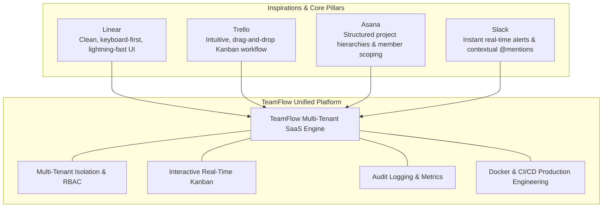

# TeamFlow — Product Vision & Strategic Overview

## 1. Executive Summary

**TeamFlow** is a modern, production-grade, multi-tenant Software-as-a-Service (SaaS) project management platform designed for growing businesses, digital agencies, and engineering teams. It unites task tracking, visual Kanban workflows, project planning, contextual discussions, and real-time collaboration into a unified, high-performance web application.

Unlike toy tutorials or superficial clones, TeamFlow is engineered as a commercial-grade platform with enterprise-ready multi-tenant data isolation, robust role-based access control (RBAC), resilient real-time WebSockets, and fully containerized deployment.

Concurrently, TeamFlow serves an explicit educational purpose: to demonstrate mastery of modern full-stack software architecture, domain modeling, concurrent state handling, distributed event dispatching, and automated testing.

---

## 2. Problem Statement

Modern teams face significant friction in project execution:

1. **The "Tool Sprawl" Dilemma:** Teams often juggle disjointed tools—using one tool for high-level roadmaps, another for agile sprint boards, a third for comments, and a separate chat platform for alerts. Context is lost, deadlines slip, and cross-project visibility degrades.
2. **Enterprise Bloat vs. Toy Simplicity:** Existing software falls into two extremes: either overly rigid, sluggish legacy enterprise systems (Jira) or simplistic personal todo apps that lack true multi-tenancy, granular project scoping, auditability, and team collaboration.
3. **Data Leakage Risks in Multi-Tenant Environments:** In shared SaaS environments, inadequate data scoping represents a catastrophic vulnerability. A single missing tenant identifier in an API query can expose sensitive corporate client data.
4. **Disconnect Between Collaboration and Execution:** Standard tools require manual page refreshes to observe updates made by teammates, leading to stale states, overwritten tasks, and communication lag.

---

## 3. Product Vision & Value Proposition

TeamFlow bridges this gap by synthesizing the best elements of premier collaboration software into a coherent, high-velocity experience:

### Core Value Proposition

- **Unified Team Workspace:** One platform for company-wide projects, sprint execution, and direct discussions.
- **Strict Multi-Tenant Security:** Complete logical data partitioning between competing organizations sharing common infrastructure.
- **Frictionless Real-Time Updates:** Tasks, status changes, and comments broadcast live across team sessions without manual refreshes.
- **High-Signal Analytics:** Native calculation of project health, task completion rates, and bottlenecks derived directly from actual operational data.

---

## 4. Product Objectives

### 4.1 Business & Operational Objectives
1. **Multi-Organization Management:** Allow companies to register, create branded workspaces, and seamlessly manage internal teams and external collaborators.
2. **Project Visibility & Scoping:** Provide clear distinction between organization-wide membership and project-specific access, preventing unauthorized internal visibility.
3. **Agile Workflow Acceleration:** Empower teams to organize work through customizable Kanban boards, clear priority tiers, and task dependencies.
4. **Data Isolation Guarantee:** Ensure zero cross-tenant data exposure through database-level constraints and backend guard verification.
5. **Operational Auditability:** Record an immutable, tamper-resistant history of all critical organizational actions.

### 4.2 Engineering & Learning Objectives
1. **Mastery of the Modular Monolith:** Structure a scalable NestJS backend with explicit module boundaries, strong encapsulation, and zero cyclic dependencies.
2. **Relational Database Excellence:** Architect a normalized PostgreSQL schema with Prisma, employing composite unique constraints, foreign keys, index optimization, and ACID transactions.
3. **Robust Real-Time Systems:** Implement WebSocket gateways via Socket.IO backed by Redis pub/sub for scalable multi-client event broadcasting and reconnect reconciliation.
4. **Production-Grade DevOps:** Containerize full-stack services with multi-stage Docker builds, Nginx reverse proxying, and automated GitHub Actions CI/CD pipelines.
5. **Interview-Ready Engineering Depth:** Document every architectural decision, trade-off, and security consideration to demonstrate senior-level technical competency.

---

## 5. Target User Personas

| Persona | Role & Context | Core Needs & Frustrations | How TeamFlow Solves It |
|---|---|---|---|
| **Sarah — The Digital Agency Owner** | • **Role:** Organization Owner • **Context:** Runs a 25-person agency managing multiple client deliverables simultaneously. | • **Frustrations:** Fear of clients seeing other clients' work; difficulty tracking team velocity. • **Needs:** Multi-organization switching, granular project permissions, bird's-eye dashboard metrics. | Provides strict multi-tenancy, project-level member scoping, and high-level organization analytics. |
| **Alex — The Engineering Project Manager** | • **Role:** Project Manager / Admin • **Context:** Coordinates sprint cycles across 8 developers. | • **Frustrations:** Outdated task statuses, missed blockers, slow board interfaces. • **Needs:** Drag-and-drop Kanban, subtask tracking, dependency mapping, instant status alerts. | Delivers a responsive, optimistic-UI Kanban board with real-time status broadcasts and dependency validation. |
| **David — The Full-Stack Developer** | • **Role:** Team Member • **Context:** Builds features and resolves bugs daily. | • **Frustrations:** Clunky form inputs, slow page loads, ambiguous task descriptions. • **Needs:** Clean task detail views, markdown comments with @mentions, file attachments, filtered "My Tasks" view. | Minimalist Linear-inspired UI, keyboard shortcuts, fast search/filtering, and real-time discussion threads. |
| **Elena — The External Client Stakeholder** | • **Role:** Guest / Client Collaborator • **Context:** Reviews deliverables and provides feedback on specific agency projects. | • **Frustrations:** Overwhelmed by internal technical jargon; sees unrelated agency work. • **Needs:** Read-only board access, clear deadline visibility, ability to comment on relevant deliverables. | Restricts access exclusively to assigned projects with read-only task viewing and scoped commenting. |

---

## 6. Architectural North Star & Core Philosophy

To maintain engineering excellence throughout development, TeamFlow adheres to five core principles:

1. **Modular Monolith Over Premature Microservices:** A well-architected modular monolith in NestJS provides clean domain boundaries, fast internal execution, and simple transactional guarantees without the operational complexity and network latency of microservices.
2. **Backend-Enforced Authorization:** Security is never entrusted to the client. Frontend UI elements adapt for user convenience, but every API endpoint and WebSocket channel independently authenticates and authorizes requests.
3. **Data Integrity at the Database Level:** The database is not a passive data bucket; it is an active enforcement layer. Foreign keys, check constraints, composite unique indexes, and ACID transactions guarantee business invariants regardless of the calling code.
4. **Optimistic UI with Deterministic Reconciliation:** The client interface responds immediately to user actions (e.g., card drag-and-drop) while gracefully reverting state and alerting the user if the server rejects the mutation.
5. **Comprehensive Educational Documentation:** Code is not complete until it is understood, documented, and tested. Every component must be explainable in a senior engineering interview.

