# TeamFlow — Requirements Review & Consistency Audit Report

**Audit Date:** November 2, 2026  
**Auditor:** Senior Software Architect & Lead Technical Reviewer  
**Status:** Audit Completed — Corrections Identified & Applied  
**Governing Documents:** [`AGENTS.md`](../../AGENTS.md), [`context/01-teamflow-client-project-brief.md`](../../context/01-teamflow-client-project-brief.md), [`docs/00-project-overview/requirements.md`](./requirements.md)

---

## 1. Executive Summary & Audit Scope

Prior to proceeding with database schema modeling and system architecture, a rigorous consistency audit of the initial requirements specification was conducted. 

In professional software engineering, **requirements validation** ensures that the specification is correct, complete, consistent, unambiguous, and testable.

This audit analyzed all 12 functional modules, non-functional criteria, user journeys, and security invariants against the original Client Specification and the [`AGENTS.md`](../../AGENTS.md) engineering contract.

The audit identified **9 critical discrepancies and architectural ambiguities** across the initial draft. All issues have been cataloged below along with their root causes, architectural impacts, and implemented corrections.

---

## 2. Inconsistencies, Contradictions & Corrections Log

```mermaid
flowchart TD
    subgraph AuditCategories ["Identified Inconsistencies & Gaps"]
        I1["1. RBAC Hierarchy Ambiguity\n(Org Roles vs Project Roles)"]
        I2["2. Project Creation Paradox\n(Who can create & who becomes PM?)"]
        I3["3. Task Status vs. BLOCKED State\n(Enum vs Dynamic Dependency)"]
        I4["4. Rate Limiting Policy Mismatch\n(1-min burst vs 15-min lockout)"]
        I5["5. Kanban Fractional Index Precision\n(IEEE 754 precision exhaustion)"]
        I6["6. Tenant vs. Project Authorization\n(Internal cross-project data leakage)"]
        I7["7. Invitation Status Transitions\n(DECLINED vs REVOKED semantics)"]
        I8["8. File Upload Architecture\n(API Streaming vs S3 Pre-signed URLs)"]
        I9["9. Mathematical Dashboard Formulas\n(Ambiguous completion rate metrics)"]
    end

    subgraph Solutions ["Applied Architectural Corrections"]
        S1["Two-Tier RBAC Architecture"]
        S2["Creator-to-PM Auto-Assignment"]
        S3["Dependency-Driven IsBlocked Flag"]
        S4["Two-Tier Rate Limiting Protocol"]
        S5["Column Normalization Algorithm"]
        S6["Two-Layer Authorization Barrier"]
        S7["Explicit DECLINED Status Enum"]
        S8["Multipart Server Stream + Magic Bytes"]
        S9["Exact SQL / Mathematical Formulas"]
    end

    I1 --> S1
    I2 --> S2
    I3 --> S3
    I4 --> S4
    I5 --> S5
    I6 --> S6
    I7 --> S7
    I8 --> S8
    I9 --> S9
```

---

### Issue 1: Flat RBAC Matrix vs. Multi-Tier Scope
- **Discrepancy:** The initial RBAC matrix in `requirements.md` presented `Project Manager` in the same flat table as `Org Owner`, `Org Admin`, and `Member`.
- **Root Cause & Architectural Impact:** In a multi-project SaaS, a user is an Organization Member globally, but may be a Project Manager on Project Alpha and merely a Contributor on Project Beta. Treating `Project Manager` as a top-level organization role confuses authorization logic, as it cannot be granted globally without violating project isolation.
- **Implemented Correction:** Formalized a **Two-Tier RBAC Architecture**:
  1. **Tier 1 (Organization-Level Roles):** `ORG_OWNER`, `ORG_ADMIN`, `ORG_MEMBER`, `ORG_GUEST`.
  2. **Tier 2 (Project-Level Roles):** `PROJECT_MANAGER`, `CONTRIBUTOR`, `VIEWER`.
  - Organization Owners and Admins possess superuser override privileges across all projects within their organization.

---

### Issue 2: Project Creation Chicken-and-Egg Paradox
- **Discrepancy:** In the original user journey and RBAC table, project creation was assigned to `Project Manager`, while standard `Member` was blocked (`❌`).
- **Root Cause & Architectural Impact:** A user cannot hold the role of `Project Manager` on a project that does not yet exist. If standard members cannot create projects, and they cannot be project managers beforehand, only Org Owners/Admins could ever create projects, contradicting the collaborative vision.
- **Implemented Correction:** `ORG_OWNER`, `ORG_ADMIN`, and authorized `ORG_MEMBER` users can create projects. Upon creation, the creator is automatically assigned the `PROJECT_MANAGER` role within the new project's `ProjectMember` join table.

---

### Issue 3: Task Status Enum vs. the "BLOCKED" State
- **Discrepancy:** The client brief Section 3 Module D listed task statuses as: `BACKLOG`, `TODO`, `IN_PROGRESS`, `IN_REVIEW`, `DONE`, `CANCELLED`. However, the workflow diagram in `user-journeys-and-workflows.md` introduced `BLOCKED` as an active status column.
- **Root Cause & Architectural Impact:** If `BLOCKED` is a distinct status in the database enum, moving a task to `BLOCKED` destroys its prior operational status (e.g., whether it was in `TODO` or `IN_PROGRESS` before becoming blocked). Furthermore, if dependencies clear, the system would not know which status column to restore the card to.
- **Implemented Correction:** Retained the 6 client-specified statuses (`BACKLOG`, `TODO`, `IN_PROGRESS`, `IN_REVIEW`, `DONE`, `CANCELLED`). A task's blocked condition is modeled as a **dynamic dependency state** (`isBlocked: boolean`, computed from `TaskDependency` where unresolved predecessors exist). Tasks with active impediments display a visual "Blocked" badge and blocker warning in their existing column.

---

### Issue 4: Rate-Limiting Policy Contradiction
- **Discrepancy:** `NFR-005` specified *"5 requests/min on auth endpoints"*, whereas `FR-013` specified *"5 failed attempts per 15-minute window"*.
- **Root Cause & Architectural Impact:** The two requirements conflated network-level DoS request throttling with account-level brute-force credential stuffing defense. Five requests per minute globally on login would prevent legitimate users from retrying typos, while failing to lock out slow-drip password guessing over hours.
- **Implemented Correction:** Established a **Two-Tier Rate Limiting Protocol**:
  1. **Network/IP Level Throttling (Redis token bucket):** Max 10 HTTP requests per minute per IP on public `/auth/*` endpoints (prevents request flooding).
  2. **Account-Level Lockout (Failed Attempt Sliding Window):** 5 consecutive failed password attempts for a specific email address within 15 minutes triggers a 15-minute cooldown/lockout (prevents credential attacks).

---

### Issue 5: Kanban Fractional Index Precision Degradation
- **Discrepancy:** The initial SRS proposed calculating new card positions as `(prev + next) / 2` without addressing IEEE 754 64-bit floating point precision limits.
- **Root Cause & Architectural Impact:** After approximately 53 consecutive card insertions between two adjacent items, floating point precision exhausts its mantissa. The midpoint calculation yields a value identical to one of the bounds ($order == prev$ or $order == next$), causing non-deterministic sorting and broken card positions on page reload.
- **Implemented Correction:** Added `FR-050B`: **Automatic Column Rebalancing Algorithm**. When the difference between adjacent cards drops below $\epsilon = 10^{-6}$, the backend automatically re-spaces all cards in the column by integer steps of $1000$ within a single database transaction.

---

### Issue 6: Internal Project Boundary Data Leakage
- **Discrepancy:** The initial tenant isolation specification focused exclusively on checking `organizationId`, assuming this was sufficient for all resource queries.
- **Root Cause & Architectural Impact:** In an agency or enterprise, multiple projects exist within the same organization. If an API endpoint for tasks or comments only verifies `task.organizationId === activeOrgId`, any employee in the company could inspect tasks belonging to private projects they were not assigned to.
- **Implemented Correction:** Established a **Two-Layer Authorization Barrier**:
  1. **Layer 1 (Tenant Isolation Guard):** Enforces that the target entity belongs to `activeOrganizationId`. Rejects cross-company requests with `403 Forbidden`.
  2. **Layer 2 (Project Access Policy):** Verifies that the user holds an active `ProjectMember` record for the parent project (or holds `ORG_OWNER`/`ORG_ADMIN` superuser privileges). Rejects unauthorized intra-company requests with `403 Forbidden`.

---

### Issue 7: Semantics of Invitation Rejection
- **Discrepancy:** `FR-018` listed invitation statuses as `PENDING`, `ACCEPTED`, `EXPIRED`, `REVOKED`, and stated that an invitee declining an invite sets it to `REVOKED`.
- **Root Cause & Architectural Impact:** Blurring "Admin revoked the invitation" with "Invited user actively declined" destroys operational auditability. Workspace administrators need to distinguish between an invite they canceled versus an applicant who declined.
- **Implemented Correction:** Introduced explicit status `DECLINED`. The complete invitation state machine is now:
  $$\text{PENDING} \longrightarrow \{\text{ACCEPTED} \mid \text{DECLINED} \mid \text{EXPIRED} \mid \text{REVOKED}\}$$

---

### Issue 8: File Upload Security & Storage Architecture
- **Discrepancy:** The SRS initially proposed client pre-signed upload URLs directly to S3/MinIO, but also required server-side binary magic byte verification.
- **Root Cause & Architectural Impact:** If a client uploads directly to an S3 bucket via a pre-signed URL, the backend API never touches the byte stream. Therefore, server-side magic byte inspection cannot occur before storage, creating a malware hosting vulnerability.
- **Implemented Correction:** For Version 1.0 (MVP file size capped at 10MB), uploads are routed through the NestJS backend via a streaming multipart pipeline (`multer`). The backend validates magic bytes in-memory before streaming the sanitized payload to S3/MinIO. Pre-signed URLs are utilized exclusively for secure, time-limited **downloads** (`FR-077`).

---

### Issue 9: Ambiguous Analytics Metric Calculations
- **Discrepancy:** `FR-066` and `FR-067` called for "Task completion rate" and "Project progress" without defining the underlying mathematical formulas.
- **Root Cause & Architectural Impact:** Different developers would compute progress differently (e.g., whether `CANCELLED` tasks count against the total, or whether subtasks weight the calculation).
- **Implemented Correction:** Codified exact mathematical definitions in `FR-066` and `FR-067`:
  $$\text{Completion Rate (\%)} = \left( \frac{\text{Count}(\text{Tasks where } status = \text{DONE})}{\text{Count}(\text{Tasks where } status \neq \text{CANCELLED})} \right) \times 100$$
  $$\text{Overdue Tasks} = \text{Tasks where } dueDate < \text{NOW}() \text{ AND } status \notin (\text{'DONE'}, \text{'CANCELLED'})$$

---

## 3. Summary of Document Updates

1. **[`docs/00-project-overview/requirements.md`](./requirements.md):** Fully updated with Two-Tier RBAC, reconciled rate-limiting, dynamic `isBlocked` dependency modeling, fractional rebalancing, and exact mathematical formulas.
2. **[`docs/00-project-overview/user-journeys-and-workflows.md`](./user-journeys-and-workflows.md):** Updated Journey 3 (Creator-to-PM auto-assignment) and Journey 4 (Kanban status transitions with dynamic dependency blocker badges).
3. **[`docs/00-project-overview/traceability-matrix.md`](./traceability-matrix.md):** Created complete end-to-end Requirements Traceability Matrix.
4. **[`docs/08-learning-notes/concepts/02-requirements-validation-and-traceability.md`](../08-learning-notes/concepts/02-requirements-validation-and-traceability.md):** Authored educational guide on requirements validation, traceability mechanics, and senior interview topics.
