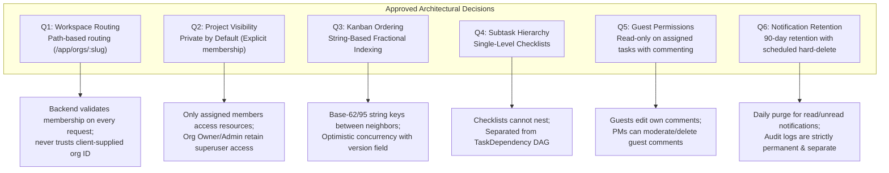

# TeamFlow — Requirements Review & Architectural Consistency Audit Report

**Audit Date:** November 2, 2026  
**Document Version:** 1.2.0 (Audited, Reconciled & Client-Approved)  
**Lead Architect & Reviewer:** Hamza Jemli  
**Governing Documents:** [`AGENTS.md`](../../AGENTS.md), [`context/01-teamflow-client-project-brief.md`](../../context/01-teamflow-client-project-brief.md), [`docs/00-project-overview/requirements.md`](./requirements.md)  
**Traceability Matrix:** [`traceability-matrix.md`](./traceability-matrix.md)

---

## 1. Executive Summary

This report documents the architectural audit, consistency review, and formal resolution of all requirements issues prior to database modeling and system implementation.

The client formally reviewed and approved **six foundational architecture decisions (Q1–Q6)**. In addition, the specification was hardened across **seven deep technical domains (A–G)**:
1. **Kanban Concurrency & Ordering:** Replaced floating-point numbers with string-based fractional indexing; integrated optimistic locking with `version` fields; defined column rebalancing triggers and atomic transaction boundaries.
2. **Multi-Tenant Authorization:** Established a 6-layer defense-in-depth framework spanning REST, nested Prisma writes, background workers, and WebSockets; evaluated PostgreSQL Row-Level Security (RLS) connection pool trade-offs.
3. **Anti-Lockout Rate Limiting:** Eliminated the account-lockout Denial-of-Service vulnerability by replacing hard account lockouts with progressive server-side artificial delays (1s–5s) and Redis sliding-window IP throttling.
4. **File Storage Pipeline Security:** Hardened the 10MB multipart pipeline with explicit MIME allowlists, magic-byte inspection, randomized UUID keys, path traversal defense, and pre-signed download tokens.
5. **Real-Time Event Reliability:** Clarified the lifecycle across Database Commit, Redis Publish, and Client Delivery; evaluated the Transactional Outbox Pattern; established client-side reconnect reconciliation.
6. **Codified Dashboard Formulas:** Defined exact mathematical formulas in UTC, strictly excluding soft-deleted and `CANCELLED` records, with zero-denominator safety ($0.0\%$).
7. **Traceability Rigor:** Upgraded the Requirements Traceability Matrix to track the 4 distinct verification stages: *Criterion Defined*, *Scenario Designed*, *Implementation Planned*, and *Execution Pending*.

---

## 2. Approved Architecture Decisions Log (Q1–Q6)



### Decision Q1: Workspace Routing Strategy
- **Decision:** **Path-based workspace routing** (`/app/orgs/:slug/...` or `/app/...` with active organization context).
- **Engineering Justification:** Subdomain routing (`acme.teamflow.app`) introduces substantial operational complexity: wildcard SSL certificates, local Docker hosts file hacks, and cross-subdomain cookie tracking. Path-based routing operates cleanly across all environments.
- **Enforcement Rule:** The backend independently validates that the authenticated user holds an active membership in the requested organization for every request. Client-supplied organization IDs are never accepted as proof of access.

### Decision Q2: Project Visibility Policy
- **Decision:** **Private by default.**
- **Engineering Justification:** In multi-team enterprises and agencies, projects often contain sensitive client contracts or confidential code. Projects must be isolated to assigned members by default.
- **Enforcement Rule:** A standard organization member has zero access or visibility into projects they have not been added to. `ORG_OWNER` and `ORG_ADMIN` retain administrative override access across all projects within their organization.

### Decision Q3: Kanban Card Ordering Strategy
- **Decision:** **String-based fractional indexing** (replacing numeric floating-point indexing).
- **Engineering Justification:** Floating-point division ($(prev + next) / 2$) exhausts IEEE 754 53-bit mantissa precision after ~53 consecutive insertions between two cards, causing numeric rounding collisions. String-based fractional indexing produces arbitrarily long variable-length base-62/base-95 keys, guaranteeing infinite midpoint generation.
- **Enforcement Rule:** Optimistic locking via an integer `version` field detects concurrent moves. Tie-breaking is deterministic via `ORDER BY orderKey ASC, id ASC`. When any key length exceeds 64 characters, an atomic column rebalance re-spaces cards.

### Decision Q4: Subtask Hierarchy Depth
- **Decision:** **Single-level checklist items.**
- **Engineering Justification:** Real-world Kanban teams use checklists for immediate actionable acceptance criteria on a card. Deeply recursive task hierarchies introduce massive SQL recursive CTE query overhead and fragile tree UI components.
- **Enforcement Rule:** Checklist items are modeled in a dedicated `Subtask` entity. They cannot contain nested children. Inter-task blockers remain strictly in `TaskDependency`.

### Decision Q5: Guest Role Scope & Moderation
- **Decision:** **Read-only on assigned tasks with commenting permissions.**
- **Engineering Justification:** External client stakeholders need visibility into deliverable progress and the ability to give feedback without accidentally modifying sprint statuses or task assignments.
- **Enforcement Rule:** `ORG_GUEST` users can view only projects and tasks where they are assigned `VIEWER`. They can post comments, edit/delete their own comments, but cannot modify task statuses or project settings. `PROJECT_MANAGER`s possess comment moderation authority to delete inappropriate guest comments.

### Decision Q6: Notification Retention & Audit Isolation
- **Decision:** **90-day retention for notifications; permanent retention for audit logs.**
- **Engineering Justification:** In-app alerts lose operational relevance after 3 months; unpruned notification tables grow to millions of rows, degrading query performance. Audit logs, conversely, are compliance artifacts that must never be automatically truncated.
- **Enforcement Rule:** A daily cron job at 03:00 UTC hard-deletes read and unread notifications created $>90$ days ago using chunked transactions. Audit logs (`ActivityLog`) are completely excluded from this purge.

---

## 3. Deep Technical Evaluations & Hardened Specifications

### Section A: Kanban Concurrency, Ordering & Rebalancing
1. **Key Generation Algorithm:** TeamFlow utilizes variable-length ASCII keys (`"a0"`, `"a1"`, ..., `"z9"`). When inserting between `"a1"` and `"a2"`, the midpoint generator appends a character (e.g. `"a1V"`).
2. **Concurrency Conflict Detection:** A card move request submits the client's known `version`:
   ```sql
   UPDATE tasks 
   SET status = :newStatus, orderKey = :newKey, version = version + 1, updatedAt = NOW() 
   WHERE id = :taskId AND version = :clientVersion;
   ```
   If 0 rows are updated, another user has modified the task. The transaction rolls back and returns HTTP 409 Conflict. The client reverts card position and displays a notification.
3. **Rebalancing Safety:** When any card's `orderKey` exceeds 64 bytes in length, an atomic rebalance is scheduled:
   - The transaction acquires a row-level lock: `SELECT id FROM tasks WHERE projectId = :pId AND status = :status ORDER BY orderKey ASC FOR UPDATE`.
   - Cards are re-assigned clean keys spaced by discrete intervals: `"a0"`, `"a1"`, `"a2"`...
   - The lock prevents concurrent card insertions during the milliseconds of re-indexing.
4. **Transaction Boundary:** Updating status + updating `orderKey` + incrementing `version` + inserting `TaskStatusHistory` + inserting `ActivityLog` executes in **one single ACID transaction**.

### Section B: Layered Multi-Tenant Authorization & PostgreSQL RLS
1. **Six-Layer Defense:**
   - Layer 1: JWT Session Authentication & Token Expiration.
   - Layer 2: Active Organization Membership Check.
   - Layer 3: Organization Role Permissions (`ORG_OWNER`, `ORG_ADMIN`, `ORG_MEMBER`, `ORG_GUEST`).
   - Layer 4: Project Access Policy (Private project membership or Admin override).
   - Layer 5: Programmatic Query Scoping (`WHERE organizationId = :orgId AND projectId = :pId`).
   - Layer 6: Real-time Socket Room Authorization & Pre-Signed Download URLs.
2. **Coverage Across Components:**
   - *Nested Prisma Operations:* Explicit foreign key validation on every relation connection.
   - *Raw SQL:* `$queryRaw` prohibited unless parameterized with tenant filters.
   - *Background Workers:* Job payloads must encapsulate `organizationId`; worker execution contexts run under tenant guards.
   - *WebSocket Gateways:* Socket connections authenticate via JWT; room joining verifies Layer 2 and Layer 4 permissions.
3. **PostgreSQL Row-Level Security (RLS) Evaluation:**  
   PostgreSQL RLS (`ALTER TABLE ... ENABLE ROW LEVEL SECURITY`) enforces database-level tenant isolation via session variables (`SET LOCAL app.current_tenant_id = :id`). However, because Prisma utilizes connection pooling and often operates with PgBouncer in transaction mode, session variables can bleed across pooled connections unless wrapped in dedicated transactions. Therefore, RLS is evaluated as an optional defense-in-depth hardening layer for a future release, while Layer 5 programmatic scoping remains the mandatory primary control.

### Section C: Anti-Lockout Rate-Limiting Policy
- **Vulnerability Identified:** The initial proposal to lock accounts after 5 failed password attempts allowed attackers to launch Denial-of-Service attacks against valid users.
- **Hardened Two-Tier Protocol:**
  - *Tier 1 (IP Throttling):* Max 10 requests per minute per IP on public auth endpoints via a Redis sliding window. Halts volumetric brute-forcing.
  - *Tier 2 (Progressive Account Cooldown):* Failed attempts for a specific email address trigger progressive server-side artificial delays:
    - Attempts 1–3: Immediate generic 401 response (`"Invalid email or password"`).
    - Attempts 4–9: Progressive delay of 1 to 5 seconds injected before returning 401.
    - Attempts 10+: 15-minute cooldown for that specific `(IP + email)` pairing. The account is **never globally locked**, ensuring that legitimate active sessions remain fully functional.
  - *Generic Responses:* Forgot-password requests always return HTTP 200 OK regardless of account existence.

### Section D: File Storage Pipeline Security
- **MIME Allowlist:** Restricted to `image/jpeg`, `image/png`, `image/webp`, `application/pdf`, `text/plain`, `application/zip`.
- **Magic Byte Validation:** The first 512 bytes are inspected in-memory (`file-type`). If detected binary signature differs from declared client header, upload is rejected with 400 Bad Request.
- **Path Traversal & Storage Isolation:** Filenames are stripped. Files are saved in private object storage buckets under randomized UUID paths: `attachments/<orgId>/<UUIDv4>.<ext>`.
- **Download Authorization:** Pre-signed URLs with **15-minute expiration** are generated only after verifying Layer 2 and Layer 4 permissions, accompanied by `Content-Disposition: attachment` and `X-Content-Type-Options: nosniff`.
- **Orphan Cleanup:** Daily scheduled worker queries S3 for objects $>24\text{ hours}$ old with no matching PostgreSQL record and purges them.

### Section E: Real-Time Event Reliability & Outbox Pattern
1. **Three-Phase Event Model:**
   - Phase 1 (Database Commit): PostgreSQL commits state changes atomically.
   - Phase 2 (Event Publish): NestJS emits event to Redis Pub/Sub post-commit (`$transaction().then(() => emit())`).
   - Phase 3 (Client Delivery): Socket.IO relays event to connected browser sockets.
2. **Failure Handling & Reconciliation:**
   - If Redis fails or a client is offline, the database remains authoritative.
   - Upon reconnecting or regaining window focus, clients query:
     `GET /api/v1/projects/:id/board?since=<lastKnownTimestamp>`
     reconciling any missed state changes.
3. **Transactional Outbox Pattern (Cataloged for v1.2):** An `OutboxEvent` table will be introduced to PostgreSQL in release v1.2 to provide guaranteed at-least-once event publication. For the MVP, post-commit publishing + client reconciliation provides optimal simplicity and high reliability.
4. **WebSocket Security:** Handshakes authenticate via JWT; mid-session membership revocation immediately purges user sockets from project rooms and terminates connections.

### Section F: Codified Analytics & Dashboard Formulas
All metrics in `FR-066` and `FR-067` are codified with exact mathematical formulas:
- **Completion Rate (%):**
  $$\text{Completion Rate} = \begin{cases} 
  0.0\%, & \text{if Eligible Tasks} = 0 \\
  \left( \frac{\text{COUNT}(\text{tasks where } status = \text{'DONE'})}{\text{COUNT}(\text{tasks where } status \neq \text{'CANCELLED'})} \right) \times 100, & \text{otherwise}
  \end{cases}$$
  *Rules:* Excludes soft-deleted tasks (`deletedAt IS NULL`). Excludes `CANCELLED` tasks. Zero denominator returns `0.0%`.
- **Overdue Tasks:**
  $$\text{Overdue Tasks} = \text{COUNT}(\text{tasks}) \quad \text{where } dueDate < \text{NOW}() \text{ AT TIME ZONE 'UTC'} \text{ AND } status \notin (\text{'DONE'}, \text{'CANCELLED'}) \text{ AND } deletedAt \text{ IS NULL}$$
- **Timezone Rule:** All database comparisons execute in **UTC**. Client displays format timestamps to the user's configured profile timezone.

### Section G: Traceability Verification Lifecycle
The Traceability Matrix ([`traceability-matrix.md`](./traceability-matrix.md)) tracks 4 distinct verification stages:
1. *Acceptance Criterion Defined:* `Defined` (100% of FRs/NFRs complete).
2. *Test Scenario Designed:* `Designed` (Test procedures and target files architected).
3. *Automated Test Implemented:* `Planned (Not Implemented)` (Code has not started).
4. *Automated Test Executed:* `Pending (Not Executed)` (Execution pending).

---

## 4. Phased Scope & Release Breakdown

| Scope Release | Modules & Features Included | Technical Focus |
|---|---|---|
| **Release 1.0 (MVP Core)** | • Auth, sessions, email verification, password reset.<br>• Org creation, member invitations, Two-Tier RBAC.<br>• Private projects by default, project membership.<br>• Task CRUD, statuses, priorities, single-level checklists.<br>• String fractional Kanban board with optimistic locking.<br>• Task dependency cycle detection ($A \rightarrow B \rightarrow A$).<br>• Basic task comments and immutable activity audit logs. | Rock-solid multi-tenant data modeling, ACID transactions, and deterministic Kanban state. |
| **Release 1.1 (Collaboration & Files)** | • S3/MinIO attachment pipeline with magic-byte validation.<br>• In-app notification center dropdown with 90-day retention.<br>• Organization & project analytics dashboards with Redis caching. | Storage security and asynchronous notification workflows. |
| **Release 1.2 (Hardening & Reliability)** | • Transactional Outbox Pattern for guaranteed real-time delivery.<br>• Advanced session inspection with remote device revocation.<br>• Automatic Kanban column rebalancing worker. | Distributed reliability and operational scalability. |
| **Release 2.0+ (Enterprise Commercial)** | • Stripe subscriptions & seat billing.<br>• ClamAV antivirus daemon for file attachments.<br>• Interactive Gantt charts & critical path scheduling.<br>• Enterprise SAML / SSO / SCIM provisioning. | Commercial monetization and enterprise IT integration. |

---

## 5. Unresolved Technical Questions (For Later Architectural Phases)

All immediate product questions have been approved (Q1–Q6). The following secondary technical considerations are logged for **Milestone 2 (Database Architecture)** and **Milestone 5 (DevOps)**:

| # | Technical Question | Current Assessment | Planned Resolution Point |
|---|---|---|---|
| **T1** | **Prisma Connection Pooling vs. PgBouncer:** Will the production deployment use PgBouncer in transaction mode or Prisma Accelerate? | Impacts session-level SQL configuration (e.g. RLS). | Milestone 2 (Database Architecture) |
| **T2** | **Full-Text Search Engine:** PostgreSQL `tsvector` vs. Prisma simple `contains` query. | `tsvector` with GIN indexing is recommended for fast English stemming and search. | Milestone 2 (Database Architecture) |
| **T3** | **Mail Provider for Production:** Nodemailer with local SMTP container for development; Amazon SES or Resend for production. | Standardized under an abstract `MailService` interface. | Milestone 3 (Authentication) |

---

## 6. Requirements Sign-Off Checklist

- [x] All 81 Functional Requirements (`FR-001` to `FR-081`) defined with Given-When-Then criteria.
- [x] All 20 Non-Functional Requirements (`NFR-001` to `NFR-020`) defined with measurable metrics.
- [x] Two-Tier RBAC architecture mapped across organization and project scopes.
- [x] String-based fractional indexing algorithm specified with base-62 keys and tie-breaking.
- [x] Optimistic concurrency control specified with `version` conditional updates.
- [x] Two-Layer authorization barrier specified (Tenant isolation + Private project scoping).
- [x] Anti-lockout rate-limiting protocol specified with progressive delays.
- [x] File upload pipeline hardened with in-memory magic-byte validation and pre-signed downloads.
- [x] Real-time event reliability lifecycle clarified (Commit vs. Publish vs. Delivery).
- [x] Exact mathematical formulas codified for analytics metrics with UTC and zero-denominator handling.
- [x] 90-day notification retention specified with daily purge worker; audit logs permanently preserved.
- [x] Traceability matrix updated with 4-stage verification lifecycle.
- [x] MVP (v1.0) scope strictly isolated from subsequent releases (v1.1, v1.2, v2.0+).

---

## 7. Architectural Recommendation

> **FINAL VERDICT:** **The TeamFlow Requirements Specification (v1.2.0) is formally AUDITED, COMPLETE, CONSISTENT, TRACEABLE, and APPROVED for Architecture & Database Design.**
