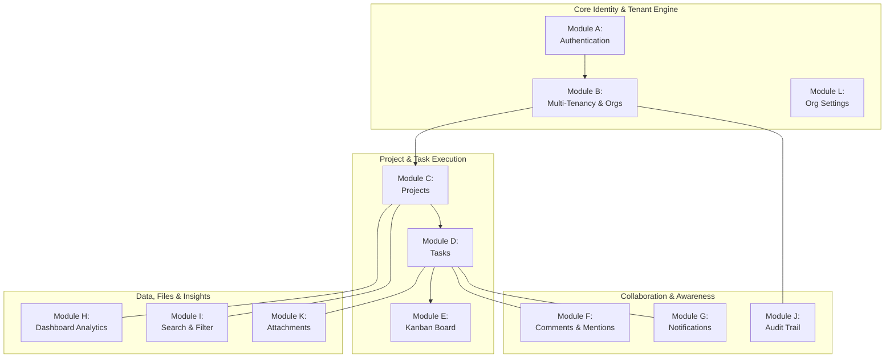
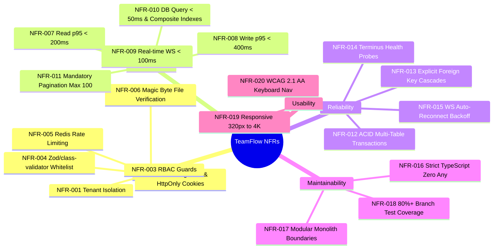

# TeamFlow — Software Requirements Specification (SRS)

**Document Version:** 1.0.0  
**Specification Standard:** Aligned with IEEE 830 / ISO/IEC/IEEE 29148  
**Client / Product Owner:** Client Specification (Version 1.0)  
**Lead Engineer & Architect:** Hamza Jemli  
**System Architecture:** Modular Monolith (Next.js + NestJS + PostgreSQL + Redis + Socket.IO)  
**Operating Framework:** [`AGENTS.md`](../../AGENTS.md)

---

## 1. Introduction & Requirements Engineering Principles

### 1.1 Purpose of this Document
This Software Requirements Specification (SRS) defines the formal functional and non-functional requirements for the **TeamFlow** SaaS platform. It serves as the baseline contract for system design, database modeling, API implementation, testing suites, and customer acceptance.

### 1.2 Requirements Identification Convention
Every requirement in this specification is assigned a unique, immutable identifier:
- **`FR-xxx`**: Functional Requirement (system behaviors, inputs, processing, and outputs).
- **`NFR-xxx`**: Non-Functional Requirement (security, performance, reliability, and architectural constraints).

### 1.3 Requirements Classification
Each requirement is categorized using the MoSCoW prioritization model for Version 1.0:
- **MUST:** Mandatory core requirement for Version 1.0 MVP delivery.
- **SHOULD:** High-priority requirement included in v1.0 unless technical blockers arise.
- **COULD:** Secondary capability desirable for v1.0 polish.
- **WON'T (v1):** Explicitly deferred to Version 2.0+ (Out of scope).

---

## 2. Functional Requirements (FR-001 to FR-081)

### Module A — Authentication and Account Management

| ID | Priority | Requirement Description | Inputs / Triggers | Expected System Behavior & Validation |
|---|---|---|---|---|
| **FR-001** | MUST | User Registration | Email, password, full name | Validates email syntax, enforces password complexity (min 8 chars, 1 uppercase, 1 number, 1 special char). Hashes password with Argon2id. Creates user record with `isEmailVerified: false`. Dispatches verification email. |
| **FR-002** | MUST | Email Verification | Verification token from email link | Validates token signature and expiration (24h TTL). Sets `isEmailVerified: true`. Invalidates used token. |
| **FR-003** | MUST | User Authentication (Login) | Email, password | Checks user existence and password hash using Argon2id. Generates secure session and access/refresh token pair. Issues tokens in `HttpOnly`, `SameSite=Strict`, `Secure` cookies. Updates `lastLoginAt`. |
| **FR-004** | MUST | User Logout | Logout request | Clears authentication cookies on client. Deletes active session record from database/Redis. Disconnects authenticated WebSocket connections. |
| **FR-005** | MUST | Token Rotation & Session Refresh | Valid refresh token cookie | Validates refresh token against active session. Issues new short-lived access token (15m) and rotated refresh token. Revokes previous refresh token (single-use rotation). |
| **FR-006** | MUST | Password Reset Request | Account email address | Generates cryptographically secure, single-use reset token with 1-hour expiration. Dispatches password reset email. Always returns 200 OK to prevent email enumeration. |
| **FR-007** | MUST | Password Reset Execution | Valid reset token, new password | Validates token. Updates user password hash. Invalidate all active sessions for the user across all devices. |
| **FR-008** | MUST | In-App Password Change | Current password, new password | Authenticated user supplies current password. Verifies current password. Updates password hash with Argon2id. Invalidate other active sessions. |
| **FR-009** | MUST | User Profile Management | Name, bio, timezone, job title | Updates user profile metadata. Validates string lengths and character constraints. Returns updated profile DTO. |
| **FR-010** | SHOULD | Profile Avatar Upload | Image file (JPEG/PNG/WebP, max 2MB) | Validates MIME type via magic bytes. Resizes/optimizes avatar. Uploads to object storage under unique key. Updates user avatar URL. Deletes old avatar file if present. |
| **FR-011** | MUST | Active Session Inspection | Authenticated user request | Lists all active sessions for the user: device name, OS/browser, IP address, creation time, and last activity time. |
| **FR-012** | MUST | Remote Session Revocation | Target `sessionId` or "Revoke all other" | Deletes specified session(s) from database/Redis. Subsequent API requests using revoked session tokens are rejected with 401 Unauthorized. |
| **FR-013** | MUST | Authentication Rate Limiting | Repeated login/reset attempts | Limits authentication attempts per IP/email (max 5 failed attempts per 15-minute window). Rejects excess requests with HTTP 429 Too Many Requests. |

---

### Module B — Organization and Multi-Tenancy

| ID | Priority | Requirement Description | Inputs / Triggers | Expected System Behavior & Validation |
|---|---|---|---|---|
| **FR-014** | MUST | Organization Creation | Org name, optional slug/logo | Creates new `Organization` entity. Creates `Membership` record associating authenticated user with role `OWNER`. Automatically sets active workspace context. |
| **FR-015** | MUST | Organization Metadata Update | Org name, logo | Allowed only for `OWNER` and `ADMIN`. Updates organization record. Emits update event. |
| **FR-016** | MUST | Workspace Context Switching | Target `organizationId` | Verifies user possesses an active membership in the target organization. Sets active tenant context cookie/header. Subsequent requests are scoped to this tenant. |
| **FR-017** | MUST | Member Invitation | Invitee email, target role (`ADMIN`, `MEMBER`, `GUEST`) | Authorized user (`OWNER`/`ADMIN`) creates invitation. Generates cryptographically random invitation token with 7-day expiration. Dispatches invitation email. Status set to `PENDING`. |
| **FR-018** | MUST | Invitation Status Tracking | Invitation lifecycle | Tracks status transitions: `PENDING` $\rightarrow$ `ACCEPTED`, `EXPIRED`, or `REVOKED`. Prevents acceptance of expired or revoked tokens. |
| **FR-019** | MUST | Invitation Acceptance | Valid token, authenticated user | Verifies authenticated user's email matches the invitation email. Creates `Membership` record. Updates invitation status to `ACCEPTED`. |
| **FR-020** | MUST | Invitation Revocation & Decline | Token or invitation ID | Invitee can decline; Org Admin/Owner can revoke pending invitation. Status transitions to `REVOKED`. |
| **FR-021** | MUST | Member Role Modification | `targetUserId`, new role | Only `OWNER` (or `ADMIN` modifying non-owners) can change member roles. Prevents demoting the organization's sole `OWNER`. |
| **FR-022** | MUST | Member Removal | `targetUserId` | Removes user from `Membership`. Cascades removal from all `ProjectMember` records and unassigns from active tasks within the organization. Revokes active org sessions. |
| **FR-023** | MUST | Sole Owner Invariant Enforcement | Demote/remove owner request | The system strictly forbids deleting or demoting the last `OWNER` of an organization. Returns 400 Bad Request with explicit error code `LAST_OWNER_CANNOT_BE_REMOVED`. |
| **FR-024** | MUST | Cross-Tenant Isolation Enforcement | Every API request | Backend guard extracts `organizationId` from authenticated token/context. Every database query strictly filters by `organizationId`. Returns 403 Forbidden on mismatch. |

---

### Module C — Project Management

| ID | Priority | Requirement Description | Inputs / Triggers | Expected System Behavior & Validation |
|---|---|---|---|---|
| **FR-025** | MUST | Project Creation | Title, description, dates, status | Validates user role (`OWNER`, `ADMIN`, or authorized `MEMBER`). Creates `Project` belonging to active `organizationId`. Automatically adds creator as initial `PROJECT_MANAGER`. |
| **FR-026** | MUST | Project Detail Retrieval | `projectId` | Validates user membership in project (or Org Owner/Admin privileges). Returns project details, task summary statistics, and assigned members. |
| **FR-027** | MUST | Project Metadata Update | Title, description, start/end dates | Authorized user (`OWNER`, `ADMIN`, `PROJECT_MANAGER`) updates project fields. Emits `project.updated` real-time event. |
| **FR-028** | MUST | Project Status Transition | New status | Validates transition across states: `PLANNING`, `ACTIVE`, `ON_HOLD`, `COMPLETED`, `ARCHIVED`. Logs transition to activity audit trail. |
| **FR-029** | MUST | Project Archival | `projectId`, archive action | Sets status to `ARCHIVED`. Hides project from active project queries by default. Tasks within archived projects become read-only. |
| **FR-030** | MUST | Project Soft Deletion | `projectId`, delete action | Restricted to `OWNER` and `ADMIN`. Sets `deletedAt` timestamp (soft delete). Preserves data for 30-day recovery retention. Cascades soft delete to associated tasks. |
| **FR-031** | MUST | Project Member Assignment | `projectId`, `userId`, project role | Adds organization member to `ProjectMember`. User can now access project tasks and boards. Dispatches notification to assigned member. |
| **FR-032** | MUST | Project Member Removal | `projectId`, `userId` | Removes `ProjectMember` record. Unassigns user from any pending tasks in the project. Revokes project WebSocket channel access. |
| **FR-033** | MUST | Project Manager Designation | `projectId`, `userId` | Assigns designated member as `PROJECT_MANAGER` for the project. Grants project-level administration rights. |
| **FR-034** | MUST | Project Listing & Filtering | Query parameters: status, search | Returns paginated list of projects accessible to the user within the active organization. Supports filtering by status and sorting by updated date. |

---

### Module D — Task Management

| ID | Priority | Requirement Description | Inputs / Triggers | Expected System Behavior & Validation |
|---|---|---|---|---|
| **FR-035** | MUST | Task Creation | Title, description, `projectId`, priority, due date, status | Validates title (1–255 chars), due date, and user project access. Sets status (defaults to `TODO` or `BACKLOG`). Assigns fractional order index for Kanban position. |
| **FR-036** | MUST | Task Detail Retrieval | `taskId` | Returns task record, assignees, labels, subtasks, attachments, comments count, and status change history. Enforces project access check. |
| **FR-037** | MUST | Task Update | Title, description, priority, due date | Updates task attributes. Verifies user has edit permissions. Records activity log. Emits `task.updated` event. |
| **FR-038** | MUST | Task Status Transition | `newStatus` | Validates status against enum: `BACKLOG`, `TODO`, `IN_PROGRESS`, `IN_REVIEW`, `DONE`, `CANCELLED`. Updates task status and `updatedAt`. Emits `task.status_changed`. |
| **FR-039** | MUST | Task Status History Logging | On status change | Automatically inserts `TaskStatusHistory` record capturing `taskId`, `oldStatus`, `newStatus`, `changedById`, and timestamp. |
| **FR-040** | MUST | Task Assignee Management | `taskId`, array of `userId`s | Assigns or unassigns members. Emits `task.assigned` event. Generates in-app notifications for newly assigned users. |
| **FR-041** | MUST | Task Assignee Validation | Assignee `userId` | Strictly rejects assigning any user who is not an explicit member of the task's parent project. Returns 400 Bad Request with `ASSIGNEE_NOT_IN_PROJECT`. |
| **FR-042** | MUST | Task Priority Assignment | Priority level | Validates priority: `LOW`, `MEDIUM`, `HIGH`, `URGENT`. Updates task record and emits real-time update. |
| **FR-043** | MUST | Subtask / Checklist Management | Title, completed boolean | Allows creating, toggling completion, and deleting checklist subtasks within a task. Computes checklist completion ratio (e.g., 3/5 complete). |
| **FR-044** | SHOULD | Task Dependency Linking | `taskId`, `dependsOnTaskId` | Creates dependency where Task A is blocked by Task B. Enforces that both tasks belong to the same project. |
| **FR-045** | MUST | Circular Dependency Prevention | New dependency link | Executes cycle detection algorithm (Depth-First Search / topological check). Strictly rejects links that introduce cycles ($A \rightarrow B \rightarrow A$). Returns 400 `CIRCULAR_DEPENDENCY_DETECTED`. |
| **FR-046** | MUST | Task Soft Deletion | `taskId` | Sets `deletedAt` timestamp. Hides task from active board and list views while preserving comments and audit trail. |

---

### Module E — Kanban Board

| ID | Priority | Requirement Description | Inputs / Triggers | Expected System Behavior & Validation |
|---|---|---|---|---|
| **FR-047** | MUST | Kanban Board Aggregation | `projectId` | Returns tasks grouped into status columns (`BACKLOG`, `TODO`, `IN_PROGRESS`, `IN_REVIEW`, `DONE`, `CANCELLED`), ordered ascending by `orderIndex`. |
| **FR-048** | MUST | Cross-Column Drag-and-Drop | `taskId`, `newStatus`, `prevTaskId`, `nextTaskId` | Updates task status to target column. Calculates new `orderIndex` between preceding and succeeding cards. Records status history. Emits `task.status_changed`. |
| **FR-049** | MUST | Intra-Column Reordering | `taskId`, `prevTaskId`, `nextTaskId` in same column | Recalculates `orderIndex` to position card between target neighbors. Updates database. Emits `task.reordered`. |
| **FR-050** | MUST | Fractional / Lexicographical Ordering | Card reordering action | Generates float or lexicographical order key avoiding reindexing of all column cards on each drop. Handles precision collisions via re-normalization when interval drops below $\epsilon$. |
| **FR-051** | MUST | Optimistic UI Updates | Client drag event | Client UI updates board immediately without waiting for server network roundtrip. |
| **FR-052** | MUST | Concurrency & Rejection Rollback | Server rejection / error | If server rejects move (403, 404, or concurrency conflict), client reverts card to previous column and position and displays error toast. |
| **FR-053** | MUST | Board Filtering | Assignee, priority, label query | Filters displayed board cards in real time. Persists active filter selections in URL query parameters. |

---

### Module F — Comments and Collaboration

| ID | Priority | Requirement Description | Inputs / Triggers | Expected System Behavior & Validation |
|---|---|---|---|---|
| **FR-054** | MUST | Task Comment Creation | `taskId`, markdown content | Sanitizes input to prevent XSS. Saves comment record linked to task and author. Broadcasts `comment.created` to task room. |
| **FR-055** | MUST | Comment Editing | `commentId`, updated content | Only original author can edit comment. Updates content and sets `isEdited: true` with `updatedAt`. Emits `comment.updated`. |
| **FR-056** | MUST | Comment Deletion | `commentId` | Author, Project Manager, or Org Admin can delete comment. Soft deletes comment. Emits `comment.deleted`. |
| **FR-057** | MUST | User Mentions (@username) | Comment text containing `@username` | Regex parses mentions. Verifies mentioned users belong to the project. Creates notifications for mentioned users. |
| **FR-058** | MUST | Live Comment Broadcasting | New comment created | Dispatches real-time WebSocket event to all clients actively viewing the task or project room. |

---

### Module G — Notifications

| ID | Priority | Requirement Description | Inputs / Triggers | Expected System Behavior & Validation |
|---|---|---|---|---|
| **FR-059** | MUST | Notification Generation | Assignment, mention, comment, invite | Automatically generates `Notification` record in database with actor, recipient, type, target entity link, and read status `false`. |
| **FR-060** | MUST | Real-Time Push Delivery | New notification generated | Emits `notification.created` over WebSocket to the specific user's private socket room (`user:<userId>`). |
| **FR-061** | MUST | Notification Persistence | System events | Persists all notifications in PostgreSQL so users receive full historical unread alerts upon logging in or reconnecting. |
| **FR-062** | MUST | Notification Listing & Pagination | Authenticated user request | Returns paginated list of notifications for the user within the active organization, ordered newest first. |
| **FR-063** | MUST | Mark Notification Read / Unread | `notificationId`, `isRead` boolean | Updates read state for specified notification. Decrements unread badge count. |
| **FR-064** | MUST | Mark All Notifications Read | Mark all action | Bulk updates all unread notifications for the user in the active organization to `isRead: true`. |
| **FR-065** | SHOULD | Notification Preferences | Preference toggles per event type | Allows user to toggle in-app and email notification preferences for assignments, comments, and mentions. |

---

### Module H — Dashboard and Analytics

| ID | Priority | Requirement Description | Inputs / Triggers | Expected System Behavior & Validation |
|---|---|---|---|---|
| **FR-066** | MUST | Organization Dashboard Metrics | `organizationId` | Calculates: Total Projects, Active Projects, Completed Projects, Total Tasks, Pending Tasks, Overdue Tasks, Task Completion Rate (%), and Recent Organization Activity. Derived strictly from live DB records. |
| **FR-067** | MUST | Project Dashboard Metrics | `projectId` | Calculates: Project Progress %, Task Distribution by Status (pie/bar data), Tasks by Priority breakdown, Overdue Tasks list, and Member Workload distribution. |
| **FR-068** | MUST | Redis Metric Caching | Dashboard query | Caches computed analytics aggregates in Redis with 60-second TTL. Invalidates cache keys upon task/project mutations. |

---

### Module I — Search and Filtering

| ID | Priority | Requirement Description | Inputs / Triggers | Expected System Behavior & Validation |
|---|---|---|---|---|
| **FR-069** | MUST | Global Workspace Search | Search query string (min 2 chars) | Searches across accessible projects, tasks, and members within active organization. Returns categorized search results. |
| **FR-070** | MUST | Multi-Attribute Task Filtering | Filters: status, priority, assignee, due date, label | Dynamically builds parameterized database query applying all selected filters. Returns filtered task list. |
| **FR-071** | MUST | Pagination and Sorting | `page`, `limit` (max 100), `sortBy`, `sortOrder` | Implements limit-offset or cursor pagination on all list endpoints. Enforces default limit of 20 and maximum cap of 100. |

---

### Module J — Activity Logs and Audit Trail

| ID | Priority | Requirement Description | Inputs / Triggers | Expected System Behavior & Validation |
|---|---|---|---|---|
| **FR-072** | MUST | Audit Event Recording | System actions (project created, member invited, status changed, settings modified) | Creates immutable `ActivityLog` capturing `organizationId`, `actorId`, `actionType`, `entityType`, `entityId`, `metadata` (JSON), and timestamp. |
| **FR-073** | MUST | Activity Feed Retrieval | `organizationId` or `projectId` | Returns paginated activity feed filtered by user's authorized scope. |
| **FR-074** | MUST | Audit Log Immutability | Update or delete attempts | Activity logs are strictly append-only. API endpoints do NOT expose update or delete methods. Database triggers or service guards reject alterations. |

---

### Module K — File and Attachment Management

| ID | Priority | Requirement Description | Inputs / Triggers | Expected System Behavior & Validation |
|---|---|---|---|---|
| **FR-075** | MUST | Secure File Upload | Multipart upload: file, `taskId` | Validates file size (max 10MB) and MIME type (PDF, PNG, JPEG, WebP, ZIP, TXT). Verifies magic bytes. Uploads file to S3/MinIO bucket under unique UUID key. |
| **FR-076** | MUST | Attachment Metadata Storage | Post-upload | Saves `Attachment` record in PostgreSQL containing original filename, storage key, MIME type, size in bytes, uploader ID, and `taskId`. |
| **FR-077** | MUST | Secure File Download / View | `attachmentId` | Verifies user's access rights to the associated task. Generates pre-signed S3/MinIO URL with 15-minute expiration. Client downloads directly from storage. Storage credentials remain completely hidden. |
| **FR-078** | MUST | Attachment Deletion & Orphan Cleanup | Delete attachment action | Author or Org Admin can delete attachment. Deletes database record and issues delete command to object storage. |

---

### Module L — Organization Settings

| ID | Priority | Requirement Description | Inputs / Triggers | Expected System Behavior & Validation |
|---|---|---|---|---|
| **FR-079** | MUST | Organization Profile Settings | Org name, avatar/logo | Restricted to `OWNER` and `ADMIN`. Updates organization profile. Emits real-time update. |
| **FR-080** | MUST | Organization Member Directory | Org view | Displays all active members, their roles, join dates, and invitation statuses. Allows `OWNER`/`ADMIN` to manage members. |
| **FR-081** | MUST | Organization Deletion (Danger Zone) | `organizationId`, confirmation string | Restricted strictly to `OWNER`. Requires typing full organization name to confirm. Soft-deletes organization and revokes all active memberships. |

---

## 3. Non-Functional Requirements (NFR-001 to NFR-020)

| ID | Category | Requirement Specification | Metric & Verification Method |
|---|---|---|---|
| **NFR-001** | Security | **Tenant Isolation Enforcement:** No user shall ever access or manipulate data belonging to another organization. | 100% of organization-scoped queries must filter by `organizationId`. Verified by automated integration test suite attempting cross-tenant reads, updates, and deletes. Must return 403 Forbidden. |
| **NFR-002** | Security | **Password & Token Cryptography:** Passwords hashed using Argon2id ($m=65536, t=3, p=4$). Tokens stored exclusively in `HttpOnly`, `SameSite=Strict`, `Secure` cookies. | Verified via static analysis and automated auth test suite. Tokens must never appear in `localStorage` or URL query parameters. |
| **NFR-003** | Security | **Role-Based Access Control:** All sensitive endpoints protected by backend NestJS Guards executing role and policy validation. | No route accessible without appropriate `@UseGuards(JwtAuthGuard, RolesGuard)`. Verified via endpoint permission tests. |
| **NFR-004** | Security | **Strict Input Validation:** All API inputs validated via class-validator DTOs with `whitelist: true, forbidNonWhitelisted: true`. | Payload containing extra properties or malformed types rejected with HTTP 400 Bad Request. HTML in user text sanitized against XSS. |
| **NFR-005** | Security | **Rate Limiting:** Protect public endpoints from brute-force and DoS attacks using Redis-backed rate limiting. | Max 5 requests/min on `/auth/login`, `/auth/register`, `/auth/forgot-password`. Max 100 requests/min on authenticated API endpoints. Verified via load simulation. |
| **NFR-006** | Security | **File Upload Hardening:** Strict validation of uploaded files. | File size capped at 10MB. File content validated using magic byte inspection (not trusting client `Content-Type` header). Stored under randomized UUID keys. |
| **NFR-007** | Performance | **Read API Latency:** Common read endpoints (task lists, project details, user profile) must respond rapidly under standard load. | **p95 latency < 200 ms**; p99 < 350 ms under 100 concurrent virtual users in local Docker environment. Verified via k6 benchmark. |
| **NFR-008** | Performance | **Write API Latency:** Standard transactional mutations (task creation, status change, comments). | **p95 latency < 400 ms** under 50 concurrent write operations. Verified via k6 benchmark. |
| **NFR-009** | Performance | **Real-Time Event Latency:** Latency from database transaction commit to client receipt of WebSocket event. | **< 100 ms** latency on local network / Docker Compose environment. |
| **NFR-010** | Performance | **Database Query Optimization:** Queries must utilize composite indexes and avoid full-table scans. | Zero queries exceeding 50 ms execution time on dataset of 50,000 tasks. Composite indexes required on `(organizationId, projectId)`, `(projectId, status, orderIndex)`, `(organizationId, email)`. No N+1 queries. |
| **NFR-011** | Performance | **Enforced Pagination:** All list endpoints must require pagination. | Default page size: 20. Maximum allowable page size: 100. Any request omitting pagination receives default limits. |
| **NFR-012** | Reliability | **ACID Transactions:** Multi-record operations (invitation acceptance, task assignment, project deletion) must execute within atomic database transactions. | Prisma `$transaction` API used for all multi-table mutations. Verified by simulating failures mid-transaction and confirming 0 partial writes. |
| **NFR-013** | Reliability | **Referential Integrity & Cascades:** Database constraints must enforce relationship consistency. | Foreign keys on all relational fields. Soft deletion used for tasks, projects, and organizations to preserve audit history and prevent orphaned records. |
| **NFR-014** | Reliability | **Health Check Probes:** System must expose liveness and readiness probes. | NestJS Terminus endpoint `/api/v1/health` checking PostgreSQL connection, Redis ping, and storage accessibility. Returns 200 OK or 503 Service Unavailable. |
| **NFR-015** | Reliability | **WebSocket Reconnection Resiliency:** Clients losing connectivity must automatically reconnect and reconcile state. | Socket.IO client configured with exponential backoff reconnect. Upon reconnection, client refreshes active board state to capture missed updates. |
| **NFR-016** | Maintainability | **Strict TypeScript Discipline:** Type safety enforced throughout frontend and backend. | TypeScript configured with `strict: true`, `noImplicitAny: true`. Zero usage of `any` without explicit documented architectural justification. Passes `tsc --noEmit`. |
| **NFR-017** | Maintainability | **Modular Monolith Encapsulation:** Strict encapsulation of NestJS domain modules. | No module may directly query another module's repository or internal services. Inter-module communication via exported service interfaces or event emitters. |
| **NFR-018** | Maintainability | **Automated Test Coverage:** Core business logic must be thoroughly tested. | **>= 80% branch coverage** on core domains: authentication, organization membership, project authorization, and task status transition logic. |
| **NFR-019** | Usability | **Responsive Design:** Application interface must adapt cleanly across form factors. | Breakpoints: Mobile (320px–767px), Tablet (768px–1023px), Desktop (1024px+). Desktop-first optimization with touch-friendly targets (min 44x44px) on mobile. |
| **NFR-020** | Accessibility | **Accessibility & Keyboard Navigation:** Essential features accessible without a mouse. | WCAG 2.1 AA compliance: contrast ratio >= 4.5:1 for standard text, ARIA attributes on modals and dropdowns, full keyboard support (Tab, Enter, Space, Escape, Arrow keys) on Kanban cards. |

---

## 4. Role-Based Access Control (RBAC) Matrix

TeamFlow supports 6 distinct roles across two organizational scopes:
1. **System-Level:** `Platform Admin`
2. **Organization-Level:** `Organization Owner`, `Organization Admin`, `Project Manager`, `Member`, `Guest`

### 4.1 Permission Matrix

| Capability / Action | Platform Admin | Org Owner | Org Admin | Project Manager | Member | Guest |
|---|:---:|:---:|:---:|:---:|:---:|:---:|
| **Platform Management** |
| Access Global System Health & Metrics | ✅ | ❌ | ❌ | ❌ | ❌ | ❌ |
| Manage All Organizations & System Users | ✅ | ❌ | ❌ | ❌ | ❌ | ❌ |
| **Organization Management** |
| Delete Organization (Danger Zone) | ✅ | ✅ | ❌ | ❌ | ❌ | ❌ |
| Transfer Organization Ownership | ❌ | ✅ | ❌ | ❌ | ❌ | ❌ |
| Update Organization Name / Logo | ✅ | ✅ | ✅ | ❌ | ❌ | ❌ |
| View Organization Audit Activity Logs | ✅ | ✅ | ✅ | ❌ | ❌ | ❌ |
| Invite New Members to Organization | ❌ | ✅ | ✅ | ❌ | ❌ | ❌ |
| Remove Member from Organization | ❌ | ✅ | ✅ | ❌ | ❌ | ❌ |
| Modify Member Role (Promote/Demote) | ❌ | ✅ | ✅ (non-owners) | ❌ | ❌ | ❌ |
| View Organization Member Directory | ✅ | ✅ | ✅ | ✅ | ✅ | ✅ |
| **Project Management** |
| Create New Project in Organization | ❌ | ✅ | ✅ | ✅ | ❌ | ❌ |
| Archive / Soft-Delete Project | ❌ | ✅ | ✅ | ❌ | ❌ | ❌ |
| Update Project Metadata (Title, Dates) | ❌ | ✅ | ✅ | ✅ (assigned) | ❌ | ❌ |
| Add / Remove Members from Project | ❌ | ✅ | ✅ | ✅ (assigned) | ❌ | ❌ |
| View Project Details & Task Board | ❌ | ✅ | ✅ | ✅ (assigned) | ✅ (assigned) | ✅ (assigned) |
| **Task & Kanban Operations** |
| Create Task in Project | ❌ | ✅ | ✅ | ✅ (assigned) | ✅ (assigned) | ❌ |
| Move / Reorder Task on Kanban Board | ❌ | ✅ | ✅ | ✅ (assigned) | ✅ (assigned) | ❌ |
| Update Task Details (Title, Description) | ❌ | ✅ | ✅ | ✅ (assigned) | ✅ (assigned) | ❌ |
| Change Task Status (e.g., TODO $\rightarrow$ DONE) | ❌ | ✅ | ✅ | ✅ (assigned) | ✅ (assigned) | ❌ |
| Assign / Unassign Members to Task | ❌ | ✅ | ✅ | ✅ (assigned) | ✅ (assigned) | ❌ |
| Soft-Delete Task | ❌ | ✅ | ✅ | ✅ (assigned) | ❌ | ❌ |
| **Collaboration & Comments** |
| Post Comment on Task | ❌ | ✅ | ✅ | ✅ (assigned) | ✅ (assigned) | ✅ (assigned) |
| Edit / Delete Own Comment | ❌ | ✅ | ✅ | ✅ | ✅ | ✅ |
| Delete Any Comment on Task | ❌ | ✅ | ✅ | ✅ (assigned) | ❌ | ❌ |
| Upload File Attachment to Task | ❌ | ✅ | ✅ | ✅ (assigned) | ✅ (assigned) | ❌ |
| Download Task Attachment | ❌ | ✅ | ✅ | ✅ (assigned) | ✅ (assigned) | ✅ (assigned) |

---

## 5. Acceptance Criteria by Major Module

### Module A: Authentication
- **Given** an unregistered email and valid password, **when** calling `POST /api/v1/auth/register`, **then** a user record is created, a hashed password is saved (never plaintext), and a verification email token is queued.
- **Given** valid credentials, **when** calling `POST /api/v1/auth/login`, **then** the response sets an `HttpOnly`, `SameSite=Strict`, `Secure` cookie containing the JWT session token, and returns the sanitized user DTO.
- **Given** 5 consecutive failed login attempts within 15 minutes for an IP/email, **when** a 6th attempt occurs, **then** the system responds with HTTP 429 Too Many Requests.

### Module B: Multi-Tenancy & Tenant Isolation
- **Given** User A belonging exclusively to Organization 1, **when** User A issues an API request for `/api/v1/projects/:id` belonging to Organization 2, **then** the backend guard immediately rejects the request with HTTP 403 Forbidden.
- **Given** an Organization with one Owner, **when** an Admin or the Owner attempts to delete or demote that Owner, **then** the operation is rejected with HTTP 400 Bad Request (`LAST_OWNER_CANNOT_BE_REMOVED`).

### Module C: Project Management
- **Given** an active organization, **when** an Org Admin creates a project, **then** the project is stored with the active `organizationId`, the creator is added as `ProjectMember` with role `PROJECT_MANAGER`, and an audit event is logged.
- **Given** an archived project, **when** any user attempts to create or modify tasks within it, **then** the backend rejects the mutation with HTTP 400 (`PROJECT_IS_ARCHIVED`).

### Module D & E: Tasks & Kanban Board
- **Given** a task belonging to Project 1, **when** a user attempts to assign an organization member who is NOT a member of Project 1, **then** the request is rejected with HTTP 400 (`ASSIGNEE_NOT_IN_PROJECT`).
- **Given** two tasks A and B, **when** a dependency is added such that A depends on B and B depends on A, **then** the cycle detection algorithm rejects the request with HTTP 400 (`CIRCULAR_DEPENDENCY_DETECTED`).
- **Given** a user dragging a task card from `TODO` to `IN_PROGRESS` on the Kanban board, **when** the drop completes, **then** the UI updates optimistically, a `PATCH /api/v1/tasks/:id/status` request is dispatched, the database records the transition in `TaskStatusHistory`, and a `task.status_changed` event is broadcast to all active room subscribers.

---

## 6. Open Questions & Decisions Requiring Approval

The following architectural and product decisions have significant implementation implications and require approval before database modeling and development begin:

| # | Question / Decision Item | Option A | Option B | Recommendation & Architectural Impact |
|---|---|---|---|---|
| **Q1** | **Multi-Tenancy Workspace Routing** | **Path-based routing** (e.g., `/org/:slug/dashboard` or session header) | **Subdomain routing** (e.g., `acme.teamflow.app`) | **Recommend Option A (Path-based):** Simplifies local Docker, SSL certificates, cookie management, and CORS without requiring wildcard DNS. |
| **Q2** | **Project Visibility Within Organization** | **Private by default:** Only explicitly assigned `ProjectMember`s can see the project. | **Public to Org by default:** All org members can view projects; private projects are optional. | **Recommend Option A (Private by default):** Stronger security posture, matches client requirement that project access is separate from org access. |
| **Q3** | **Kanban Card Ordering Strategy** | **Fractional Indexing:** Order stored as a floating-point number halfway between neighbors ($O(1)$ update). | **Lexicographical Strings:** Order stored as string keys (e.g., `a0`, `a1`, like Jira/Linear). | **Recommend Option A (Fractional Indexing):** Simple to implement and query in PostgreSQL; re-normalize only when precision interval drops below $\epsilon = 10^{-6}$. |
| **Q4** | **Subtask Depth Limit** | **Single-level checklist:** Simple checklist items attached to parent task. | **Hierarchical recursive tasks:** Subtasks can have subtasks indefinitely. | **Recommend Option A (Single-level checklist):** Fully satisfies MVP needs; avoids recursive SQL queries and UI tree complexity. |
| **Q5** | **Guest Role Capabilities** | **Read-only on assigned tasks:** Can only view and comment. | **Contributor on assigned tasks:** Can toggle checklist items and change status. | **Recommend Option A:** Keeps Guest strictly limited to feedback, preventing unauthorized status changes by external stakeholders. |

