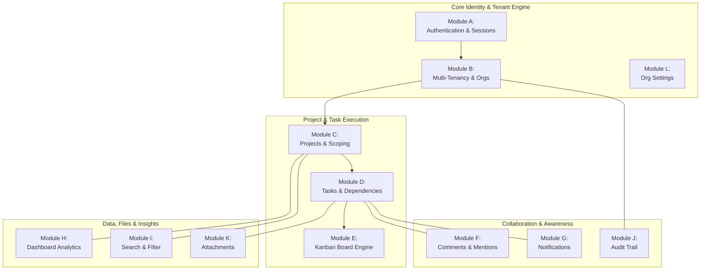

# TeamFlow — Software Requirements Specification (SRS)

**Document Version:** 1.1.0 (Audited & Reconciled)  
**Specification Standard:** Aligned with IEEE 830 / ISO/IEC/IEEE 29148  
**Client / Product Owner:** Client Specification (Version 1.0)  
**Lead Engineer & Architect:** Hamza Jemli  
**System Architecture:** Modular Monolith (Next.js + NestJS + PostgreSQL + Redis + Socket.IO)  
**Governing Framework:** [`AGENTS.md`](../../AGENTS.md)  
**Audit Report:** [`requirements-review-report.md`](./requirements-review-report.md)  
**Traceability Matrix:** [`traceability-matrix.md`](./traceability-matrix.md)

---

## 1. Introduction & Requirements Engineering Principles

### 1.1 Purpose of this Document
This Software Requirements Specification (SRS) defines the formal functional and non-functional requirements for the **TeamFlow** SaaS platform. Following a formal architectural audit, this revised specification resolves prior ambiguities surrounding RBAC hierarchies, project creation workflows, dependency blocker modeling, rate limiting, and precision handling.

### 1.2 Requirements Identification Convention
Every requirement is assigned a permanent identifier:
- **`FR-xxx`**: Functional Requirement (system behaviors, inputs, state machines, and API outputs).
- **`NFR-xxx`**: Non-Functional Requirement (security, latency envelopes, reliability, and code constraints).

### 1.3 Requirements Prioritization
Requirements are classified using the MoSCoW framework for Version 1.0:
- **MUST:** Essential core capability for Version 1.0 delivery.
- **SHOULD:** High-priority requirement included in v1.0 unless unexpected technical blockers occur.
- **COULD:** Secondary capability desirable for v1.0 polish.
- **WON'T (v1):** Explicitly deferred to Version 2.0+ (Out of scope).

---

## 2. Functional Requirements (FR-001 to FR-081)

### Module A — Authentication and Account Management

| ID | Priority | Requirement Description | Inputs / Triggers | Expected System Behavior & Validation |
|---|---|---|---|---|
| **FR-001** | MUST | User Registration | Email, password, full name | Validates email syntax, enforces password complexity (min 8 chars, 1 uppercase, 1 number, 1 special char). Hashes password with Argon2id ($m=65536, t=3, p=4$). Creates user record with `isEmailVerified: false`. Queues verification email token. |
| **FR-002** | MUST | Email Verification | Verification token from email link | Validates token signature and expiration (24h TTL). Sets `isEmailVerified: true`. Invalidates used token. |
| **FR-003** | MUST | User Authentication (Login) | Email, password | Verifies user credentials via Argon2id. Generates a stateful `Session` record in database/Redis. Issues a short-lived access JWT (15m) and rotated refresh token (7d) in `HttpOnly`, `SameSite=Strict`, `Secure` cookies. Updates `lastLoginAt`. |
| **FR-004** | MUST | User Logout | Logout request | Clears authentication cookies on client. Deletes the active `Session` record from database/Redis. Disconnects authenticated WebSocket connections associated with this session. |
| **FR-005** | MUST | Token Rotation & Session Refresh | Valid refresh token cookie | Validates refresh token against active session. Issues new short-lived access token (15m) and rotated single-use refresh token. Replaces old token hash in database (reuse detection). |
| **FR-006** | MUST | Password Reset Request | Account email address | Generates cryptographically secure, single-use reset token with 1-hour expiration. Dispatches reset email. Always returns 200 OK to prevent email enumeration. |
| **FR-007** | MUST | Password Reset Execution | Valid reset token, new password | Validates token. Updates user password hash with Argon2id. Atomically invalidates all active sessions for the user across all devices. |
| **FR-008** | MUST | In-App Password Change | Current password, new password | Authenticated user supplies current password. Verifies current password. Updates password hash with Argon2id. Invalidates all other active sessions except current. |
| **FR-009** | MUST | User Profile Management | Name, bio, timezone, job title | Updates user profile metadata. Validates string lengths and character constraints. Returns updated profile DTO. |
| **FR-010** | SHOULD | Profile Avatar Upload | Image file (JPEG/PNG/WebP, max 2MB) | Validates MIME type via binary magic bytes. Resizes/optimizes avatar. Streams to object storage under unique UUID key. Updates user avatar URL. Deletes old avatar file if present. |
| **FR-011** | MUST | Active Session Inspection | Authenticated user request | Lists all active sessions for the user: device name, OS/browser, IP address, creation time, and last activity time. |
| **FR-012** | MUST | Remote Session Revocation | Target `sessionId` or "Revoke all other" | Deletes specified session(s) from database/Redis. Subsequent API requests using revoked session tokens are rejected with 401 Unauthorized. |
| **FR-013** | MUST | Two-Tier Rate Limiting Protocol | Login, register, and reset endpoints | **Tier 1 (IP Throttling):** Max 10 req/min per IP on public auth endpoints. **Tier 2 (Account Lockout):** 5 consecutive failed login attempts on an email within 15 min triggers a 15-minute lockout. Returns 429 Too Many Requests. |

---

### Module B — Organization and Multi-Tenancy

| ID | Priority | Requirement Description | Inputs / Triggers | Expected System Behavior & Validation |
|---|---|---|---|---|
| **FR-014** | MUST | Organization Creation | Org name, optional slug/logo | Creates new `Organization` entity. Creates `Membership` record associating authenticated user with role `ORG_OWNER`. Automatically sets active workspace context. |
| **FR-015** | MUST | Organization Metadata Update | Org name, logo | Allowed only for `ORG_OWNER` and `ORG_ADMIN`. Updates organization record. Emits real-time update event to org members. |
| **FR-016** | MUST | Workspace Context Switching | Target `organizationId` | Verifies user possesses an active membership in target organization. Sets active tenant context cookie. Subsequent requests are scoped strictly to this tenant. |
| **FR-017** | MUST | Member Invitation | Invitee email, target role (`ORG_ADMIN`, `ORG_MEMBER`, `ORG_GUEST`) | Authorized user (`ORG_OWNER`/`ORG_ADMIN`) creates invitation. Generates cryptographically random token with 7-day expiration. Dispatches invitation email. Status set to `PENDING`. |
| **FR-018** | MUST | Invitation Status Tracking | Invitation lifecycle | Tracks status transitions: $\text{PENDING} \longrightarrow \{\text{ACCEPTED} \mid \text{DECLINED} \mid \text{EXPIRED} \mid \text{REVOKED}\}$. Prevents acceptance of non-pending tokens. |
| **FR-019** | MUST | Invitation Acceptance | Valid token, authenticated user | Verifies authenticated user's email matches the invitation email. Creates `Membership` record. Updates invitation status to `ACCEPTED`. |
| **FR-020** | MUST | Invitation Decline & Revocation | Token or invitation ID | Invitee can decline (status set to `DECLINED`); Org Admin/Owner can cancel (status set to `REVOKED`). |
| **FR-021** | MUST | Member Role Modification | `targetUserId`, new role | Only `ORG_OWNER` (or `ORG_ADMIN` modifying non-owners) can change member roles. Prevents demoting the organization's sole `ORG_OWNER`. |
| **FR-022** | MUST | Member Removal | `targetUserId` | Removes user from `Membership`. Cascades removal from all `ProjectMember` records and unassigns from active tasks within the organization. Disconnects user's active WebSockets for this org. |
| **FR-023** | MUST | Sole Owner Invariant Enforcement | Demote/remove owner request | The system strictly forbids deleting or demoting the last `ORG_OWNER` of an organization. Returns 400 Bad Request with explicit error code `LAST_OWNER_CANNOT_BE_REMOVED`. |
| **FR-024** | MUST | Two-Layer Authorization Barrier | Every API request | **Layer 1 (Tenant Isolation):** Backend guard verifies entity `organizationId === activeOrganizationId`. Rejects cross-tenant access with 403 Forbidden. **Layer 2 (Project Scoping):** For project-level entities, verifies caller is an assigned `ProjectMember` (or Org Owner/Admin). Rejects unauthorized internal access with 403 Forbidden. |

---

### Module C — Project Management

| ID | Priority | Requirement Description | Inputs / Triggers | Expected System Behavior & Validation |
|---|---|---|---|---|
| **FR-025** | MUST | Project Creation & Auto-PM Assignment | Title, description, dates, status | Allowed for `ORG_OWNER`, `ORG_ADMIN`, and authorized `ORG_MEMBER`. Creates `Project` belonging to active `organizationId`. Atomically adds creator as `ProjectMember` with role `PROJECT_MANAGER`. |
| **FR-026** | MUST | Project Detail Retrieval | `projectId` | Validates user membership in project (or Org Owner/Admin privileges). Returns project details, task summary statistics, and assigned members. |
| **FR-027** | MUST | Project Metadata Update | Title, description, start/end dates | Authorized user (`ORG_OWNER`, `ORG_ADMIN`, or project `PROJECT_MANAGER`) updates project fields. Emits `project.updated` real-time event. |
| **FR-028** | MUST | Project Status Transition | New status | Validates transition across states: `PLANNING`, `ACTIVE`, `ON_HOLD`, `COMPLETED`, `ARCHIVED`. Logs transition to activity audit trail. |
| **FR-029** | MUST | Project Archival | `projectId`, archive action | Sets status to `ARCHIVED`. Hides project from active project queries by default. All tasks within archived projects become read-only. |
| **FR-030** | MUST | Project Soft Deletion | `projectId`, delete action | Restricted to `ORG_OWNER` and `ORG_ADMIN`. Sets `deletedAt` timestamp. Preserves data for 30-day recovery. Cascades soft delete to associated tasks and comments. |
| **FR-031** | MUST | Project Member Assignment | `projectId`, `userId`, project role | Adds organization member to `ProjectMember` with role `CONTRIBUTOR` or `VIEWER`. Dispatches notification to assigned member. |
| **FR-032** | MUST | Project Member Removal | `projectId`, `userId` | Removes `ProjectMember` record. Unassigns user from any pending tasks in the project. Revokes project WebSocket channel access. |
| **FR-033** | MUST | Project Manager Designation | `projectId`, `userId` | Assigns designated project member as `PROJECT_MANAGER` for the project. |
| **FR-034** | MUST | Project Listing & Filtering | Query parameters: status, search | Returns paginated list of projects accessible to the user within the active organization. Enforces project visibility scoping. |

---

### Module D — Task Management

| ID | Priority | Requirement Description | Inputs / Triggers | Expected System Behavior & Validation |
|---|---|---|---|---|
| **FR-035** | MUST | Task Creation | Title, description, `projectId`, priority, due date, status | Validates title (1–255 chars), due date, and user project access. Sets status (defaults to `TODO` or `BACKLOG`). Assigns fractional `orderIndex` for Kanban position. |
| **FR-036** | MUST | Task Detail Retrieval | `taskId` | Returns task record, assignees, labels, subtasks, attachments, comments count, dynamic `isBlocked` flag, and status change history. Enforces Layer 2 project access check. |
| **FR-037** | MUST | Task Update | Title, description, priority, due date | Updates task attributes. Verifies user has edit permissions in project. Records activity log. Emits `task.updated` event. |
| **FR-038** | MUST | Task Status Transition | `newStatus` | Validates status against enum: `BACKLOG`, `TODO`, `IN_PROGRESS`, `IN_REVIEW`, `DONE`, `CANCELLED`. Updates task status and `updatedAt`. Emits `task.status_changed`. |
| **FR-039** | MUST | Task Status History Logging | On status change | Automatically inserts `TaskStatusHistory` record capturing `taskId`, `oldStatus`, `newStatus`, `changedById`, and timestamp. |
| **FR-040** | MUST | Task Assignee Management | `taskId`, array of `userId`s | Assigns or unassigns members. Emits `task.assigned` event. Generates in-app notifications for newly assigned users. |
| **FR-041** | MUST | Task Assignee Validation | Assignee `userId` | Strictly rejects assigning any user who is not an explicit member of the task's parent project. Returns 400 Bad Request with `ASSIGNEE_NOT_IN_PROJECT`. |
| **FR-042** | MUST | Task Priority Assignment | Priority level | Validates priority: `LOW`, `MEDIUM`, `HIGH`, `URGENT`. Updates task record and emits real-time update. |
| **FR-043** | MUST | Subtask / Checklist Management | Title, completed boolean | Allows creating, toggling completion, and deleting single-level checklist items within a task. Computes checklist completion ratio (e.g., 3/5 complete). |
| **FR-044** | SHOULD | Task Dependency Linking | `taskId`, `dependsOnTaskId` | Creates dependency where Task A is blocked by Task B. Enforces that both tasks belong to the same project. Sets dynamic `isBlocked = true` on Task A if Task B is not `DONE`. |
| **FR-045** | MUST | Circular Dependency Prevention | New dependency link | Executes cycle detection algorithm (Depth-First Search / topological check). Strictly rejects links that introduce cycles ($A \rightarrow B \rightarrow A$). Returns 400 `CIRCULAR_DEPENDENCY_DETECTED`. |
| **FR-046** | MUST | Task Soft Deletion | `taskId` | Sets `deletedAt` timestamp. Hides task from active board and list views while preserving comments and audit trail. |

---

### Module E — Kanban Board

| ID | Priority | Requirement Description | Inputs / Triggers | Expected System Behavior & Validation |
|---|---|---|---|---|
| **FR-047** | MUST | Kanban Board Aggregation | `projectId` | Returns tasks grouped into status columns (`BACKLOG`, `TODO`, `IN_PROGRESS`, `IN_REVIEW`, `DONE`, `CANCELLED`), ordered ascending by `orderIndex`. Each task includes its computed `isBlocked` flag. |
| **FR-048** | MUST | Cross-Column Drag-and-Drop | `taskId`, `newStatus`, `prevTaskId`, `nextTaskId` | Updates task status to target column. Calculates new `orderIndex = (prev.orderIndex + next.orderIndex) / 2`. Records status history. Emits `task.status_changed`. |
| **FR-049** | MUST | Intra-Column Reordering | `taskId`, `prevTaskId`, `nextTaskId` in same column | Recalculates `orderIndex` to position card between target neighbors. Updates database. Emits `task.reordered`. |
| **FR-050A** | MUST | Fractional Card Indexing | Card reordering action | Assigns floating-point order index enabling $O(1)$ reordering without updating surrounding cards. |
| **FR-050B** | MUST | Automatic Column Rebalancing | Card drop where $|prev - next| < 10^{-6}$ | When floating point precision gap drops below threshold, backend atomically rebalances the column, spacing all cards by integer increments of $1000$. |
| **FR-051** | MUST | Optimistic UI Updates | Client drag event | Client UI updates board immediately without waiting for server network roundtrip. |
| **FR-052** | MUST | Concurrency & Rejection Rollback | Server rejection / error | If server rejects move (403, 404, or optimistic locking 409 conflict), client reverts card to previous column and position and displays error toast. |
| **FR-053** | MUST | Board Filtering | Assignee, priority, label query | Filters displayed board cards in real time. Persists active filter selections in URL query parameters. |

---

### Module F — Comments and Collaboration

| ID | Priority | Requirement Description | Inputs / Triggers | Expected System Behavior & Validation |
|---|---|---|---|---|
| **FR-054** | MUST | Task Comment Creation | `taskId`, markdown content | Sanitizes input using DOMPurify to prevent XSS. Saves comment record linked to task and author. Broadcasts `comment.created` to task room. |
| **FR-055** | MUST | Comment Editing | `commentId`, updated content | Only original author can edit comment. Updates content and sets `isEdited: true` with `updatedAt`. Emits `comment.updated`. |
| **FR-056** | MUST | Comment Deletion | `commentId` | Author, Project Manager, or Org Admin can delete comment. Soft deletes comment. Emits `comment.deleted`. |
| **FR-057** | MUST | User Mentions (@username) | Comment text containing `@username` | Regex parses mentions. Verifies mentioned users belong to the project. Creates notifications for mentioned users. |
| **FR-058** | MUST | Live Comment Broadcasting | New comment created | Dispatches real-time WebSocket event to all clients actively viewing the task or project room. |

---

### Module G — Notifications

| ID | Priority | Requirement Description | Inputs / Triggers | Expected System Behavior & Validation |
|---|---|---|---|---|
| **FR-059** | MUST | Notification Generation | Assignment, mention, comment, invite | Automatically generates `Notification` record in database with actor, recipient, type, target entity link, and read status `false`. |
| **FR-060** | MUST | Real-Time Push Delivery | New notification generated | Emits `notification.created` over WebSocket to the specific user's private socket room (`user:<userId>`). |
| **FR-061** | MUST | Notification Persistence & Retention | System events | Persists all notifications in PostgreSQL so users receive full historical unread alerts upon logging in or reconnecting. Retained for 90 days. |
| **FR-062** | MUST | Notification Listing & Pagination | Authenticated user request | Returns paginated list of notifications for the user within the active organization, ordered newest first. |
| **FR-063** | MUST | Mark Notification Read / Unread | `notificationId`, `isRead` boolean | Updates read state for specified notification. Decrements unread badge count. |
| **FR-064** | MUST | Mark All Notifications Read | Mark all action | Bulk updates all unread notifications for the user in the active organization to `isRead: true`. |
| **FR-065** | SHOULD | Notification Preferences | Preference toggles per event type | Allows user to toggle in-app and email notification preferences for assignments, comments, and mentions. |

---

### Module H — Dashboard and Analytics

| ID | Priority | Requirement Description | Inputs / Triggers | Expected System Behavior & Validation |
|---|---|---|---|---|
| **FR-066** | MUST | Organization Dashboard Metrics | `organizationId` | Calculates: Total Projects, Active Projects, Completed Projects, Total Tasks, Pending Tasks, Overdue Tasks, Task Completion Rate (%), and Recent Activity. $$\text{Completion Rate} = \left(\frac{\text{Count}(\text{Tasks } status = \text{DONE})}{\text{Count}(\text{Tasks } status \neq \text{CANCELLED})}\right) \times 100$$ $$\text{Overdue} = \text{Tasks where } dueDate < \text{NOW}() \text{ AND } status \notin (\text{'DONE'}, \text{'CANCELLED'})$$ |
| **FR-067** | MUST | Project Dashboard Metrics | `projectId` | Calculates: Project Progress %, Task Distribution by Status, Tasks by Priority breakdown, Overdue Tasks list, and Member Workload distribution. Progress formula identical to completion rate scoped to project. |
| **FR-068** | MUST | Redis Metric Caching | Dashboard query | Caches computed analytics aggregates in Redis with 60-second TTL. Automatically invalidates cache keys upon task or project mutations. |

---

### Module I — Search and Filtering

| ID | Priority | Requirement Description | Inputs / Triggers | Expected System Behavior & Validation |
|---|---|---|---|---|
| **FR-069** | MUST | Global Workspace Search | Search query string (min 2 chars) | Searches across accessible projects, tasks, and members within active organization. Enforces Layer 2 project scoping on task results. |
| **FR-070** | MUST | Multi-Attribute Task Filtering | Filters: status, priority, assignee, due date, label | Dynamically builds parameterized database query applying all selected filters. Returns filtered task list. |
| **FR-071** | MUST | Pagination and Sorting | `page`, `limit` (max 100), `sortBy`, `sortOrder` | Implements limit-offset or cursor pagination on all list endpoints. Enforces default limit of 20 and maximum cap of 100. |

---

### Module J — Activity Logs and Audit Trail

| ID | Priority | Requirement Description | Inputs / Triggers | Expected System Behavior & Validation |
|---|---|---|---|---|
| **FR-072** | MUST | Audit Event Recording | System actions (project created, member invited, status changed, settings modified) | Creates immutable `ActivityLog` capturing `organizationId`, `actorId`, `actionType`, `entityType`, `entityId`, `metadata` (JSON), and timestamp. |
| **FR-073** | MUST | Activity Feed Retrieval | `organizationId` or `projectId` | Returns paginated activity feed filtered by user's authorized scope. |
| **FR-074** | MUST | Audit Log Immutability | Update or delete attempts | Activity logs are strictly append-only. API endpoints do NOT expose update or delete methods. Service guards reject alterations. |

---

### Module K — File and Attachment Management

| ID | Priority | Requirement Description | Inputs / Triggers | Expected System Behavior & Validation |
|---|---|---|---|---|
| **FR-075** | MUST | Secure File Upload Pipeline | Multipart upload: file, `taskId` | Validates file size (max 10MB) and MIME type. Inspects binary magic bytes in-memory before streaming to S3/MinIO bucket under unique UUID key. |
| **FR-076** | MUST | Attachment Metadata Storage | Post-upload | Saves `Attachment` record in PostgreSQL containing original filename, storage key, MIME type, size in bytes, uploader ID, and `taskId`. |
| **FR-077** | MUST | Secure File Download / View | `attachmentId` | Verifies user's access rights to the associated project. Generates pre-signed S3/MinIO URL with 15-minute expiration. Client downloads directly from storage. |
| **FR-078** | MUST | Attachment Deletion & Orphan Cleanup | Delete attachment action | Author or Org Admin can delete attachment. Deletes database record and issues delete command to object storage. Daily background worker prunes orphaned storage blobs. |

---

### Module L — Organization Settings

| ID | Priority | Requirement Description | Inputs / Triggers | Expected System Behavior & Validation |
|---|---|---|---|---|
| **FR-079** | MUST | Organization Profile Settings | Org name, avatar/logo | Restricted to `ORG_OWNER` and `ORG_ADMIN`. Updates organization profile. Emits real-time update. |
| **FR-080** | MUST | Organization Member Directory | Org view | Displays all active members, their roles, join dates, and invitation statuses. Allows `ORG_OWNER`/`ORG_ADMIN` to manage members. |
| **FR-081** | MUST | Organization Deletion (Danger Zone) | `organizationId`, confirmation string | Restricted strictly to `ORG_OWNER`. Requires typing full organization name to confirm. Soft-deletes organization and cascades soft-delete to child projects and tasks. |

---

## 3. Two-Tier Role-Based Access Control (RBAC) Matrix

TeamFlow divides authorization into two explicit scopes:
1. **Tier 1 (Organization-Level Roles):** `ORG_OWNER`, `ORG_ADMIN`, `ORG_MEMBER`, `ORG_GUEST`
2. **Tier 2 (Project-Level Roles):** `PROJECT_MANAGER`, `CONTRIBUTOR`, `VIEWER`

### 3.1 Organization-Level Permissions Matrix

| Capability / Action | Platform Admin | ORG_OWNER | ORG_ADMIN | ORG_MEMBER | ORG_GUEST |
|---|:---:|:---:|:---:|:---:|:---:|
| Access Global System Metrics | ✅ | ❌ | ❌ | ❌ | ❌ |
| Delete Organization (Danger Zone) | ✅ | ✅ | ❌ | ❌ | ❌ |
| Transfer Organization Ownership | ❌ | ✅ | ❌ | ❌ | ❌ |
| Update Organization Name / Logo | ✅ | ✅ | ✅ | ❌ | ❌ |
| View Organization Audit Activity Logs | ✅ | ✅ | ✅ | ❌ | ❌ |
| Invite New Members to Organization | ❌ | ✅ | ✅ | ❌ | ❌ |
| Remove Member from Organization | ❌ | ✅ | ✅ | ❌ | ❌ |
| Modify Member Role (Promote/Demote) | ❌ | ✅ | ✅ (non-owners) | ❌ | ❌ |
| View Organization Member Directory | ✅ | ✅ | ✅ | ✅ | ✅ |
| Create New Project in Organization | ❌ | ✅ | ✅ | ✅ (auto-assigned PM) | ❌ |

---

### 3.2 Project-Level Permissions Matrix

> *Note:* `ORG_OWNER` and `ORG_ADMIN` possess superuser override access across all projects within their organization. For `ORG_MEMBER` and `ORG_GUEST` users, project permissions are strictly determined by their assigned `ProjectMember` role:

| Capability / Action | PROJECT_MANAGER | CONTRIBUTOR | VIEWER (Guest default) |
|---|:---:|:---:|:---:|
| Update Project Metadata (Title, Dates) | ✅ | ❌ | ❌ |
| Add / Remove Members from Project | ✅ | ❌ | ❌ |
| Archive / Soft-Delete Project | ✅ (Owner/Admin only) | ❌ | ❌ |
| Create Task in Project | ✅ | ✅ | ❌ |
| Move / Reorder Task on Kanban Board | ✅ | ✅ | ❌ |
| Update Task Details (Title, Description) | ✅ | ✅ (assigned/creator) | ❌ |
| Change Task Status (e.g. TODO $\rightarrow$ DONE) | ✅ | ✅ | ❌ |
| Assign / Unassign Members to Task | ✅ | ✅ | ❌ |
| Soft-Delete Task | ✅ | ❌ | ❌ |
| Post Comment on Task | ✅ | ✅ | ✅ (assigned tasks) |
| Upload File Attachment to Task | ✅ | ✅ | ❌ |
| Download Task Attachment | ✅ | ✅ | ✅ |

---

## 4. Reconciled Non-Functional Requirements (NFR-001 to NFR-020)

| ID | Category | Requirement Specification | Metric & Verification Method |
|---|---|---|---|
| **NFR-001** | Security | **Two-Layer Authorization Enforcement:** 100% rejection of cross-tenant and unauthorized cross-project data access. | Every query filtered by `organizationId` and project membership. Verified by automated penetration tests (`test/e2e/tenant-isolation.e2e-spec.ts`). Must return 403 Forbidden. |
| **NFR-002** | Security | **Password & Token Cryptography:** Passwords hashed with Argon2id ($m=65536, t=3, p=4$). Short-lived access JWTs (15m) and rotated refresh tokens (7d) stored in `HttpOnly`, `SameSite=Strict`, `Secure` cookies. | Verified via static analysis and token inspection tests. Tokens never stored in `localStorage` or URL parameters. |
| **NFR-003** | Security | **Backend RBAC Guards:** All endpoints protected by NestJS Guards (`JwtAuthGuard`, `TenantGuard`, `RolesGuard`). | Zero routes accessible without appropriate guards. |
| **NFR-004** | Security | **Strict Input Validation:** Class-validator DTOs with `whitelist: true, forbidNonWhitelisted: true`. DOMPurify HTML sanitization. | Extra payload fields rejected with 400 Bad Request. |
| **NFR-005** | Security | **Two-Tier Rate Limiting Protocol:** IP throttling and account lockout. | Max 10 req/min per IP on public auth; 5 failed logins on an email within 15 min triggers 15 min lockout. Authenticated API capped at 100 req/min per session. |
| **NFR-006** | Security | **File Upload Hardening:** 10MB file limit; in-memory magic byte inspection; randomized UUID storage keys; pre-signed download URLs (15m TTL). | Upload of disguised executable files rejected with 400 Bad Request. |
| **NFR-007** | Performance | **Read API Latency:** Task lists, project overviews, and member directories. | **p95 latency < 200 ms** under 100 concurrent virtual users in local Docker environment. Verified via k6. |
| **NFR-008** | Performance | **Write API Latency:** Task creation, drag-and-drop status changes, comments. | **p95 latency < 400 ms** under 50 concurrent write mutations. Verified via k6. |
| **NFR-009** | Performance | **Real-Time Event Latency:** Database commit to client WebSocket receipt. | **< 100 ms** latency on local Docker environment. |
| **NFR-010** | Performance | **Database Query Optimization:** Composite indexes on `(projectId, status, orderIndex)`, `(organizationId, projectId)`. | Zero queries exceeding 50 ms execution time on a 50,000 task dataset. No N+1 queries. |
| **NFR-011** | Performance | **Enforced Pagination:** All list endpoints paginated. | Default: 20 items. Maximum cap: 100 items. Requests omitting pagination receive default limit. |
| **NFR-012** | Reliability | **ACID Transactions:** Multi-record mutations executed via Prisma `$transaction`. | Zero partial writes during simulated mid-operation failures. |
| **NFR-013** | Reliability | **Referential Integrity & Cascades:** Explicit foreign keys with soft-delete retention. | Deleting an organization cascades soft-delete to projects and tasks. |
| **NFR-014** | Reliability | **Health Probes:** Terminus health endpoint `/api/v1/health` monitoring PostgreSQL, Redis, and storage. | Returns 200 OK or 503 Service Unavailable. |
| **NFR-015** | Reliability | **WebSocket Reconnection & Board Resync:** Auto-reconnect with exponential backoff. | On reconnect, client fetches `GET /api/v1/projects/:id/board?since=<timestamp>` to reconcile missed updates. |
| **NFR-016** | Maintainability | **Strict TypeScript:** `strict: true`, `noImplicitAny: true`. | Zero `any` shortcuts in application code. Passes `tsc --noEmit`. |
| **NFR-017** | Maintainability | **Modular Monolith Encapsulation:** Zero cross-module direct repository access. | Verified via automated `dependency-cruiser` linting rules. |
| **NFR-018** | Maintainability | **Automated Test Coverage:** Core business domains. | **>= 80% branch coverage** on authentication, tenant isolation, permissions, and task status logic. |
| **NFR-019** | Usability | **Responsive Design:** Mobile (320px+), Tablet, Desktop. | Desktop-first optimization with touch targets >= 44x44px on mobile. |
| **NFR-020** | Accessibility | **WCAG 2.1 AA:** Contrast >= 4.5:1, keyboard navigation. | Full keyboard support (Tab, Enter, Space, Escape, Arrow keys) for Kanban cards and modals. |

---

## 5. Updated Open Questions & Decisions Log

The following decisions have been reviewed and structured for formal client sign-off:

| # | Architecture / Product Decision | Audited Proposal & Recommendation | Technical Implications | Status |
|---|---|---|---|:---:|
| **Q1** | **Multi-Tenancy Workspace Routing** | **Path-based routing** (`/app/...` with active org context in secure cookie and header). | Eliminates wildcard DNS and SSL complexity in local Docker and production VPS. | **Pending Approval** |
| **Q2** | **Project Visibility Within Organization** | **Private by default:** Only explicitly assigned `ProjectMember`s can view a project (plus Org Owner/Admin). | Enforces strict intra-company confidentiality across client teams. | **Pending Approval** |
| **Q3** | **Kanban Card Ordering Strategy** | **Fractional Indexing (`Float`) with Automatic Rebalancing:** Cards spaced midway; rebalance when $\Delta < 10^{-6}$. | Delivers $O(1)$ fast drops without precision breakdown or large SQL updates. | **Pending Approval** |
| **Q4** | **Subtask Hierarchy Depth** | **Single-level checklist items** (`Subtask` entity). | Satisfies 100% of MVP checklist requirements without complex recursive CTE queries. | **Pending Approval** |
| **Q5** | **Guest Role Scope** | **Read-only on assigned tasks with commenting rights.** Cannot create tasks or change statuses. | Prevents external client stakeholders from corrupting internal sprint statuses. | **Pending Approval** |
| **Q6** | **Notification Retention Policy** | **90-day retention with scheduled hard-delete.** | Prevents unbounded growth of the `Notification` table over time. | **Pending Approval** |
