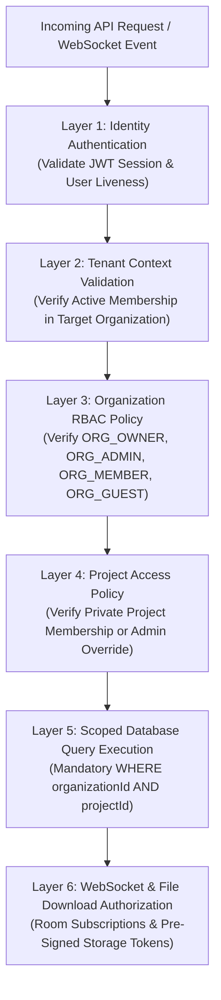
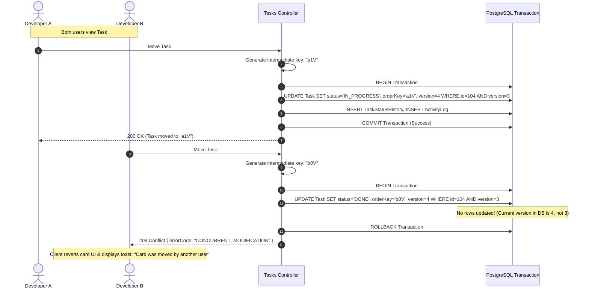
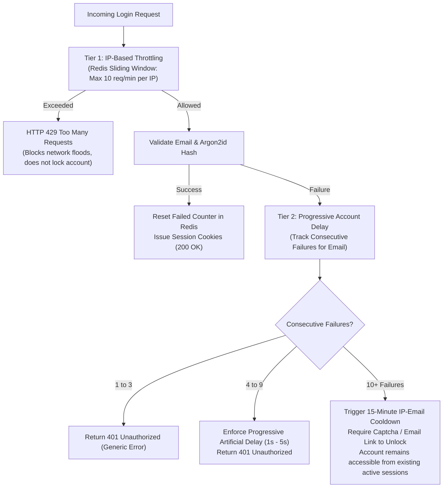
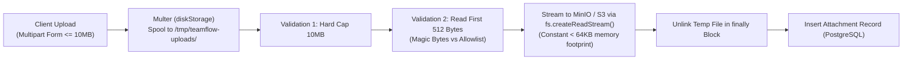
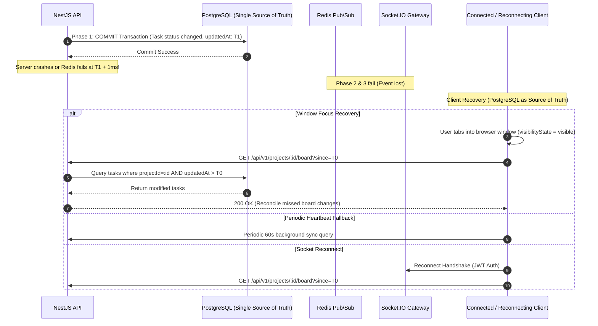

# TeamFlow — Software Requirements Specification (SRS)

**Document Version:** 1.2.1 (Final Requirements Verification)  
**Specification Standard:** Aligned with IEEE 830 / ISO/IEC/IEEE 29148  
**Client / Product Owner:** Client Specification (Version 1.0)  
**Lead Engineer & Architect:** Hamza Jemli  
**System Architecture:** Modular Monolith (Next.js + NestJS + PostgreSQL + Redis + Socket.IO)  
**Governing Framework:** [`AGENTS.md`](../../AGENTS.md)  
**Audit Report:** [`requirements-review-report.md`](./requirements-review-report.md)  
**Traceability Matrix:** [`traceability-matrix.md`](./traceability-matrix.md)

---

## 1. Introduction & Approved Architecture Directives

### 1.1 Purpose & Scope
This Software Requirements Specification (SRS) defines the authoritative technical and operational contract for the **TeamFlow** multi-tenant SaaS project management platform. 

This version (1.2.1) incorporates the **final requirements verification pass**, defining exact duplicate-key tie-breaking, post-commit real-time event recovery, disk-spooled memory-safe file uploads, GDPR-compliant audit log privacy, and provisional release timelines.

### 1.2 Summary of Approved Architecture Decisions
1. **Q1 — Workspace Routing:** Path-based workspace routing (`/app/orgs/:slug/...` or `/app/...` with active organization context). The backend independently authenticates and validates membership for every request. Client-supplied IDs are never trusted as proof of access.
2. **Q2 — Project Visibility:** Private by default. Only explicitly assigned `ProjectMember`s can view or access project resources. `ORG_OWNER` and `ORG_ADMIN` retain administrative override access.
3. **Q3 — Kanban Card Ordering:** String-based fractional indexing using a deterministic variable-length base-62 key algorithm. Floating-point indices are discarded. Optimistic concurrency with integer `version` fields handles simultaneous moves.
4. **Q4 — Subtask Hierarchy:** Single-level checklist items (`ChecklistItem` / `Subtask`). No nested subtasks. Kept distinct from `TaskDependency`.
5. **Q5 — Guest Permissions:** Read-only access to assigned projects and tasks with commenting privileges. Guests cannot create/edit tasks, change statuses, or manage members. Guests can edit/delete their own comments; Project Managers can moderate/delete guest comments.
6. **Q6 — Notification & Audit Retention:** 90-day retention for both read and unread notifications via a daily scheduled cron job. Audit logs (`ActivityLog`) are governed by a separate, privacy-compliant **365-day retention policy** with user pseudonymization upon account deletion.

---

## 2. Layered Multi-Tenant Authorization Architecture

Tenant isolation and resource authorization cannot rely on a single filter, interceptor, or client check. TeamFlow implements a **Six-Layer Defense-in-Depth Authorization Strategy**:



### Layered Defense Enforcement Matrix
1. **Layer 1 (Authentication):** Extracts and cryptographically verifies the short-lived access JWT from `HttpOnly` cookies. Validates that the backing `Session` record in database/Redis is active and has not been revoked.
2. **Layer 2 (Tenant Context Validation):** Resolves the target `organizationId` from the verified URL path or request context. Validates that the authenticated user holds an active, non-suspended `Membership` record for that specific organization.
3. **Layer 3 (Organization RBAC):** Evaluates organizational permissions (e.g. inviting members, modifying org settings, creating projects).
4. **Layer 4 (Project Scoping):** Because projects are private by default (Decision Q2), access to any project-scoped resource (tasks, boards, comments) requires verifying that the user is an explicit `ProjectMember` with an assigned role (`PROJECT_MANAGER`, `CONTRIBUTOR`, `VIEWER`), unless the user holds `ORG_OWNER` or `ORG_ADMIN` override privileges.
5. **Layer 5 (Database Scoping):** All data-access services and repositories enforce explicit tenant and project filters:
   ```typescript
   // Mandatory pattern across all queries
   where: {
     id: resourceId,
     projectId: validatedProjectId,
     organizationId: validatedActiveOrgId,
     deletedAt: null,
   }
   ```
   *Nested Prisma Operations & Raw SQL:* Nested writes (`create`, `update`, `connect`) must explicitly include foreign key checks. Raw SQL (`$queryRaw`) is prohibited unless parameterized with explicit tenant predicates.
   *Background Jobs & Scheduled Tasks:* Workers must run within an explicitly injected tenant security context; jobs cannot execute across tenants without partitioned batches.
6. **Layer 6 (WebSockets & File Downloads):** WebSocket connection handshakes verify authentication tokens; joining rooms (`org:<id>`, `project:<id>`) executes the identical Layer 2 and Layer 4 checks. File downloads require a signed token generated only after validating project membership.
7. **PostgreSQL Row-Level Security (RLS) Evaluation:** While PostgreSQL native RLS provides database-level enforcement (`USING (organization_id = current_setting('app.current_org_id'))`), it requires executing `SET LOCAL app.current_org_id` on every acquired database connection. Because Prisma uses a connection pool (and frequently runs behind PgBouncer in transaction mode where session-level settings can bleed across pooled connections unless wrapped in dedicated transactions), RLS is evaluated as an optional supplementary defense, not a replacement for programmatic Layer 5 scoping.

---

## 3. String-Based Fractional Indexing & Kanban Concurrency (Verified & Hardened)

### 3.1 Ordering Key Specification & Intermediate Generation
Floating-point indices (`orderIndex: Float`) are discarded. TeamFlow implements **string-based fractional indexing** (using variable-length base-62 ASCII characters: `0-9`, `A-Z`, `a-z`):

- **Key Representation:** Strings ordered via standard byte lexicographical order.
- **Midpoint Generation:** Given two adjacent cards with keys $K_1$ and $K_2$ ($K_1 < K_2$), the generator produces $K_{\text{new}}$ such that $K_1 < K_{\text{new}} < K_2$ (e.g. between `"a0"` and `"a1"` $\rightarrow$ `"a0V"`).
- **Arbitrary Precision:** String keys grow in length as intervals narrow, providing theoretically unbounded precision immune to floating-point underflow.



### 3.2 Concurrency, Duplicate Keys, Tie-Breaking & Atomic Rebalancing
1. **Simultaneous Moves into the Same Gap (Duplicate Keys):** If two users drag two *different* tasks (Task A and Task B) into the same gap between `"a1"` and `"a2"` at the exact same moment, both cards may be assigned identical keys (e.g. `"a1V"`).
   - **Deterministic Tie-Breaking:** In all queries and UI renders, sorting is strictly defined as:
     $$\text{ORDER BY orderKey ASC, id ASC}$$
     Because `id` is an immutable unique UUIDv4, the relative position between Task A and Task B is **100% deterministic** across all clients. Cards will never jump or swap randomly on refresh.
2. **Moving the Same Card Simultaneously (Optimistic Concurrency):**
   - Every `Task` record contains an integer `version` field.
   - Status and order updates execute conditional writes:
     $$\text{UPDATE tasks SET status = :status, orderKey = :key, version = version + 1 WHERE id = :id AND version = :expectedVersion}$$
   - If 0 rows are updated, the transaction rolls back and returns **HTTP 409 Conflict**. The client reverts the optimistic drag, alerts the user, and triggers a background sync to refresh the card state.
3. **Atomic Column Rebalancing & Protected Records:**
   - **Trigger Threshold:** When any card's `orderKey` exceeds 64 characters in length, an automatic rebalance is triggered for that column.
   - **Protected Records & Row Locks:** To guarantee safety under concurrent modifications, the rebalance routine acquires an exclusive row-level lock on **all active tasks in that specific status column of that project**:
     ```sql
     SELECT id FROM tasks 
     WHERE projectId = :projectId AND status = :status AND deletedAt IS NULL 
     ORDER BY orderKey ASC, id ASC 
     FOR UPDATE;
     ```
   - Cards are re-spaced with clean, uniform 2-character keys: `"a0"`, `"a1"`, `"a2"`...
   - Any concurrent card move attempting to enter or exit that column during the rebalance will pause and wait for the transaction lock to release, guaranteeing serial consistency without deadlocks or missed moves.
4. **Atomic Transaction Boundary:** Updating status + updating `orderKey` + incrementing `version` + inserting `TaskStatusHistory` + inserting `ActivityLog` executes in **one single ACID transaction**.

---

## 4. Authentication, Session Management & Anti-Lockout Rate Limiting

### 4.1 Anti-Lockout Rate-Limiting Policy
To eliminate the Denial-of-Service vulnerability where attackers lock out legitimate users by spamming failed logins, TeamFlow enforces a **Multi-Tier Progressive Delay Protocol**:



1. **Tier 1 (IP-Based Request Throttling):** Redis sliding window limits requests to **10 requests per minute per IP address** across public `/auth/*` endpoints. Returns HTTP 429 Too Many Requests if exceeded.
2. **Tier 2 (Progressive Account Cooldown, Not Hard Lockout):**
   - Failures 1–3: Immediate generic 401 response (`"Invalid email or password"`).
   - Failures 4–9: Progressive server-side artificial delay (1 second to 5 seconds) injected before returning 401. This destroys automated brute-force script throughput without locking out legitimate users.
   - Failures 10+: The specific `(IP + email)` pairing is placed on a 15-minute cooldown. The account is **never globally locked**: existing active sessions continue working normally.
3. **Generic Error Responses:** All authentication failures return identical generic messages (`"Invalid email or password"`) to eliminate account enumeration.
4. **Endpoint-Specific Throttling:**
   - `/auth/forgot-password`: Max 3 requests per hour per email address. The API **always returns HTTP 200 OK** regardless of whether the email exists.
   - `/auth/verify-email`: Max 5 verification attempts per hour per token.

---

## 5. File Upload Memory Safety & Storage Security Pipeline

### 5.1 Memory-Safe Spooling vs. Heap Exhaustion
Using `multer.memoryStorage()` for 10MB files allows concurrent uploads to exhaust the Node.js process heap (e.g. 20 concurrent uploads consume $>200\text{ MB}$ buffer, causing V8 garbage collection freezes and Out-Of-Memory crashes).

TeamFlow implements **Disk-Spooled Streaming with In-Flight Validation**:



1. **Disk Storage Spooling:** Uploads are streamed to a secure temporary directory (`/tmp/teamflow-uploads/` or OS temp) via `multer.diskStorage()`, capping file size at 10MB. Node.js heap memory consumption remains negligible ($< 64\text{ KB}$ buffer per upload).
2. **In-Flight Binary Magic-Byte Inspection:** The server opens the temporary file descriptor, reads the initial 512 bytes using `file-type`, and verifies the true binary signature against the allowlist:
   - Images: `image/jpeg`, `image/png`, `image/webp`.
   - Documents: `application/pdf`, `text/plain`.
   - Archives: `application/zip`.
   If magic bytes do not match the declared client `Content-Type`, the temporary file is unlinked immediately and the request is rejected with HTTP 400 (`FILE_TYPE_MISMATCH`).
3. **Stream Transmission & Guaranteed Temp Cleanup:** Validated files are streamed directly from the temporary disk spool to S3/MinIO using `fs.createReadStream()`. The temporary file is unconditionally deleted (`fs.unlink()`) inside a `finally` block, ensuring zero disk leaks regardless of success or network failure.
4. **Concurrency & Memory Limits:** Max 3 concurrent uploads per authenticated user session. Global upload semaphore limits simultaneous disk writes to 20 across the container.
5. **Presigned Download URLs & Expiration Behavior:**
   - **Lifespan:** Presigned URLs expire strictly after **15 minutes (900 seconds)** (`X-Amz-Expires=900`). Any request arriving after 900 seconds is rejected by S3/MinIO with HTTP 403 Forbidden.
   - **URL Leakage Defense:** Presigned URLs are pre-authenticated tokens. To minimize risk, they are generated only after Layer 2 and Layer 4 authorization checks and issued with safe headers:
     `Content-Disposition: attachment; filename="sanitized-name.ext"`  
     `X-Content-Type-Options: nosniff`  
     `Cache-Control: private, no-store, max-age=0` (prevents proxy caching).
6. **Failed Uploads & Orphan Cleanup:** Direct uploads execute atomically with database record creation. A daily scheduled cron worker queries S3 for objects created $>24\text{ hours}$ ago with no corresponding `Attachment` record in PostgreSQL, permanently pruning orphaned storage blobs.

---

## 6. Real-Time Event Reliability & Crash Recovery Architecture

### 6.1 Database Commit vs. Event Publish vs. Client Delivery
In collaborative software, event reliability requires distinguishing three distinct operational phases:

| Phase | Responsibility | Failure Mode | System Behavior |
|---|---|---|---|
| **Phase 1: Database Commit** | PostgreSQL (ACID Transaction) | Constraint failure, concurrency collision | Transaction rolls back; API returns error; zero events published. |
| **Phase 2: Event Publish** | NestJS Service $\rightarrow$ Redis Pub/Sub | Server crash or Redis connection drop at $T_1 + 1\text{ms}$ | Database remains committed; event is NOT published (best-effort limitation). |
| **Phase 3: Client Delivery** | Socket.IO Gateway $\rightarrow$ Connected Browsers | Client WiFi drops, mobile backgrounding | Event delivered to online clients; disconnected client misses event. |



### 6.2 MVP Best-Effort Guarantee & Crash Recovery Protocol
- **PostgreSQL is the Sole Source of Truth:** Redis Pub/Sub is an ephemeral transport channel; state is never persisted in Redis.
- **MVP Best-Effort Guarantee:** If the backend server crashes after committing to PostgreSQL but before publishing to Redis, the event will not be broadcast via WebSockets.
- **Client Crash Recovery Protocol:** Clients recover from dropped events without requiring manual full page reloads:
  1. **Window Focus Sync:** When a user switches tabs or focuses the window (`document.visibilityState === 'visible'`), the client queries:
     `GET /api/v1/projects/:id/board?since=<lastSyncTimestamp>`
  2. **Periodic Heartbeat Sync:** Every 60 seconds, active board clients execute a lightweight delta check.
  3. **Reconnect Sync:** Upon Socket.IO auto-reconnection, the client immediately synchronizes board state.
- **Future Outbox Upgrade Path (Cataloged for v1.2):** For guaranteed at-least-once event publication, an `outbox_events` table will be introduced to PostgreSQL in release v1.2. The business mutation and the event are recorded in the same ACID transaction, and an asynchronous de-queuer reads the table and publishes to Redis.

---

## 7. Codified Dashboard & Analytics Mathematical Formulas

### 7.1 Organization Dashboard Metrics (FR-066)
1. **Total Projects:**
   $$\text{Total Projects} = \text{COUNT}(\text{projects}) \quad \text{where } organizationId = :orgId \text{ AND } deletedAt \text{ IS NULL}$$
2. **Active Projects:**
   $$\text{Active Projects} = \text{COUNT}(\text{projects}) \quad \text{where } organizationId = :orgId \text{ AND } status = \text{'ACTIVE'} \text{ AND } deletedAt \text{ IS NULL}$$
3. **Completed Projects:**
   $$\text{Completed Projects} = \text{COUNT}(\text{projects}) \quad \text{where } organizationId = :orgId \text{ AND } status = \text{'COMPLETED'} \text{ AND } deletedAt \text{ IS NULL}$$
4. **Task Completion Rate (%):**
   $$\text{Completion Rate} = \begin{cases} 
   0.0\%, & \text{if } \text{Eligible Tasks} = 0 \\
   \left( \frac{\text{COUNT}(\text{tasks where } status = \text{'DONE'})}{\text{COUNT}(\text{tasks where } status \neq \text{'CANCELLED'})} \right) \times 100, & \text{otherwise}
   \end{cases}$$
   *Rule:* Soft-deleted tasks (`deletedAt IS NOT NULL`) are strictly excluded. `CANCELLED` tasks are excluded from both numerator and denominator. If denominator is 0, returns `0.0%` (zero-denominator safety).
5. **Overdue Tasks Count:**
   $$\text{Overdue Tasks} = \text{COUNT}(\text{tasks}) \quad \text{where } organizationId = :orgId \text{ AND } dueDate < \text{NOW}() \text{ AT TIME ZONE 'UTC'} \text{ AND } status \notin (\text{'DONE'}, \text{'CANCELLED'}) \text{ AND } deletedAt \text{ IS NULL}$$
   *Timezone Rule:* Date comparisons execute strictly in **UTC** at the database level.

### 7.2 Project Dashboard Metrics (FR-067)
1. **Project Progress (%):** Uses the identical formula as Completion Rate, scoped strictly to the target `projectId`.
2. **Task Distribution by Status:** Returns integer counts grouped by status enum: `BACKLOG`, `TODO`, `IN_PROGRESS`, `IN_REVIEW`, `DONE`, `CANCELLED` (where `deletedAt IS NULL`).
3. **Tasks by Priority:** Returns integer counts grouped by priority enum: `LOW`, `MEDIUM`, `HIGH`, `URGENT` (where `deletedAt IS NULL`).

---

## 8. Audit Log Retention, Data Hygiene & Privacy (GDPR/CCPA)

| Policy Dimension | In-App Notifications (`Notification` entity) | Security Audit Logs (`ActivityLog` entity) |
|---|---|---|
| **Retention Window** | **90 calendar days** from creation date. | **365 calendar days (1 year)** standard compliance retention. |
| **Read vs. Unread** | Both read and unread notifications follow the identical 90-day retention rule. | N/A (immutable chronological log). |
| **Purge Mechanism** | Daily cron job (03:00 UTC) executing batch hard-deletion:  <br>`DELETE FROM notifications WHERE createdAt < NOW() - INTERVAL '90 days'` | Configurable annual archival/purge worker. Notification jobs **never** touch audit logs. |
| **Audit Data Schema** | `id`, `recipientId`, `actorId`, `type`, `entityId`, `isRead`, `createdAt`. | `id`, `organizationId`, `actorId` (UUID nullable), `actionType`, `entityType`, `entityId`, `metadata` (JSONB), `ipAddressMasked`, `createdAt`. |
| **Sensitive Data Prohibition** | Passwords, tokens, payment credentials, and message bodies are strictly prohibited. | **STRICT PROHIBITION:** Passwords, password hashes, auth tokens, session cookies, raw IP addresses, and personal comment text must NEVER be recorded. |
| **Account Deletion (Right to Erasure)** | When user deletes account, personal notifications are hard-deleted. | When user deletes account, `actorId` is set to `NULL` (or anonymized system UUID), personal metadata is scrubbed, and display name is pseudonymized as `"Former Member"`. The audit event remains immutable. |

---

## 9. Phased Scope & Release Breakdown (Provisional Estimates)

> *Note: Timeline durations are provisional engineering estimates for planning purposes, not contractual delivery commitments.*

```mermaid
gantt
    title TeamFlow Phased Implementation Scope (Provisional Estimates)
    dateFormat  YYYY-MM-DD
    section Release 1.0 (MVP Core - Provisional)
    Auth, Sessions & Two-Tier RBAC :done, r1_1, 2026-11-01, 3d
    Private Projects & Scoping :active, r1_2, after r1_1, 3d
    Tasks & String Fractional Kanban :r1_3, after r1_2, 4d
    Single-Level Checklists & DAG Dependencies :r1_4, after r1_3, 3d
    Basic Comments & Immutable Audit Trail :r1_5, after r1_4, 3d
    section Release 1.1 (Collaboration & Files)
    Disk-Safe Attachments & S3 Pipeline :r2_1, after r1_5, 3d
    In-App Notification Center (90d Retention) :r2_2, after r2_1, 3d
    Dashboard Analytics & Redis Caching :r2_3, after r2_2, 3d
    section Release 1.2 (Hardening & Scale)
    Transactional Outbox Pattern for WebSockets :r3_1, after r2_3, 3d
    Advanced Session Inspection & Device Revocation :r3_2, after r3_1, 2d
    section Release 2.0+ (Enterprise)
    Stripe Subscriptions & ClamAV Antivirus :r4_1, after r3_2, 5d
    Gantt Charts & Native Mobile Apps :r4_2, after r4_1, 5d
```

### Scope Allocation Summary
- **Release 1.0 (MVP Core):**
  - Authentication, password hashing (Argon2id), session management.
  - Organization creation, member invitations, and Two-Tier RBAC.
  - Private projects by default and explicit project membership.
  - Task CRUD, priorities, statuses, and single-level checklists.
  - Interactive Kanban board with string-based fractional indexing (`orderKey`) and optimistic concurrency (`version`).
  - Task dependency cycle detection ($A \rightarrow B \rightarrow A$ rejection).
  - Basic task comments and immutable activity audit logs.
- **Release 1.1 (Collaboration & Files):**
  - Disk-spooled S3/MinIO attachment pipeline with magic-byte validation and secure pre-signed downloads.
  - In-app notification center dropdown with 90-day retention purge.
  - Organization and project analytics dashboards with Redis cache invalidation.
- **Release 1.2 (Hardening & Scale):**
  - Transactional Outbox Pattern for guaranteed real-time event publishing.
  - Advanced session inspection UI with remote device revocation.
  - Automatic column rebalancing worker when key length exceeds 64 chars.
- **Release 2.0+ (Enterprise Commercial):**
  - Stripe recurring subscriptions and seat billing.
  - ClamAV antivirus scanning daemon for uploads.
  - Interactive Gantt charts and critical path scheduling.
  - Enterprise SAML / SSO / SCIM provisioning.
