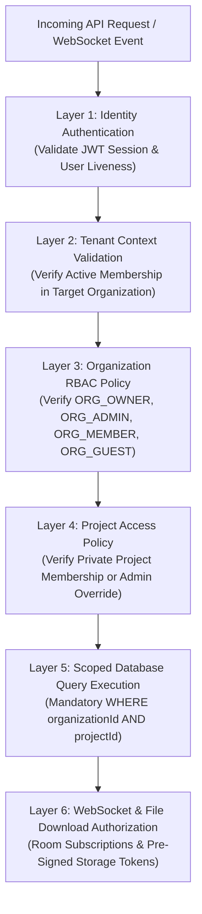
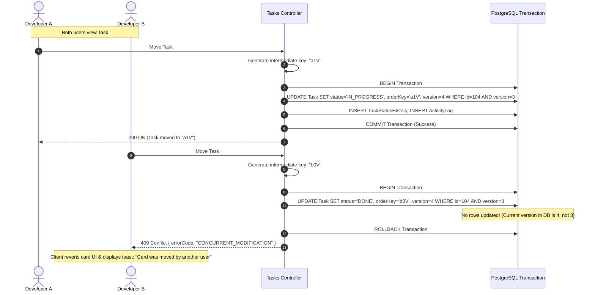
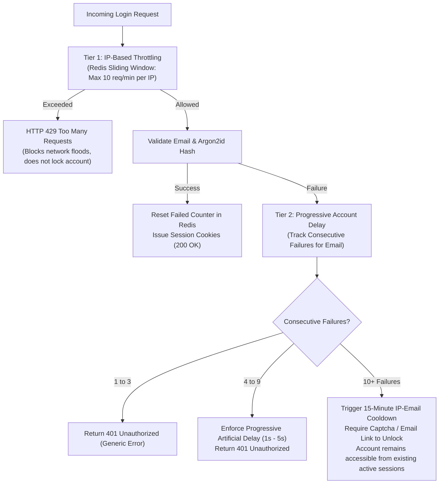
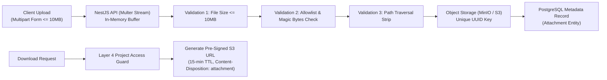
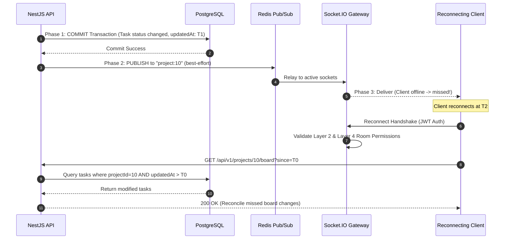

# TeamFlow — Software Requirements Specification (SRS)

**Document Version:** 1.2.0 (Architecturally Audited & Client-Approved)  
**Specification Standard:** Aligned with IEEE 830 / ISO/IEC/IEEE 29148  
**Client / Product Owner:** Client Specification (Version 1.0)  
**Lead Engineer & Architect:** Hamza Jemli  
**System Architecture:** Modular Monolith (Next.js + NestJS + PostgreSQL + Redis + Socket.IO)  
**Governing Framework:** [`AGENTS.md`](../../AGENTS.md)  
**Audit Report:** [`requirements-review-report.md`](./requirements-review-report.md)  
**Traceability Matrix:** [`traceability-matrix.md`](./traceability-matrix.md)

---

## 1. Introduction & Approved Architecture Directives

### 1.1 Purpose & Scope
This Software Requirements Specification (SRS) defines the authoritative technical and operational contract for the **TeamFlow** multi-tenant SaaS project management platform. 

This version (1.2.0) incorporates the **six formally approved architectural decisions (Q1–Q6)** and resolves all critical concurrency, rate-limiting, authorization, and event-reliability constraints.

### 1.2 Summary of Approved Architecture Decisions
1. **Q1 — Workspace Routing:** Path-based workspace routing (`/app/orgs/:slug/...` or `/app/...` with active organization context). The backend independently authenticates and validates membership for every request. Client-supplied IDs are never trusted as proof of access.
2. **Q2 — Project Visibility:** Private by default. Only explicitly assigned `ProjectMember`s can view or access project resources. `ORG_OWNER` and `ORG_ADMIN` retain administrative override access.
3. **Q3 — Kanban Card Ordering:** String-based fractional indexing using a deterministic variable-length base-62/base-95 key algorithm. Floating-point indices are discarded. Optimistic concurrency with `version` fields handles simultaneous moves.
4. **Q4 — Subtask Hierarchy:** Single-level checklist items (`ChecklistItem` / `Subtask`). No nested subtasks. Kept distinct from `TaskDependency`.
5. **Q5 — Guest Permissions:** Read-only access to assigned projects and tasks with commenting privileges. Guests cannot create/edit tasks, change statuses, or manage members. Guests can edit/delete their own comments; Project Managers can moderate/delete guest comments.
6. **Q6 — Notification Retention:** 90-day retention for both read and unread notifications, executed via a daily scheduled background job with retries. Audit logs are governed by an independent permanent retention policy.

---

## 2. Layered Multi-Tenant Authorization Architecture

Tenant isolation and resource authorization cannot rely on a single filter, interceptor, or client check. TeamFlow implements a **Six-Layer Defense-in-Depth Authorization Strategy**:



### Layered Defense Enforcement Matrix
1. **Layer 1 (Authentication):** Extracts and cryptographically verifies the short-lived access JWT from `HttpOnly` cookies. Validates that the backing `Session` record in database/Redis is active and has not been revoked.
2. **Layer 2 (Tenant Context Validation):** Resolves the target `organizationId` from the verified URL path or request context. Validates that the authenticated user holds an active, non-suspended `Membership` record for that specific organization.
3. **Layer 3 (Organization RBAC):** Evaluates organizational permissions (e.g. inviting members, modifying org settings, creating projects).
4. **Layer 4 (Project Scoping):** Because projects are private by default (Decision Q2), access to any project-scoped resource (tasks, boards, comments) requires verifying that the user is an explicit `ProjectMember` with an assigned role (`PROJECT_MANAGER`, `CONTRIBUTOR`, `VIEWER`), unless the user holds `ORG_OWNER` or `ORG_ADMIN` override privileges.
5. **Layer 5 (Database Scoping):** All data-access services and repositories enforce explicit tenant and project filters:
   ```typescript
   // Mandatory pattern across all queries
   where: {
     id: resourceId,
     projectId: validatedProjectId,
     organizationId: validatedActiveOrgId,
     deletedAt: null,
   }
   ```
   *Nested Prisma Operations & Raw SQL:* Nested writes (`create`, `update`, `connect`) must explicitly include foreign key checks. Raw SQL (`$queryRaw`) is prohibited unless parameterized with explicit tenant predicates.
   *Background Jobs & Scheduled Tasks:* Workers must run within an explicitly injected tenant security context; jobs cannot execute across tenants without partitioned batches.
6. **Layer 6 (WebSockets & File Downloads):** WebSocket connection handshakes verify authentication tokens; joining rooms (`org:<id>`, `project:<id>`) executes the identical Layer 2 and Layer 4 checks. File downloads require a signed token generated only after validating project membership.
7. **PostgreSQL Row-Level Security (RLS) Evaluation:** While PostgreSQL native RLS provides database-level enforcement (`USING (organization_id = current_setting('app.current_org_id'))`), it requires executing `SET LOCAL app.current_org_id` on every acquired database connection. Because Prisma uses a connection pool (and frequently runs behind PgBouncer in production where session-level settings can bleed across pooled connections unless wrapped in dedicated transactions), RLS is evaluated as an optional supplementary defense, not a replacement for programmatic Layer 5 scoping.

---

## 3. String-Based Fractional Indexing & Kanban Concurrency (Decision Q3)

### 3.1 Ordering Key Specification
Floating-point indices (`orderIndex: Float`) are discarded due to IEEE 754 precision exhaustion. TeamFlow implements **string-based fractional indexing** (utilizing the byte-lexicographical principles established by David Greenspan and utilized in Linear/Figma):

- **Key Representation:** Variable-length ASCII strings using base-62 characters (`0-9`, `A-Z`, `a-z`) or base-95 printable characters.
- **Midpoint Generation:** Given two adjacent cards with keys $K_1$ and $K_2$ where $K_1 < K_2$, the algorithm generates a lexicographically intermediate key $K_{\text{new}}$ such that $K_1 < K_{\text{new}} < K_2$.
  - Example: Between `"a0"` and `"a1"`, the generator produces `"a0V"`.
  - When inserting at the top: Given first card `"a0"`, generates `"Zz"`.
  - When inserting at the bottom: Given last card `"z9"`, generates `"za"`.
- **Arbitrary Precision:** Because string keys grow in length as intervals narrow, precision is theoretically unbounded and immune to numeric floating-point mantissa underflow.



### 3.2 Concurrency, Duplicate Keys & Tie-Breaking
1. **Fractional Indexing Does Not Eliminate Concurrency Conflicts:** Fractional indexing solves the mathematical key generation problem, but concurrent moves of the same card or multiple cards dropped into the same slot still require concurrency control.
2. **Optimistic Concurrency Control:** Every `Task` record contains an integer `version` field. Status and order updates execute with a conditional write:
   $$\text{UPDATE tasks SET status = :status, orderKey = :key, version = version + 1 WHERE id = :id AND version = :expectedVersion}$$
   If 0 rows are updated, the transaction rolls back, and the API returns HTTP 409 Conflict.
3. **Simultaneous Drops Between the Same Neighbors:** If two different tasks (Task X and Task Y) are dropped between the same neighbors concurrently, both may receive the identical generated key (e.g. `"a1V"`).
   - **Deterministic Tie-Breaking:** In all queries, sorting is defined as:
     $$\text{ORDER BY orderKey ASC, id ASC}$$
     If keys match, the immutable `UUID` ensures deterministic card ordering across all clients without visual jumping.
4. **Column Rebalancing (Key Regeneration):** Over thousands of moves, string keys can grow in length (e.g. exceeding 32 characters).
   - **Trigger:** A background rebalancing routine is triggered when any key length exceeds 64 characters.
   - **Execution:** A single atomic transaction re-spaces all tasks in that specific project column with clean, uniform 2-character keys: `"a0"`, `"a1"`, `"a2"`, ..., `"z9"`.
   - **Safety:** The rebalance transaction acquires a row-level lock on the project column (`FOR UPDATE`), preventing concurrent card drops during the milliseconds of re-indexing.
5. **Atomic Transaction Boundary:** Moving a task across columns executes the following operations in a **single ACID transaction**:
   - `UPDATE Task` (new status, new `orderKey`, increment `version`, update `updatedAt`).
   - `INSERT TaskStatusHistory` (captures `taskId`, `oldStatus`, `newStatus`, `changedById`, timestamp).
   - `INSERT ActivityLog` (captures `organizationId`, actor, action `'TASK_STATUS_CHANGED'`, metadata).

---

## 4. Authentication, Session Management & Anti-Lockout Rate Limiting

### 4.1 Anti-Lockout Rate-Limiting Policy (Resolving Denial-of-Service Risk)
Account lockout policies that lock an account after 5 failed password attempts create a critical Denial-of-Service (DoS) vulnerability: an attacker can intentionally lock out company executives simply by submitting 5 wrong passwords for their email addresses.

TeamFlow resolves this with a **Resilient Multi-Tier Rate-Limiting Policy**:



1. **Tier 1 (IP-Based Request Throttling):** Enforces a Redis sliding window limit of **10 requests per minute per IP address** across all public `/auth/*` endpoints. If exceeded, returns HTTP 429 Too Many Requests. This halts volumetric network flooding without penalizing specific accounts.
2. **Tier 2 (Progressive Account Cooldown, Not Hard Lockout):**
   - Failures 1–3: Standard generic error response: `"Invalid email or password"`.
   - Failures 4–9: The backend injects a progressive server-side artificial delay (1 second to 5 seconds) before returning HTTP 401. This completely ruins the throughput of automated brute-force scripts while allowing humans to retry.
   - Failures 10+: The specific `(IP + email)` pairing is placed on a 15-minute cooldown. The account is **never globally locked**: existing active sessions for that user continue functioning uninterrupted.
3. **Generic Error Responses:** All authentication failures return identical timing and message payloads (`"Invalid email or password"`) to eliminate account enumeration.
4. **Endpoint-Specific Throttling:**
   - `/auth/forgot-password`: Max 3 requests per hour per email address. The API **always returns HTTP 200 OK** regardless of whether the email exists, preventing enumeration.
   - `/auth/verify-email`: Max 5 verification attempts per hour per token.
5. **Distributed Storage:** All rate-limiting buckets and counters reside in **Redis**, ensuring consistent enforcement across multiple NestJS application instances.

---

## 5. File Upload & Storage Security Architecture (Decision D)

File uploads for Version 1.0 (MVP) are processed via an in-memory streaming pipeline through the NestJS backend with strict validation before transmission to MinIO/S3:



### Mandatory Storage Security Safeguards
1. **Explicit MIME & Extension Allowlist:** Only the following file types are permitted:
   - Images: `image/jpeg` (`.jpg`, `.jpeg`), `image/png` (`.png`), `image/webp` (`.webp`).
   - Documents: `application/pdf` (`.pdf`), `text/plain` (`.txt`).
   - Archives: `application/zip` (`.zip`).
   All other formats (including `.exe`, `.sh`, `.html`, `.svg`, `.php`) are strictly rejected.
2. **Binary Magic-Byte Inspection:** The server inspects the first 512 bytes of the file stream using `file-type` to detect the true binary signature. If the detected magic bytes do not match the declared client `Content-Type`, the upload is rejected immediately with HTTP 400 (`FILE_TYPE_MISMATCH`).
3. **Path Traversal Defense & Randomized Keys:** Client-provided filenames are completely discarded for storage keys. Files are stored under cryptographically randomized paths:
   $$\text{storageKey} = \text{"attachments/"} + \text{organizationId} + \text{"/"} + \text{UUIDv4}() + \text{"."} + \text{sanitizedExtension}$$
4. **Storage Isolation:** Files are stored strictly in private object storage buckets (MinIO locally, S3 in production). Files are never written to the public web server root or static asset directories.
5. **Secure Download Pipeline:** Direct access to storage buckets is forbidden. Downloads require calling `GET /api/v1/attachments/:id/download`:
   - The backend executes Layer 2 (Tenant) and Layer 4 (Project) checks.
   - Generates a pre-signed S3 URL with **15-minute expiration**.
   - Enforces safe download headers:
     `Content-Disposition: attachment; filename="sanitized-original-name.ext"`  
     `X-Content-Type-Options: nosniff`
6. **Failed Uploads & Orphan Cleanup:** Direct uploads execute atomically with database record creation. A daily scheduled cron worker queries S3 for objects created $>24\text{ hours}$ ago with no corresponding `Attachment` record in PostgreSQL, permanently pruning orphaned storage blobs.
7. **Concurrency & Memory Limits:** Multer is configured with `limits: { fileSize: 10 * 1024 * 1024, files: 1 }`. Max 3 simultaneous uploads per authenticated user session.
8. **Malware Scanning (Future Enhancement):** ClamAV antivirus container integration is formally cataloged as a Version 2.0 security enhancement.

---

## 6. Real-Time Event Reliability & Delivery Model (Decision E)

### 6.1 Database Commit vs. Event Publish vs. Client Delivery
In collaborative software, event reliability requires distinguishing three distinct operational phases:

| Phase | Responsibility | Failure Mode | System Behavior |
|---|---|---|---|
| **Phase 1: Database Commit** | PostgreSQL (ACID Transaction) | Disk full, constraint failure, concurrency conflict | Transaction rolls back; API returns error; zero events are published. |
| **Phase 2: Event Publish** | NestJS Service $\rightarrow$ Redis Pub/Sub | Redis broker network partition / crash | Database remains committed; warning logged; event emission fails. |
| **Phase 3: Client Delivery** | Socket.IO Gateway $\rightarrow$ Connected Browsers | Client WiFi drops, mobile backgrounding | Event delivered to online clients; disconnected client misses event. |



### 6.2 MVP Event Strategy vs. Transactional Outbox Pattern
- **MVP (Version 1.0) Reliability Strategy:** Post-commit best-effort event publishing via Redis Pub/Sub combined with **Client-Side Reconnect Reconciliation**:
  - The API emits WebSocket events only *after* the PostgreSQL transaction commits successfully (`$transaction().then(() => emit())`).
  - To handle missed events during disconnections, when a Socket.IO client reconnects or regains browser focus, it triggers a lightweight reconciliation query:
    $$\text{GET /api/v1/projects/:id/board?since=<lastKnownTimestamp>}$$
  - Stale DOM nodes are refreshed to match authoritative server truth.
- **Transactional Outbox Pattern (Cataloged for Version 1.2):** For guaranteed at-least-once event delivery, an `OutboxEvent` table will be introduced to PostgreSQL. Events are written inside the business transaction, and an asynchronous de-queuer reads the outbox table and publishes to Redis. This is formally cataloged for release v1.2 to avoid premature queue infrastructure in the MVP.

### 6.3 WebSocket Connection & Room Security
1. **Authentication Handshake:** Socket.IO connections must pass a valid JWT in the connection `auth.token` or cookie. Unauthenticated connections are rejected immediately (`disconnect(true)`).
2. **Room Authorization:** Joining an organization room (`org:<id>`) or project room (`project:<id>`) requires the gateway to execute Layer 2 and Layer 4 checks.
3. **Mid-Session Revocation:** If an administrator revokes a user's membership or removes them from a project, the backend service emits an internal revocation signal. The WebSocket gateway immediately removes the user's sockets from all associated project rooms and issues `socket.disconnect(true)`.
4. **Idempotency & Duplicate Handling:** Every WebSocket event payload carries an immutable `eventId: UUID`. Clients maintain a sliding window of the last 100 received event IDs to discard duplicate messages.

---

## 7. Codified Dashboard & Analytics Mathematical Formulas (Decision F)

To prevent implementation ambiguity, all metrics for `FR-066` and `FR-067` are codified with exact mathematical definitions, boundary conditions, and timezone constraints:

### 7.1 Organization Dashboard Metrics (FR-066)
1. **Total Projects:**
   $$\text{Total Projects} = \text{COUNT}(\text{projects}) \quad \text{where } organizationId = :orgId \text{ AND } deletedAt \text{ IS NULL}$$
2. **Active Projects:**
   $$\text{Active Projects} = \text{COUNT}(\text{projects}) \quad \text{where } organizationId = :orgId \text{ AND } status = \text{'ACTIVE'} \text{ AND } deletedAt \text{ IS NULL}$$
3. **Completed Projects:**
   $$\text{Completed Projects} = \text{COUNT}(\text{projects}) \quad \text{where } organizationId = :orgId \text{ AND } status = \text{'COMPLETED'} \text{ AND } deletedAt \text{ IS NULL}$$
4. **Task Completion Rate (%):**
   $$\text{Completion Rate} = \begin{cases} 
   0.0\%, & \text{if } \text{Eligible Tasks} = 0 \\
   \left( \frac{\text{COUNT}(\text{tasks where } status = \text{'DONE'})}{\text{COUNT}(\text{tasks where } status \neq \text{'CANCELLED'})} \right) \times 100, & \text{otherwise}
   \end{cases}$$
   *Rule:* Soft-deleted tasks (`deletedAt IS NOT NULL`) are strictly excluded. `CANCELLED` tasks are excluded from both numerator and denominator so teams are not penalized for deprecated features. If denominator is 0, the metric returns `0.0%` (not `NaN` or division-by-zero error).
5. **Overdue Tasks Count:**
   $$\text{Overdue Tasks} = \text{COUNT}(\text{tasks}) \quad \text{where } organizationId = :orgId \text{ AND } dueDate < \text{NOW}() \text{ AND } status \notin (\text{'DONE'}, \text{'CANCELLED'}) \text{ AND } deletedAt \text{ IS NULL}$$
   *Timezone Rule:* Date comparisons execute strictly in **UTC** at the database level (`NOW() AT TIME ZONE 'UTC'`).

### 7.2 Project Dashboard Metrics (FR-067)
1. **Project Progress (%):** Uses the identical formula as Completion Rate, scoped strictly to the target `projectId`.
2. **Task Distribution by Status:** Returns integer counts grouped by status enum: `BACKLOG`, `TODO`, `IN_PROGRESS`, `IN_REVIEW`, `DONE`, `CANCELLED` (where `deletedAt IS NULL`).
3. **Tasks by Priority:** Returns integer counts grouped by priority enum: `LOW`, `MEDIUM`, `HIGH`, `URGENT` (where `deletedAt IS NULL`).

---

## 8. Notification & Audit Log Retention Policies (Decision Q6)

| Policy Dimension | In-App Notifications (`Notification` entity) | Security Audit Logs (`ActivityLog` entity) |
|---|---|---|
| **Retention Window** | **90 calendar days** from creation date. | **Permanent** (minimum 365 days; immutable). |
| **Read vs. Unread** | Both read and unread notifications follow the identical 90-day retention rule. | N/A (append-only log). |
| **Purge Mechanism** | Scheduled daily cron job (03:00 UTC) executing batch hard-deletion:  <br>`DELETE FROM notifications WHERE createdAt < NOW() - INTERVAL '90 days'` | Retention policy does NOT apply. Audit logs are never deleted or truncated by notification jobs. |
| **Retry & Failure Handling** | If the scheduled purge fails, the worker logs an alert, tracks the error, and retries automatically on the next scheduled run. Batch chunking (5000 rows per transaction) prevents database lock contention. | Append-only. Modifying or deleting audit logs is strictly prohibited. |

---

## 9. Scope & Release Planning (MVP vs. Later Releases)

The complete product vision is preserved, with clear milestone boundaries separating Release 1.0 (MVP) from subsequent releases:

```mermaid
gantt
    title TeamFlow Phased Release Scope
    dateFormat  YYYY-MM-DD
    section Release 1.0 (MVP Core)
    Auth, Sessions & Two-Tier RBAC :done, r1_1, 2026-11-01, 3d
    Private Projects & Scoping :active, r1_2, after r1_1, 3d
    Tasks & String Fractional Kanban :r1_3, after r1_2, 4d
    Single-Level Checklists & DAG Dependencies :r1_4, after r1_3, 3d
    Basic Comments & Immutable Audit Trail :r1_5, after r1_4, 3d
    section Release 1.1 (Enhancements)
    Attachments & S3 Storage Pipeline :r2_1, after r1_5, 3d
    In-App Notification Center :r2_2, after r2_1, 3d
    Dashboard Analytics & Redis Caching :r2_3, after r2_2, 3d
    section Release 1.2 (Hardening)
    Transactional Outbox Pattern for WebSockets :r3_1, after r2_3, 3d
    Advanced Session Inspection & Revocation :r3_2, after r3_1, 2d
    section Release 2.0+ (Enterprise)
    Stripe Subscriptions & ClamAV Antivirus :r4_1, after r3_2, 5d
    Gantt Charts & Native Mobile Apps :r4_2, after r4_1, 5d
```

### Scope Allocation Summary
- **Release 1.0 (MVP Core):**
  - Authentication, password hashing (Argon2id), session management.
  - Organization creation, member invitations, and Two-Tier RBAC.
  - Private projects by default and explicit project membership.
  - Task CRUD, priorities, statuses, and single-level checklists.
  - Interactive Kanban board with string-based fractional indexing (`orderKey`) and optimistic concurrency (`version`).
  - Task dependency cycle detection ($A \rightarrow B \rightarrow A$ rejection).
  - Basic task comments and immutable activity audit logs.
- **Release 1.1 (Collaboration & Files):**
  - S3/MinIO attachment pipeline with in-memory magic-byte validation and secure pre-signed downloads.
  - In-app notification center dropdown with 90-day retention purge.
  - Organization and project analytics dashboards with Redis cache invalidation.
- **Release 1.2 (Reliability & Hardening):**
  - Transactional Outbox Pattern for guaranteed real-time event publishing.
  - Advanced session inspection UI with remote device revocation.
  - Automatic column rebalancing trigger when key length exceeds 64 chars.
- **Release 2.0+ (Enterprise & Commercial):**
  - Stripe recurring subscriptions and seat billing.
  - ClamAV antivirus scanning daemon for uploads.
  - Interactive Gantt charts and critical path scheduling.
  - Enterprise SAML / SSO / SCIM provisioning.
