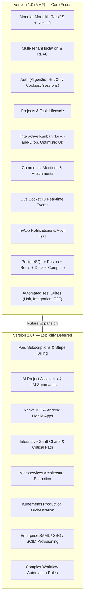

# TeamFlow — Project Scope, Milestones & Roadmap

This document defines the formal boundaries of **Version 1.0 (MVP)**, explicitly identifies features deferred to future releases, and outlines the engineering milestones and Definition of Done.

---

## 1. Scope Boundary: Version 1.0 (MVP) vs. Version 2.0+

To prevent scope creep and guarantee high software quality, TeamFlow enforces strict scope control. Version 1.0 focuses on building a rock-solid, production-grade modular monolith.



### 1.1 Detailed Scope Comparison Table

| Domain | In Version 1.0 (MVP) | Deferred to Version 2.0+ (Out of Scope) | Rationale for v1 Boundary |
|---|---|---|---|
| **Architecture** | Clean Modular Monolith in NestJS with strict module boundaries. | Distributed Microservices architecture. | Monolith eliminates distributed transaction failures, network latency, and premature complexity. |
| **Multi-Tenancy** | Logical tenant isolation with shared database, row-level `organizationId` scoping, and tenant guards. | Separate database-per-tenant or schema-per-tenant. | Row-level scoping provides the ideal balance of performance, migration simplicity, and resource efficiency. |
| **Billing & Payments** | Free organization tier; member counts tracked without hard billing limits. | Stripe integration, recurring credit card subscriptions, invoicing, tax calculation. | Payment gateways introduce heavy third-party webhook logic unrelated to core project collaboration. |
| **AI Capabilities** | None in application runtime (AI coding assistant used only during development). | In-app generative AI task generation, automated sprint summaries, smart scheduling. | Focus must remain on rock-solid fundamentals, data modeling, and deterministic real-time state. |
| **Project Scheduling** | Start/end dates, task due dates, status columns, list and Kanban views. | Dynamic Gantt charts, resource leveling, CPM (Critical Path Method) calculators. | Interactive Gantt charts require massive SVG layout engines and complex constraint solvers. |
| **Authentication** | Email/password, Argon2id, email verification, password reset, session management. | Enterprise Single Sign-On (SAML 2.0, Okta, Azure AD), Social OAuth (Google, GitHub). | First master custom, highly secure stateful session management before adding OAuth wrappers. |
| **Mobile Platforms** | Mobile-responsive Next.js web application (320px+). | Native Swift / Kotlin or React Native applications. | Responsive web UI reaches 100% of devices immediately with a single codebase. |
| **Infrastructure** | Docker, Docker Compose, Nginx reverse proxy, GitHub Actions CI/CD. | Kubernetes (K8s), Helm charts, multi-region database clustering. | Docker Compose handles local and VPS production needs with minimal DevOps overhead. |

---

## 2. Project Delivery Milestones (M1 to M8)

The project is structured into 8 sequential milestones as defined in the Client Delivery Specification:

```mermaid
gantt
    title TeamFlow Engineering Delivery Milestones
    dateFormat  YYYY-MM-DD
    section Specifications & Architecture
    M1: Requirements & Architecture (SRS, ADRs, Diagrams) :done, m1, 2026-11-01, 2d
    section Backend & Database Foundation
    M2: Database Modeling & Backend Scaffold (Prisma, NestJS) :active, m2, after m1, 3d
    M3: Authentication & Multi-Tenant Engine :m3, after m2, 3d
    section Core Application Features
    M4: Project & Task Management :m4, after m3, 4d
    M5: Collaboration & Real-Time Kanban :m5, after m4, 4d
    M6: Analytics Dashboard & Notifications :m6, after m5, 3d
    section Quality & Production
    M7: Production Engineering (Docker, CI/CD, Tests) :m7, after m6, 3d
    M8: Deployment, Live Demo & Handover :m8, after m7, 2d
```

| Milestone | Deliverables | Client Acceptance Criteria |
|---|---|---|
| **M1: Requirements & Architecture** | • Complete SRS (`docs/00-project-overview/`)<br>• System Architecture Diagrams<br>• ADRs for foundational technical decisions | Client reviews and formally approves all specifications, open question resolutions, and architectural diagrams. |
| **M2: Database & Backend Foundation** | • PostgreSQL Schema & Prisma Migrations<br>• ER Diagram and entity relationship docs<br>• NestJS Modular Monolith scaffold with Swagger | Database tables created with all constraints, composite indexes, foreign keys, and seed scripts. |
| **M3: Authentication & Organizations** | • Argon2id hashing & session management<br>• Email verification & password reset flows<br>• Organization creation, switching, and member invites<br>• Strict tenant isolation guards | Automated integration tests verify that cross-tenant access is rejected with 403 Forbidden. Auth cookies set securely. |
| **M4: Projects & Task Management** | • Project CRUD and member scoping<br>• Task CRUD, priorities, statuses, and assignees<br>• Dependency cycle detection algorithm<br>• Task status audit history | Verification that tasks cannot be assigned to non-project members; cycle detection prevents $A \rightarrow B \rightarrow A$. |
| **M5: Collaboration & Real-Time Kanban** | • Interactive drag-and-drop Kanban board<br>• Optimistic UI updates with rollback<br>• Socket.IO WebSocket gateway with Redis adapter<br>• Comments with @mentions and file attachments | Dragging a card updates state immediately, persists to DB, and broadcasts live to other connected browsers without refresh. |
| **M6: Dashboard & Notifications** | • Organization & Project analytics dashboards<br>• In-app notification center dropdown<br>• Redis caching for computed analytics metrics | Dashboard statistics accurately reflect live database queries. Notifications trigger in real time on mentions/assignments. |
| **M7: Production Engineering** | • Multi-stage Dockerfiles (frontend, backend)<br>• Docker Compose local environment<br>• Nginx reverse proxy configuration<br>• GitHub Actions CI/CD pipeline<br>• Jest unit/integration tests & Playwright E2E tests | 100% of CI checks pass: linting, strict TypeScript check, unit tests (>=80% coverage), integration tests, E2E user flows. |
| **M8: Deployment & Handover** | • Production VPS deployment with HTTPS<br>• Complete documentation tree (`docs/00` to `docs/09`)<br>• Educational learning notes & interview prep<br>• Live portfolio demo & GitHub repository | Application runs live in production. Developer demonstrates ability to explain every architectural component. |

---

## 3. Formal Definition of Done (DoD)

A feature or milestone is considered **DONE** and ready for client sign-off only when all seven conditions are fulfilled:

1. **Requirements Satisfied:** All functional requirements associated with the feature are fully implemented.
2. **Business Rules & Invariants Enforced:** Invariants (e.g., sole owner, tenant isolation, assignee scoping) are validated at both service and database layers.
3. **Security & Authorization Verified:** Backend guards prevent unauthorized or cross-tenant data access; security implications are reviewed.
4. **Automated Tests Passing:** Unit, integration, and E2E tests are written and pass cleanly in the CI pipeline without warnings.
5. **Strict Type Safety Maintained:** TypeScript compiles under `strict: true` with zero `any` shortcuts.
6. **Documentation Updated:** Technical documentation, API schemas, and Mermaid diagrams are synchronized with the codebase.
7. **Educational Explanation Delivered:** The developer receives a comprehensive explanation of how the code works, why the architecture was chosen, and how to defend it in a technical interview.

