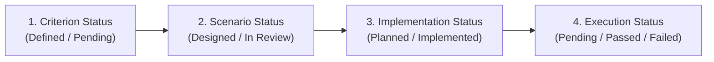

# TeamFlow — Requirements Traceability Matrix (RTM)

**Specification Version:** 1.2.0 (Audited & Client-Approved)  
**Status:** Approved Architectural Baseline  
**Governing Standard:** IEEE 830 / ISO/IEC/IEEE 29148  
**Purpose:** Provides bi-directional traceability connecting the Original Client Specification, SRS Requirement IDs (`FR-xxx`, `NFR-xxx`), User Journeys, Formal Acceptance Criteria, Test Scenarios, and Implementation / Execution Verification States.

---

## 1. Traceability & Verification Lifecycle Definitions

In accordance with rigorous software engineering discipline, this matrix strictly distinguishes between designed criteria and actual test execution:

| Lifecycle Dimension | Allowed Values in this Matrix | Current Phase Meaning |
|---|---|---|
| **Criterion Status** | `Defined` \| `Draft` | Formal Given-When-Then acceptance condition is documented and approved. |
| **Scenario Status** | `Designed` \| `Pending` | Concrete test procedure, fixtures, and assertions have been architected. |
| **Implementation Status** | `Planned (Not Implemented)` \| `Implemented` | Source code for automated test exists in repository. *Current Status: All tests are Planned (Implementation has not started).* |
| **Execution Status** | `Pending (Not Executed)` \| `Passed` \| `Failed` | Test has executed in CI/CD pipeline and result recorded. *Current Status: Pending execution.* |

---

## 2. Comprehensive Traceability Matrix

### Module A — Authentication and Account Management

| Client Brief Section | SRS ID | Related Journey | Acceptance Criteria (Given-When-Then) | Target Test Scenario & File | Criterion Status | Scenario Status | Implementation Status | Execution Status |
|---|---|---|---|---|:---:|:---:|:---:|:---:|
| Module A (Registration) | **FR-001** | UJ-1 | **Given** valid registration details, **when** `POST /api/v1/auth/register` called, **then** user is created with `isEmailVerified: false` and Argon2id hash. | `auth.service.spec.ts` (Unit): Test password hashing & email uniqueness. | `Defined` | `Designed` | `Planned (Not Implemented)` | `Pending (Not Executed)` |
| Module A (Verification) | **FR-002** | UJ-1 | **Given** an unexpired token, **when** calling `/auth/verify-email`, **then** `isEmailVerified` is set to `true` and token is invalidated. | `auth.e2e-spec.ts` (E2E): Complete verification token link flow. | `Defined` | `Designed` | `Planned (Not Implemented)` | `Pending (Not Executed)` |
| Module A (Login & Tokens) | **FR-003** | UJ-1 | **Given** valid credentials, **when** logging in, **then** issue `HttpOnly`, `SameSite=Strict`, `Secure` cookies with access & rotated refresh tokens. | `auth.guard.spec.ts` (Integration): Assert tokens set exclusively in secure cookies. | `Defined` | `Designed` | `Planned (Not Implemented)` | `Pending (Not Executed)` |
| Module A (Logout) | **FR-004** | Session | **Given** an authenticated session, **when** calling `/auth/logout`, **then** clear auth cookies, delete session record, and close WebSockets. | `session.service.spec.ts` (Unit): Assert session deletion & cookie clearing. | `Defined` | `Designed` | `Planned (Not Implemented)` | `Pending (Not Executed)` |
| Module A (Token Rotation) | **FR-005** | Refresh | **Given** a valid refresh token cookie, **when** calling `/auth/refresh`, **then** issue a new 15m access token and single-use rotated refresh token. | `token.service.spec.ts` (Integration): Test refresh token rotation & reuse detection. | `Defined` | `Designed` | `Planned (Not Implemented)` | `Pending (Not Executed)` |
| Module A (Password Reset) | **FR-006** **FR-007** | Recovery | **Given** an account email, **when** reset requested, **then** send single-use 1h token; upon reset, update password hash and revoke all sessions. | `auth.e2e-spec.ts` (E2E): Request reset, submit new password, assert old session invalidated. | `Defined` | `Designed` | `Planned (Not Implemented)` | `Pending (Not Executed)` |
| Module A (Password Change) | **FR-008** | Profile | **Given** an authenticated user, **when** changing password with correct current password, **then** update hash and revoke other active sessions. | `auth.service.spec.ts` (Unit): Verify current password check & session revocation. | `Defined` | `Designed` | `Planned (Not Implemented)` | `Pending (Not Executed)` |
| Module A (Profile & Avatar) | **FR-009** **FR-010** | Profile | **Given** valid profile data and image <= 2MB, **when** uploaded, **then** validate magic bytes, resize, upload to S3, and update user record. | `profile.service.spec.ts` (Integration): Upload PNG and assert S3 key generation. | `Defined` | `Designed` | `Planned (Not Implemented)` | `Pending (Not Executed)` |
| Module A (Active Sessions) | **FR-011** **FR-012** | Security | **Given** multiple active devices, **when** user revokes a session ID, **then** delete target session; subsequent requests with that token return 401. | `session.e2e-spec.ts` (E2E): Multi-device login, revoke Device B, assert Device B returns 401. | `Defined` | `Designed` | `Planned (Not Implemented)` | `Pending (Not Executed)` |
| Module A (Anti-Lockout Rate Limit) | **FR-013** **NFR-005** | Public Auth | **Given** repeated failed logins on an email, **when** failures exceed 3, **then** inject progressive server delays (1s–5s); do not lock account globally. | `rate-limiter.guard.spec.ts` (Integration): Test IP rate throttle & progressive delay. | `Defined` | `Designed` | `Planned (Not Implemented)` | `Pending (Not Executed)` |

---

### Module B — Organization and Multi-Tenancy

| Client Brief Section | SRS ID | Related Journey | Acceptance Criteria (Given-When-Then) | Target Test Scenario & File | Criterion Status | Scenario Status | Implementation Status | Execution Status |
|---|---|---|---|---|:---:|:---:|:---:|:---:|
| Module B (Org Creation) | **FR-014** | UJ-1 | **Given** an authenticated user, **when** creating an organization, **then** create `Organization` and insert `Membership` with role `ORG_OWNER`. | `organizations.service.spec.ts` (Unit): Test atomic creation of Org + Owner Membership. | `Defined` | `Designed` | `Planned (Not Implemented)` | `Pending (Not Executed)` |
| Module B (Org Metadata) | **FR-015** | Settings | **Given** an `ORG_OWNER` or `ORG_ADMIN`, **when** updating name/logo, **then** update record and broadcast update to org members. | `organizations.controller.spec.ts` (Integration): Verify only Owner/Admin can update. | `Defined` | `Designed` | `Planned (Not Implemented)` | `Pending (Not Executed)` |
| Module B (Path Context Switch) | **FR-016** | Routing | **Given** a user with multiple orgs, **when** requesting path `/app/orgs/:slug/...`, **then** validate active membership; reject invalid slugs. | `tenant.middleware.spec.ts` (Integration): Assert path-based tenant validation. | `Defined` | `Designed` | `Planned (Not Implemented)` | `Pending (Not Executed)` |
| Module B (Invitations) | **FR-017** **FR-018** | UJ-2 | **Given** an `ORG_ADMIN`, **when** inviting email with role, **then** generate 7-day token, send email, and track status `PENDING`. | `invitations.service.spec.ts` (Unit): Test invitation creation & 7-day expiration math. | `Defined` | `Designed` | `Planned (Not Implemented)` | `Pending (Not Executed)` |
| Module B (Invite Acceptance) | **FR-019** | UJ-2 | **Given** an invitation token and matching authenticated user email, **when** accepted, **then** create `Membership` and set status `ACCEPTED`. | `invitations.e2e-spec.ts` (E2E): Invite employee, accept invite, assert dashboard access. | `Defined` | `Designed` | `Planned (Not Implemented)` | `Pending (Not Executed)` |
| Module B (Invite Decline) | **FR-020** | UJ-2 | **Given** an invitation token, **when** invitee clicks decline, **then** update status to `DECLINED`; invite cannot subsequently be accepted. | `invitations.service.spec.ts` (Unit): Test transition to `DECLINED` & rejection of reuse. | `Defined` | `Designed` | `Planned (Not Implemented)` | `Pending (Not Executed)` |
| Module B (Role Modify) | **FR-021** | Directory | **Given** an `ORG_OWNER`, **when** changing a member's role, **then** update `Membership.role`; non-owners cannot demote an Owner. | `memberships.service.spec.ts` (Unit): Test permission checks for role promotion/demotion. | `Defined` | `Designed` | `Planned (Not Implemented)` | `Pending (Not Executed)` |
| Module B (Member Remove) | **FR-022** | Directory | **Given** an authorized admin, **when** removing a member, **then** remove `Membership`, unassign from tasks/projects, and disconnect WebSockets. | `memberships.service.spec.ts` (Integration): Cascade removal from projects and active tasks. | `Defined` | `Designed` | `Planned (Not Implemented)` | `Pending (Not Executed)` |
| Module B (Sole Owner Rule) | **FR-023** | Directory | **Given** an organization with one Owner, **when** attempting to remove or demote that Owner, **then** reject with 400 `LAST_OWNER_CANNOT_BE_REMOVED`. | `memberships.service.spec.ts` (Unit): Assert error when removing final remaining owner. | `Defined` | `Designed` | `Planned (Not Implemented)` | `Pending (Not Executed)` |
| Module B (Layered Auth) | **FR-024** **NFR-001** | All Reqs | **Given** a user in Org 1, **when** querying resources belonging to Org 2, **then** `TenantGuard` rejects request with HTTP 403 Forbidden. | `tenant-isolation.e2e-spec.ts` (E2E): Comprehensive cross-tenant data exfiltration test. | `Defined` | `Designed` | `Planned (Not Implemented)` | `Pending (Not Executed)` |

---

### Module C — Project Management (Private by Default)

| Client Brief Section | SRS ID | Related Journey | Acceptance Criteria (Given-When-Then) | Target Test Scenario & File | Criterion Status | Scenario Status | Implementation Status | Execution Status |
|---|---|---|---|---|:---:|:---:|:---:|:---:|
| Module C (Project Create) | **FR-025** | UJ-3 | **Given** an authorized member, **when** creating a project, **then** create `Project` (`isPrivate=true`) and automatically add creator as `PROJECT_MANAGER`. | `projects.service.spec.ts` (Unit): Test project creation & automatic PM assignment. | `Defined` | `Designed` | `Planned (Not Implemented)` | `Pending (Not Executed)` |
| Module C (Project Detail) | **FR-026** | Project | **Given** a project member (or Org Admin), **when** requesting project details, **then** return project metadata; reject non-members with 403. | `projects.controller.spec.ts` (Integration): Verify project access scoping. | `Defined` | `Designed` | `Planned (Not Implemented)` | `Pending (Not Executed)` |
| Module C (Project Update) | **FR-027** | Settings | **Given** an assigned `PROJECT_MANAGER`, **when** updating metadata, **then** persist changes and emit `project.updated` WebSocket event. | `projects.service.spec.ts` (Unit): Verify PM authorization for project updates. | `Defined` | `Designed` | `Planned (Not Implemented)` | `Pending (Not Executed)` |
| Module C (Status Lifecycle) | **FR-028** | Lifecycle | **Given** valid status transition (`PLANNING` $\rightarrow$ `ACTIVE`), **when** executed, **then** update status, record audit log, and broadcast event. | `projects.service.spec.ts` (Unit): Test valid/invalid project status transitions. | `Defined` | `Designed` | `Planned (Not Implemented)` | `Pending (Not Executed)` |
| Module C (Project Archive) | **FR-029** | Settings | **Given** an active project, **when** archived, **then** mark status `ARCHIVED`; all tasks within project become read-only. | `projects.service.spec.ts` (Integration): Assert task mutations rejected on archived project. | `Defined` | `Designed` | `Planned (Not Implemented)` | `Pending (Not Executed)` |
| Module C (Soft Deletion) | **FR-030** | Settings | **Given** an `ORG_ADMIN`, **when** deleting project, **then** set `deletedAt = NOW()`; preserve data for 30 days and cascade soft-delete to tasks. | `projects.service.spec.ts` (Integration): Verify soft-deletion cascade to tasks. | `Defined` | `Designed` | `Planned (Not Implemented)` | `Pending (Not Executed)` |
| Module C (Member Assign) | **FR-031** | UJ-3 | **Given** an organization member, **when** added to project, **then** create `ProjectMember` record with role `CONTRIBUTOR` or `VIEWER`. | `project-members.service.spec.ts` (Unit): Verify member must belong to parent organization. | `Defined` | `Designed` | `Planned (Not Implemented)` | `Pending (Not Executed)` |
| Module C (Member Removal) | **FR-032** | UJ-3 | **Given** an assigned member, **when** removed from project, **then** remove `ProjectMember` and unassign from incomplete project tasks. | `project-members.service.spec.ts` (Integration): Assert unassignment from project tasks. | `Defined` | `Designed` | `Planned (Not Implemented)` | `Pending (Not Executed)` |
| Module C (Manager Assign) | **FR-033** | Settings | **Given** an assigned member, **when** designated as Project Manager, **then** update project role to `PROJECT_MANAGER`. | `project-members.service.spec.ts` (Unit): Assert role elevation within project. | `Defined` | `Designed` | `Planned (Not Implemented)` | `Pending (Not Executed)` |
| Module C (List & Filter) | **FR-034** | Listing | **Given** an authenticated user, **when** listing projects, **then** return only projects where user is member (unless Org Owner/Admin). | `projects.service.spec.ts` (Integration): Test private project visibility isolation. | `Defined` | `Designed` | `Planned (Not Implemented)` | `Pending (Not Executed)` |

---

### Module D & E — Task Management & Kanban Board (String Fractional Indexing)

| Client Brief Section | SRS ID | Related Journey | Acceptance Criteria (Given-When-Then) | Target Test Scenario & File | Criterion Status | Scenario Status | Implementation Status | Execution Status |
|---|---|---|---|---|:---:|:---:|:---:|:---:|
| Module D (Task Creation) | **FR-035** | UJ-4 | **Given** valid task input, **when** creating task, **then** assign default status `TODO`, generate initial string `orderKey`, and save to DB. | `tasks.service.spec.ts` (Unit): Validate task creation & string key generation. | `Defined` | `Designed` | `Planned (Not Implemented)` | `Pending (Not Executed)` |
| Module D (Task Retrieval) | **FR-036** | Task Modal | **Given** a task ID, **when** retrieved by authorized project member, **then** return task data, subtasks, assignees, dynamic `isBlocked` flag. | `tasks.controller.spec.ts` (Integration): Test task detail retrieval & Layer 4 access check. | `Defined` | `Designed` | `Planned (Not Implemented)` | `Pending (Not Executed)` |
| Module D (Status Transition) | **FR-038** **FR-039** | UJ-4 | **Given** a valid status change, **when** executed, **then** atomically update status, record `TaskStatusHistory`, and emit event. | `tasks.service.spec.ts` (Integration): Verify atomic status update + history log in transaction. | `Defined` | `Designed` | `Planned (Not Implemented)` | `Pending (Not Executed)` |
| Module D (Assignee Scoping) | **FR-040** **FR-041** | Task Details | **Given** a user not in the parent project, **when** assigned to task, **then** reject with HTTP 400 `ASSIGNEE_NOT_IN_PROJECT`. | `tasks.service.spec.ts` (Unit): Assert rejection of non-project members. | `Defined` | `Designed` | `Planned (Not Implemented)` | `Pending (Not Executed)` |
| Module D (Single Checklists) | **FR-043** | Task Details | **Given** a task, **when** single-level checklist item created/toggled, **then** update item; prevent nested checklist creation. | `subtasks.service.spec.ts` (Unit): Test single-level checklist toggle & ratio calculation. | `Defined` | `Designed` | `Planned (Not Implemented)` | `Pending (Not Executed)` |
| Module D (Dependencies) | **FR-044** **FR-045** | Task Details | **Given** a circular dependency ($A \rightarrow B \rightarrow A$), **when** proposed, **then** cycle detection algorithm rejects with 400 `CIRCULAR_DEPENDENCY_DETECTED`. | `dependencies.service.spec.ts` (Unit): Test DFS cycle detection on complex DAGs. | `Defined` | `Designed` | `Planned (Not Implemented)` | `Pending (Not Executed)` |
| Module E (Kanban View) | **FR-047** | UJ-4 | **Given** a project ID, **when** loading board, **then** return tasks grouped into 6 columns, ordered by `orderKey ASC, id ASC`. | `kanban.service.spec.ts` (Integration): Test column grouping & string key sorting. | `Defined` | `Designed` | `Planned (Not Implemented)` | `Pending (Not Executed)` |
| Module E (Drag-and-Drop) | **FR-048** **FR-049** | UJ-4 | **Given** a card dropped between keys $K_1$ and $K_2$, **when** moving, **then** generate intermediate string key $K_{\text{new}}$ and update status. | `fractional-index.spec.ts` (Unit): Test string midpoint generation between arbitrary keys. | `Defined` | `Designed` | `Planned (Not Implemented)` | `Pending (Not Executed)` |
| Module E (Key Rebalance) | **FR-050B** | UJ-4 | **Given** any task key exceeding 64 chars in length, **when** dropped, **then** trigger atomic column rebalance (`a0`, `a1`...). | `kanban.service.spec.ts` (Integration): Test key length threshold & atomic column re-indexing. | `Defined` | `Designed` | `Planned (Not Implemented)` | `Pending (Not Executed)` |
| Module E (Optimistic Concurrency) | **FR-051** **FR-052** | UJ-4 | **Given** task version mismatch during move, **when** conditional update fails, **then** rollback transaction, return 409, and client reverts UI. | `kanban.e2e-spec.ts` (E2E): Simulate simultaneous moves; assert 409 and UI rollback. | `Defined` | `Designed` | `Planned (Not Implemented)` | `Pending (Not Executed)` |

---

### Module F to L — Collaboration, Analytics, Files & Settings

| Client Brief Section | SRS ID | Related Journey | Acceptance Criteria (Given-When-Then) | Target Test Scenario & File | Criterion Status | Scenario Status | Implementation Status | Execution Status |
|---|---|---|---|---|:---:|:---:|:---:|:---:|
| Module F (Comments & Guests) | **FR-054** **FR-056** | UJ-5 | **Given** a `VIEWER` (Guest), **when** commenting, **then** allow post and self-edit/delete; allow `PROJECT_MANAGER` moderation deletion. | `comments.service.spec.ts` (Unit): Test guest comment creation & PM moderation deletion. | `Defined` | `Designed` | `Planned (Not Implemented)` | `Pending (Not Executed)` |
| Module F (Mentions) | **FR-057** **FR-058** | UJ-5 | **Given** `@username` in comment, **when** posted, **then** verify mentioned user is in project, create notification, and push live alert. | `comments.service.spec.ts` (Integration): Test mention extraction & notification dispatch. | `Defined` | `Designed` | `Planned (Not Implemented)` | `Pending (Not Executed)` |
| Module G (90-Day Retention) | **FR-059** **FR-061** | Notifications | **Given** notifications $>90$ days old, **when** daily cron executes, **then** permanently delete records; do not purge audit logs. | `notifications-purge.spec.ts` (Integration): Test scheduled 90-day hard-delete worker. | `Defined` | `Designed` | `Planned (Not Implemented)` | `Pending (Not Executed)` |
| Module G (Mark as Read) | **FR-063** **FR-064** | Dropdown | **Given** unread notifications, **when** marked read individually or bulk, **then** update `isRead: true` and decrement badge counter. | `notifications.controller.spec.ts` (Unit): Test single and bulk mark-as-read. | `Defined` | `Designed` | `Planned (Not Implemented)` | `Pending (Not Executed)` |
| Module H (Exact Formulas) | **FR-066** **FR-067** | Dashboard | **Given** dashboard query, **when** calculated, **then** execute exact formulas; handle zero denominator as 0.0%; compare dates in UTC. | `dashboard.service.spec.ts` (Integration): Verify SQL aggregate formulas & zero-denominator test. | `Defined` | `Designed` | `Planned (Not Implemented)` | `Pending (Not Executed)` |
| Module I (Search & Filter) | **FR-069** **FR-070** | Search | **Given** search query or filter set, **when** executed, **then** return paginated matching tasks/projects scoped strictly to Layer 2 & 4 permissions. | `search.service.spec.ts` (Integration): Test full-text search & project scoping. | `Defined` | `Designed` | `Planned (Not Implemented)` | `Pending (Not Executed)` |
| Module J (Permanent Audit) | **FR-072** **FR-074** | Audit | **Given** significant system actions, **when** executed, **then** write immutable `ActivityLog`; reject all update/delete requests. | `activity-logs.service.spec.ts` (Unit): Verify audit log persistence & immutability. | `Defined` | `Designed` | `Planned (Not Implemented)` | `Pending (Not Executed)` |
| Module K (File Upload Pipeline) | **FR-075** **FR-077** | Attachments | **Given** multipart upload <= 10MB, **when** submitted, **then** validate magic bytes vs allowlist; pre-signed URLs used only for download. | `attachments.service.spec.ts` (Integration): Test magic byte validation & pre-signed download URL. | `Defined` | `Designed` | `Planned (Not Implemented)` | `Pending (Not Executed)` |
| Module L (Org Danger Zone) | **FR-079** **FR-081** | Settings | **Given** an `ORG_OWNER`, **when** typing org name to confirm deletion, **then** soft-delete organization and cascade to child projects. | `organizations.service.spec.ts` (Integration): Test danger-zone organization deletion. | `Defined` | `Designed` | `Planned (Not Implemented)` | `Pending (Not Executed)` |
