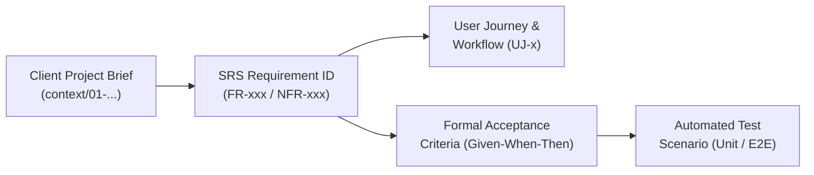

# TeamFlow — Requirements Traceability Matrix (RTM)

**Specification Version:** 1.1.0  
**Status:** Approved Architectural Baseline  
**Governing Standard:** IEEE 830 / ISO/IEC/IEEE 29148  
**Purpose:** Provides bi-directional traceability connecting the Original Client Specification, SRS Requirements (`FR-xxx`, `NFR-xxx`), User Journeys, Acceptance Criteria, and Verification Test Scenarios.

---

## 1. Traceability Architecture

---

## 2. Comprehensive Traceability Matrix

### Module A — Authentication and Account Management

| Client Brief Section | SRS ID | Related User Journey | Formal Acceptance Criteria (Given-When-Then) | Target Test Scenario & Level |
|---|---|---|---|---|
| Module A (Registration) | **FR-001** | UJ-1 (Onboarding) | **Given** valid registration details, **when** `POST /api/v1/auth/register` is called, **then** user is created with `isEmailVerified: false` and Argon2id hash. | `auth.service.spec.ts` (Unit): Test password hashing & email uniqueness. |
| Module A (Verification) | **FR-002** | UJ-1 (Onboarding) | **Given** an unexpired token, **when** calling `/auth/verify-email`, **then** `isEmailVerified` is set to `true` and token is invalidated. | `auth.e2e-spec.ts` (E2E): Complete verification token link flow. |
| Module A (Login & Tokens) | **FR-003** | UJ-1 (Onboarding) | **Given** valid credentials, **when** logging in, **then** issue `HttpOnly`, `SameSite=Strict`, `Secure` cookies with access & rotated refresh tokens. | `auth.guard.spec.ts` (Integration): Assert tokens set exclusively in secure cookies. |
| Module A (Logout) | **FR-004** | Session Mgmt | **Given** an authenticated session, **when** calling `/auth/logout`, **then** clear auth cookies, delete session record, and close WebSockets. | `session.service.spec.ts` (Unit): Assert session deletion & cookie clearing. |
| Module A (Token Rotation) | **FR-005** | Token Refresh | **Given** a valid refresh token cookie, **when** calling `/auth/refresh`, **then** issue a new 15m access token and single-use rotated refresh token. | `token.service.spec.ts` (Integration): Test refresh token rotation & reuse detection. |
| Module A (Password Reset) | **FR-006** **FR-007** | Account Recovery | **Given** an account email, **when** reset requested, **then** send single-use 1h token; upon reset, update password hash and revoke all sessions. | `auth.e2e-spec.ts` (E2E): Request reset, submit new password, assert old session invalidated. |
| Module A (Password Change) | **FR-008** | Profile Settings | **Given** an authenticated user, **when** changing password with correct current password, **then** update hash and revoke other active sessions. | `auth.service.spec.ts` (Unit): Verify current password check & session revocation. |
| Module A (Profile & Avatar) | **FR-009** **FR-010** | Profile Settings | **Given** valid profile data and image <= 2MB, **when** uploaded, **then** validate magic bytes, resize, upload to S3, and update user record. | `profile.service.spec.ts` (Integration): Upload PNG and assert S3 key generation. |
| Module A (Active Sessions) | **FR-011** **FR-012** | Security Settings | **Given** multiple active devices, **when** user revokes a session ID, **then** delete target session; subsequent requests with that token return 401. | `session.e2e-spec.ts` (E2E): Multi-device login, revoke Device B, assert Device B returns 401. |
| Module A (Rate Limiting) | **FR-013** **NFR-005** | Public Auth | **Given** 5 failed login attempts in 15m for an email, **when** a 6th attempt occurs, **then** reject with HTTP 429 Too Many Requests. | `rate-limiter.guard.spec.ts` (Integration): Simulate 6 rapid failed logins; assert 429. |

---

### Module B — Organization and Multi-Tenancy

| Client Brief Section | SRS ID | Related User Journey | Formal Acceptance Criteria (Given-When-Then) | Target Test Scenario & Level |
|---|---|---|---|---|
| Module B (Org Creation) | **FR-014** | UJ-1 (Onboarding) | **Given** an authenticated user, **when** creating an organization, **then** create `Organization` and insert `Membership` with role `ORG_OWNER`. | `organizations.service.spec.ts` (Unit): Test atomic creation of Org + Owner Membership. |
| Module B (Org Metadata) | **FR-015** | Org Settings | **Given** an `ORG_OWNER` or `ORG_ADMIN`, **when** updating name/logo, **then** update record and broadcast update to org members. | `organizations.controller.spec.ts` (Integration): Verify only Owner/Admin can update. |
| Module B (Context Switch) | **FR-016** | Workspace Nav | **Given** a user with multiple org memberships, **when** switching orgs, **then** update active tenant session cookie after validating membership. | `tenant.middleware.spec.ts` (Integration): Assert activeOrgId cookie updates cleanly. |
| Module B (Invitations) | **FR-017** **FR-018** | UJ-2 (Invitations) | **Given** an `ORG_ADMIN`, **when** inviting email with role, **then** generate 7-day token, send email, and track status `PENDING`. | `invitations.service.spec.ts` (Unit): Test invitation creation & 7-day expiration math. |
| Module B (Invite Acceptance) | **FR-019** | UJ-2 (Invitations) | **Given** an invitation token and matching authenticated user email, **when** accepted, **then** create `Membership` and set status `ACCEPTED`. | `invitations.e2e-spec.ts` (E2E): Invite employee, accept invite, assert dashboard access. |
| Module B (Invite Decline) | **FR-020** | UJ-2 (Invitations) | **Given** an invitation token, **when** invitee clicks decline, **then** update status to `DECLINED`; invite cannot subsequently be accepted. | `invitations.service.spec.ts` (Unit): Test transition to `DECLINED` & rejection of reuse. |
| Module B (Role Modify) | **FR-021** | Member Directory | **Given** an `ORG_OWNER`, **when** changing a member's role, **then** update `Membership.role`; non-owners cannot demote an Owner. | `memberships.service.spec.ts` (Unit): Test permission checks for role promotion/demotion. |
| Module B (Member Remove) | **FR-022** | Member Directory | **Given** an authorized admin, **when** removing a member, **then** remove `Membership`, unassign from tasks/projects, and disconnect WebSockets. | `memberships.service.spec.ts` (Integration): Cascade removal from projects and active tasks. |
| Module B (Sole Owner Rule) | **FR-023** | Member Directory | **Given** an organization with one Owner, **when** attempting to remove or demote that Owner, **then** reject with 400 `LAST_OWNER_CANNOT_BE_REMOVED`. | `memberships.service.spec.ts` (Unit): Assert error when removing final remaining owner. |
| Module B (Tenant Isolation) | **FR-024** **NFR-001** | All Requests | **Given** a user in Org 1, **when** querying resources belonging to Org 2, **then** `TenantGuard` rejects request with HTTP 403 Forbidden. | `tenant-isolation.e2e-spec.ts` (E2E): Comprehensive cross-tenant data exfiltration test. |

---

### Module C — Project Management

| Client Brief Section | SRS ID | Related User Journey | Formal Acceptance Criteria (Given-When-Then) | Target Test Scenario & Level |
|---|---|---|---|---|
| Module C (Project Create) | **FR-025** | UJ-3 (Projects) | **Given** an authorized member, **when** creating a project, **then** create `Project` and automatically add creator as `PROJECT_MANAGER`. | `projects.service.spec.ts` (Unit): Test project creation & automatic PM assignment. |
| Module C (Project Detail) | **FR-026** | Project Overview | **Given** a project member (or Org Admin), **when** requesting project details, **then** return project metadata, statistics, and member roster. | `projects.controller.spec.ts` (Integration): Verify project access scoping. |
| Module C (Project Update) | **FR-027** | Project Settings | **Given** an assigned `PROJECT_MANAGER`, **when** updating metadata, **then** persist changes and emit `project.updated` WebSocket event. | `projects.service.spec.ts` (Unit): Verify PM authorization for project updates. |
| Module C (Status Lifecycle) | **FR-028** | Project Overview | **Given** valid status transition (`PLANNING` $\rightarrow$ `ACTIVE`), **when** executed, **then** update status, record audit log, and broadcast event. | `projects.service.spec.ts` (Unit): Test valid/invalid project status transitions. |
| Module C (Project Archive) | **FR-029** | Project Settings | **Given** an active project, **when** archived, **then** mark status `ARCHIVED`; all tasks within project become read-only. | `projects.service.spec.ts` (Integration): Assert task mutations rejected on archived project. |
| Module C (Soft Deletion) | **FR-030** | Project Settings | **Given** an `ORG_ADMIN`, **when** deleting project, **then** set `deletedAt = NOW()`; preserve data for 30 days and cascade soft-delete to tasks. | `projects.service.spec.ts` (Integration): Verify soft-deletion cascade to tasks. |
| Module C (Member Assign) | **FR-031** | UJ-3 (Projects) | **Given** an organization member, **when** added to project, **then** create `ProjectMember` record and dispatch notification. | `project-members.service.spec.ts` (Unit): Verify member must belong to parent organization. |
| Module C (Member Removal) | **FR-032** | UJ-3 (Projects) | **Given** an assigned member, **when** removed from project, **then** remove `ProjectMember` and unassign from incomplete project tasks. | `project-members.service.spec.ts` (Integration): Assert unassignment from project tasks. |
| Module C (Manager Assign) | **FR-033** | Project Settings | **Given** an assigned member, **when** designated as Project Manager, **then** update project role to `PROJECT_MANAGER`. | `project-members.service.spec.ts` (Unit): Assert role elevation within project. |
| Module C (List & Filter) | **FR-034** | Project Listing | **Given** an authenticated user, **when** listing projects, **then** return only projects where user is member (unless Org Owner/Admin). | `projects.service.spec.ts` (Integration): Test project visibility isolation. |

---

### Module D & E — Task Management & Kanban Board

| Client Brief Section | SRS ID | Related User Journey | Formal Acceptance Criteria (Given-When-Then) | Target Test Scenario & Level |
|---|---|---|---|---|
| Module D (Task Creation) | **FR-035** | UJ-4 (Kanban) | **Given** valid task input, **when** creating task, **then** assign default status `TODO`, compute initial `orderIndex`, and save to DB. | `tasks.service.spec.ts` (Unit): Validate task creation & order index calculation. |
| Module D (Task Retrieval) | **FR-036** | Task Modal | **Given** a task ID, **when** retrieved by authorized project member, **then** return full task data, subtasks, labels, assignees, and attachments. | `tasks.controller.spec.ts` (Integration): Test task detail retrieval & access check. |
| Module D (Status Transition) | **FR-038** **FR-039** | UJ-4 (Kanban) | **Given** a valid status change, **when** executed, **then** update task status, atomically record `TaskStatusHistory`, and emit `task.status_changed`. | `tasks.service.spec.ts` (Integration): Verify atomic status update + history log. |
| Module D (Assignee Scoping) | **FR-040** **FR-041** | Task Details | **Given** a user not in the parent project, **when** assigned to task, **then** reject with HTTP 400 `ASSIGNEE_NOT_IN_PROJECT`. | `tasks.service.spec.ts` (Unit): Assert rejection of non-project members. |
| Module D (Subtasks) | **FR-043** | Task Checklist | **Given** a task, **when** subtask created or toggled, **then** update subtask record and recalculate parent completion ratio. | `subtasks.service.spec.ts` (Unit): Test subtask checklist toggle & ratio calculation. |
| Module D (Dependencies) | **FR-044** **FR-045** | Task Details | **Given** a circular dependency ($A \rightarrow B \rightarrow A$), **when** proposed, **then** cycle detection algorithm rejects with 400 `CIRCULAR_DEPENDENCY_DETECTED`. | `dependencies.service.spec.ts` (Unit): Test DFS cycle detection on complex DAGs. |
| Module E (Kanban View) | **FR-047** | UJ-4 (Kanban) | **Given** a project ID, **when** loading board, **then** return tasks grouped into 6 columns, sorted ascending by `orderIndex`. | `kanban.service.spec.ts` (Integration): Test column grouping & ordering query. |
| Module E (Drag-and-Drop) | **FR-048** **FR-049** | UJ-4 (Kanban) | **Given** a card dropped between cards A and B, **when** moving, **then** set `orderIndex = (orderA + orderB) / 2` and update column status. | `kanban.service.spec.ts` (Unit): Verify fractional index midpoint calculation. |
| Module E (Column Rebalance) | **FR-050B** | UJ-4 (Kanban) | **Given** adjacent cards where $|orderA - orderB| < 10^{-6}$, **when** dropped, **then** atomically re-space all column cards by intervals of 1000. | `kanban.service.spec.ts` (Integration): Simulate precision exhaustion & assert rebalance. |
| Module E (Rollback) | **FR-051** **FR-052** | UJ-4 (Kanban) | **Given** an optimistic card drag, **when** server rejects update (e.g. 403 or dependency block), **then** client reverts card position with error toast. | `kanban.e2e-spec.ts` (E2E): Simulate server failure during drag-and-drop; assert UI rollback. |

---

### Module F to L — Collaboration, Analytics, Files & Settings

| Client Brief Section | SRS ID | Related User Journey | Formal Acceptance Criteria (Given-When-Then) | Target Test Scenario & Level |
|---|---|---|---|---|
| Module F (Comments) | **FR-054** **FR-055** | Task Modal | **Given** markdown comment text, **when** submitted, **then** sanitize HTML, store in DB, and broadcast `comment.created` to task room. | `comments.service.spec.ts` (Unit): Test XSS sanitization & comment creation. |
| Module F (Mentions) | **FR-057** **FR-058** | UJ-5 (Real-time) | **Given** `@username` in comment, **when** posted, **then** verify mentioned user is in project, create notification, and push live alert. | `comments.service.spec.ts` (Integration): Test mention extraction & notification dispatch. |
| Module G (Notifications) | **FR-059** **FR-061** | UJ-5 (Real-time) | **Given** an assignment or mention, **when** triggered, **then** persist notification in PostgreSQL and emit to user's private socket room. | `notifications.service.spec.ts` (Integration): Verify DB persistence & socket emission. |
| Module G (Mark as Read) | **FR-063** **FR-064** | Notification Dropdown | **Given** unread notifications, **when** marked read individually or bulk, **then** update `isRead: true` and decrement badge counter. | `notifications.controller.spec.ts` (Unit): Test single and bulk mark-as-read. |
| Module H (Dashboard Metrics) | **FR-066** **FR-067** | Dashboard | **Given** an organization or project, **when** metrics requested, **then** execute exact SQL formulas (completion rate, overdue count) and cache in Redis. | `dashboard.service.spec.ts` (Integration): Verify SQL aggregate formulas against test data. |
| Module I (Search & Filter) | **FR-069** **FR-070** | Global Search | **Given** a search query or filter set, **when** executed, **then** return paginated matching tasks/projects scoped strictly to authorized tenant. | `search.service.spec.ts` (Integration): Test full-text search & multi-attribute filter. |
| Module J (Audit Trail) | **FR-072** **FR-074** | Org Activity | **Given** a significant system action, **when** executed, **then** write immutable `ActivityLog` record; no API allows updating/deleting logs. | `activity-logs.service.spec.ts` (Unit): Verify audit log persistence & immutability. |
| Module K (File Upload) | **FR-075** **FR-077** | Task Attachments | **Given** a multipart upload <= 10MB, **when** submitted, **then** validate magic bytes, stream to S3 under UUID key, and issue secure download URLs. | `attachments.service.spec.ts` (Integration): Test magic bytes validation & pre-signed URL gen. |
| Module L (Org Settings) | **FR-079** **FR-081** | Org Settings | **Given** an `ORG_OWNER`, **when** typing org name to confirm deletion, **then** soft-delete organization and cascade to child projects. | `organizations.service.spec.ts` (Integration): Test danger-zone organization deletion. |

---

## 3. Non-Functional Traceability Matrix

| NFR ID | Category | Target Metric | Verification Method & Test Suite |
|---|---|---|---|
| **NFR-001** | Security | 100% rejection of cross-tenant data access. | `test/e2e/tenant-isolation.e2e-spec.ts`: Automated multi-tenant penetration tests. |
| **NFR-002** | Security | Argon2id ($m=65536, t=3, p=4$); tokens in `HttpOnly` cookies. | `test/unit/auth/argon2.spec.ts`: Static check & password hashing benchmark. |
| **NFR-003** | Security | 100% of sensitive routes protected by backend NestJS Guards. | `test/e2e/rbac-guards.e2e-spec.ts`: Probe all endpoints without auth tokens. |
| **NFR-004** | Security | DTO validation with `whitelist: true, forbidNonWhitelisted: true`. | `test/unit/common/validation-pipe.spec.ts`: Post payloads with unexpected keys. |
| **NFR-005** | Security | Max 10 req/min IP throttle; 5 failed logins triggers 15m lockout. | `test/integration/rate-limiter.spec.ts`: Redis sliding window rate-limit test. |
| **NFR-006** | Security | Magic byte binary validation; UUID keys; pre-signed downloads. | `test/integration/storage/file-validation.spec.ts`: Upload disguised `.exe` as `.png`. |
| **NFR-007** | Performance | Read API p95 latency < 200ms under 100 concurrent virtual users. | `test/load/k6-read-benchmark.js`: k6 load test on task lists & project overview. |
| **NFR-008** | Performance | Write API p95 latency < 400ms under 50 concurrent mutations. | `test/load/k6-write-benchmark.js`: k6 load test on task creation & status moves. |
| **NFR-009** | Performance | Real-time WebSocket delivery < 100ms from DB commit to client. | `test/integration/realtime/latency.spec.ts`: Automated benchmark measuring emit-to-recv. |
| **NFR-010** | Performance | Zero queries > 50ms; composite indexes on `(projectId, status, orderIndex)`. | `test/integration/database/query-plan.spec.ts`: PostgreSQL `EXPLAIN ANALYZE` tests. |
| **NFR-011** | Performance | Pagination enforced: default 20, maximum cap 100 items per request. | `test/integration/common/pagination.spec.ts`: Request page size 500; assert capped at 100. |
| **NFR-012** | Reliability | ACID multi-table transactions via Prisma `$transaction`. | `test/integration/database/transactions.spec.ts`: Simulate mid-transaction failure; assert 0 partial writes. |
| **NFR-013** | Reliability | Foreign keys on all relational fields; soft deletion retention. | `test/integration/database/cascades.spec.ts`: Test soft-delete cascade behavior. |
| **NFR-014** | Reliability | Health check endpoint `/api/v1/health` probing DB, Redis, and disk. | `test/e2e/health.e2e-spec.ts`: Health check probe testing component failures. |
| **NFR-015** | Reliability | Socket.IO client auto-reconnect backoff with board resync. | `test/e2e/realtime-reconnect.e2e-spec.ts`: Drop socket connection, emit events, reconnect. |
| **NFR-016** | Quality | TypeScript `strict: true`, zero `any` shortcuts in application code. | `npm run type-check`: `tsc --noEmit` verified in CI/CD pipeline. |
| **NFR-017** | Architecture | Modular monolith boundaries: zero cross-module repository access. | `dependency-cruiser`: Automated static analysis checking module encapsulation. |
| **NFR-018** | Quality | >= 80% branch coverage on core domains (auth, tenant, tasks). | `npm run test:cov`: Jest coverage report enforced in CI/CD. |
| **NFR-019** | Usability | Responsive layouts across Mobile (320px), Tablet, and Desktop. | `test/e2e/responsive.spec.ts`: Playwright viewport simulation across devices. |
| **NFR-020** | Accessibility | WCAG 2.1 AA compliance: contrast >= 4.5:1, full keyboard navigation. | `axe-core`: Automated accessibility auditing in Playwright E2E tests. |
