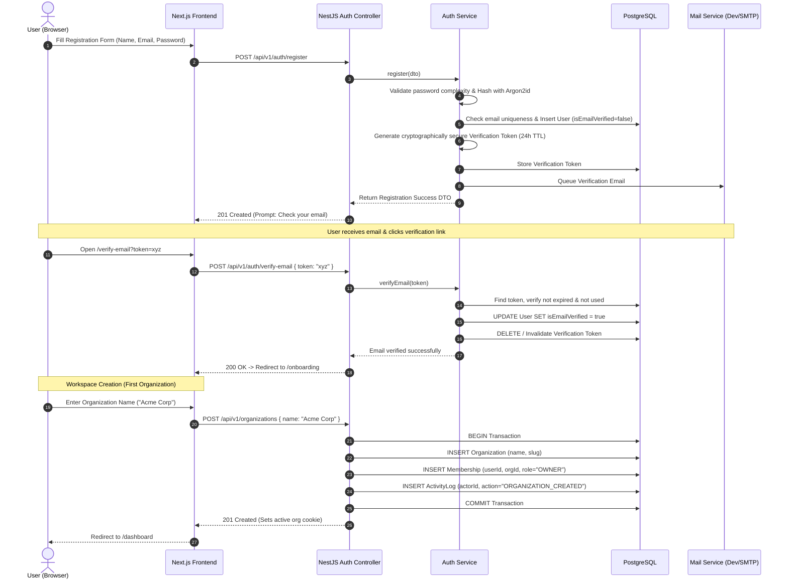
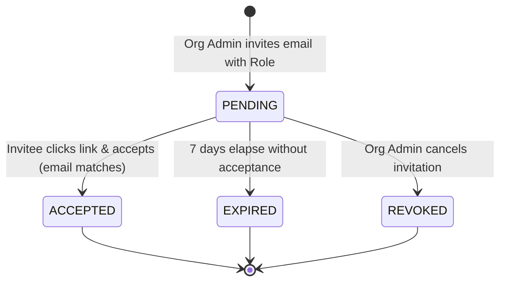
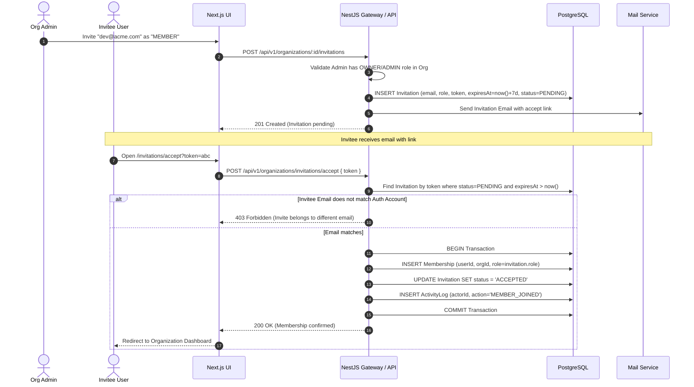
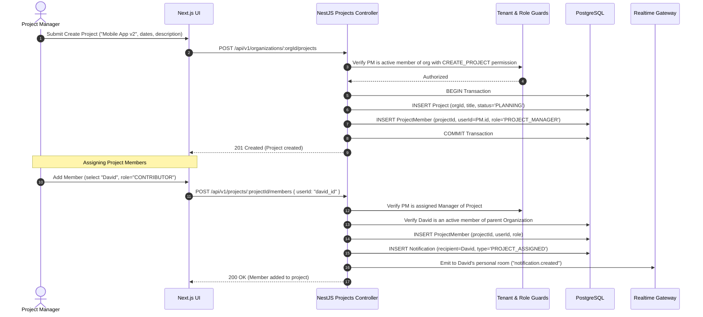
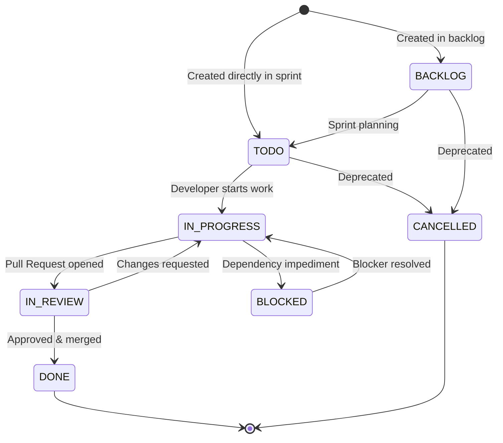
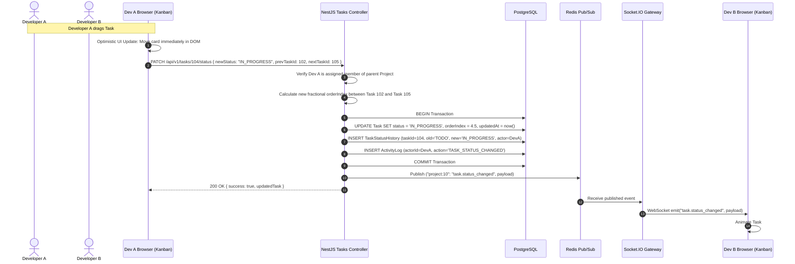
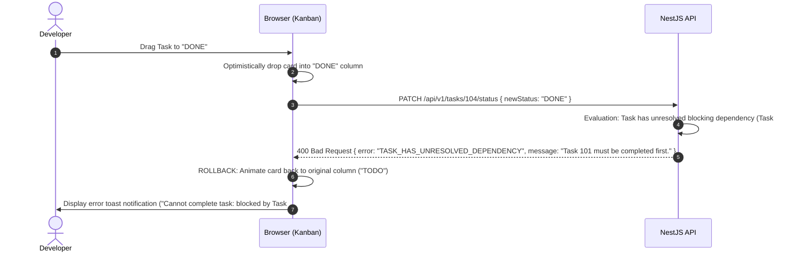
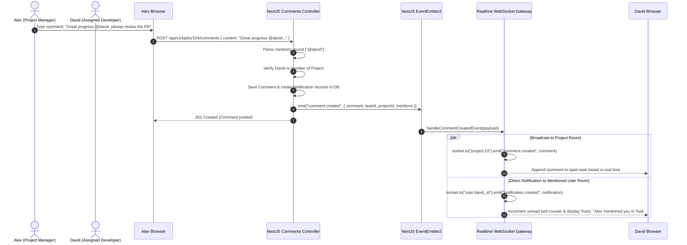

# TeamFlow — User Journeys & System Workflows

This document models the critical user journeys, state transitions, and real-time interaction flows across the **TeamFlow** platform using formal software engineering sequence diagrams and state machines.

---

## 1. Journey 1: Registration, Verification & Organization Onboarding

### User Story
> As a new user, I want to create an account, verify my email address, and establish a new company workspace so that my team can immediately begin collaborating.

---

## 2. Journey 2: Member Invitation & Workspace Joining

### User Story
> As an Organization Owner or Admin, I want to invite an employee to my workspace via email with a designated role, and have the system safely enroll them once accepted.

### 2.1 Invitation State Lifecycle

### 2.2 Sequence Diagram

---

## 3. Journey 3: Project Creation & Member Scoping

### User Story
> As a Project Manager, I want to create a new project and assign a specific subset of organization members so that sensitive projects remain strictly isolated from uninvolved staff.

---

## 4. Journey 4: Task Lifecycle & Kanban Board Workflow

### User Story
> As an engineer, I want to drag my task across columns on the Kanban board with instant visual feedback, having status changes persisted atomically and synced live to teammates.

### 4.1 Task Status State Machine

### 4.2 Optimistic Drag-and-Drop Sequence with Concurrency Protection

### 4.3 Error / Rejection Rollback Sequence

---

## 5. Journey 5: Real-Time Collaboration & Notification Broadcasting

### User Story
> As a team member, when someone comments on my assigned task or mentions me, I want to receive an immediate real-time in-app notification without refreshing the page.

