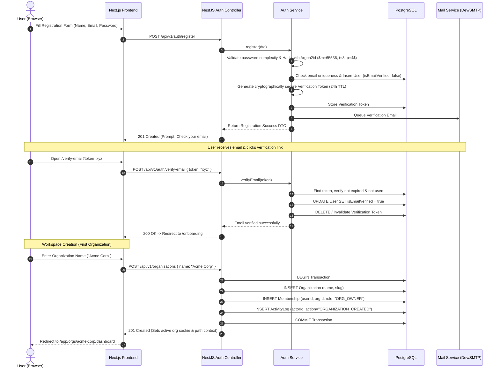
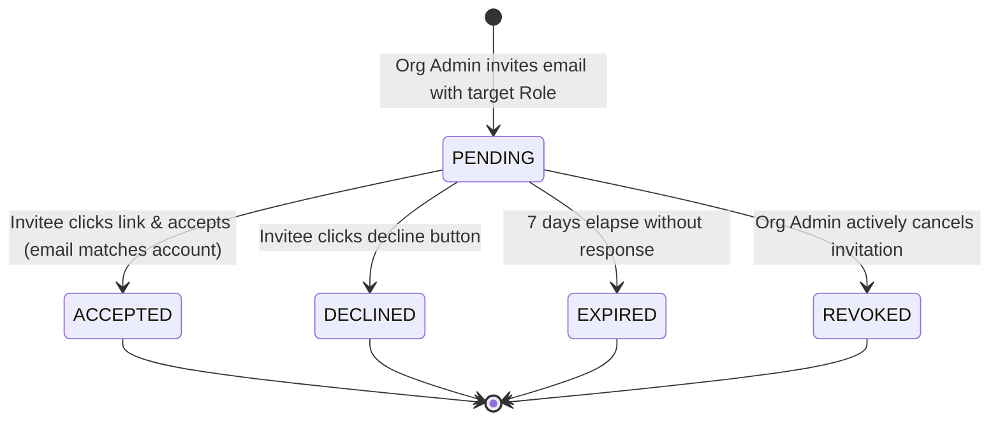
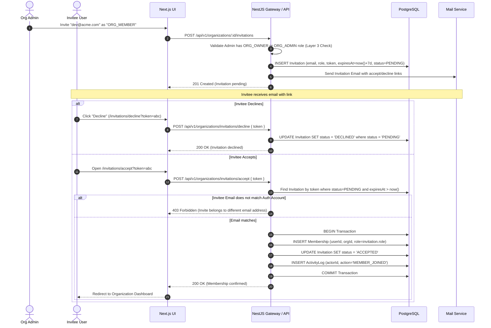
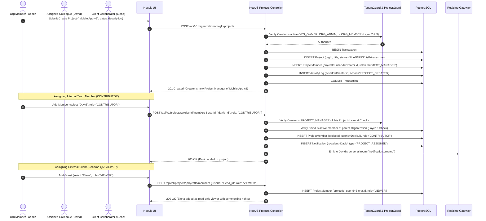
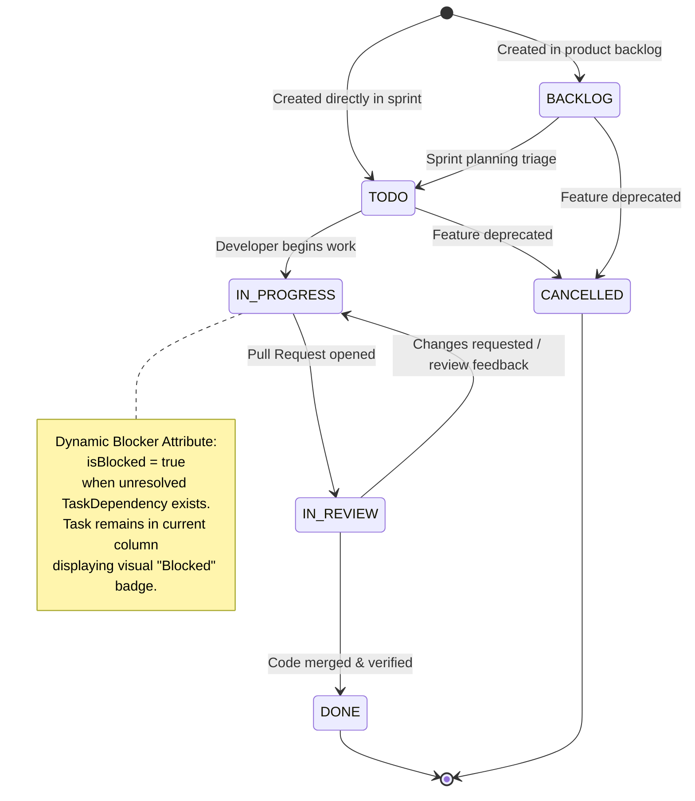
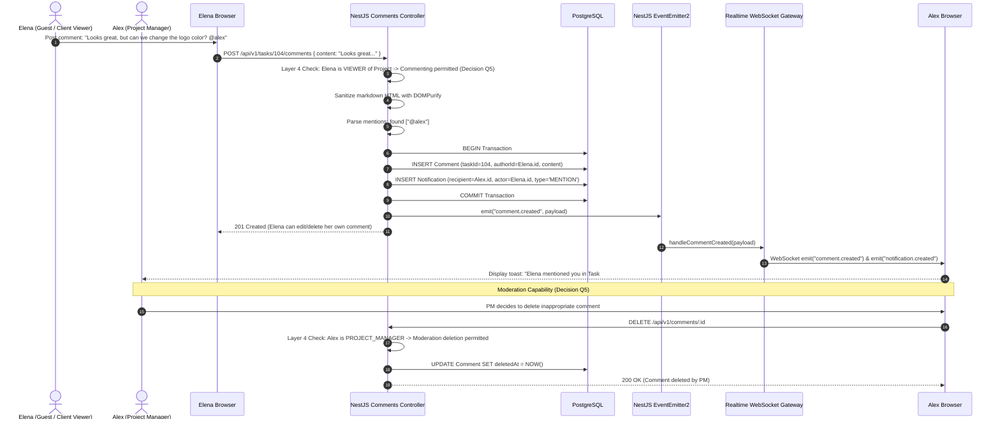

# TeamFlow — User Journeys & System Workflows

**Document Version:** 1.2.0 (Architecturally Audited & Client-Approved)  
**Specification Standard:** Aligned with IEEE 830 / ISO/IEC/IEEE 29148  
**Audit Report:** [`requirements-review-report.md`](./requirements-review-report.md)  
**Traceability Matrix:** [`traceability-matrix.md`](./traceability-matrix.md)

This document models the critical user journeys, state transitions, string-based Kanban ordering interactions, and real-time event flows across the **TeamFlow** platform.

---

## 1. Journey 1: Registration, Verification & Organization Onboarding

### User Story
> As a new user, I want to create an account, verify my email address, and establish a new company workspace so that my team can immediately begin collaborating.



---

## 2. Journey 2: Member Invitation & Workspace Joining

### User Story
> As an Organization Owner or Admin, I want to invite an employee to my workspace via email with a designated role, and have the system safely enroll them once accepted.

### 2.1 Reconciled Invitation State Lifecycle



### 2.2 Sequence Diagram



---

## 3. Journey 3: Project Creation & Member Scoping (Decision Q2: Private by Default)

### User Story
> As an Organization Member (or Admin), I want to create a new project and automatically be assigned as its Project Manager, then assign a specific subset of organization members so that sensitive client work remains strictly private.



---

## 4. Journey 4: Task Lifecycle & Kanban Board Workflow (Decision Q3: String Fractional Indexing)

### User Story
> As an engineer, I want to drag my task across columns on the Kanban board with instant visual feedback, having status changes persisted atomically with string-based ordering keys and synced live to teammates.

### 4.1 Task Status State Machine with Dynamic Blocker Modeling



### 4.2 Optimistic Drag-and-Drop Sequence with String Fractional Indexing & Optimistic Concurrency

```mermaid
sequenceDiagram
    autonumber
    actor DevA as Developer A
    actor DevB as Developer B
    participant UI_A as Dev A Browser (Kanban)
    participant API as NestJS Tasks Controller
    participant DB as PostgreSQL
    participant Redis as Redis Pub/Sub
    participant Gateway as Socket.IO Gateway
    participant UI_B as Dev B Browser (Kanban)

    Note over DevA,UI_A: Dev A drags Task #104 (version: 3) from TODO to IN_PROGRESS between "a1" and "a2"
    UI_A->>UI_A: Optimistic UI Update: Render card in target slot immediately
    UI_A->>API: PATCH /api/v1/tasks/104/status { newStatus: "IN_PROGRESS", prevKey: "a1", nextKey: "a2", version: 3 }
    
    API->>API: Layer 2 & 4 Auth: Verify Dev A has CONTRIBUTOR or PM role in Project
    API->>API: Generate string intermediate key between "a1" and "a2" -> "a1V"
    
    API->>DB: BEGIN Transaction
    API->>DB: UPDATE Task SET status = 'IN_PROGRESS', orderKey = 'a1V', version = 4 WHERE id = 104 AND version = 3
    alt Version mismatch (Task was modified concurrently by another user)
        API->>DB: ROLLBACK Transaction
        API-->>UI_A: 409 Conflict { errorCode: "CONCURRENT_MODIFICATION" }
        UI_A->>UI_A: Revert card to original column and position; toast "Task was updated by another user"
    else Version matches
        API->>DB: INSERT TaskStatusHistory (taskId=104, old='TODO', new='IN_PROGRESS', actor=DevA)
        API->>DB: INSERT ActivityLog (actorId=DevA, action='TASK_STATUS_CHANGED')
        API->>DB: COMMIT Transaction (Phase 1 Complete)

        Note over API,Redis: Phase 2: Post-Commit Best-Effort Broadcast
        API->>Redis: Publish ("project:10": "task.status_changed", { taskId: 104, newStatus: "IN_PROGRESS", orderKey: "a1V", version: 4 })
        API-->>UI_A: 200 OK { success: true, updatedTask }

        Note over Redis,UI_B: Phase 3: Client Event Delivery
        Redis->>Gateway: Relay published event
        Gateway->>UI_B: WebSocket emit("task.status_changed", payload)
        UI_B->>UI_B: Animate Task #104 moving to "IN_PROGRESS" slot "a1V" without refresh
    end
```

---

## 5. Journey 5: Real-Time Collaboration & Guest Interactions (Decision Q5)

### User Story
> As a project participant (or guest client), I want to comment on a task, mention colleagues, and receive real-time notifications, while project managers retain comment moderation authority.


