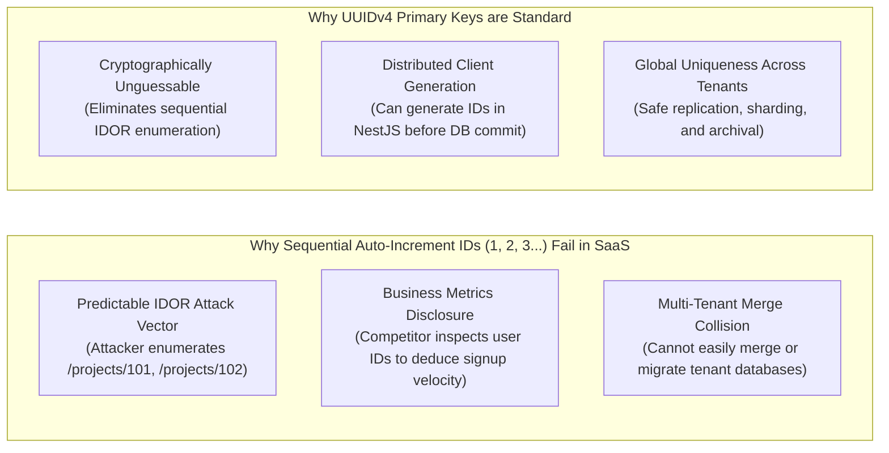
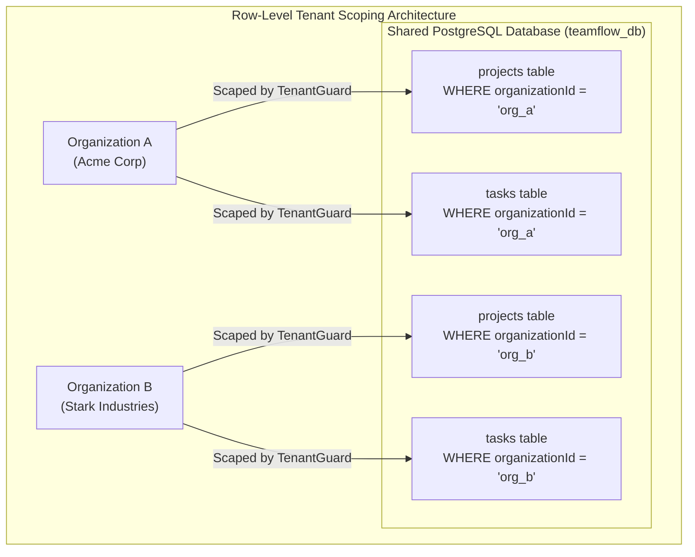

# TeamFlow — Database Architecture & Design Overview

**Document Version:** 1.0.0  
**Database Engine:** PostgreSQL 16  
**ORM:** Prisma 5+  
**Architecture Model:** Shared Database with Row-Level Multi-Tenant Scoping  
**Related Documents:** [`er-diagram.md`](./er-diagram.md), [`relationships.md`](./relationships.md), [`indexes-and-optimization.md`](./indexes-and-optimization.md)

---

## 1. Architectural Philosophy & Design Principles

The database tier is the foundational source of truth for TeamFlow. In accordance with [`AGENTS.md`](../../AGENTS.md), we reject the anti-pattern of treating the database as a dumb, passive storage bucket. The database actively enforces business invariants, data integrity, and multi-tenant security through constraints, foreign keys, and indexes.

### Core Architectural Principles
1. **Third Normal Form (3NF) Baseline:** All tables are normalized to 3NF to eliminate data redundancy and update anomalies. Denormalization is applied strictly where measurable performance bottlenecks exist (e.g. storing `organizationId` directly on `Task` and `Attachment` to avoid multi-table joins during tenant validation).
2. **Database-Enforced Invariants:** Critical invariants (such as preventing duplicate emails, ensuring an invitation belongs to an organization, and enforcing task-project consistency) are enforced by database `UNIQUE`, `NOT NULL`, and `CHECK` constraints, never relying solely on frontend forms or backend controllers.
3. **Universally Scoped Multi-Tenancy:** Every tenant-scoped entity contains an indexed, non-nullable foreign key: `organizationId UUID NOT NULL`.
4. **Deterministic Auditing:** All entities track their lifecycle via UTC timestamps (`createdAt`, `updatedAt`, `deletedAt`).

---

## 2. Primary Key Strategy: UUIDv4 vs. Auto-Incrementing Integers

TeamFlow strictly utilizes **Universally Unique Identifiers (UUIDv4)** for all primary keys (`id UUID PRIMARY KEY DEFAULT gen_random_uuid()`):



- **Index Performance Mitigation:** To prevent B-Tree index fragmentation inherent to random UUIDs, high-write tables (`TaskStatusHistory`, `ActivityLog`, `Notification`) cluster on composite indexes beginning with their organizational parent (`organizationId`) or chronological timestamp (`createdAt DESC`).

---

## 3. Row-Level Multi-Tenancy Architecture

TeamFlow uses a **Shared Database, Shared Schema with Row-Level Tenant Scoping** model:



### Targeted Denormalization for Tenant Scoping
In strict 3NF, a `Task` belongs to a `Project`, which belongs to an `Organization`. Therefore, a task's tenant could theoretically be deduced via `Task.projectId -> Project.organizationId`.

However, TeamFlow **explicitly denormalizes `organizationId` directly onto `Task`, `Comment`, `Attachment`, `Label`, and `Notification`**:
- **Why It Matters:** Without direct `organizationId`, every single task query, card drag, or comment query would require an expensive SQL `JOIN` on `Project` and `Organization` merely to verify tenant ownership.
- **Security Guarantee:** By storing `organizationId` on the record, NestJS `TenantGuard` and Prisma services execute single-table indexed queries:
  $$\text{WHERE id = :taskId AND organizationId = :activeOrgId}$$
  If a malicious user submits an ID belonging to another company, the database engine returns zero rows immediately, eliminating cross-tenant existence disclosure.

---

## 4. Soft-Deletion Architecture (`deletedAt`)

To prevent catastrophic accidental data loss and protect compliance audit trails, primary business entities utilize **Soft Deletion**:

| Entity | Deletion Strategy | Cascade Behavior | Retention Policy |
|---|---|---|---|
| `Organization` | Soft Delete (`deletedAt`) | Cascades soft-delete to child `Project`, `Task`, `Comment`, `Attachment`. | 30-day recovery window; permanent purge on request. |
| `Project` | Soft Delete (`deletedAt`) | Cascades soft-delete to child `Task`, `Comment`, `Attachment`. | 30-day recovery window. |
| `Task` | Soft Delete (`deletedAt`) | Hides task from board/lists; preserves `Comment`, `TaskStatusHistory`. | 30-day recovery window. |
| `Comment` | Soft Delete (`deletedAt`) | Replaces content with `"[Comment deleted]"`; preserves author link. | 30-day recovery window. |
| `User` | Soft Delete (`deletedAt`) | Sets `deletedAt`; anonymizes PII; preserves `ActivityLog.actorId = NULL`. | GDPR Right to Erasure compliant. |
| `Session` | **Hard Delete** | Immediately purged on logout or session revocation. | Transient security token. |
| `VerificationToken` | **Hard Delete** | Immediately purged upon verification or expiration. | Transient security token. |
| `Notification` | **Hard Delete** | Purged automatically after 90 days via scheduled cron job. | 90-day rolling purge. |

### Query Filter Discipline
In Prisma, soft-deleted records are filtered out by default across all active business queries:
```typescript
where: {
  projectId: projectId,
  organizationId: activeOrgId,
  deletedAt: null, // Mandatory filter on all active reads
}
```

---

## 5. Column Types & Data Sizing Discipline

To ensure optimal storage efficiency, memory alignment, and query performance in PostgreSQL:

| Column Category | Target PostgreSQL Data Type | Justification & Constraints |
|---|---|---|
| **Primary Keys & FKs** | `UUID` | 16-byte binary format; unguessable; native PostgreSQL indexing support. |
| **Email Addresses** | `VARCHAR(255)` | Lowercased, indexed, RFC 5321 compliant length. |
| **Password Hashes** | `VARCHAR(255)` | Argon2id string representation fits within 100 bytes; 255 provides ample buffer. |
| **Titles & Names** | `VARCHAR(255)` | Enforces upper bound; prevents unbounded string memory allocation. |
| **Descriptions & Posts** | `TEXT` | Unbounded variable-length text stored in PostgreSQL TOAST tables for large markdown. |
| **String Order Keys** | `VARCHAR(255)` | Base-62 fractional indexing strings; indexed with standard B-Tree byte sorting. |
| **Enumerations** | `VARCHAR(50)` / PostgreSQL `ENUM` | Strongly typed statuses (`TaskStatus`, `ProjectStatus`, `OrgRole`, `ProjectRole`). |
| **Timestamps** | `TIMESTAMP WITH TIME ZONE` (`TIMESTAMPTZ`) | **Mandatory UTC.** Prevents timezone ambiguities across international teams. |
| **Audit Metadata** | `JSONB` | Binary JSON supporting GIN indexing and fast key-value lookups for event metadata. |
| **File Sizes** | `BIGINT` | Supports 64-bit byte representations without 32-bit integer overflow. |

