# TeamFlow — Entity-Relationship Diagram (ERD)

**Document Version:** 1.0.0  
**Status:** Approved Architectural Baseline  
**Database Engine:** PostgreSQL 16  
**ORM:** Prisma  
**Related Documents:** [`database-overview.md`](./database-overview.md), [`relationships.md`](./relationships.md), [`indexes-and-optimization.md`](./indexes-and-optimization.md)

---

## 1. Visual Entity-Relationship Diagram

This diagram specifies all 19 relational entities of the **TeamFlow** platform, including their attributes, primary keys (`PK`), foreign keys (`FK`), and relational cardinalities.

```mermaid
erDiagram
    %% Core Identity & Tenant Entities
    USER ||--o{ SESSION : has
    USER ||--o{ VERIFICATION_TOKEN : owns
    USER ||--o{ MEMBERSHIP : holds
    USER ||--o{ PROJECT_MEMBER : assigned
    USER ||--o{ TASK_ASSIGNEE : assigned
    USER ||--o{ COMMENT : writes
    USER ||--o{ ATTACHMENT : uploads
    USER ||--o{ NOTIFICATION : receives
    USER ||--o{ ACTIVITY_LOG : triggers

    ORGANIZATION ||--o{ MEMBERSHIP : contains
    ORGANIZATION ||--o{ INVITATION : issues
    ORGANIZATION ||--o{ PROJECT : owns
    ORGANIZATION ||--o{ LABEL : defines
    ORGANIZATION ||--o{ ATTACHMENT : stores
    ORGANIZATION ||--o{ NOTIFICATION : scopes
    ORGANIZATION ||--o{ ACTIVITY_LOG : logs

    %% Project & Task Hierarchies
    PROJECT ||--o{ PROJECT_MEMBER : scopes
    PROJECT ||--o{ TASK : contains
    TASK ||--o{ TASK_ASSIGNEE : assigned_to
    TASK ||--o{ SUBTASK : includes
    TASK ||--o{ TASK_STATUS_HISTORY : tracks
    TASK ||--o{ COMMENT : has
    TASK ||--o{ ATTACHMENT : attaches
    TASK ||--o{ TASK_LABEL : categorized_by
    LABEL ||--o{ TASK_LABEL : tags

    TASK ||--o{ TASK_DEPENDENCY : blocks
    TASK ||--o{ TASK_DEPENDENCY : blocked_by

    USER {
        uuid id PK
        string email UK
        string passwordHash
        string fullName
        string avatarUrl
        boolean isEmailVerified
        string timezone
        datetime lastLoginAt
        datetime createdAt
        datetime updatedAt
        datetime deletedAt
    }

    SESSION {
        uuid id PK
        uuid userId FK
        string sessionTokenHash UK
        string ipAddress
        string userAgent
        datetime expiresAt
        datetime revokedAt
        datetime createdAt
        datetime updatedAt
    }

    VERIFICATION_TOKEN {
        uuid id PK
        uuid userId FK
        string tokenHash UK
        string type
        datetime expiresAt
        datetime usedAt
        datetime createdAt
    }

    ORGANIZATION {
        uuid id PK
        string name
        string slug UK
        string logoUrl
        datetime createdAt
        datetime updatedAt
        datetime deletedAt
    }

    MEMBERSHIP {
        uuid id PK
        uuid organizationId FK
        uuid userId FK
        string role
        datetime createdAt
        datetime updatedAt
    }

    INVITATION {
        uuid id PK
        uuid organizationId FK
        string email
        string role
        string tokenHash UK
        string status
        uuid invitedById FK
        datetime expiresAt
        datetime createdAt
        datetime updatedAt
    }

    PROJECT {
        uuid id PK
        uuid organizationId FK
        string title
        string description
        string status
        boolean isPrivate
        datetime startDate
        datetime endDate
        datetime createdAt
        datetime updatedAt
        datetime deletedAt
    }

    PROJECT_MEMBER {
        uuid id PK
        uuid projectId FK
        uuid userId FK
        string role
        datetime joinedAt
        datetime createdAt
        datetime updatedAt
    }

    TASK {
        uuid id PK
        uuid organizationId FK
        uuid projectId FK
        string title
        string description
        string status
        string priority
        string orderKey
        int version
        boolean isBlocked
        datetime dueDate
        uuid creatorId FK
        datetime createdAt
        datetime updatedAt
        datetime deletedAt
    }

    TASK_ASSIGNEE {
        uuid id PK
        uuid taskId FK
        uuid userId FK
        datetime assignedAt
    }

    TASK_DEPENDENCY {
        uuid id PK
        uuid taskId FK
        uuid dependsOnTaskId FK
        datetime createdAt
    }

    TASK_STATUS_HISTORY {
        uuid id PK
        uuid taskId FK
        string oldStatus
        string newStatus
        uuid changedById FK
        datetime createdAt
    }

    SUBTASK {
        uuid id PK
        uuid taskId FK
        string title
        boolean isCompleted
        int orderIndex
        datetime completedAt
        datetime createdAt
        datetime updatedAt
    }

    LABEL {
        uuid id PK
        uuid organizationId FK
        string name
        string colorHex
        datetime createdAt
        datetime updatedAt
    }

    TASK_LABEL {
        uuid id PK
        uuid taskId FK
        uuid labelId FK
    }

    COMMENT {
        uuid id PK
        uuid taskId FK
        uuid authorId FK
        string content
        boolean isEdited
        datetime createdAt
        datetime updatedAt
        datetime deletedAt
    }

    ATTACHMENT {
        uuid id PK
        uuid organizationId FK
        uuid taskId FK
        string filename
        string storageKey UK
        string mimeType
        bigint sizeBytes
        uuid uploaderId FK
        datetime createdAt
        datetime deletedAt
    }

    NOTIFICATION {
        uuid id PK
        uuid organizationId FK
        uuid recipientId FK
        uuid actorId FK
        string type
        string entityType
        uuid entityId
        string message
        boolean isRead
        datetime readAt
        datetime createdAt
    }

    ACTIVITY_LOG {
        uuid id PK
        uuid organizationId FK
        uuid actorId FK
        string actionType
        string entityType
        uuid entityId
        jsonb metadata
        string ipAddressMasked
        datetime createdAt
    }
```

---

## 2. Entity Summary & Classification

| Domain Group | Entity Name | Primary Responsibility | Tenant Scoped? | Soft Deleted? |
|---|---|---|:---:|:---:|
| **Identity & Access** | `User` | Global user credentials, personal profile, and authentication state. | ❌ (Global) | ✅ |
| | `Session` | Active login sessions, device user-agents, IP records, and token hashes. | ❌ (Global) | ❌ (Hard Delete) |
| | `VerificationToken` | Single-use email verification and password reset cryptographic tokens. | ❌ (Global) | ❌ (Hard Delete) |
| **Multi-Tenancy** | `Organization` | Corporate workspace boundary (the primary tenant container). | ✅ (Root Tenant) | ✅ |
| | `Membership` | Associates a User with an Organization with a specific `OrgRole`. | ✅ | ❌ |
| | `Invitation` | Pending invitations to join an organization with designated roles. | ✅ | ❌ |
| **Project Management** | `Project` | Work container holding tasks, milestones, and assigned members. | ✅ | ✅ |
| | `ProjectMember` | Explicit membership scoping users to private projects with a `ProjectRole`. | ✅ | ❌ |
| **Task & Kanban** | `Task` | Core unit of work, priority, status, string `orderKey`, and `version`. | ✅ | ✅ |
| | `TaskAssignee` | Join entity supporting multi-user assignment to a task. | ✅ (via Task) | ❌ |
| | `TaskDependency` | Directed Acyclic Graph (DAG) modeling task blockers (`taskId` blocked by `dependsOnTaskId`). | ✅ (via Task) | ❌ |
| | `TaskStatusHistory` | Immutable chronological log of task status transitions. | ✅ (via Task) | ❌ (Immutable) |
| | `Subtask` | Single-level checklist items within a task. | ✅ (via Task) | ❌ |
| | `Label` | Organization-scoped colored categorization tags. | ✅ | ❌ |
| | `TaskLabel` | Join entity associating tasks with labels. | ✅ (via Task) | ❌ |
| **Collaboration & Files** | `Comment` | Markdown discussion posts on tasks. | ✅ (via Task) | ✅ |
| | `Attachment` | Metadata for files stored in S3/MinIO. | ✅ | ✅ |
| **System Operations** | `Notification` | In-app user alerts with 90-day retention purge. | ✅ | ❌ (90-day Purge) |
| | `ActivityLog` | Immutable audit trail for security and business events (365-day retention). | ✅ | ❌ (Immutable) |

