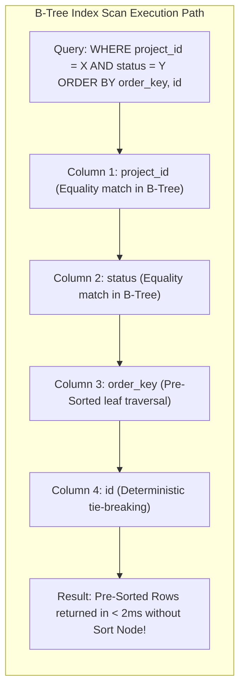
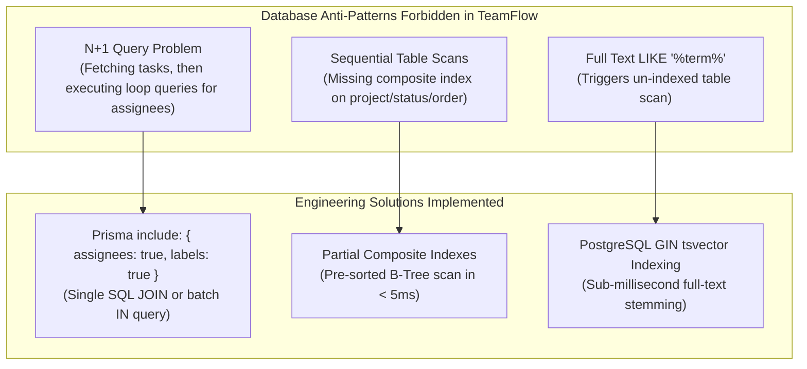

# TeamFlow — Database Indexing Architecture & Query Optimization

**Document Version:** 1.0.0  
**Database Engine:** PostgreSQL 16  
**ORM:** Prisma 5+  
**Target Query Latency:** Read queries < 50ms (p95 < 200ms API SLA)  
**Related Documents:** [`er-diagram.md`](./er-diagram.md), [`database-overview.md`](./database-overview.md), [`relationships.md`](./relationships.md)

---

## 1. Indexing Philosophy & Strategy

In PostgreSQL, indexes are not free; each index adds write amplification, consumes RAM in the buffer pool, and slows down `INSERT`, `UPDATE`, and `DELETE` operations.

TeamFlow adheres to a **Workload-Driven Indexing Strategy**:
1. **Index Leftmost Prefix Rule:** Composite index columns are ordered strictly by query predicate selectivity:
   $$\text{[Equality Filters]} \longrightarrow \text{[Inequality / Range Filters]} \longrightarrow \text{[Sort / OrderBy Columns]}$$
2. **Covering High-Frequency Workloads:** Indexes are tailored to our primary operational queries: Kanban board rendering, workspace dashboard aggregations, notification feeds, and user session validation.
3. **Eliminating In-Memory Sorts:** Composite indexes covering `orderKey` and `createdAt` enable PostgreSQL to perform pre-sorted B-Tree index scans, bypassing costly temporary disk or memory sorting (`Sort` nodes in `EXPLAIN ANALYZE`).

---

## 2. The Core Kanban Composite Index (Deep Dive)

The most performance-critical query in the entire platform is loading the project Kanban board:

```sql
SELECT id, title, status, priority, order_key, version, is_blocked, due_date
FROM tasks
WHERE project_id = :projectId 
  AND status = :status 
  AND deleted_at IS NULL
ORDER BY order_key ASC, id ASC;
```

### The Composite Index Design
$$\text{CREATE INDEX idx\_tasks\_kanban ON tasks (project\_id, status, order\_key ASC, id ASC) WHERE deleted\_at IS NULL;}$$



### Why this Index Eliminates Bottlenecks:
1. **Partial Index Filter (`WHERE deleted_at IS NULL`):** Soft-deleted tasks are completely omitted from the index tree, shrinking index size by up to 40% and keeping the index memory-resident in PostgreSQL `shared_buffers`.
2. **Exact Equality Match (`project_id`, `status`):** Narrows the search space instantly to the specific project column.
3. **Pre-Sorted Order (`order_key ASC, id ASC`):** Because the B-Tree leaf pages are already sorted by `order_key` and `id`, PostgreSQL streams the rows directly to the client without executing an in-memory `QuickSort` or disk `External Sort`.

---

## 3. Comprehensive Table-by-Table Index Specifications

### 3.1 Identity, Authentication & Sessions

| Entity | Index Definition | Index Type | Purpose & Query Pattern |
|---|---|:---:|---|
| `User` | `UNIQUE (email)` | Unique B-Tree | Fast user authentication lookup; guarantees email uniqueness. |
| `Session` | `UNIQUE (sessionTokenHash)` | Unique B-Tree | Sub-millisecond session validation on every HTTP request. |
| `Session` | `INDEX (userId, revokedAt, expiresAt)` | Composite B-Tree | `FR-011` Active session listing and bulk revocation. |
| `VerificationToken` | `UNIQUE (tokenHash)` | Unique B-Tree | Fast email verification & password reset token lookups. |
| `VerificationToken` | `INDEX (userId, type, expiresAt)` | Composite B-Tree | Cleanup of expired tokens and multi-request invalidation. |

---

### 3.2 Organizations, Memberships & Invitations

| Entity | Index Definition | Index Type | Purpose & Query Pattern |
|---|---|:---:|---|
| `Organization` | `UNIQUE (slug)` | Unique B-Tree | Path-based workspace URL resolution (`/app/orgs/:slug`). |
| `Membership` | `UNIQUE (organizationId, userId)` | Unique B-Tree | Prevents duplicate user memberships; validates user tenant access. |
| `Membership` | `INDEX (userId, organizationId)` | Composite B-Tree | Fast listing of organizations a user belongs to for workspace switcher. |
| `Invitation` | `UNIQUE (tokenHash)` | Unique B-Tree | Fast invitation link validation. |
| `Invitation` | `INDEX (organizationId, status, expiresAt)` | Composite B-Tree | Organization member directory listing pending invitations. |

---

### 3.3 Projects & Project Scoping

| Entity | Index Definition | Index Type | Purpose & Query Pattern |
|---|---|:---:|---|
| `Project` | `INDEX (organizationId, deletedAt, status)` | Composite B-Tree | Workspace project listing and status filtering (`WHERE deletedAt IS NULL`). |
| `ProjectMember` | `UNIQUE (projectId, userId)` | Unique B-Tree | Prevents duplicate project assignment; checks project access. |
| `ProjectMember` | `INDEX (userId, role)` | Composite B-Tree | Fast retrieval of all projects where a user is assigned. |

---

### 3.4 Tasks, Dependencies & Kanban

| Entity | Index Definition | Index Type | Purpose & Query Pattern |
|---|---|:---:|---|
| `Task` | `INDEX (projectId, status, orderKey ASC, id ASC) WHERE deletedAt IS NULL` | **Partial Composite B-Tree** | **Primary Kanban board query.** Enables pre-sorted Index Scan. |
| `Task` | `INDEX (organizationId, deletedAt)` | Composite B-Tree | Tenant isolation verification and organization-wide task counts. |
| `Task` | `INDEX (organizationId, dueDate, status) WHERE deletedAt IS NULL` | Composite B-Tree | `FR-066` Fast aggregation of overdue tasks in UTC. |
| `Task` | `INDEX (creatorId)` | B-Tree | Filtering tasks created by a specific user. |
| `TaskAssignee` | `UNIQUE (taskId, userId)` | Unique B-Tree | Prevents duplicate assignment; task detail assignee lookup. |
| `TaskAssignee` | `INDEX (userId, taskId)` | Composite B-Tree | Cross-project "My Tasks" dashboard query for assigned developer. |
| `TaskDependency` | `UNIQUE (taskId, dependsOnTaskId)` | Unique B-Tree | Prevents duplicate dependency links; validates task blockers. |
| `TaskDependency` | `INDEX (dependsOnTaskId)` | B-Tree | Reverse lookup: finding all tasks blocked by a completed task. |
| `TaskStatusHistory` | `INDEX (taskId, createdAt DESC)` | Composite B-Tree | Chronological status transition audit feed for task side panel. |
| `Subtask` | `INDEX (taskId, orderIndex ASC)` | Composite B-Tree | Ordered checklist rendering in task modal. |

---

### 3.5 Collaboration, Files, Notifications & Auditing

| Entity | Index Definition | Index Type | Purpose & Query Pattern |
|---|---|:---:|---|
| `Label` | `INDEX (organizationId, name)` | Composite B-Tree | Workspace tag selection and autocomplete. |
| `TaskLabel` | `UNIQUE (taskId, labelId)` | Unique B-Tree | Prevents duplicate labeling of a task. |
| `Comment` | `INDEX (taskId, deletedAt, createdAt ASC)` | Composite B-Tree | Threaded task discussion feed in chronological order. |
| `Attachment` | `UNIQUE (storageKey)` | Unique B-Tree | Object storage key lookup; prevents storage collision. |
| `Attachment` | `INDEX (taskId, deletedAt)` | Composite B-Tree | Task modal attachment list. |
| `Notification` | `INDEX (recipientId, isRead, createdAt DESC)` | Composite B-Tree | In-app notification center dropdown with unread badge count. |
| `Notification` | `INDEX (createdAt)` | B-Tree | `FR-061` Daily scheduled 90-day retention purge worker. |
| `ActivityLog` | `INDEX (organizationId, createdAt DESC)` | Composite B-Tree | Workspace audit activity feed. |
| `ActivityLog` | `INDEX (createdAt)` | B-Tree | 365-day compliance retention worker. |
| `ActivityLog` | `INDEX (metadata)` | **GIN (jsonb_path_ops)** | Fast indexing for arbitrary JSON metadata queries. |

---

## 4. Query Plan Benchmarks & Anti-Patterns to Prevent



### Benchmark SLA Constraints
- All primary read queries on a dataset of **50,000 tasks** must achieve:
  - `EXPLAIN (ANALYZE, BUFFERS)` execution time $< 15\text{ ms}$.
  - Zero `Seq Scan` on primary tables.
  - Zero `Sort` nodes on board aggregation queries.

