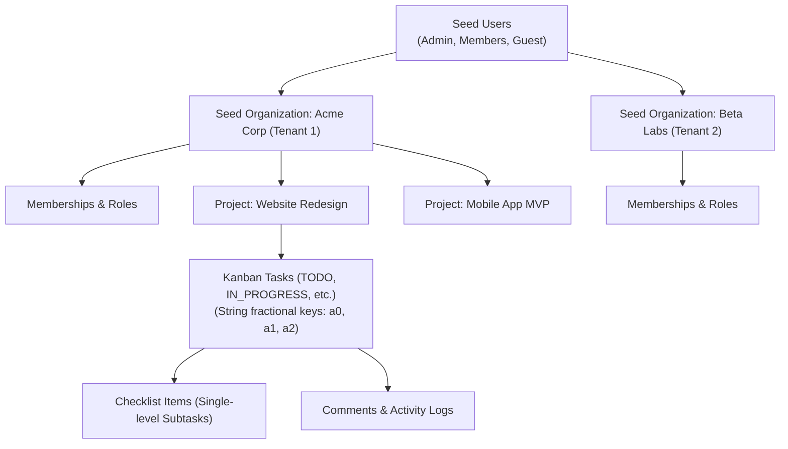

# TeamFlow — Database Migration & Seeding Strategy

**Document Version:** 1.0.0  
**Database Engine:** PostgreSQL 16  
**Migration Tool:** Prisma Migrate  
**Seeding Script:** `prisma/seed.ts`  
**Related Documents:** [`database-overview.md`](./database-overview.md), [`er-diagram.md`](./er-diagram.md), [`transactions.md`](./transactions.md)

---

## 1. Migration Philosophy & Architectural Principles

Database schema evolution in TeamFlow is treated with the same engineering rigor as application code. As established in [`AGENTS.md`](../../AGENTS.md):
- Never silently modify the database schema without documenting the migration and its architectural impact.
- Avoid destructive commands and prevent data loss.
- Maintain forward and backward compatibility during deployments.

### Prisma Migration Lifecycle
TeamFlow uses **Prisma Migrate** to maintain an immutable, version-controlled history of schema changes stored in `prisma/migrations/`:

```mermaid
flowchart TD
    subgraph DevWorkflow ["Development Workflow (Local)"]
        D1["Edit prisma/schema.prisma"] --> D2["Run 'prisma migrate dev --name <change>'"]
        D2 --> D3["Prisma generates SQL migration file\n(prisma/migrations/YYYYMMDDHHMMSS_name/migration.sql)"]
        D3 --> D4["Prisma applies SQL to local PostgreSQL"]
        D4 --> D5["Prisma regenerates TypeScript Client\n(@prisma/client)"]
        D5 --> D6["Commit schema.prisma and migrations/ to Git"]
    end

    subgraph CI_CD ["CI / Production Deployment Workflow"]
        P1["Git Pull / Docker Build"] --> P2["Run 'prisma migrate deploy'"]
        P2 --> P3["Prisma checks _prisma_migrations table"]
        P3 --> P4["Applies pending migrations in transaction"]
        P4 --> P5["Start NestJS API Service"]
    end
```



---

## 2. Zero-Downtime Migration Strategy: The Expand / Contract Pattern

In a production SaaS environment, schema migrations must never lock tables for extended periods or break running backend instances during rolling updates. TeamFlow enforces the **Expand / Contract (Parallel Run)** pattern for all breaking schema modifications (such as column renames, type conversions, or non-nullable column additions).

```mermaid
sequenceDiagram
    autonumber
    Note over OldApp, DB: Phase 1: Expand (Non-breaking additive change)
    Admin->>DB: Apply Migration (Add new_column NULLABLE)
    Note over OldApp, DB: Phase 2: Dual-Writing
    AppV2->>DB: Deploy App v2 (Writes to old_column AND new_column; Reads from old_column)
    Note over Admin, DB: Phase 3: Data Backfill
    Admin->>DB: Run batch script: UPDATE Table SET new_column = old_column WHERE new_column IS NULL
    Note over AppV3, DB: Phase 4: Switch Reads
    AppV3->>DB: Deploy App v3 (Reads and writes to new_column only)
    Note over Admin, DB: Phase 5: Contract (Clean up)
    Admin->>DB: Apply Migration (DROP COLUMN old_column; ADD NOT NULL to new_column)
```

### Critical Rules for Safe Migrations
1. **Never Rename a Column Directly in Production:** Directly renaming a column (`ALTER TABLE "Task" RENAME COLUMN "desc" TO "description"`) causes immediate 500 errors on running API nodes that are still querying the old column name.
2. **Adding Non-Nullable Columns:**
   - *Prohibited:* `ALTER TABLE "Task" ADD COLUMN "priority" VARCHAR NOT NULL;` (Fails if table has existing rows).
   - *Approved:* Add column as nullable or with a default value:
     ```sql
     ALTER TABLE "Task" ADD COLUMN "priority" "TaskPriority" NOT NULL DEFAULT 'MEDIUM';
     ```
3. **Index Creation Without Blocking Writes:** In production PostgreSQL, index additions on large tables should use `CREATE INDEX CONCURRENTLY` to avoid table write locks.

---

## 3. Seed Data Architecture (`prisma/seed.ts`)

The database seeding pipeline provides a deterministic, repeatable, and realistic development and test environment. It is idempotent (safe to run repeatedly without creating duplicates or failing on unique constraints).

### Seed Entity Hierarchy


### TypeScript Seeding Specification (`prisma/seed.ts`)
```typescript
import { PrismaClient, OrgRole, ProjectRole, TaskStatus, TaskPriority } from '@prisma/client';
import * as bcrypt from 'bcrypt';

const prisma = new PrismaClient();

async function main() {
  console.log('🌱 Starting TeamFlow database seed...');

  // 1. Password Hashing (Cost factor 12)
  const passwordHash = await bcrypt.hash('Teamflow123!', 12);

  // 2. Upsert Platform Users
  const adminUser = await prisma.user.upsert({
    where: { email: 'admin@teamflow.local' },
    update: {},
    create: {
      email: 'admin@teamflow.local',
      passwordHash,
      firstName: 'Alex',
      lastName: 'Vance',
      isEmailVerified: true,
    },
  });

  const memberUser = await prisma.user.upsert({
    where: { email: 'member@teamflow.local' },
    update: {},
    create: {
      email: 'member@teamflow.local',
      passwordHash,
      firstName: 'Sarah',
      lastName: 'Connor',
      isEmailVerified: true,
    },
  });

  const guestUser = await prisma.user.upsert({
    where: { email: 'guest@teamflow.local' },
    update: {},
    create: {
      email: 'guest@teamflow.local',
      passwordHash,
      firstName: 'Kyle',
      lastName: 'Reese',
      isEmailVerified: true,
    },
  });

  // 3. Upsert Primary Tenant (Acme Corp)
  const acmeOrg = await prisma.organization.upsert({
    where: { slug: 'acme-corp' },
    update: {},
    create: {
      name: 'Acme Corporation',
      slug: 'acme-corp',
    },
  });

  // 4. Upsert Secondary Tenant (Beta Labs - For Multi-Tenant Isolation Verification)
  const betaOrg = await prisma.organization.upsert({
    where: { slug: 'beta-labs' },
    update: {},
    create: {
      name: 'Beta Labs',
      slug: 'beta-labs',
    },
  });

  // 5. Establish Multi-Tenant Memberships
  await prisma.membership.upsert({
    where: { organizationId_userId: { organizationId: acmeOrg.id, userId: adminUser.id } },
    update: {},
    create: { organizationId: acmeOrg.id, userId: adminUser.id, role: OrgRole.ORG_OWNER },
  });

  await prisma.membership.upsert({
    where: { organizationId_userId: { organizationId: acmeOrg.id, userId: memberUser.id } },
    update: {},
    create: { organizationId: acmeOrg.id, userId: memberUser.id, role: OrgRole.ORG_MEMBER },
  });

  await prisma.membership.upsert({
    where: { organizationId_userId: { organizationId: acmeOrg.id, userId: guestUser.id } },
    update: {},
    create: { organizationId: acmeOrg.id, userId: guestUser.id, role: OrgRole.ORG_GUEST },
  });

  // 6. Create Projects (Private by Default)
  const websiteProject = await prisma.project.upsert({
    where: { id: '00000000-0000-0000-0000-000000000001' },
    update: {},
    create: {
      id: '00000000-0000-0000-0000-000000000001',
      organizationId: acmeOrg.id,
      name: 'Website Redesign',
      key: 'WEB',
      description: 'Marketing website refresh and customer portal design',
      createdById: adminUser.id,
    },
  });

  // 7. Establish Project Membership
  await prisma.projectMember.upsert({
    where: { projectId_userId: { projectId: websiteProject.id, userId: memberUser.id } },
    update: {},
    create: { projectId: websiteProject.id, userId: memberUser.id, role: ProjectRole.PROJECT_MEMBER },
  });

  // 8. Create Kanban Tasks with Fractional Order Keys
  const task1 = await prisma.task.upsert({
    where: { id: '00000000-0000-0000-0000-000000000010' },
    update: {},
    create: {
      id: '00000000-0000-0000-0000-000000000010',
      organizationId: acmeOrg.id,
      projectId: websiteProject.id,
      taskNumber: 1,
      title: 'Design Hero Section Mockup',
      description: 'Create high-fidelity Figma components for the landing hero.',
      status: TaskStatus.TODO,
      priority: TaskPriority.HIGH,
      orderKey: 'a0',
      createdById: adminUser.id,
    },
  });

  const task2 = await prisma.task.upsert({
    where: { id: '00000000-0000-0000-0000-000000000020' },
    update: {},
    create: {
      id: '00000000-0000-0000-0000-000000000020',
      organizationId: acmeOrg.id,
      projectId: websiteProject.id,
      taskNumber: 2,
      title: 'Set Up Tailwind Design System',
      description: 'Configure typography, color palette, and component primitives.',
      status: TaskStatus.IN_PROGRESS,
      priority: TaskPriority.URGENT,
      orderKey: 'a0',
      createdById: adminUser.id,
    },
  });

  // 9. Assign Tasks
  await prisma.taskAssignee.upsert({
    where: { taskId_userId: { taskId: task2.id, userId: memberUser.id } },
    update: {},
    create: { taskId: task2.id, userId: memberUser.id, assignedById: adminUser.id },
  });

  // 10. Checklist Items (Subtasks)
  await prisma.subtask.upsert({
    where: { id: '00000000-0000-0000-0000-000000000100' },
    update: {},
    create: {
      id: '00000000-0000-0000-0000-000000000100',
      taskId: task2.id,
      title: 'Define dark mode semantic tokens',
      isCompleted: true,
      position: 1,
      createdById: memberUser.id,
    },
  });

  console.log('✅ TeamFlow database seed completed successfully.');
}

main()
  .catch((e) => {
    console.error('❌ Seeding failed:', e);
    process.exit(1);
  })
  .finally(async () => {
    await prisma.$disconnect();
  });
```

---

## 4. Drift Detection & Rollback Procedures

### Schema Drift Detection
Schema drift occurs when changes are applied directly to the database without a corresponding Prisma migration file.
- **Detection Command:**
  ```bash
  npx prisma migrate status
  ```
  This command compares the migration history in `_prisma_migrations` with local migration files and database catalog metadata.
- **Resolution Policy:** If drift is detected in a staging or production database, never run `prisma db push` (which can cause silent data loss). Instead, extract the drift via `prisma migrate diff` and generate a compensatory migration file.

### Rollback Strategy
Prisma Migrate does not generate automatic `down` migrations to prevent accidental data destruction. Rollbacks are managed via:
1. **Forward-Fix Migration (Preferred):** Create a new migration that reverses the changes introduced by the problematic migration:
   ```bash
   npx prisma migrate dev --name revert_feature_x
   ```
2. **Point-In-Time-Recovery (Disaster Recovery):**
   - TeamFlow utilizes PostgreSQL Write-Ahead Log (WAL) archiving combined with daily base backups (`pg_dump` / Barman / AWS RDS snapshots).
   - In case of catastrophic data corruption, the database is restored to the exact minute prior to the failed deployment.
