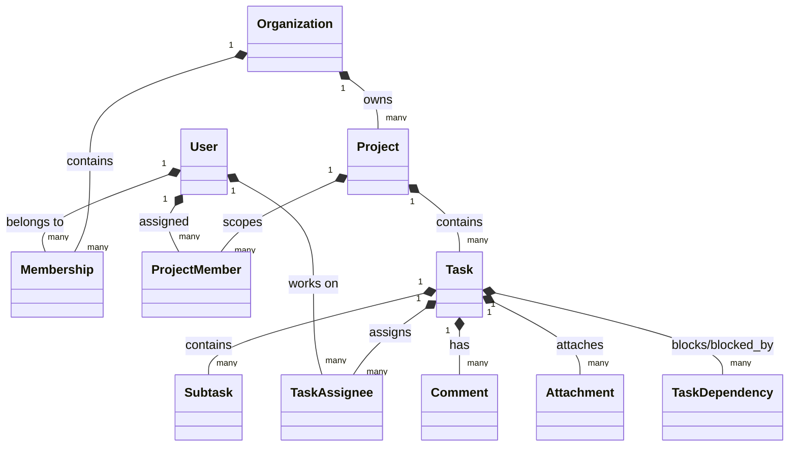
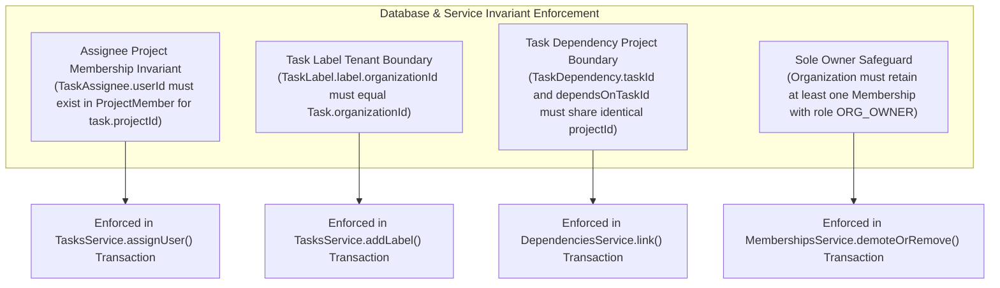

# TeamFlow — Database Entity Relationships & Foreign Key Specifications

**Document Version:** 1.0.0  
**Database Engine:** PostgreSQL 16  
**ORM:** Prisma 5+  
**Related Documents:** [`er-diagram.md`](./er-diagram.md), [`database-overview.md`](./database-overview.md), [`indexes-and-optimization.md`](./indexes-and-optimization.md)

---

## 1. Relational Cardinality & Ownership Matrix

This document defines the formal relationships, cardinality constraints, foreign key configurations, and cascading delete behaviors across the **TeamFlow** schema.



### Complete Relationship Specification Table

| Parent Entity | Child Entity | Cardinality | Foreign Key Column | `ON DELETE` Constraint | Business Rationale |
|---|---|:---:|---|---|---|
| `User` | `Session` | $1 : N$ | `Session.userId` | `CASCADE` | When a user account is purged, all active authentication sessions must be immediately destroyed. |
| `User` | `VerificationToken` | $1 : N$ | `VerificationToken.userId` | `CASCADE` | Ephemeral verification tokens have no purpose if the user account is removed. |
| `User` | `Membership` | $1 : N$ | `Membership.userId` | `CASCADE` | Purging a user account cleanly removes their memberships across all workspaces. |
| `Organization` | `Membership` | $1 : N$ | `Membership.organizationId` | `CASCADE` | Hard-deleting an organization automatically dissolves all memberships in that tenant. |
| `Organization` | `Invitation` | $1 : N$ | `Invitation.organizationId` | `CASCADE` | Deleting an organization purges all pending and historical invitations issued by that tenant. |
| `User` | `Invitation` | $1 : N$ | `Invitation.invitedById` | `SET NULL` | If the inviter's account is removed, the invitation record remains valid, recording `invitedById = NULL`. |
| `Organization` | `Project` | $1 : N$ | `Project.organizationId` | `CASCADE` | Deleting an organization removes all projects owned by that tenant. |
| `Project` | `ProjectMember` | $1 : N$ | `ProjectMember.projectId` | `CASCADE` | Hard-deleting a project purges its member access lists. |
| `User` | `ProjectMember` | $1 : N$ | `ProjectMember.userId` | `CASCADE` | Removing a user account cleanly revokes their project memberships. |
| `Organization` | `Task` | $1 : N$ | `Task.organizationId` | `CASCADE` | Direct tenant foreign key; cascades on organization purge. |
| `Project` | `Task` | $1 : N$ | `Task.projectId` | `CASCADE` | Hard-deleting a project cascades deletion to all child tasks. |
| `User` | `Task` (Creator) | $1 : N$ | `Task.creatorId` | `SET NULL` | If the creator leaves or deletes their account, the task remains intact with `creatorId = NULL`. |
| `Task` | `TaskAssignee` | $1 : N$ | `TaskAssignee.taskId` | `CASCADE` | Deleting a task automatically cleans up its assignment join records. |
| `User` | `TaskAssignee` | $1 : N$ | `TaskAssignee.userId` | `CASCADE` | Deleting a user unassigns them from all tasks. |
| `Task` | `TaskDependency` | $1 : N$ | `TaskDependency.taskId` | `CASCADE` | Deleting a task clears its dependency relationships. |
| `Task` | `TaskDependency` | $1 : N$ | `TaskDependency.dependsOnTaskId` | `CASCADE` | Deleting the blocking task unblocks the dependent task. |
| `Task` | `TaskStatusHistory` | $1 : N$ | `TaskStatusHistory.taskId` | `CASCADE` | Deleting a task removes its status audit records. |
| `User` | `TaskStatusHistory` | $1 : N$ | `TaskStatusHistory.changedById` | `SET NULL` | If the user who moved the card is deleted, history is preserved with `changedById = NULL`. |
| `Task` | `Subtask` | $1 : N$ | `Subtask.taskId` | `CASCADE` | Checklist items exist strictly within a parent task; deleting the task cascades to subtasks. |
| `Organization` | `Label` | $1 : N$ | `Label.organizationId` | `CASCADE` | Deleting an organization removes its custom categorization labels. |
| `Task` | `TaskLabel` | $1 : N$ | `TaskLabel.taskId` | `CASCADE` | Deleting a task cleans up label assignments. |
| `Label` | `TaskLabel` | $1 : N$ | `TaskLabel.labelId` | `CASCADE` | Deleting a label un-tags all associated tasks. |
| `Task` | `Comment` | $1 : N$ | `Comment.taskId` | `CASCADE` | Deleting a task removes all its discussion comments. |
| `User` | `Comment` | $1 : N$ | `Comment.authorId` | `SET NULL` | If a user deletes their account, their comments remain visible as `"Former Member"` (`authorId = NULL`). |
| `Organization` | `Attachment` | $1 : N$ | `Attachment.organizationId` | `CASCADE` | Direct tenant foreign key; cascades on organization purge. |
| `Task` | `Attachment` | $1 : N$ | `Attachment.taskId` | `CASCADE` | Deleting a task deletes its attachment metadata records in PostgreSQL. |
| `User` | `Attachment` | $1 : N$ | `Attachment.uploaderId` | `SET NULL` | If the uploader is deleted, the file metadata remains with `uploaderId = NULL`. |
| `Organization` | `Notification` | $1 : N$ | `Notification.organizationId` | `CASCADE` | Deleting an organization removes all notifications generated within it. |
| `User` | `Notification` (Recipient) | $1 : N$ | `Notification.recipientId` | `CASCADE` | Deleting a user account removes their personal in-app notifications. |
| `User` | `Notification` (Actor) | $1 : N$ | `Notification.actorId` | `SET NULL` | If the actor is deleted, the notification remains with `actorId = NULL`. |
| `Organization` | `ActivityLog` | $1 : N$ | `ActivityLog.organizationId` | `RESTRICT` | **Compliance Safeguard:** An organization cannot be hard-deleted if active audit logs are locked under retention. |
| `User` | `ActivityLog` | $1 : N$ | `ActivityLog.actorId` | `SET NULL` | **GDPR Right to Erasure:** Deleting a user pseudonymizes audit logs by setting `actorId = NULL`. |

---

## 2. Many-to-Many Join Tables & Composite Constraints

To prevent duplicate associations and race conditions, join tables enforce strict composite unique keys at the database level:

### 2.1 Workspace Membership (`Membership`)
- **Composite Unique Key:** `UNIQUE (organizationId, userId)`
- **Constraint:** A user can only possess one active membership record per organization.

### 2.2 Project Membership (`ProjectMember`)
- **Composite Unique Key:** `UNIQUE (projectId, userId)`
- **Constraint:** A user can only be assigned once to a project.

### 2.3 Task Assignment (`TaskAssignee`)
- **Composite Unique Key:** `UNIQUE (taskId, userId)`
- **Constraint:** A user cannot be assigned multiple times to the same task.

### 2.4 Task Dependencies (`TaskDependency`)
- **Composite Unique Key:** `UNIQUE (taskId, dependsOnTaskId)`
- **Check Constraint:** `CHECK (taskId <> dependsOnTaskId)`
- **Constraint:** A task can never depend on itself. Graph cycle detection algorithms prevent transitive circular dependencies ($A \rightarrow B \rightarrow A$).

### 2.5 Task Labels (`TaskLabel`)
- **Composite Unique Key:** `UNIQUE (taskId, labelId)`
- **Constraint:** A label cannot be applied to the same task multiple times.

---

## 3. Data Integrity & Domain Invariants



1. **Assignee Scoping Invariant:** Before inserting a `TaskAssignee` record, the backend transaction validates:
   ```sql
   SELECT 1 FROM project_members 
   WHERE project_id = (SELECT project_id FROM tasks WHERE id = :taskId)
     AND user_id = :targetUserId;
   ```
   If no record exists, the transaction aborts with HTTP 400 `ASSIGNEE_NOT_IN_PROJECT`.
2. **Label Tenant Invariant:** A task can only be tagged with a `Label` that belongs to the same `organizationId`.
3. **Dependency Project Boundary Invariant:** A dependency can only be created between tasks belonging to the **same project**. Cross-project task dependencies are forbidden in Version 1.0.
4. **Sole Owner Invariant:** The database transaction for role modification or member removal checks:
   ```sql
   SELECT COUNT(*) FROM memberships 
   WHERE organization_id = :orgId AND role = 'ORG_OWNER';
   ```
   If count $\le 1$, the operation is rejected with HTTP 400 `LAST_OWNER_CANNOT_BE_REMOVED`.
