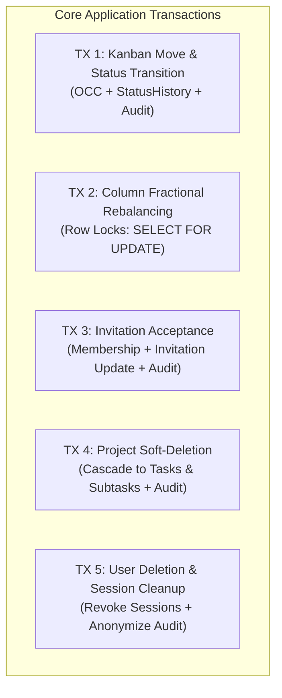
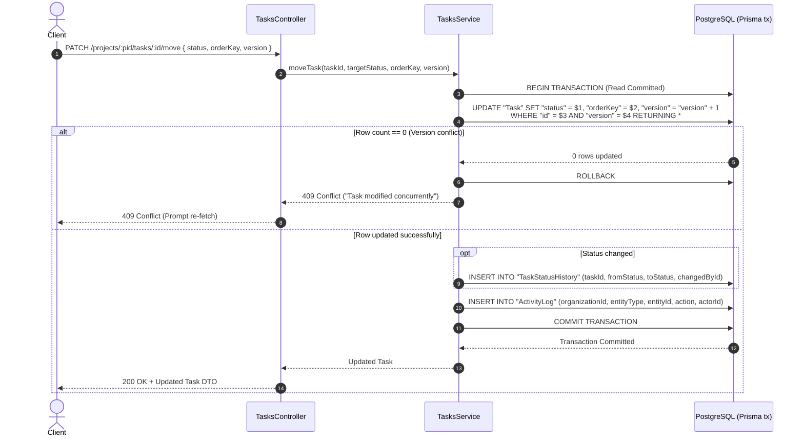
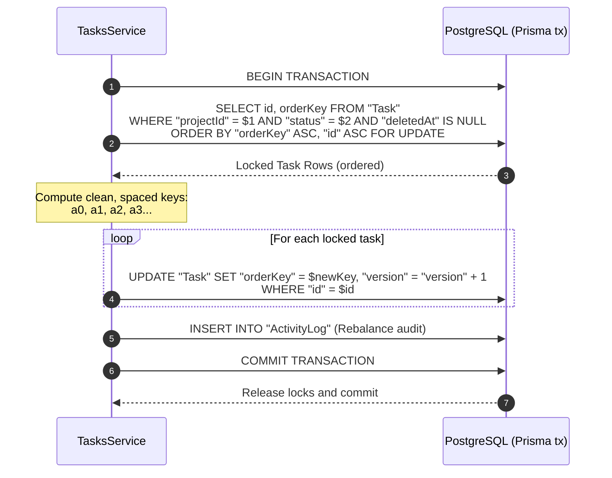
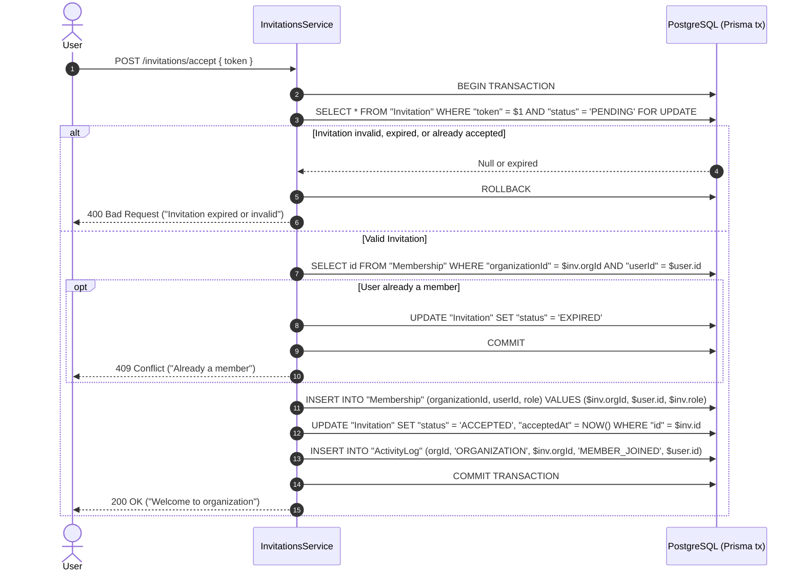
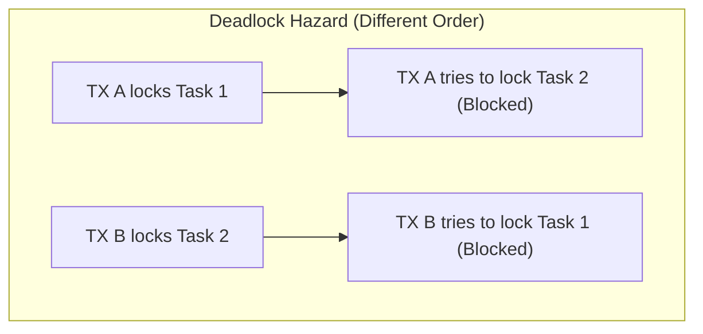

# TeamFlow — Database Transaction Boundaries & Concurrency Control

**Document Version:** 1.0.0  
**Database Engine:** PostgreSQL 16  
**ORM:** Prisma 5+  
**Default Isolation Level:** Read Committed (PostgreSQL Default)  
**Related Documents:** [`er-diagram.md`](./er-diagram.md), [`database-overview.md`](./database-overview.md), [`relationships.md`](./relationships.md), [`indexes-and-optimization.md`](./indexes-and-optimization.md)

---

## 1. Architectural Philosophy & ACID Guarantees

In TeamFlow, transactions are not optional performance wrappers; they are the boundary of **business invariant enforcement**. Every operation that mutates multiple related tables or requires atomic state transitions MUST execute within a database transaction.

### Core ACID Principles in TeamFlow
1. **Atomicity (All or Nothing):** If any query inside an operation fails (e.g., duplicate unique constraint, foreign key violation, network drop), every change within that transaction is rolled back completely. No orphaned records (such as an updated task without a status history record) can exist.
2. **Consistency (Preserving Invariants):** Every transaction transitions the database from one valid state to another, strictly satisfying all `FOREIGN KEY`, `CHECK`, `NOT NULL`, and `UNIQUE` constraints.
3. **Isolation (Concurrent Execution Safety):** TeamFlow standardizes on PostgreSQL's **Read Committed** isolation level for standard operations, combined with explicit **Optimistic Concurrency Control (OCC)** via version stamping and targeted **Pessimistic Row-Level Locking (`SELECT ... FOR UPDATE`)** for rebalancing operations.
4. **Durability (Committed Data Persists):** Once PostgreSQL returns confirmation of a commit, the changes are written to the Write-Ahead Log (WAL) and are guaranteed to survive server crashes or restarts.

---

## 2. Critical Transaction Boundaries



---

### TX-01: Kanban Task Reordering & Status Transition

When a user drags a task between columns or changes its position in a Kanban view:
- **Tables Modified:** `Task`, `TaskStatusHistory` (if status changed), `ActivityLog`.
- **Concurrency Control:** Optimistic Concurrency Control (OCC) using `Task.version`.



#### TypeScript / Prisma Implementation Pattern
```typescript
async function moveTask(
  taskId: string,
  targetStatus: TaskStatus,
  newOrderKey: string,
  expectedVersion: number,
  actorId: string,
  organizationId: string
): Promise<Task> {
  return await prisma.$transaction(async (tx) => {
    // 1. Fetch current task to verify existence and capture previous status
    const currentTask = await tx.task.findUnique({
      where: { id: taskId, deletedAt: null },
      select: { id: true, status: true, version: true, organizationId: true, projectId: true },
    });

    if (!currentTask || currentTask.organizationId !== organizationId) {
      throw new NotFoundException('Task not found');
    }

    if (currentTask.version !== expectedVersion) {
      throw new ConflictException('Task was modified by another user. Please refresh and retry.');
    }

    // 2. Perform atomic update with version increment
    const updatedTask = await tx.task.update({
      where: { id: taskId, version: expectedVersion },
      data: {
        status: targetStatus,
        orderKey: newOrderKey,
        version: { increment: 1 },
      },
    });

    // 3. Record status history if column changed
    if (currentTask.status !== targetStatus) {
      await tx.taskStatusHistory.create({
        data: {
          taskId,
          fromStatus: currentTask.status,
          toStatus: targetStatus,
          changedById: actorId,
        },
      });
    }

    // 4. Record immutable activity log
    await tx.activityLog.create({
      data: {
        organizationId,
        actorId,
        entityType: 'TASK',
        entityId: taskId,
        action: 'TASK_MOVED',
        metadata: {
          previousStatus: currentTask.status,
          newStatus: targetStatus,
          orderKey: newOrderKey,
        },
      },
    });

    return updatedTask;
  }, {
    maxWait: 5000,
    timeout: 10000,
    isolationLevel: Prisma.TransactionIsolationLevel.ReadCommitted,
  });
}
```

---

### TX-02: Kanban Column Fractional Rebalancing

When consecutive drag-and-drop operations exhaust fractional index precision (e.g. key length exceeds 64 characters) or when duplicate keys are detected:
- **Tables Modified:** `Task` (multiple rows within single column).
- **Concurrency Control:** Pessimistic Row Locking (`SELECT ... FOR UPDATE`) to prevent concurrent moves during rebalancing.



#### TypeScript / Prisma Implementation Pattern
```typescript
async function rebalanceColumn(
  projectId: string,
  status: TaskStatus,
  organizationId: string,
  actorId: string
): Promise<void> {
  await prisma.$transaction(async (tx) => {
    // 1. Acquire pessimistic lock on all tasks in this column
    const tasks = await tx.$queryRaw<Array<{ id: string }>>`
      SELECT id FROM "Task"
      WHERE "projectId" = ${projectId}::uuid
        AND "status" = ${status}::"TaskStatus"
        AND "deletedAt" IS NULL
      ORDER BY "orderKey" ASC, "id" ASC
      FOR UPDATE
    `;

    if (tasks.length === 0) return;

    // 2. Generate evenly spaced fractional keys
    const rebalancedKeys = generateUniformKeys(tasks.length);

    // 3. Batch update the keys atomically
    for (let i = 0; i < tasks.length; i++) {
      await tx.task.update({
        where: { id: tasks[i].id },
        data: {
          orderKey: rebalancedKeys[i],
          version: { increment: 1 },
        },
      });
    }

    // 4. Record audit event
    await tx.activityLog.create({
      data: {
        organizationId,
        actorId,
        entityType: 'PROJECT',
        entityId: projectId,
        action: 'KANBAN_REBALANCED',
        metadata: { status, taskCount: tasks.length },
      },
    });
  }, {
    timeout: 15000, // Allow up to 15s for large column rebalances
    isolationLevel: Prisma.TransactionIsolationLevel.ReadCommitted,
  });
}
```

---

### TX-03: Invitation Acceptance & Member Onboarding

When an invited user clicks the invitation acceptance link:
- **Tables Modified:** `Invitation`, `Membership`, `ActivityLog`.
- **Guarantees:** The invitation must be in `PENDING` state and not expired. The user must not already be an active member of the organization.



---

### TX-04: Project Soft-Deletion & Resource Cascading

When an administrator soft-deletes a project:
- **Tables Modified:** `Project`, `Task`, `ActivityLog`.
- **Guarantees:** Soft-deletes the project and all active tasks within it in a single atomic transaction. Prevents orphaned active tasks from appearing in global searches or dashboard metrics.

```typescript
async function softDeleteProject(
  projectId: string,
  organizationId: string,
  actorId: string
): Promise<void> {
  await prisma.$transaction(async (tx) => {
    const now = new Date();

    // 1. Soft-delete the project
    const project = await tx.project.update({
      where: { id: projectId, organizationId, deletedAt: null },
      data: { deletedAt: now },
    });

    // 2. Cascade soft-delete to all child tasks
    await tx.task.updateMany({
      where: { projectId, deletedAt: null },
      data: { deletedAt: now },
    });

    // 3. Record audit trail
    await tx.activityLog.create({
      data: {
        organizationId,
        actorId,
        entityType: 'PROJECT',
        entityId: projectId,
        action: 'PROJECT_DELETED',
        metadata: { projectName: project.name, deletedAt: now.toISOString() },
      },
    });
  });
}
```

---

### TX-05: Task Assignment Batch Synchronization

When a project manager assigns multiple users to a task:
- **Tables Modified:** `TaskAssignee`, `ActivityLog`, `Notification` (batch created).
- **Guarantees:** Verifies all assigned users are active members of the organization. Atomically syncs the join table (inserts new, removes unassigned) to prevent partial assignment state.

```typescript
async function syncTaskAssignees(
  taskId: string,
  targetUserIds: string[],
  organizationId: string,
  actorId: string
): Promise<void> {
  await prisma.$transaction(async (tx) => {
    // 1. Verify task belongs to organization
    const task = await tx.task.findUniqueOrThrow({
      where: { id: taskId, organizationId, deletedAt: null },
      select: { id: true, title: true, projectId: true },
    });

    // 2. Verify all target users are valid organization members
    if (targetUserIds.length > 0) {
      const validMembers = await tx.membership.count({
        where: {
          organizationId,
          userId: { in: targetUserIds },
        },
      });

      if (validMembers !== targetUserIds.length) {
        throw new BadRequestException('One or more assignees are not members of this organization.');
      }
    }

    // 3. Fetch existing assignees
    const currentAssignees = await tx.taskAssignee.findMany({
      where: { taskId },
      select: { userId: true },
    });
    const currentUserIds = new Set(currentAssignees.map(a => a.userId));
    const targetUserIdSet = new Set(targetUserIds);

    // 4. Calculate diff
    const toAdd = targetUserIds.filter(id => !currentUserIds.has(id));
    const toRemove = [...currentUserIds].filter(id => !targetUserIdSet.has(id));

    // 5. Delete unassigned
    if (toRemove.length > 0) {
      await tx.taskAssignee.deleteMany({
        where: { taskId, userId: { in: toRemove } },
      });
    }

    // 6. Insert new assignees
    if (toAdd.length > 0) {
      await tx.taskAssignee.createMany({
        data: toAdd.map(userId => ({
          taskId,
          userId,
          assignedById: actorId,
        })),
      });

      // 7. Dispatch notifications for newly assigned users (excluding self-assignment)
      const notifyUsers = toAdd.filter(uid => uid !== actorId);
      if (notifyUsers.length > 0) {
        await tx.notification.createMany({
          data: notifyUsers.map(recipientId => ({
            organizationId,
            recipientId,
            type: 'TASK_ASSIGNED',
            title: 'New Task Assignment',
            body: `You have been assigned to task: ${task.title}`,
            resourceType: 'TASK',
            resourceId: taskId,
          })),
        });
      }
    }

    // 8. Audit log
    await tx.activityLog.create({
      data: {
        organizationId,
        actorId,
        entityType: 'TASK',
        entityId: taskId,
        action: 'TASK_ASSIGNMENT_UPDATED',
        metadata: { added: toAdd, removed: toRemove },
      },
    });
  });
}
```

---

## 3. Concurrency Control Strategies: OCC vs. Pessimistic Locking

| Strategy | Mechanism | Use Case in TeamFlow | Trade-offs |
| :--- | :--- | :--- | :--- |
| **Optimistic Concurrency Control (OCC)** | `version INT DEFAULT 1` incremented on every update (`WHERE id = :id AND version = :v`) | High-frequency single-task updates (Kanban moves, title edits, status changes) | High throughput; non-blocking; requires client retry on 409 Conflict. |
| **Pessimistic Row Locking** | `SELECT ... FOR UPDATE` | Rebalancing fractional order keys; Invitation token consumption | Completely prevents race conditions; serializes concurrent requests; held only for milliseconds within a transaction. |
| **Database Constraints** | `UNIQUE` composite indexes | Multi-tenant duplicate prevention (`(organizationId, name)` or `(taskId, userId)`) | Absolute consistency at engine level; eliminates race window without software-level locking. |

---

## 4. Deadlock Prevention Guidelines

When multiple concurrent transactions update multiple tables or multiple rows in the same table, deadlocks can occur if locks are acquired in different orders:



### TeamFlow Deadlock Prevention Rules:
1. **Deterministic Row Ordering:** Whenever batch operations update or lock multiple rows, always sort by primary key in ascending order (`ORDER BY id ASC`) before applying updates or `FOR UPDATE` locks.
2. **Consistent Table Access Order:** In multi-table transactions, always modify parent entities before child entities:
   - Order: `Organization` $\to$ `Project` $\to$ `Task` $\to$ `Subtask` / `Comment` $\to$ `ActivityLog`.
3. **Keep Transactions Short:** Never perform external network calls (e.g. AWS S3 uploads, email sending via SendGrid, Redis publishing) inside a database transaction block. Perform database mutations first, commit, and then execute external side effects asynchronously.
4. **Explicit Timeouts:** Every interactive Prisma transaction must configure `maxWait: 5000` (time to acquire connection) and `timeout: 10000` (execution deadline) to prevent stuck transactions from holding locks indefinitely.

---

## 5. Prisma Transaction Error Handling Matrix

| Prisma Error Code | PostgreSQL SQLSTATE | Cause | Application Handling | HTTP Response |
| :--- | :--- | :--- | :--- | :--- |
| **`P2002`** | `23505` | Unique constraint violation (e.g., duplicate slug, email, assignee) | Catch error, map target field to user-friendly message | `409 Conflict` |
| **`P2003`** | `23503` | Foreign key constraint failure (e.g., parent project deleted) | Catch error, inform client that referenced entity no longer exists | `400 Bad Request` or `404 Not Found` |
| **`P2025`** | `N/A` | Record not found or OCC version mismatch during update | Catch error, trigger stale state workflow | `409 Conflict` or `404 Not Found` |
| **`P2034`** | `40P01` / `40001` | Transaction failed due to deadlock or write conflict | Retry transaction with exponential backoff (up to 3 times) | `503 Service Unavailable` (if retries exhausted) |
| **`P2028`** | `N/A` | Transaction timeout reached | Log alert, inspect query execution time | `504 Gateway Timeout` |

