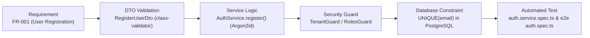
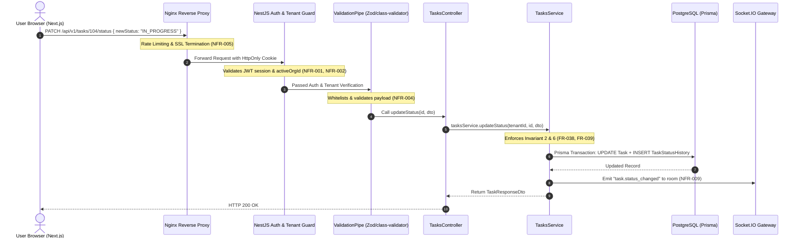

# Engineering Learning Note 01: Software Requirements Specification (SRS) in Modern SaaS Engineering

**Topic:** Requirements Engineering, Traceability, and Defect Cost Prevention  
**Application Context:** TeamFlow Multi-Tenant SaaS Project Management Platform  
**Target Audience:** Full-Stack Software Engineer (Preparation for Senior Engineering Roles & Technical Interviews)  
**Governing Standard:** IEEE 830 / ISO/IEC/IEEE 29148 & [`AGENTS.md`](../../../AGENTS.md)

---

## 1. What Was Implemented

In this initial phase of TeamFlow, we implemented the complete **Software Requirements Specification (SRS)** framework located in `docs/00-project-overview/`:

1. **[`requirements.md`](../../00-project-overview/requirements.md):** 81 granular functional requirements (`FR-001` through `FR-081`) spanning 12 business modules, alongside 20 measurable non-functional requirements (`NFR-001` through `NFR-020`).
2. **[`project-vision.md`](../../00-project-overview/project-vision.md):** Product objectives, problem definition, competitive analysis (Linear + Trello + Asana + Slack), and user personas.
3. **[`user-journeys-and-workflows.md`](../../00-project-overview/user-journeys-and-workflows.md):** Formal Mermaid sequence diagrams and state machines for registration, onboarding, invitations, Kanban optimistic drag-and-drop, and real-time broadcasting.
4. **[`business-rules-and-security.md`](../../00-project-overview/business-rules-and-security.md):** Inviolable business invariants, multi-tenant row-level isolation guarantees, OWASP Top 10 threat models, and failure scenario recovery.
5. **[`scope-and-roadmap.md`](../../00-project-overview/scope-and-roadmap.md):** Strict MVP (v1.0) vs. deferred (v2.0+) scope boundaries, M1–M8 milestones, and the 7-step Definition of Done.
6. **[`glossary.md`](../../00-project-overview/glossary.md):** Comprehensive technical and domain dictionary.

---

## 2. Why It Is Necessary

A common anti-pattern among junior developers and poorly run startups is **"Cowboy Coding"**—jumping immediately into `npm install`, creating random database tables, and writing React components before understanding the full problem space.

In software engineering, requirements defects are the most expensive bugs in existence.

### The Boehm Defect Cost Amplification Curve
Barry Boehm's classic software economics research demonstrated that the relative cost to identify and fix a software defect increases exponentially through each phase of development:

```text
Cost Multiplier
  200x |                                                    [Production Outage]
  100x |                                            *
   50x |                                    * [Testing/QA]
   20x |                            *
   10x |                    * [Implementation]
    5x |            * [Architecture/Design]
    1x |____* [Requirements/SRS]_______________________________________________
           Reqs     Arch         Code       QA            Production
```

- **In the Requirements Phase ($1\times$ cost):** If we realize that a task shouldn't be assigned to an employee who isn't a member of the project, we simply add a bullet point (`FR-041`). Cost: 2 minutes of text editing.
- **In the Architecture Phase ($5\times$ cost):** We add a composite foreign key or a join table constraint (`ProjectMember`). Cost: 30 minutes of schema revision.
- **In the Implementation Phase ($10\times$ cost):** If discovered while coding, we must rewrite NestJS services, update DTOs, modify frontend forms, and adjust UI dropdowns. Cost: 1 day of development.
- **In the Testing Phase ($50\times$ cost):** If caught in QA, tickets are filed, code is rolled back, database schemas are modified with new migrations, and the full regression test suite must be re-run. Cost: 3 days of engineer/QA time.
- **In Production ($100\times–200\times+$ cost):** If an unauthorized employee in Company B sees confidential tasks in Company A because tenant scoping was ambiguous, the company faces catastrophic data breach liabilities, emergency data migrations, customer loss, and potential legal penalties under GDPR/SOC2. Cost: Tens of thousands of dollars and severe reputational damage.

By producing an exhaustive SRS before writing application code, we eliminate ambiguities when they cost almost nothing to fix.

---

## 3. The Underlying Technical Concepts

### 3.1 Functional vs. Non-Functional Requirements
- **Functional Requirements (FRs):** Describe **what the system does**—its specific behaviors, inputs, business calculations, state transitions, and API outputs. Example: `FR-048` specifies that dragging a card to a new column updates the task status, calculates a new fractional order index, records status history, and emits a WebSocket event.
- **Non-Functional Requirements (NFRs):** Describe **how well the system performs**—its quality attributes, performance envelopes, security standards, and operational limits. Crucially, a professional NFR must be **quantitatively measurable**. Stating *"The API must be fast"* is not an engineering requirement; stating *"The read API must achieve a p95 latency under 200 ms with 100 concurrent users"* (`NFR-007`) is an enforceable engineering requirement.

### 3.2 The Traceability Matrix
Traceability is the ability to link every software artifact back to its originating requirement.



In TeamFlow, this traceability ensures:
1. **Zero Gold-Plating:** We never write code that doesn't solve an approved requirement.
2. **Comprehensive Test Coverage:** For every `FR-xxx`, at least one automated unit or integration test exists to verify its acceptance criteria.
3. **Change Impact Analysis:** If a requirement changes, we can instantly trace which files, schemas, and tests require modification.

---

## 4. How It Works Internally: Architecture & Data Flow

In TeamFlow's modular monolith architecture, the requirements directly inform the structure of our NestJS modules and data flows.

### Request-to-Requirement Lifecycle Flow



---

## 5. Important Files & Architectural Responsibilities

The requirements established in this phase dictate the structure of the entire repository:

```text
TeamFlow/
├── AGENTS.md                                   # Persistent AI engineering instructions
├── docs/
│   ├── 00-project-overview/                    # Current Deliverable: Foundational SRS
│   │   ├── README.md                           # Directory index & SRS rationale
│   │   ├── project-vision.md                   # Product vision, objectives & personas
│   │   ├── requirements.md                     # Complete FR-xxx & NFR-xxx specifications
│   │   ├── user-journeys-and-workflows.md      # Mermaid sequence diagrams & state flows
│   │   ├── business-rules-and-security.md      # Business invariants & threat model
│   │   ├── scope-and-roadmap.md                # MVP boundaries, milestones & DoD
│   │   └── glossary.md                         # Domain and technical dictionary
│   ├── 01-architecture/                        # Next: Modular monolith design & ADRs
│   ├── 02-database/                            # Next: PostgreSQL schema & ERD
│   ├── 03-backend/                             # Next: NestJS module specifications
│   ├── 04-frontend/                            # Next: Next.js layout & state design
│   ├── 05-devops/                              # Docker, Nginx, CI/CD specifications
│   ├── 06-security/                            # Penetration testing & tenant isolation
│   ├── 07-testing/                             # Unit, Integration, and E2E test plan
│   └── 08-learning-notes/                      # Educational documentation (This file)
└── context/                                    # Raw reference consultation files
```

---

## 6. Practical Code & Specification Examples

### Example 1: Enforcing FR-041 (Assignee Project Membership Validation)

In our SRS, `FR-041` states: *"A task cannot be assigned to someone who is not a member of its project."*

Here is how that requirement translates directly into production NestJS business logic:

```typescript
// src/tasks/tasks.service.ts
import { Injectable, BadRequestException, ForbiddenException } from '@nestjs/common';
import { PrismaService } from '../infrastructure/prisma.service';

@Injectable()
export class TasksService {
  constructor(private readonly prisma: PrismaService) {}

  async assignUserToTask(
    organizationId: string,
    projectId: string,
    taskId: string,
    targetUserId: string,
  ): Promise<void> {
    // 1. Enforce Tenant & Project Boundaries (FR-024, NFR-001)
    const task = await this.prisma.task.findFirst({
      where: {
        id: taskId,
        projectId: projectId,
        organizationId: organizationId,
        deletedAt: null,
      },
    });

    if (!task) {
      throw new ForbiddenException('Task does not exist or access is unauthorized.');
    }

    // 2. Enforce Invariant 6 / FR-041 (Assignee must belong to the Project)
    const projectMembership = await this.prisma.projectMember.findUnique({
      where: {
        projectId_userId: {
          projectId: projectId,
          userId: targetUserId,
        },
      },
    });

    if (!projectMembership) {
      // Rejection with unambiguous error code defined in SRS
      throw new BadRequestException({
        statusCode: 400,
        errorCode: 'ASSIGNEE_NOT_IN_PROJECT',
        message: 'The proposed assignee is not an authorized member of this project.',
      });
    }

    // 3. Atomically Insert Assignment and Audit Record (NFR-012, FR-072)
    await this.prisma.$transaction([
      this.prisma.taskAssignee.create({
        data: {
          taskId: taskId,
          userId: targetUserId,
        },
      }),
      this.prisma.activityLog.create({
        data: {
          organizationId: organizationId,
          entityType: 'TASK',
          entityId: taskId,
          actionType: 'TASK_ASSIGNED',
          metadata: { assignedUserId: targetUserId },
        },
      }),
    ]);
  }
}
```

### Example 2: Realistic API Request / Response (FR-048 Status Transition)

**HTTP Request:**
```http
PATCH /api/v1/tasks/550e8400-e29b-41d4-a716-446655440000/status HTTP/1.1
Host: api.teamflow.local
Content-Type: application/json
Cookie: teamflow_session=eyJhbGciOiJIUzI1Ni...

{
  "newStatus": "IN_PROGRESS",
  "prevTaskId": "330e8400-e29b-41d4-a716-446655440001",
  "nextTaskId": "440e8400-e29b-41d4-a716-446655440002"
}
```

**HTTP Success Response (200 OK):**
```json
{
  "statusCode": 200,
  "data": {
    "id": "550e8400-e29b-41d4-a716-446655440000",
    "projectId": "110e8400-e29b-41d4-a716-446655440000",
    "title": "Implement Argon2id password hashing",
    "status": "IN_PROGRESS",
    "priority": "HIGH",
    "orderIndex": 4.5,
    "updatedAt": "2026-11-02T01:15:00.000Z"
  }
}
```

**HTTP Error Response (400 Bad Request on Circular Dependency):**
```json
{
  "statusCode": 400,
  "error": "BAD_REQUEST",
  "errorCode": "CIRCULAR_DEPENDENCY_DETECTED",
  "message": "Cannot add dependency: Task A already depends on Task B directly or indirectly.",
  "timestamp": "2026-11-02T01:15:02.120Z",
  "path": "/api/v1/tasks/550e8400-e29b-41d4-a716-446655440000/dependencies"
}
```

---

## 7. Alternative Approaches & Architectural Trade-offs

| Decision | Alternative Considered | Chosen Approach | Why We Chose It (Trade-off Analysis) |
|---|---|---|---|
| **Multi-Tenancy Model** | **Database-per-tenant** (Each organization gets its own PostgreSQL DB) | **Shared Database with Row-Level Scoping** (`organizationId` on all tables) | • *Alternative:* Extreme isolation, but running migrations across 500 databases is an operational nightmare and infrastructure costs scale linearly.<br>• *Chosen:* Highly cost-effective, simple migrations with Prisma, and identical security guarantees when backed by rigorous query scoping and automated isolation tests. |
| **System Architecture** | **Microservices** (Separate Auth, Project, Task, and Notification microservices) | **Modular Monolith** in NestJS | • *Alternative:* Independent scaling, but introduces distributed transactions (Saga pattern), eventual consistency lag, network latency, and massive Docker overhead.<br>• *Chosen:* Fast local development, ACID database transactions, clean module boundaries, and simple deployment while retaining the ability to extract microservices later if scaling demands it. |
| **Session Management** | **Stateless JWT in localStorage** | **Stateful Session / Rotated Refresh Token in HttpOnly Cookies** | • *Alternative:* Simple to implement, but vulnerable to XSS token theft, and impossible to revoke active sessions instantly when an employee is terminated.<br>• *Chosen:* Maximum security against XSS; enables immediate remote session revocation (`FR-012`) and full session auditability. |

---

## 8. Security & Performance Considerations

### Security Rules Established by the SRS
1. **Never Trust the Client:** An incoming request must never be permitted to specify its own `organizationId` in the body or URL without the backend verifying that the user belongs to that organization.
2. **Defensive Database Queries:** Every single database query executed by Prisma must include `organizationId: activeOrgId`. Even if an attacker guesses the UUID of a task in another tenant, the query returns `null`, preventing existence disclosure.
3. **Argon2id vs bcrypt:** Argon2id is intentionally selected over bcrypt because it provides tunable memory hardness ($m=65536$), resisting modern parallelized GPU attacks.

### Performance Envelopes
1. **Composite Indexing:** High-frequency queries (e.g., loading Kanban tasks for a project) require composite indexes on `(projectId, status, orderIndex)` to prevent PostgreSQL table scans.
2. **Read vs. Write Budgets:** Read queries have a strict p95 budget of < 200 ms. Dashboard queries must leverage Redis cache-aside invalidation (`NFR-008`).

---

## 9. Testing Strategy Derived from the SRS

Because requirements have unique IDs, our testing strategy maps 1:1 to them:

1. **Unit Tests (Jest):**
   - Test password hashing complexity validation (`FR-001`).
   - Test circular dependency cycle detection algorithm (`FR-045`).
   - Test fractional indexing position math (`FR-050`).
2. **Integration Tests (NestJS + TestContainers / Postgres):**
   - Attempt cross-tenant queries: Authenticate as Tenant A, query Tenant B's tasks, assert 403 Forbidden (`NFR-001`).
   - Attempt demoting the last organization owner: assert 400 Bad Request (`FR-023`).
   - Assign a non-project user to a task: assert 400 Bad Request (`FR-041`).
3. **End-to-End Tests (Playwright):**
   - Execute full user journeys (Registration $\rightarrow$ Org Creation $\rightarrow$ Member Invite $\rightarrow$ Project Creation $\rightarrow$ Kanban drag-and-drop).
   - Verify WebSocket real-time synchronization across two simulated browser contexts.

---

## 10. Common Mistakes to Avoid in Requirements Engineering

1. **Vague, Unmeasurable NFRs:** Writing *"The system should be secure and fast"* is useless. Always specify quantitative metrics: *"Argon2id with 64MB memory, p95 read < 200ms."*
2. **Confusing Authentication with Authorization:** Authentication verifies *who you are* (email/password valid). Authorization verifies *what you are allowed to do* (is this user allowed to delete this specific project?). Always enforce both independently.
3. **Implicit Multi-Tenancy:** Assuming that filtering by `projectId` is enough. If a project query forgets to verify `organizationId`, an IDOR vulnerability is born.
4. **Skipping Edge Cases in the Spec:** Omitting concurrent updates or network drops from the requirements leads to broken frontend state in production.

---

## 11. Technical Interview Questions & Answers

### Q1: "Why would you choose a Modular Monolith over Microservices for a new SaaS product?"
**Answer:**  
*"Starting with microservices introduces distributed-systems overhead—such as network latency, data consistency challenges, distributed tracing, and complex deployments—before the business domain boundaries are proven. A modular monolith in NestJS provides the best of both worlds: strict domain encapsulation, clear module interfaces, and type safety, but with zero network overhead between modules and full ACID database transaction guarantees. If a specific business module later experiences disproportionate load, its clean boundaries make extracting it into a microservice straightforward."*

### Q2: "How do you prevent cross-tenant data leakage in a multi-tenant application with a shared database?"
**Answer:**  
*"Cross-tenant data protection requires defense-in-depth across three layers:*  
1. *At the Guard layer: A global `TenantGuard` extracts the authenticated user's session, verifies their active organization membership, and injects the validated `organizationId` into the request context.*  
2. *At the Service layer: All database queries are explicitly partitioned by this validated `organizationId`. We never trust an organization ID provided in the HTTP request payload.*  
3. *At the Automated Test layer: We maintain explicit negative integration tests that intentionally simulate an authenticated user from Tenant A attempting to read, update, and delete resources belonging to Tenant B, asserting that the system consistently rejects them with 403 Forbidden or 404 Not Found."*

### Q3: "What is Barry Boehm's Defect Cost Curve, and how did it influence your project methodology?"
**Answer:**  
*"Boehm's curve demonstrates that the cost to fix a software defect increases exponentially through each phase of development—from $1\times$ in requirements, to $5\times$ in design, $10\times$ in coding, $50\times$ in QA, and over $100\times$ in production. By defining granular functional requirements (`FR-xxx`), non-functional criteria (`NFR-xxx`), role-permission matrices, and failure edge cases before writing application code, we resolved critical architectural ambiguities at the lowest possible cost, establishing a solid foundation for implementation and automated testing."*

