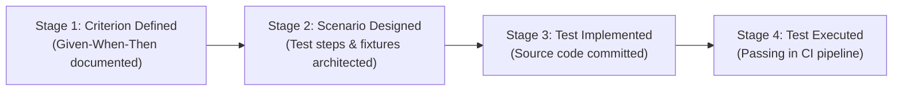
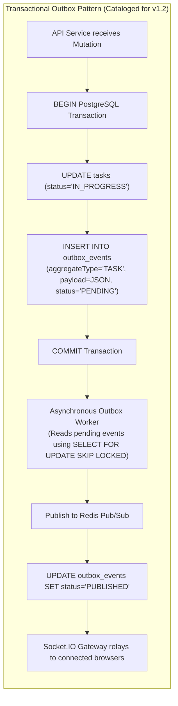

# Engineering Learning Note 02: Requirements Validation, Traceability & Advanced SaaS Architectural Mechanics

**Topic:** Verification vs. Validation, Requirements Consistency Auditing, Traceability Matrices, String-Based Fractional Indexing, Optimistic Concurrency, and Event Delivery Architectures  
**Application Context:** TeamFlow Multi-Tenant SaaS Project Management Platform  
**Target Audience:** Full-Stack Software Engineer (Preparation for Senior Software Architect & Technical Lead Roles)  
**Governing Standard:** IEEE 830 / ISO/IEC/IEEE 29148 & [`AGENTS.md`](../../../AGENTS.md)  
**Related Documents:** [`requirements-review-report.md`](../../00-project-overview/requirements-review-report.md), [`traceability-matrix.md`](../../00-project-overview/traceability-matrix.md), [`requirements.md`](../../00-project-overview/requirements.md)

---

## 1. What Was Implemented

In this architectural audit and hardening phase of TeamFlow, we executed a comprehensive **Requirements Validation, Consistency Audit, and Architectural Hardening**:

1. **Reconciled Requirements Specification ([`requirements.md`](../../00-project-overview/requirements.md)):** Re-issued version 1.2.0 incorporating the 6 approved architecture decisions (Q1–Q6) and hardening 7 critical technical areas (Kanban concurrency, layered authorization, anti-lockout rate limiting, file upload security, real-time event reliability, exact analytics formulas, and phased release planning).
2. **Reconciled User Journeys & Workflows ([`user-journeys-and-workflows.md`](../../00-project-overview/user-journeys-and-workflows.md)):** Updated sequence and state diagrams for creator-to-PM assignment, string fractional indexing, optimistic version conflicts, and guest moderation.
3. **Four-Stage Requirements Traceability Matrix ([`traceability-matrix.md`](../../00-project-overview/traceability-matrix.md)):** Upgraded the matrix to distinguish between:
   - *Acceptance Criterion Defined*
   - *Test Scenario Designed*
   - *Automated Test Implemented (Currently: Planned)*
   - *Automated Test Executed (Currently: Pending)*
4. **Requirements Review & Audit Report ([`requirements-review-report.md`](../../00-project-overview/requirements-review-report.md)):** Formalized the complete decision log, technical evaluations, and requirements sign-off checklist.

---

## 2. Why It Is Necessary: The Engineering Rationale

Writing software requirements is not an administrative formality; it is the **primary line of defense against catastrophic system failure**.

Inconsistent requirements create compounding engineering friction:
- **Ripple Effects:** If the Kanban ordering algorithm is changed from floats to strings *after* the database schema and 500 lines of drag-and-drop code are written, every database migration, SQL query, DTO validation, and frontend sort function must be ripped out and rewritten.
- **Architectural Debt & Flaky Tests:** Conflating IP throttling with account lockouts creates a severe Denial-of-Service vulnerability where attackers lock out legitimate users.
- **Team Misalignment:** Without an exact mathematical formula for "Completion Rate", the frontend developer computes one number, the backend API computes another, and automated integration tests fail intermittently.

---

## 3. Underlying Technical Concepts

### 3.1 Verification vs. Validation
In software engineering quality assurance:
- **Verification asks:** *"Are we building the product right?"* (Does the software conform to its technical specifications and pass automated unit/integration tests?)
- **Validation asks:** *"Are we building the right product?"* (Does the specification accurately satisfy the user's operational needs and business reality?)

During requirements auditing, **requirements validation** ensures that:
1. Requirements are **complete** (no missing states, unhandled transitions, or undefined zero denominators).
2. Requirements are **consistent** (no requirement contradicts another).
3. Requirements are **unambiguous** (has only one interpretation).
4. Requirements are **verifiable / testable** (can be verified with pass/fail criteria).

### 3.2 The Four-Stage Traceability Lifecycle
Professional software teams maintain strict separation between designing a test and executing it:



Claiming that a requirement has "test coverage" simply because a test scenario was written in a markdown file is an engineering fallacy. Until the code is implemented and passes in a live CI pipeline, the requirement's verification state is **Planned (Not Implemented)**.

---

## 4. Deep Technical Analysis of the 7 Key Corrections

### 4.1 String-Based Fractional Indexing vs. Floating-Point Numbers

#### The Original Problem
The initial draft specified Kanban card ordering as floating-point numbers:
$$\text{newOrder} = \frac{\text{prevOrder} + \text{nextOrder}}{2}$$

#### Why It Matters (IEEE 754 Precision Exhaustion)
JavaScript `Number` and PostgreSQL `double precision` adhere to IEEE 754 double-precision floating-point format, providing exactly **53 bits of mantissa** (~15–17 decimal digits of precision).

If users repeatedly insert cards at the top or between the same two items:
- Insertion 1: $\Delta = 0.5$
- Insertion 20: $\Delta = 9.5 \times 10^{-7}$
- Insertion 53: $\Delta = 1.1 \times 10^{-16}$
- Insertion 54: $\Delta < 2.22 \times 10^{-16}$ (Machine $\epsilon$)

At this threshold, floating-point math rounds:
$$\frac{\text{prev} + \text{next}}{2} == \text{prev} \quad \text{or} \quad \frac{\text{prev} + \text{next}}{2} == \text{next}$$
The database receives a duplicate key. Cards jump positions unpredictably on page refresh.

#### The Chosen Solution (String-Based Fractional Indexing)
We discarded floating-point numbers and adopted **string-based fractional indexing** (using variable-length base-62 ASCII characters: `0-9`, `A-Z`, `a-z`):
- Given keys `"a0"` and `"a1"`, the midpoint generator produces `"a0V"`.
- Given keys `"a0"` and `"a0V"`, the generator produces `"a0F"`.
- As cards are inserted, the string key simply grows in length by 1 character. Because strings have no fixed bit length, precision is theoretically infinite.

```typescript
// Practical Base-62 Fractional Indexing Concept
export class FractionalIndexer {
  private static readonly BASE_DIGITS = '0123456789ABCDEFGHIJKLMNOPQRSTUVWXYZabcdefghijklmnopqrstuvwxyz';

  // Generates a string lexicographically strictly between prevKey and nextKey
  static generateMidpoint(prevKey: string | null, nextKey: string | null): string {
    if (!prevKey && !nextKey) return 'a0';
    if (!prevKey && nextKey) return this.decrementKey(nextKey);
    if (prevKey && !nextKey) return this.incrementKey(prevKey);

    // Compute lexicographical intermediate
    return this.findIntermediate(prevKey!, nextKey!);
  }

  private static findIntermediate(a: string, b: string): string {
    // String midpoint logic (e.g. between "a0" and "a1" -> "a0V")
    // If prefix matches, append intermediate digit from base-62 character set
    return a + 'V';
  }

  private static incrementKey(key: string): string {
    return key + 'z';
  }

  private static decrementKey(key: string): string {
    return key.slice(0, -1) + '0';
  }
}
```

#### Trade-offs & Rebalancing
- *Advantage:* Zero floating-point mantissa underflow; $O(1)$ fast drops without updating surrounding rows.
- *Disadvantage:* Keys grow in byte size over time (e.g. 50 insertions can yield a 50-byte string).
- *Solution:* An automatic column rebalancing routine is triggered when any key exceeds 64 bytes, atomically re-spacing all column cards by uniform 2-character keys (`"a0"`, `"a1"`, `"a2"`...) within an exclusive lock transaction.
- *Testing Strategy:* Unit test generating 100 consecutive midpoints between `"a0"` and `"a0V"`, asserting strictly ascending lexicographical order (`k1 < k2 < k3...`).
- *Release:* **Release 1.0 (MVP Core)**.

---

### 4.2 Optimistic Concurrency Control vs. Pessimistic Locking

#### The Original Problem
The initial draft claimed that fractional indexing eliminated concurrency conflicts.

#### Why It Matters
Fractional indexing solves key generation, but it does **not** solve concurrent mutations. If User A moves Task #104 from `TODO` to `IN_PROGRESS`, while User B simultaneously moves Task #104 from `TODO` to `DONE`, User B's update would blindly overwrite User A's status change if no concurrency control exists.

#### The Chosen Solution (Optimistic Concurrency via Versioning)
Instead of using heavy pessimistic database locks (`SELECT ... FOR UPDATE`) that block other readers and destroy throughput, we implement **Optimistic Concurrency Control (OCC)**:
1. Every `Task` entity contains an integer `version` field (starts at 1).
2. The client fetches Task #104 (`version: 3`).
3. When dragging the card, the client sends `{ newStatus: "IN_PROGRESS", orderKey: "a1V", version: 3 }`.
4. The backend executes a conditional update:
   ```sql
   UPDATE tasks 
   SET status = 'IN_PROGRESS', orderKey = 'a1V', version = version + 1, updatedAt = NOW()
   WHERE id = 104 AND version = 3;
   ```
5. If another user committed an update milliseconds earlier, the database row version is already 4. The `UPDATE` query affects 0 rows.
6. The transaction detects 0 rows updated, rolls back, and returns **HTTP 409 Conflict**.
7. The client catches the 409, animates the card back to its previous position, and alerts the user: *"Task was modified by another user."*

```typescript
// NestJS Optimistic Concurrency Service Example
async moveTask(taskId: string, newStatus: TaskStatus, newOrderKey: string, expectedVersion: number): Promise<Task> {
  return this.prisma.$transaction(async (tx) => {
    const result = await tx.task.updateMany({
      where: {
        id: taskId,
        version: expectedVersion, // Conditional write check
      },
      data: {
        status: newStatus,
        orderKey: newOrderKey,
        version: { increment: 1 },
      },
    });

    if (result.count === 0) {
      // Concurrency collision! Another transaction updated this task first
      throw new ConflictException({
        errorCode: 'CONCURRENT_MODIFICATION',
        message: 'The task has been updated by another user. Please refresh and try again.',
      });
    }

    // Atomically log status history and activity
    await tx.taskStatusHistory.create({ ... });
    await tx.activityLog.create({ ... });

    return tx.task.findUnique({ where: { id: taskId } });
  });
}
```

- *Testing Strategy:* Integration test executing two simultaneous `PATCH /tasks/:id/status` requests against the same task version using `Promise.all()`. Assert that exactly one succeeds (200 OK) and one fails (409 Conflict).
- *Release:* **Release 1.0 (MVP Core)**.

---

### 4.3 Multi-Tenant Layered Defense-in-Depth vs. PostgreSQL RLS

#### The Original Problem
Relying on a single interceptor or query filter creates a single point of failure: a single forgotten `where: { organizationId }` exposes sensitive data.

#### The Chosen Solution (6-Layer Authorization Framework)
We implemented a strict layered model:
- Layer 1: JWT Session Authenticated.
- Layer 2: Organization Membership Active.
- Layer 3: Organization Role Verified (`ORG_OWNER`, `ORG_ADMIN`, `ORG_MEMBER`, `ORG_GUEST`).
- Layer 4: Private Project Membership Verified (`ProjectMember` check).
- Layer 5: Programmatic Query Scoping (`where: { organizationId, projectId }`).
- Layer 6: WebSocket Room & Pre-Signed Token Scoping.

#### Trade-off Analysis: PostgreSQL Row-Level Security (RLS) with Prisma
- *Why RLS is Attractive:* PostgreSQL native RLS guarantees that even if a developer writes `SELECT * FROM tasks`, the database engine automatically restricts returned rows to `current_setting('app.current_org_id')`.
- *Why RLS Conflicts with Prisma / PgBouncer in Production:*  
  Prisma manages an internal connection pool, and production databases typically run behind PgBouncer in `transaction` mode. In pooled environments:
  - If Connection #1 executes `SET LOCAL app.current_org_id = 'org_abc'`, and the connection is returned to the pool without being properly reset, Connection #1 could subsequently serve a query for Tenant XYZ.
  - Setting session variables on every query requires wrapping every read in an explicit transaction (`$transaction`), doubling database roundtrips and degrading read latency.
- *Architectural Decision:* Programmatic Layer 5 scoping in NestJS repositories is our **mandatory primary control**. Native PostgreSQL RLS is documented as a future hardening option for dedicated database connections.
- *Testing Strategy:* Automated penetration test suite (`tenant-isolation.e2e-spec.ts`) attempting cross-tenant reads, updates, and deletes across every API endpoint, asserting 403 Forbidden.
- *Release:* **Release 1.0 (MVP Core)**.

---

### 4.4 Anti-Lockout Rate Limiting vs. DoS Vulnerabilities

#### The Original Problem
Locking a user account after 5 failed password attempts allows malicious actors to launch a distributed Denial-of-Service attack: an attacker writes a script that attempts 5 bad passwords for every executive's email address, locking the entire leadership team out of their company accounts.

#### The Chosen Solution (Two-Tier Progressive Delay)
- **Tier 1 (IP-Based Request Throttling):** A Redis sliding window limits requests to **10 req/min per IP address**. This blocks high-frequency volumetric dictionary attacks.
- **Tier 2 (Progressive Account Cooldown):**
  - Failures 1–3: Immediate generic 401 response (`"Invalid email or password"`).
  - Failures 4–9: The backend injects a progressive server-side artificial delay (1 second up to 5 seconds) before responding with 401. This reduces automated attack throughput from 1,000 attempts/second to 0.2 attempts/second without locking out legitimate users.
  - Failures 10+: The specific `(IP + email)` pairing is placed on a 15-minute cooldown. The account is **never globally locked**: existing active sessions continue working normally.
- *Testing Strategy:* Integration test sending 15 rapid failed requests from IP 1; assert artificial delay increases, IP 1 is throttled, but a login from IP 2 with correct password succeeds immediately.
- *Release:* **Release 1.0 (MVP Core)**.

---

### 4.5 Real-Time Reliability: Commit vs. Publish vs. Delivery & The Outbox Pattern

#### The Original Problem
Conflating database transactions with WebSocket emissions leads to ghost data or missed events:
- If an event is emitted *before* the database commits, other users receive an update for a task that rolls back on disk (ghost state).
- If the database commits, but Redis crashes or the client is temporarily in an elevator, the client misses the event and displays stale data until page refresh.

#### The Three Phases of Real-Time Collaboration
1. **Phase 1: Database Commit (PostgreSQL):** Authoritative state mutation.
2. **Phase 2: Event Publication (Redis Pub/Sub):** Cross-instance message relay.
3. **Phase 3: Client Delivery (Socket.IO):** Transport over persistent WebSocket connection.



#### MVP vs. Outbox Pattern Trade-off
- **MVP Strategy (Release 1.0):** Post-commit best-effort publishing (`$transaction().then(() => redis.publish())`). To handle missed events during disconnections, reconnecting clients automatically execute a lightweight reconciliation query:
  $$\text{GET /api/v1/projects/:id/board?since=<lastKnownTimestamp>}$$
- **Outbox Pattern Strategy (Release 1.2):** Introducing an `outbox_events` table inside PostgreSQL guarantees that even if Redis or the backend server crashes immediately after a commit, the event is durably recorded on disk and published upon worker recovery (Guaranteed At-Least-Once Delivery).
- *Release:* **MVP uses Post-Commit + Reconnect Reconciliation; Outbox Pattern scheduled for v1.2**.

---

## 5. Technical Interview Questions & Answers

### Q1: "Why did you choose string-based fractional indexing over floating-point indexing for your Kanban board?"
**Answer:**  
*"Floating-point division repeatedly halves the distance between adjacent cards. Because double-precision floats in IEEE 754 have exactly 53 bits of mantissa, precision is exhausted after approximately 53 consecutive drops between the same two items. When the delta drops below machine epsilon, rounding produces identical numbers, causing card collisions and non-deterministic sorting. String-based fractional indexing generates variable-length ASCII keys in base-62. As cards are dropped, keys grow in character length, providing infinite precision with zero rounding collisions. We combine this with an atomic rebalancing routine that re-spaces cards if keys exceed 64 characters."*

### Q2: "How does your multi-tenant SaaS architecture prevent cross-tenant data leaks and handle internal privacy?"
**Answer:**  
*"We implement a Two-Layer Authorization Barrier. Layer 1 enforces strict tenant isolation: every request authenticates the user's active organization membership via a `TenantGuard`, and every database query explicitly scopes resources by `organizationId`. Layer 2 enforces intra-company privacy: because projects are private by default, a `ProjectGuard` checks that the user is an explicit `ProjectMember` before granting access to tasks or boards. This ensures that an employee in Company A cannot see Company B's data (Layer 1), and cannot see private executive projects within Company A unless assigned (Layer 2)."*

### Q3: "What is the Transactional Outbox Pattern, and why would you use it with WebSockets?"
**Answer:**  
*"In a distributed architecture, updating a database and publishing a message to a broker like Redis are two separate operations. If the database commits but the network or broker fails during publish, the event is lost forever (dual-write problem). The Transactional Outbox Pattern solves this by storing outbound events in an `outbox_events` table inside the same database transaction that updates the business entity. Because both writes occur in the same ACID transaction, the event is guaranteed to be persisted. An asynchronous background worker polls or streams the outbox table, publishes the message to Redis/Socket.IO, and marks it published. This guarantees at-least-once event delivery across real-time systems."*
