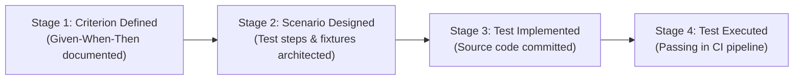

# Engineering Learning Note 02: Requirements Validation, Traceability & Advanced SaaS Architectural Mechanics

**Topic:** Verification vs. Validation, Requirements Consistency Auditing, Traceability Matrices, String Fractional Indexing, Memory Safety in File Uploads, Real-Time Crash Recovery, and Audit Privacy  
**Application Context:** TeamFlow Multi-Tenant SaaS Project Management Platform  
**Target Audience:** Full-Stack Software Engineer (Preparation for Senior Software Architect & Technical Lead Roles)  
**Governing Standard:** IEEE 830 / ISO/IEC/IEEE 29148 & [`AGENTS.md`](../../../AGENTS.md)  
**Related Documents:** [`requirements-review-report.md`](../../00-project-overview/requirements-review-report.md), [`traceability-matrix.md`](../../00-project-overview/traceability-matrix.md), [`requirements.md`](../../00-project-overview/requirements.md)

---

## 1. What Was Implemented

In this architectural audit and hardening phase of TeamFlow, we executed a comprehensive **Requirements Validation, Consistency Audit, and Architectural Hardening**:

1. **Authoritative Requirements Specification ([`requirements.md`](../../00-project-overview/requirements.md)):** Re-issued version 1.2.1 incorporating the 6 approved architecture decisions (Q1–Q6) and hardening 7 critical technical areas (Kanban concurrency, layered authorization, anti-lockout rate limiting, memory-safe file upload pipelines, real-time event crash recovery, exact analytics formulas, and provisional release planning).
2. **Reconciled User Journeys & Workflows ([`user-journeys-and-workflows.md`](../../00-project-overview/user-journeys-and-workflows.md)):** Updated sequence and state diagrams for creator-to-PM assignment, string fractional indexing, optimistic version conflicts, crash recovery sync, and guest moderation.
3. **Four-Stage Requirements Traceability Matrix ([`traceability-matrix.md`](../../00-project-overview/traceability-matrix.md)):** Upgraded the matrix to distinguish between:
   - *Acceptance Criterion Defined* (`Defined`)
   - *Test Scenario Designed* (`Designed`)
   - *Automated Test Implemented* (`Planned (Not Implemented)`)
   - *Automated Test Executed* (`Pending (Not Executed)`)
4. **Requirements Review & Verification Report ([`requirements-review-report.md`](../../00-project-overview/requirements-review-report.md)):** Formalized the complete decision log, technical evaluations, and requirements sign-off checklist.

---

## 2. Why It Is Necessary: The Engineering Rationale

Writing software requirements is not an administrative formality; it is the **primary line of defense against catastrophic system failure**.

Inconsistent requirements create compounding engineering friction:
- **Ripple Effects:** If the Kanban ordering algorithm is changed from floats to strings *after* the database schema and 500 lines of drag-and-drop code are written, every database migration, SQL query, DTO validation, and frontend sort function must be ripped out and rewritten.
- **Architectural Debt & Flaky Tests:** Conflating IP throttling with account lockouts creates a severe Denial-of-Service vulnerability where attackers lock out legitimate users.
- **Memory Safety & OOM Crashes:** Using memory storage for 10MB file uploads under concurrent traffic will crash the Node.js V8 process heap.
- **Team Misalignment:** Without an exact mathematical formula for "Completion Rate", the frontend developer computes one number, the backend API computes another, and automated integration tests fail intermittently.

---

## 3. Underlying Technical Concepts

### 3.1 Verification vs. Validation
In software engineering quality assurance:
- **Verification asks:** *"Are we building the product right?"* (Does the software conform to its technical specifications and pass automated unit/integration tests?)
- **Validation asks:** *"Are we building the right product?"* (Does the specification accurately satisfy the user's operational needs and business reality?)

During requirements auditing, **requirements validation** ensures that:
1. Requirements are **complete** (no missing states, unhandled transitions, or undefined zero denominators).
2. Requirements are **consistent** (no requirement contradicts another).
3. Requirements are **unambiguous** (has only one interpretation).
4. Requirements are **verifiable / testable** (can be verified with pass/fail criteria).

### 3.2 The Four-Stage Traceability Lifecycle
Professional software teams maintain strict separation between designing a test and executing it:



Claiming that a requirement has "test coverage" simply because a test scenario was written in a markdown file is an engineering fallacy. Until the code is implemented and passes in a live CI pipeline, the requirement's verification state is **Planned (Not Implemented)**.

---

## 4. Deep Technical Analysis of Hardened Architecture Mechanics

### 4.1 String-Based Fractional Indexing, Duplicate Keys & Tie-Breaking

#### The Original Problem
The initial draft specified Kanban card ordering as floating-point numbers:
$$\text{newOrder} = \frac{\text{prevOrder} + \text{nextOrder}}{2}$$

#### Why It Matters (IEEE 754 Precision Exhaustion)
JavaScript `Number` and PostgreSQL `double precision` adhere to IEEE 754 double-precision floating-point format, providing exactly **53 bits of mantissa** (~15–17 decimal digits of precision).

If users repeatedly insert cards between the same two items:
- Insertion 1: $\Delta = 0.5$
- Insertion 53: $\Delta = 1.1 \times 10^{-16}$
- Insertion 54: $\Delta < 2.22 \times 10^{-16}$ (Machine $\epsilon$)

At this threshold, floating-point math rounds:
$$\frac{\text{prev} + \text{next}}{2} == \text{prev} \quad \text{or} \quad \frac{\text{prev} + \text{next}}{2} == \text{next}$$
The database receives a duplicate key. Cards jump positions unpredictably on page refresh.

#### The Chosen Solution (String-Based Fractional Indexing)
We discarded floating-point numbers and adopted **string-based fractional indexing** (using variable-length base-62 ASCII characters: `0-9`, `A-Z`, `a-z`):
- Given keys `"a0"` and `"a1"`, the midpoint generator produces `"a0V"`.
- Given keys `"a0"` and `"a0V"`, the generator produces `"a0F"`.
- As cards are inserted, the string key simply grows in length by 1 character. Because strings have no fixed bit length, precision is theoretically infinite.

#### Duplicate Keys & Deterministic Tie-Breaking
If two users simultaneously drop two *different* tasks between `"a1"` and `"a2"`, both tasks may be assigned the identical key `"a1V"`.
To guarantee deterministic ordering without unique key constraint violations, all queries and UI renders strictly enforce:
$$\text{ORDER BY orderKey ASC, id ASC}$$
Because `id` is an immutable UUIDv4, the relative position between the two cards is 100% deterministic across all clients.

#### Atomic Column Rebalancing
When any card's key length exceeds 64 characters, an atomic transaction rebalances the column:
- An exclusive row-level lock is acquired on the target column:
  `SELECT id FROM tasks WHERE projectId = :pId AND status = :status AND deletedAt IS NULL ORDER BY orderKey, id FOR UPDATE`
- Cards are re-spaced with clean uniform 2-character keys (`"a0"`, `"a1"`, `"a2"`...).
- Concurrent card moves into that column wait for the lock to release, guaranteeing serial consistency.

---

### 4.2 Optimistic Concurrency Control vs. Pessimistic Locking
Instead of using heavy pessimistic database locks (`SELECT ... FOR UPDATE`) that block readers and destroy throughput, we implement **Optimistic Concurrency Control (OCC)**:
1. Every `Task` entity contains an integer `version` field (starts at 1).
2. The client fetches Task #104 (`version: 3`).
3. When dragging the card, the client sends `{ newStatus: "IN_PROGRESS", orderKey: "a1V", version: 3 }`.
4. The backend executes a conditional update:
   ```sql
   UPDATE tasks 
   SET status = 'IN_PROGRESS', orderKey = 'a1V', version = version + 1, updatedAt = NOW()
   WHERE id = 104 AND version = 3;
   ```
5. If another user committed an update milliseconds earlier, the database row version is already 4. The `UPDATE` query affects 0 rows.
6. The transaction detects 0 rows updated, rolls back, and returns **HTTP 409 Conflict**.
7. The client catches the 409, animates the card back to its previous position, and alerts the user: *"Task was modified by another user."*

---

### 4.3 File Upload Memory Safety: `multer.diskStorage` vs. `multer.memoryStorage`

#### The Problem with `memoryStorage`
In Node.js, `multer.memoryStorage()` buffers incoming file payloads directly into V8 heap memory as raw `Buffer` instances.
- If 20 concurrent users upload 10MB files simultaneously, the process allocates $>200\text{ MB}$ of contiguous heap buffers.
- In containerized environments with memory limits (e.g. 512MB RAM in Docker), high concurrency triggers V8 garbage collection pauses, event loop starvation, and sudden process termination due to **Out-Of-Memory (OOM)**.

#### The Safe Architecture (`multer.diskStorage` with Temporary Spooling)
TeamFlow utilizes disk storage spooling with guaranteed cleanup:
```typescript
// Safe Multer Spooling Configuration
const upload = multer({
  storage: multer.diskStorage({
    destination: '/tmp/teamflow-uploads',
    filename: (req, file, cb) => cb(null, `${randomUUID()}.tmp`),
  }),
  limits: {
    fileSize: 10 * 1024 * 1024, // Strict 10MB hard limit
    files: 1,
  },
});
```

1. **Chunked Disk Spooling:** Files stream from the network socket directly to `/tmp/teamflow-uploads/` in small OS buffer chunks. Node.js heap memory usage remains negligible ($< 64\text{ KB}$ per upload regardless of file size).
2. **In-Flight Validation:** The backend opens the temporary file descriptor, reads the first 512 bytes using `file-type`, and verifies the true binary magic bytes against the allowlist.
3. **Stream Pipeline to S3:** If valid, the file streams from disk to S3/MinIO via `fs.createReadStream()`.
4. **Guaranteed Temp Cleanup:** The temporary file is unconditionally deleted (`fs.unlink()`) inside a `finally` block:
   ```typescript
   try {
     await this.storageService.streamToS3(tempFilePath, s3Key);
   } finally {
     await fs.promises.unlink(tempFilePath).catch(() => {});
   }
   ```

#### Presigned Download URL Expiration & Security
- Presigned download URLs expire strictly after **15 minutes (900 seconds)** (`X-Amz-Expires=900`). Requests after 900s are rejected by S3 with 403 Forbidden.
- To prevent proxy caching of sensitive documents, responses enforce `Cache-Control: private, no-store, max-age=0`.
- To prevent stored XSS (e.g. an attacker uploading an `.html` or `.svg` file disguised as a document), responses enforce `Content-Disposition: attachment; filename="..."` and `X-Content-Type-Options: nosniff`, forcing the browser to download the file rather than execute it inline.

---

### 4.4 Real-Time Crash Recovery: PostgreSQL as the Single Source of Truth

#### The Failure Scenario
In the MVP, event emission occurs post-commit:
1. $T_1$: PostgreSQL commits task status change.
2. $T_1 + 1\text{ms}$: The backend server process crashes, or Redis connection drops before `redis.publish()` executes.
3. Result: The event is lost; connected clients do not receive a WebSocket push.

#### The Crash Recovery Protocol
Because PostgreSQL is the **sole authoritative source of truth**, state is never lost. Clients recover automatically via three fallback mechanisms:
1. **Window Focus Sync:** When a user switches tabs or focuses the browser window (`document.visibilityState === 'visible'`), the frontend fires a delta sync:
   `GET /api/v1/projects/:id/board?since=<lastSyncTimestamp>`
2. **Periodic Heartbeat Sync:** Every 60 seconds, active board clients execute a lightweight background check.
3. **Socket Reconnect Sync:** When the Socket.IO client auto-reconnects, it immediately reconciles board state.
4. **Outbox Pattern Upgrade Path (v1.2):** For guaranteed at-least-once event delivery, an `outbox_events` table will be introduced in release v1.2, writing events in the same ACID transaction as the entity mutation.

---

### 4.5 Audit Log Retention, Hygiene & Privacy (GDPR / CCPA)

#### Why "Permanent Retention" is a Compliance Liability
Stating that audit logs are "permanently retained" violates GDPR Article 5(1)(e) (Storage Limitation Principle), which mandates that personal data be kept in a form which permits identification of data subjects for no longer than is necessary.

#### The Compliant Audit Architecture
1. **Defined Retention Window:** Audit logs are retained for **365 days (1 year)** standard compliance retention, after which records are archived or pruned.
2. **Strict Sensitive Data Prohibition:**
   - Passwords and password hashes must **never** be logged.
   - Authentication tokens, session cookies, and reset tokens must **never** be logged.
   - Financial, cardholder, and banking data must **never** be logged.
   - Personal comment bodies and task description text must **never** be logged (only entity metadata like title/status is logged).
3. **Right to Erasure (User Deletion & Pseudonymization):**
   When a user deletes their account:
   - Setting `actorId = NULL` or assigning a system pseudonym (e.g. `metadata.actorName = "Former Member"`).
   - Scrubbing personal identifiers (`email`, `fullName`, `ipAddress`).
   - The operational audit log remains verifiable and immutable without retaining PII.

---

## 5. Technical Interview Questions & Answers

### Q1: "How do you handle memory safety when accepting large file uploads in Node.js?"
**Answer:**  
*"Buffering uploads into memory using `multer.memoryStorage()` is dangerous because concurrent uploads can easily exhaust the Node.js process heap, triggering V8 garbage collection freezes and Out-Of-Memory (OOM) crashes. To guarantee memory safety, we use `multer.diskStorage()` to spool files to a temporary disk directory in small OS chunks, keeping process heap usage below 64KB per upload. We open the spooled file, read the initial 512 bytes to inspect binary magic bytes against an allowlist, stream the file to S3 via `fs.createReadStream()`, and unconditionally delete the temporary file in a `finally` block."*

### Q2: "What happens if your server crashes after committing a transaction but before emitting a WebSocket event?"
**Answer:**  
*"In our MVP architecture, PostgreSQL is the single source of truth, and event emission is best-effort post-commit. If the server crashes before publishing to Redis, the database state remains committed and durable. Connected clients recover from dropped events through client-side reconciliation: whenever a user switches back to the tab (`document.visibilityState === 'visible'`), reconnects a dropped socket, or reaches the 60-second heartbeat interval, the frontend queries `GET /projects/:id/board?since=<timestamp>` to synchronize any delta changes. For release v1.2, we have cataloged the Transactional Outbox Pattern to guarantee at-least-once event publication even across process crashes."*

### Q3: "How does your multi-tenant SaaS handle audit logging while complying with GDPR Right to Erasure?"
**Answer:**  
*"We enforce strict data hygiene: audit logs record operational metadata (action type, entity ID, timestamp) but strictly prohibit logging passwords, auth tokens, or personal message bodies. To comply with GDPR storage limitation, logs follow a defined 365-day retention policy rather than indefinite storage. When a user exercises their Right to Erasure, we do not delete audit records—which would compromise operational integrity—but instead pseudonymize them: the `actorId` is disassociated or set to null, personal metadata (name, email, IP) is scrubbed, and the record references a generic 'Former Member' pseudonym."*
