# Engineering Learning Note 02: Requirements Validation, Consistency Auditing & Traceability

**Topic:** Verification vs. Validation, Requirements Consistency Auditing, Traceability Matrices, and Defect Prevention  
**Application Context:** TeamFlow Multi-Tenant SaaS Project Management Platform  
**Target Audience:** Full-Stack Software Engineer (Preparation for Senior Software Architect & Technical Lead Roles)  
**Governing Standard:** IEEE 830 / ISO/IEC/IEEE 29148 & [`AGENTS.md`](../../../AGENTS.md)  
**Related Documents:** [`requirements-review-report.md`](../../00-project-overview/requirements-review-report.md), [`traceability-matrix.md`](../../00-project-overview/traceability-matrix.md), [`requirements.md`](../../00-project-overview/requirements.md)

---

## 1. What Was Implemented

In this architectural audit phase of TeamFlow, we executed a comprehensive **Requirements Validation and Consistency Audit**:

1. **Requirements Review Report ([`requirements-review-report.md`](../../00-project-overview/requirements-review-report.md)):** Identified and reconciled 9 critical architectural discrepancies across the initial draft (Two-Tier RBAC, creator-to-PM paradox, dynamic blocker modeling, two-tier rate limiting, fractional precision rebalancing, and two-layer authorization).
2. **Requirements Traceability Matrix ([`traceability-matrix.md`](../../00-project-overview/traceability-matrix.md)):** Established complete bi-directional mapping from the original client brief $\rightarrow$ SRS Requirements (`FR-001` to `FR-081`, `NFR-001` to `NFR-020`) $\rightarrow$ User Journeys $\rightarrow$ Given-When-Then Acceptance Criteria $\rightarrow$ Automated Test Scenarios.
3. **Reconciled Specifications ([`requirements.md`](../../00-project-overview/requirements.md) & [`user-journeys-and-workflows.md`](../../00-project-overview/user-journeys-and-workflows.md)):** Re-issued version 1.1.0 with zero internal contradictions.

---

## 2. Why It Is Necessary: The Engineering Rationale

Writing a requirements specification is not a one-and-done documentation exercise. A specification authored in isolation almost always contains subtle internal contradictions, conflicting assumptions, and edge case blind spots.

If these contradictions survive into database modeling and code generation, they metastasize into **architectural debt**:
- **Conflicting Data Models:** If the UI expects `BLOCKED` to be a status column, but the database only has 6 statuses, developers invent hacky workarounds (e.g., storing "BLOCKED" in status strings, breaking enum type safety).
- **Security Vulnerabilities:** If authorization only validates `organizationId`, employees in the same company can snoop on private projects they do not belong to.
- **Rework Cascades:** Changing an authorization model after 10 controllers and 30 endpoints are coded requires touching every single guard, service, and integration test.

By conducting a formal audit before writing database schemas or code, we discover and resolve structural defects at the $1\times$ cost point.

---

## 3. Underlying Technical Concepts

### 3.1 Verification vs. Validation
In software engineering quality assurance:
- **Verification asks:** *"Are we building the product right?"* (Does the software conform to its technical specifications and pass unit tests?)
- **Validation asks:** *"Are we building the right product?"* (Does the specification accurately satisfy the user's operational needs and business reality?)

During requirements auditing, **requirements validation** ensures that:
1. Requirements are **complete** (no missing states or unhandled transitions).
2. Requirements are **consistent** (no requirement contradicts another).
3. Requirements are **unambiguous** (has only one interpretation).
4. Requirements are **verifiable / testable** (can be verified with pass/fail criteria).

### 3.2 Requirements Traceability
**Requirements Traceability** is the ability to describe and follow the life of a requirement in both a forward and backward direction.

```mermaid
flowchart TD
    subgraph Forward ["Forward Traceability (Assures Completeness)"]
        F1["Client Brief Section"] --> F2["SRS Functional Requirement"]
        F2 --> F3["Architecture & Data Model"]
        F3 --> F4["Implementation Code"]
        F4 --> F5["Automated Test Case"]
    end

    subgraph Backward ["Backward Traceability (Assures Justification)"]
        B1["Test Case Failure"] --> B2["Source Code File"]
        B2 --> B3["Architecture Component"]
        B3 --> B4["Functional Requirement ID"]
        B4 --> B5["Business Need / Client Brief"]
    end
```



- **Forward Traceability:** Guarantees that every client requirement is accounted for in the SRS, designed in the schema, implemented in code, and verified by a test.
- **Backward Traceability:** Guarantees that every line of code, database column, and test case can be justified by an approved requirement (eliminating unauthorized "gold-plating").

---

## 4. How Professional Teams Formally Approve an SRS

In mature software engineering organizations (e.g., Google, Amazon, high-growth SaaS), requirements specifications do not transition to implementation without a structured review process:

1. **Fagan Inspection / Peer Walkthrough:** Senior engineers, architects, security leads, and product managers assemble to read the specification line-by-line, actively hunting for contradictions, unhandled failure modes, and security gaps.
2. **Defect Categorization:** Discrepancies are logged into a formal review report (Severity: Critical, Major, Minor).
3. **Open Questions Resolution Gate:** Product and business trade-offs are presented to the client/stakeholders in an unambiguous Decision Log.
4. **Baseline Lock:** Once approved, the document is tagged with a formal version (e.g., `v1.1.0-approved`) and committed to version control. Subsequent changes require an Architectural Change Request (ACR).

---

## 5. Practical TeamFlow Examples: Discrepancies Found & Solved

### Example 1: Resolving the "Two-Tier RBAC" Dilemma

**What Was Wrong:**  
In the initial draft, `Project Manager` was listed as an organization-level role alongside `Org Owner`, `Org Admin`, and `Member`.

**Why It Matters:**  
An Organization represents a company with dozens of projects. If a user is given the role of `Project Manager` at the organization level, does that mean they manage *all* projects in the company? What if an agency hires an external PM for Client A's project, but must forbid them from seeing Client B's project?

**How the Revision Solves It:**  
We segregated authorization into a **Two-Tier RBAC Hierarchy**:
```typescript
// Conceptual NestJS Policy Guard Implementation
export enum OrgRole {
  OWNER = 'ORG_OWNER',
  ADMIN = 'ORG_ADMIN',
  MEMBER = 'ORG_MEMBER',
  GUEST = 'ORG_GUEST',
}

export enum ProjectRole {
  PROJECT_MANAGER = 'PROJECT_MANAGER',
  CONTRIBUTOR = 'CONTRIBUTOR',
  VIEWER = 'VIEWER',
}

@Injectable()
export class ProjectAccessGuard implements CanActivate {
  constructor(private prisma: PrismaService) {}

  async canActivate(context: ExecutionContext): Promise<boolean> {
    const req = context.switchToHttp().getRequest();
    const { user, activeOrgId } = req;
    const projectId = req.params.projectId || req.body.projectId;

    // 1. Layer 1 Check: Verify user belongs to the active tenant
    const orgMembership = await this.prisma.membership.findUnique({
      where: { userId_organizationId: { userId: user.id, organizationId: activeOrgId } }
    });
    if (!orgMembership) throw new ForbiddenException('Not a member of this organization');

    // 2. Org Owner and Org Admin enjoy superuser access across all projects in the org
    if (orgMembership.role === OrgRole.OWNER || orgMembership.role === OrgRole.ADMIN) {
      return true;
    }

    // 3. Layer 2 Check: Verify explicit membership in this specific project
    const projectMember = await this.prisma.projectMember.findUnique({
      where: { projectId_userId: { projectId, userId: user.id } }
    });
    if (!projectMember) throw new ForbiddenException('Not a member of this private project');

    // Attach project role to request for fine-grained controller checks
    req.projectRole = projectMember.role;
    return true;
  }
}
```

---

### Example 2: Resolving IEEE 754 Fractional Index Degradation (FR-050B)

**What Was Wrong:**  
The specification stated: *"Insert card midway between neighbors: `orderIndex = (prev + next) / 2`"*.

**Why It Matters:**  
JavaScript and PostgreSQL both represent standard IEEE 754 double-precision floats with 53 bits of mantissa. If users drag cards between the same two items repeatedly (e.g. inserting 55 items one after another at the top of a column):
$$\Delta = \frac{1}{2^{55}} \approx 2.77 \times 10^{-17}$$
At this threshold, floating-point rounding causes $(prev + next) / 2$ to round mathematically to $prev$ or $next$. The cards now share identical order values, producing non-deterministic card jumping on page refresh.

**How the Revision Solves It:**  
We introduced an automatic rebalancing threshold in `FR-050B`:
```typescript
// Rebalancing logic in TasksService
async calculateOrderIndex(projectId: string, status: TaskStatus, prevOrder?: number, nextOrder?: number): Promise<number> {
  const DEFAULT_SPACING = 1000;

  // Case 1: Inserting at the beginning of an empty or populated column
  if (prevOrder === undefined && nextOrder !== undefined) return nextOrder / 2;
  if (prevOrder !== undefined && nextOrder === undefined) return prevOrder + DEFAULT_SPACING;
  if (prevOrder === undefined && nextOrder === undefined) return DEFAULT_SPACING;

  // Case 2: Inserting between two existing cards
  const gap = nextOrder! - prevOrder!;
  const EPSILON = 1e-6;

  if (gap < EPSILON) {
    // Precision exhausted! Execute transactional rebalance
    await this.rebalanceColumn(projectId, status);
    // Fetch refreshed neighbors and calculate cleanly
    return this.calculateOrderIndex(projectId, status, prevOrder, nextOrder);
  }

  return (prevOrder! + nextOrder!) / 2;
}

private async rebalanceColumn(projectId: string, status: TaskStatus): Promise<void> {
  const tasks = await this.prisma.task.findMany({
    where: { projectId, status, deletedAt: null },
    orderBy: { orderIndex: 'asc' },
    select: { id: true },
  });

  // Re-space cards with clean integers: 1000, 2000, 3000...
  await this.prisma.$transaction(
    tasks.map((task, index) =>
      this.prisma.task.update({
        where: { id: task.id },
        data: { orderIndex: (index + 1) * 1000 },
      })
    )
  );
}
```

---

## 6. Architectural Trade-offs Summary

| Area | Trade-off Option Considered | Chosen Architecture | Justification |
|---|---|---|---|
| **Rate Limiting** | Single global IP counter | **Two-Tier Protocol:**<br>1. IP request throttling (10/min)<br>2. Account lockout (5 failures / 15 min) | IP throttling stops network floods but allows normal user typo retries; account lockout stops distributed credential stuffing. |
| **Blocked Tasks** | Dedicated `BLOCKED` status enum | **Dynamic `isBlocked` Flag** derived from `TaskDependency` table | Keeps operational status (`IN_PROGRESS`, `TODO`) intact when blocked, automatically clearing the visual blocker badge when dependencies resolve. |
| **File Upload Pipeline** | Direct pre-signed S3 upload | **Multipart NestJS Stream + In-Memory Magic Bytes** | Ensures 100% of uploaded files are verified against executable malware signatures before reaching cloud storage. |

---

## 7. Technical Interview Questions & Answers

### Q1: "What is the difference between verification and validation in software engineering?"
**Answer:**  
*"Verification evaluates whether an artifact adheres to its documented conditions (answering 'Are we building the product right?'), typically measured via automated tests, code linting, and type checking. Validation evaluates whether the system satisfies its intended real-world operational purpose (answering 'Are we building the right product?'), measured through acceptance testing, user journey modeling, and requirements consistency auditing."*

### Q2: "How would you prevent precision breakdown when using fractional indexing for a drag-and-drop Kanban board?"
**Answer:**  
*"Fractional indexing calculates card positions as $(prev + next) / 2$. Because 64-bit IEEE 754 floats have 53 bits of precision, repeatedly bisecting a gap causes floating point underflow after approximately 53 drops, resulting in order index collisions. The solution is to introduce an $\epsilon$ threshold (e.g., $10^{-6}$). When the difference between adjacent cards falls below $\epsilon$, the system triggers an atomic column rebalance within a database transaction, re-spacing all cards in that status column by discrete intervals of 1000. This preserves $O(1)$ fast drops 99.9% of the time while guaranteeing deterministic sorting indefinitely."*

### Q3: "What is a Requirements Traceability Matrix (RTM), and why is it critical for multi-tenant SaaS?"
**Answer:**  
*"An RTM establishes bi-directional links between business requirements, functional IDs (`FR-xxx`), architecture components, and automated test cases. In multi-tenant SaaS, it is critical because it ensures that every security invariant—such as cross-tenant isolation (`NFR-001`) and project membership scoping (`FR-024`)—is explicitly mapped to concrete automated penetration test scenarios in the CI pipeline. If an engineer modifies an authorization policy or endpoint, the RTM enables instant change impact analysis to identify exactly which test suites must be executed."*
