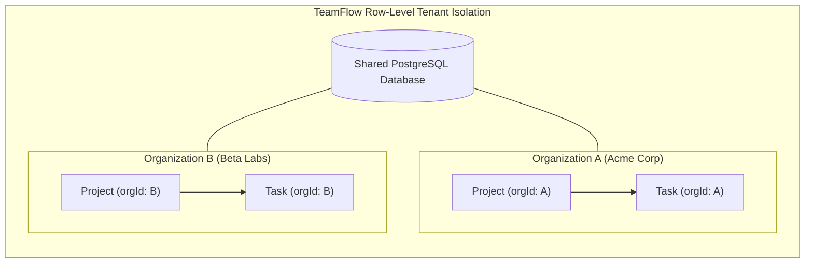
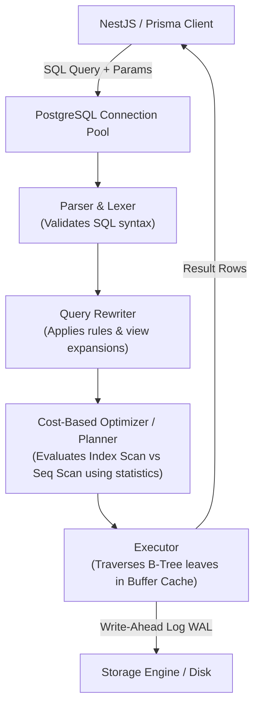
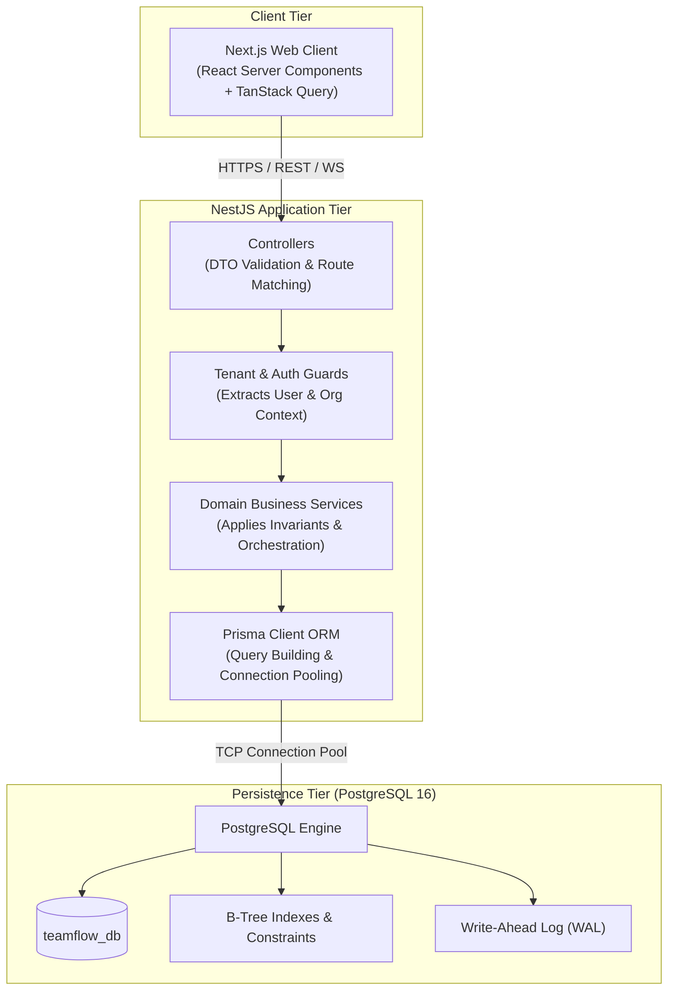
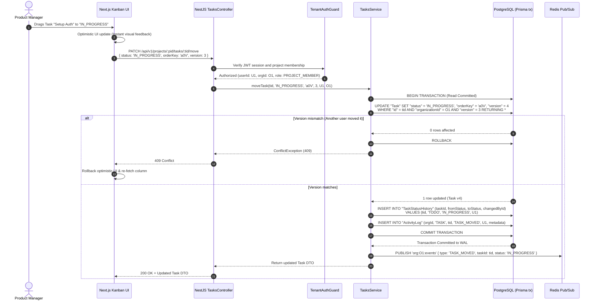
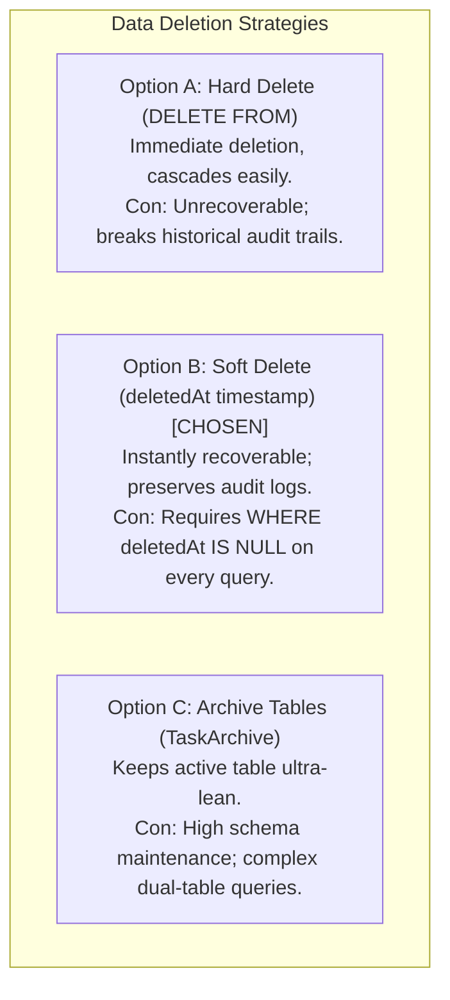
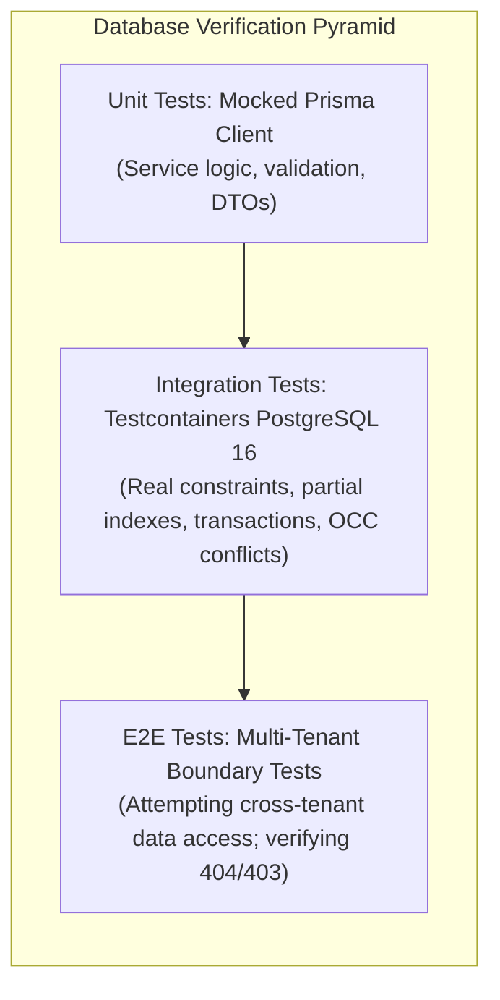

# Engineering Learning Note 03: Database Architecture, Data Modeling & Multi-Tenant Relational Design

**Topic:** Relational Data Modeling, Row-Level Multi-Tenancy, B-Tree Index Optimization, ACID Transactions, and Concurrency Control  
**Application Context:** TeamFlow Multi-Tenant SaaS Project Management Platform  
**Target Audience:** Full-Stack Software Engineer (Preparation for Senior Engineering Roles & Technical Interviews)  
**Governing Standard:** [`AGENTS.md`](../../../AGENTS.md) Sections 2, 4, 6, 7, and 8

---

## 1. What Was Implemented

In Milestone 2 Phase 2.1 of TeamFlow, we architected the complete database foundation located in `docs/02-database/`:

1. **[`er-diagram.md`](../../02-database/er-diagram.md):** Complete Entity-Relationship Model specifying 19 core tables, primary keys, foreign keys, constraints, and cardinalities.
2. **[`database-overview.md`](../../02-database/database-overview.md):** Architectural baseline establishing Third Normal Form (3NF), UUIDv4 identity strategy, row-level multi-tenant isolation, soft-deletion semantics (`deletedAt`), and PostgreSQL data type sizing.
3. **[`relationships.md`](../../02-database/relationships.md):** Complete catalog of $1:1$, $1:N$, and $N:M$ relationships, join table constraints, cascading behaviors (`CASCADE`, `SET NULL`, `RESTRICT`), and domain invariants.
4. **[`indexes-and-optimization.md`](../../02-database/indexes-and-optimization.md):** Query-driven indexing strategy featuring partial composite indexes (such as `idx_tasks_kanban`), foreign key coverage, B-Tree leaf mechanics, and query plan execution profiles.
5. **[`transactions.md`](../../02-database/transactions.md):** Formal ACID transaction boundaries for Kanban moves, column rebalancing, invitation acceptance, cascading project deletions, and assignee synchronization, coupled with Optimistic Concurrency Control (OCC) and row-level locking (`SELECT ... FOR UPDATE`).
6. **[`migrations.md`](../../02-database/migrations.md):** Schema evolution strategy leveraging Prisma Migrate, the zero-downtime Expand/Contract pattern, and deterministic, idempotent seeding (`prisma/seed.ts`).

---

## 2. Why It Is Necessary

In production SaaS engineering, **the database is the ultimate authority of truth**. A software system can survive an inefficient frontend or a buggy controller, but corrupt, leaked, or lost data in the persistence tier is catastrophic and frequently irrecoverable.

### Critical Anti-Patterns Prevented
1. **The "Dumb Storage Bucket" Anti-Pattern:** Treating PostgreSQL as an unconstrained JSON or key-value store and relying solely on Node.js/TypeScript code to enforce business logic. If an application server crashes midway through a complex update, an unconstrained database is left in a corrupted state (e.g., a task assigned to a non-existent project member). Invariants must be enforced at the database layer via `FOREIGN KEY`, `UNIQUE`, `NOT NULL`, and `CHECK` constraints.
2. **Sequential ID Enumeration (Insecure Direct Object Reference - IDOR):** Using sequential integer primary keys (`1, 2, 3...`) allows attackers to scrape records by incrementing URL IDs (`/projects/101`, `/projects/102`) and reveals proprietary growth metrics. Cryptographically random UUIDv4 primary keys completely eliminate ID enumeration attacks.
3. **Multi-Tenant Data Bleed:** Without universal, indexed tenant scoping (`organizationId`), a single missed filter in a backend query exposes Customer A's private tasks and attachments to Customer B.
4. **Lost Updates & Drag-and-Drop Race Conditions:** When two project managers reorder the same Kanban board simultaneously, blind writes overwrite each other. Implementing Optimistic Concurrency Control (OCC) via version stamping guarantees that conflicting concurrent updates are rejected with a deterministic `409 Conflict`.
5. **Migration-Induced Downtime:** Executing raw `ALTER TABLE` commands that lock tables or rename columns breaks running application instances during rolling deployments. Adopting the Expand/Contract pattern ensures continuous system availability.

---

## 3. The Underlying Technical Concepts

### 3.1 Relational Normalization vs. Strategic Denormalization
- **Third Normal Form (3NF):** A relation is in 3NF if it is in 2NF (all non-key attributes are fully dependent on the primary key) and no non-key attribute is transitively dependent on the primary key. In TeamFlow, user profiles, project details, and task attributes reside in separate tables to prevent update anomalies.
- **Strategic Denormalization:** While 3NF is our baseline, strict normalization can harm multi-tenant query performance. If verifying tenant ownership required joining `Task` $\to$ `Project` $\to$ `Organization` on every single request, query latency would compound under high load. Therefore, TeamFlow deliberately denormalizes `organizationId` directly onto `Task`, `Attachment`, and `ActivityLog`. This trade-off trades a negligible amount of disk space for instantaneous single-table tenant validation:
  ```sql
  -- Instantaneous single-table tenant boundary validation:
  SELECT * FROM "Task" WHERE "id" = :taskId AND "organizationId" = :orgId;
  ```

### 3.2 Primary Key Architecture: UUIDv4 vs. Integer vs. ULID/UUIDv7
```text
┌────────────────┬─────────────────────┬───────────────────────┬──────────────────────────┐
│ Key Type       │ Storage / Indexing  │ Security / Collision  │ Generation               │
├────────────────┼─────────────────────┼───────────────────────┼──────────────────────────┤
│ Auto-Inc Int   │ 4 or 8 bytes        │ Vulnerable to IDOR;   │ Database engine only;    │
│ (SERIAL/BIGINT)│ Clustered naturally │ Leaks business metrics│ Bottleneck at scale      │
├────────────────┼─────────────────────┼───────────────────────┼──────────────────────────┤
│ UUIDv4         │ 16 bytes            │ Cryptographically safe│ Distributed (Node.js     │
│ (gen_random)   │ High fragmentation  │ 2^122 uniqueness      │ or DB engine)            │
├────────────────┼─────────────────────┼───────────────────────┼──────────────────────────┤
│ UUIDv7 / ULID  │ 16 bytes            │ Cryptographically safe│ Distributed + Time-      │
│ (Time-ordered) │ B-Tree friendly     │ Zero collision        │ sequential sortable      │
└────────────────┴─────────────────────┴───────────────────────┴──────────────────────────┘
```
TeamFlow selects **UUIDv4** across all entities for robust distributed generation and total immunity to enumeration attacks. To neutralize B-Tree index fragmentation, high-insert tables (`TaskStatusHistory`, `ActivityLog`) are indexed with leading organizational or temporal keys (`(organizationId, createdAt DESC)`).

### 3.3 Multi-Tenant Isolation Models
There are three fundamental database architectures for multi-tenant SaaS:
1. **Database-per-Tenant:** Maximum isolation, but catastrophic operational overhead (migrating 5,000 separate databases is impractical, and resource costs are extreme).
2. **Schema-per-Tenant:** Good isolation, but PostgreSQL performance degrades past several thousand schemas due to table catalog bloat.
3. **Shared Database, Shared Schema with Row-Level Scoping (TeamFlow's Architecture):** Highly scalable, cost-effective, and operationally simple. Tenant isolation is enforced through mandatory `organizationId` columns, composite uniqueness, and NestJS repository/service interceptors.



### 3.4 B-Tree Index Mechanics and the "Leftmost Prefix" Rule
PostgreSQL uses B-Tree (Balanced Tree) indexes by default. A composite B-Tree index on `(A, B, C)` sorts data first by `A`, then by `B` within `A`, and finally by `C` within `B`.
- **Query `WHERE A = 1 AND B = 2`:** Uses the index efficiently.
- **Query `WHERE A = 1`:** Uses the index efficiently.
- **Query `WHERE B = 2`:** **CANNOT** use the index efficiently (violates the leftmost prefix rule) and results in an expensive Sequential Scan (`Seq Scan`).

In TeamFlow:
- `Task` index: `(projectId, status, orderKey ASC, id ASC) WHERE deletedAt IS NULL`
- This ensures that filtering by `projectId` and `status` immediately provides the pre-sorted order required by the Kanban board without any in-memory sort penalty.

### 3.5 Partial Indexes (`WHERE deletedAt IS NULL`)
In systems implementing soft deletion, soft-deleted rows persist in the table indefinitely. Over time, deleted rows bloat standard indexes.
A **partial index** indexes only rows matching a specific predicate:
```sql
CREATE INDEX idx_tasks_kanban ON "Task" ("projectId", "status", "orderKey" ASC, "id" ASC)
WHERE "deletedAt" IS NULL;
```
- **Benefits:** The index is 20%–50% smaller, fits entirely in the RAM buffer cache, and updates much faster on writes.

### 3.6 String Fractional Indexing
To order items in a Kanban column without updating every subsequent card when a card is moved:
- Traditional integer rank: Moving a card to position 0 in a 1,000-card column requires updating 999 other rows (`UPDATE Task SET rank = rank + 1 WHERE rank >= 0`). This causes massive database locks, write spikes, and real-time event floods.
- Floating-point indexing (`rank = (prev + next) / 2`): Suffers from IEEE 754 precision exhaustion after ~50 insertions between adjacent items.
- **String Fractional Indexing:** Uses variable-length strings (e.g. `'a0'`, `'a1'`). Moving an item between `'a0'` and `'a1'` generates `'a0V'`. This supports virtually infinite inserts between items without touching any other record in the column.

### 3.7 ACID Isolation Levels & Concurrency Control
- **PostgreSQL Read Committed:** Prevents Dirty Reads (reading uncommitted data). However, Non-Repeatable Reads and Phantom Reads are possible.
- **Optimistic Concurrency Control (OCC):** Rather than locking rows with pessimistic locks, each row maintains a `version INT`. When an update occurs, the SQL query validates the version:
  ```sql
  UPDATE "Task" SET "status" = $1, "version" = "version" + 1
  WHERE "id" = $2 AND "version" = $3;
  ```
  If another transaction updated the row first, the version has changed, 0 rows are updated, and the application raises an immediate `409 Conflict`.

---

## 4. How It Works Internally

### The PostgreSQL Query Execution Lifecycle
When NestJS issues a query through Prisma:


### PostgreSQL Multi-Version Concurrency Control (MVCC)
PostgreSQL does not overwrite rows on `UPDATE`. Instead:
1. The old row version (tuple) has its `xmax` header set to the updating transaction's ID (marking it expired).
2. A new tuple is written to disk with `xmin` set to the current transaction's ID.
3. Concurrent transactions running in `Read Committed` isolation continue to read the old tuple until the updating transaction commits.
4. The PostgreSQL **Vacuum** process (`VACUUM`) asynchronously cleans up obsolete dead tuples and reclaims disk space.

---

## 5. Position in the Application Architecture



---

## 6. Complete Data Flow: Kanban Task Drag-and-Drop

Let us trace the complete lifecycle of a user dragging a task from "TODO" to "IN_PROGRESS":



---

## 7. Important Files and Their Responsibilities

| File Path | Core Architectural Responsibility |
| :--- | :--- |
| [`docs/02-database/er-diagram.md`](../../02-database/er-diagram.md) | Complete Entity-Relationship specifications, visual Mermaid topology, and table-by-table schema definitions for all 19 entities. |
| [`docs/02-database/database-overview.md`](../../02-database/database-overview.md) | Database configuration, 3NF design principles, UUIDv4 strategy, row-level multi-tenancy rules, and soft-delete mechanics. |
| [`docs/02-database/relationships.md`](../../02-database/relationships.md) | Formal cardinality catalog ($1:1$, $1:N$, $N:M$), foreign key constraint policies (`CASCADE` vs. `SET NULL`), and join table structures. |
| [`docs/02-database/indexes-and-optimization.md`](../../02-database/indexes-and-optimization.md) | Comprehensive index catalog, composite B-Tree design, partial indexing predicates, and execution plan benchmarks. |
| [`docs/02-database/transactions.md`](../../02-database/transactions.md) | ACID transaction boundaries, Optimistic Concurrency Control (OCC), pessimistic row-level locking (`FOR UPDATE`), and deadlock prevention. |
| [`docs/02-database/migrations.md`](../../02-database/migrations.md) | Prisma migration lifecycle, zero-downtime Expand/Contract patterns, and idempotent seed architecture (`prisma/seed.ts`). |

---

## 8. Detailed Explanations of Important Functions and Patterns

### 8.1 Optimistic Concurrency Control (OCC) Pattern
```typescript
/**
 * Atomic task update with Optimistic Concurrency Control.
 * Guarantees that concurrent modifications do not silently overwrite data.
 */
async function updateTaskWithOCC(
  tx: Prisma.TransactionClient,
  taskId: string,
  organizationId: string,
  expectedVersion: number,
  updateData: Prisma.TaskUpdateInput
): Promise<Task> {
  const result = await tx.task.updateMany({
    where: {
      id: taskId,
      organizationId,
      version: expectedVersion, // OCC check
      deletedAt: null,
    },
    data: {
      ...updateData,
      version: { increment: 1 }, // Atomic version increment
    },
  });

  if (result.count === 0) {
    // If 0 rows were updated, either the task does not exist or the version has diverged
    const exists = await tx.task.findUnique({
      where: { id: taskId, organizationId, deletedAt: null },
      select: { version: true },
    });

    if (!exists) {
      throw new NotFoundException(`Task ${taskId} not found.`);
    }

    throw new ConflictException(
      `Task ${taskId} was modified concurrently (current version: ${exists.version}, expected: ${expectedVersion}). Please refresh.`
    );
  }

  return tx.task.findUniqueOrThrow({ where: { id: taskId } });
}
```

### 8.2 Fractional Index Midpoint Key Computation
```typescript
/**
 * Computes a lexicographical midpoint string between two fractional order keys.
 * Base 62 character set: [0-9, A-Z, a-z]
 */
function generateMidpointKey(prevKey: string | null, nextKey: string | null): string {
  // Edge Case 1: First item in an empty column
  if (!prevKey && !nextKey) return 'a0';

  // Edge Case 2: Prepending before the first item
  if (!prevKey && nextKey) {
    return computePrecedingKey(nextKey);
  }

  // Edge Case 3: Appending after the last item
  if (prevKey && !nextKey) {
    return computeSucceedingKey(prevKey);
  }

  // General Case: Inserting between prevKey and nextKey
  return computeBetweenKeys(prevKey!, nextKey!);
}
```

---

## 9. Practical Code Examples

### Multi-Tenant Scoped Project Retrieval with Soft-Delete Filtering
```typescript
@Injectable()
export class ProjectsService {
  constructor(private readonly prisma: PrismaService) {}

  async findProjectById(
    projectId: string,
    organizationId: string,
    requestingUserId: string
  ): Promise<ProjectWithMembers> {
    const project = await this.prisma.project.findFirst({
      where: {
        id: projectId,
        organizationId,      // Mandatory tenant boundary
        deletedAt: null,     // Soft-delete filter
        members: {
          some: { userId: requestingUserId }, // Project-level authorization
        },
      },
      include: {
        members: {
          include: {
            user: {
              select: { id: true, firstName: true, lastName: true, avatarUrl: true },
            },
          },
        },
        _count: {
          select: { tasks: { where: { deletedAt: null } } },
        },
      },
    });

    if (!project) {
      throw new NotFoundException('Project not found or access denied.');
    }

    return project;
  }
}
```

---

## 10. Realistic Input/Output Examples

### Scenario: Concurrent Kanban Move Collision
#### Input Request 1 (User A)
```http
PATCH /api/v1/projects/00000000-0000-0000-0000-000000000001/tasks/00000000-0000-0000-0000-000000000010/move
Content-Type: application/json
X-Organization-Id: acme-corp

{
  "status": "IN_PROGRESS",
  "orderKey": "a0V",
  "version": 1
}
```

#### Output 1 (User A Succeeds)
```http
HTTP/1.1 200 OK
Content-Type: application/json

{
  "id": "00000000-0000-0000-0000-000000000010",
  "title": "Design Hero Section Mockup",
  "status": "IN_PROGRESS",
  "orderKey": "a0V",
  "version": 2,
  "updatedAt": "2026-11-02T20:30:00.000Z"
}
```

#### Input Request 2 (User B - Stale Version)
```http
PATCH /api/v1/projects/00000000-0000-0000-0000-000000000001/tasks/00000000-0000-0000-0000-000000000010/move
Content-Type: application/json
X-Organization-Id: acme-corp

{
  "status": "DONE",
  "orderKey": "a0Z",
  "version": 1
}
```

#### Output 2 (User B Blocked by OCC)
```http
HTTP/1.1 409 Conflict
Content-Type: application/json

{
  "statusCode": 409,
  "error": "Conflict",
  "message": "Task 00000000-0000-0000-0000-000000000010 was modified concurrently (current version: 2, expected: 1). Please refresh.",
  "timestamp": "2026-11-02T20:30:00.150Z"
}
```

---

## 11. Alternative Implementation Approaches



| Dimension | Chosen: Soft Delete (`deletedAt`) | Alternative: Archive Tables | Alternative: Hard Delete |
| :--- | :--- | :--- | :--- |
| **Data Safety** | **Maximum:** Accidental deletions easily undone | High: Records copied before deletion | None: Lost immediately |
| **Query Complexity** | Low: Filtered via partial index | High: Queries must join active and archive tables | Lowest: Simple `SELECT *` |
| **Audit Compliance** | **Full:** Historical task references remain intact | Partial: Foreign keys broken during archiving | Violates compliance standards |

---

## 12. Security Considerations

1. **SQL Injection Immunity:** All database interactions in TeamFlow use parameterized queries executed by Prisma ORM (`$queryRaw` uses tagged template literals that compile to PostgreSQL `$1, $2` parameters). Raw string concatenation (`$queryRawUnsafe('... ' + userInput)`) is strictly prohibited.
2. **Tenant Boundary Injection Prevention:** Never allow client-supplied query parameters to override the tenant boundary. Every query in the service layer enforces `organizationId: req.user.currentOrgId` extracted from the cryptographically verified JWT session.
3. **Sensitive Field Omission:** Password hashes (`passwordHash`), refresh token hashes, and internal verification tokens MUST be excluded from standard Prisma `select` queries to prevent accidental leakage in API serialization:
   ```typescript
   // Explicit selection pattern:
   const user = await prisma.user.findUnique({
     where: { id: userId },
     select: { id: true, email: true, firstName: true, lastName: true, avatarUrl: true },
   });
   ```

---

## 13. Performance Considerations & Bottleneck Mitigations

1. **The N+1 Query Problem:**
   - *Problem:* Fetching 50 tasks and subsequently firing 50 individual queries to fetch assignees.
   - *Mitigation:* Use Prisma's `include` with relations or DataLoader batching, compiling the operation into a single `SELECT ... WHERE taskId IN (...)` query.
2. **Index Bloat and Memory Footprint:**
   - B-Tree indexes on active tables must fit inside PostgreSQL's `shared_buffers` (RAM).
   - We utilize partial indexes (`WHERE deletedAt IS NULL`) to eliminate bloat from historical soft-deleted records.
3. **Connection Pool Starvation:**
   - NestJS instances connect to PostgreSQL via a tuned connection pool (`connection_limit = 20` per pod).
   - Transactions are kept strictly sub-100ms. External I/O (S3 uploads, email dispatches, Redis publishing) is executed outside the transaction block.

---

## 14. Testing Strategy



### Essential Database Integration Test Scenarios:
1. **Tenant Isolation Test:** Create Task in Org A. Attempt to fetch, update, or delete it using a valid JWT for Org B. Verify query returns `404 Not Found` and 0 rows are mutated.
2. **OCC Conflict Test:** Spin up two parallel asynchronous workers attempting to update the same task with version 1. Verify exactly one succeeds with HTTP 200 (version becomes 2) and the other throws HTTP 409 Conflict.
3. **Cascade Integrity Test:** Soft-delete a project. Verify that all child tasks have `deletedAt` populated and disappear from active Kanban queries.

---

## 15. Common Mistakes to Avoid

1. **Forgetting to Index Foreign Keys:** In PostgreSQL, declaring a `FOREIGN KEY` does **NOT** automatically create an index on the referencing column. Failing to create an index on `projectId` in `Task` results in full table scans on parent deletions and joins.
2. **Missing `deletedAt IS NULL` in Composite Unique Constraints:** A standard unique index on `(organizationId, slug)` prevents reusing a slug even after the original organization is soft-deleted. Always create a partial unique index:
   ```sql
   CREATE UNIQUE INDEX uq_org_slug_active ON "Organization" ("slug") WHERE "deletedAt" IS NULL;
   ```
3. **Putting Network Calls Inside Transactions:**
   ```typescript
   // ANTI-PATTERN: DO NOT DO THIS
   await prisma.$transaction(async (tx) => {
     await tx.task.update(...);
     await s3Client.upload(...); // Network latency holds DB locks!
     await sendGrid.sendEmail(...); // If SendGrid times out, DB transaction fails!
   });
   ```

---

## 16. Senior Engineering Interview Questions & Answers

### Question 1: How do you design a database schema for multi-tenant SaaS to guarantee isolation while maintaining cost efficiency and developer velocity?
**Answer:**
> "There are three primary architectures: Database-per-tenant, Schema-per-tenant, and Shared-Database with Row-Level Tenant Scoping. For a high-concurrency SaaS platform like TeamFlow, the Shared-Database model with row-level scoping is the optimal choice.
> We establish universal tenant scoping by placing a non-nullable, indexed `organizationId UUID` on every tenant-owned entity. To prevent cross-tenant data leakage, we combine database-level composite unique constraints (e.g. `(organizationId, name)`) with application-level repository guards that automatically inject `organizationId` from the cryptographically verified session into every query filter. Furthermore, we can leverage PostgreSQL Row-Level Security (RLS) policies as an additional defense-in-depth layer to enforce isolation directly in the database engine."

### Question 2: Why would you choose string-based fractional indexing over integer-based ranking for Kanban board card ordering?
**Answer:**
> "Integer ranking creates an $O(N)$ write bottleneck on drag-and-drop operations. If a card is moved to the top of a column containing 1,000 cards, every subsequent row must have its rank incremented, resulting in extensive row locks, transaction latency, and massive real-time event broadcasts.
> String-based fractional indexing solves this by representing order as a variable-length lexicographical string (e.g., `'a0'`, `'a1'`). Moving an item between two cards generates a midpoint string (e.g., `'a0V'`), requiring an update to only a single row ($O(1)$ write complexity). To prevent string length degradation over thousands of moves, we monitor key length and execute an atomic, row-locked rebalancing transaction (`SELECT ... FOR UPDATE`) if key length exceeds a safe threshold."

### Question 3: What is the difference between Optimistic and Pessimistic Concurrency Control, and where should each be used in our project management platform?
**Answer:**
> "Pessimistic Concurrency Control (PCC) assumes conflicts will occur and explicitly locks rows (`SELECT ... FOR UPDATE`), serializing concurrent transactions. Optimistic Concurrency Control (OCC) assumes conflicts are rare, allowing transactions to proceed without locking by tracking a `version` integer and validating it at commit time (`WHERE version = :expected`).
> In TeamFlow, we use OCC for high-frequency user actions like Kanban task updates, moves, and comments. This maximizes throughput and keeps transactions non-blocking, returning a clean `409 Conflict` if another user modified the card first. Conversely, we use Pessimistic Row Locking for rare, critical batch operations like column key rebalancing or invitation token redemption, where concurrent modifications must be strictly serialized to guarantee mathematical consistency."

### Question 4: How do you implement zero-downtime database schema migrations when making breaking changes like renaming a column in production?
**Answer:**
> "A direct `ALTER TABLE ... RENAME COLUMN` causes instant production downtime because running application nodes continue querying the old column name until the rolling deployment completes.
> Instead, we employ the **Expand / Contract** pattern across four distinct phases:
> 1. **Expand:** Deploy a migration adding the new column as nullable.
> 2. **Dual-Write:** Deploy application code that writes to both old and new columns, but reads from the old column.
> 3. **Backfill:** Execute an asynchronous batch script to copy data from the old column to the new column for historical rows.
> 4. **Switch & Contract:** Deploy code that reads and writes exclusively to the new column. Once verified, deploy a final migration to drop the old column and add any required `NOT NULL` constraints."

### Question 5: Why are foreign keys not indexed by default in PostgreSQL, and what performance issues arise if you forget to index them?
**Answer:**
> "PostgreSQL automatically creates unique indexes for `PRIMARY KEY` and `UNIQUE` constraints, but it does **not** automatically index `FOREIGN KEY` columns because foreign key checks can often be satisfied without an index, and unnecessary indexes add write overhead.
> However, failing to index foreign key columns causes severe performance degradation in two scenarios:
> 1. **Parent-Child Joins:** Queries joining `Project` and `Task` (`WHERE task.projectId = project.id`) will perform full sequential table scans on `Task` instead of an efficient index scan.
> 2. **Cascading Deletions / Updates:** When a row in the parent table (`Project`) is deleted or updated, PostgreSQL must scan the child table (`Task`) to verify referential integrity. Without an index on `Task.projectId`, PostgreSQL is forced to perform a sequential scan of the entire `Task` table, taking shared table locks that can cause severe transaction timeouts and system-wide lock queues."

