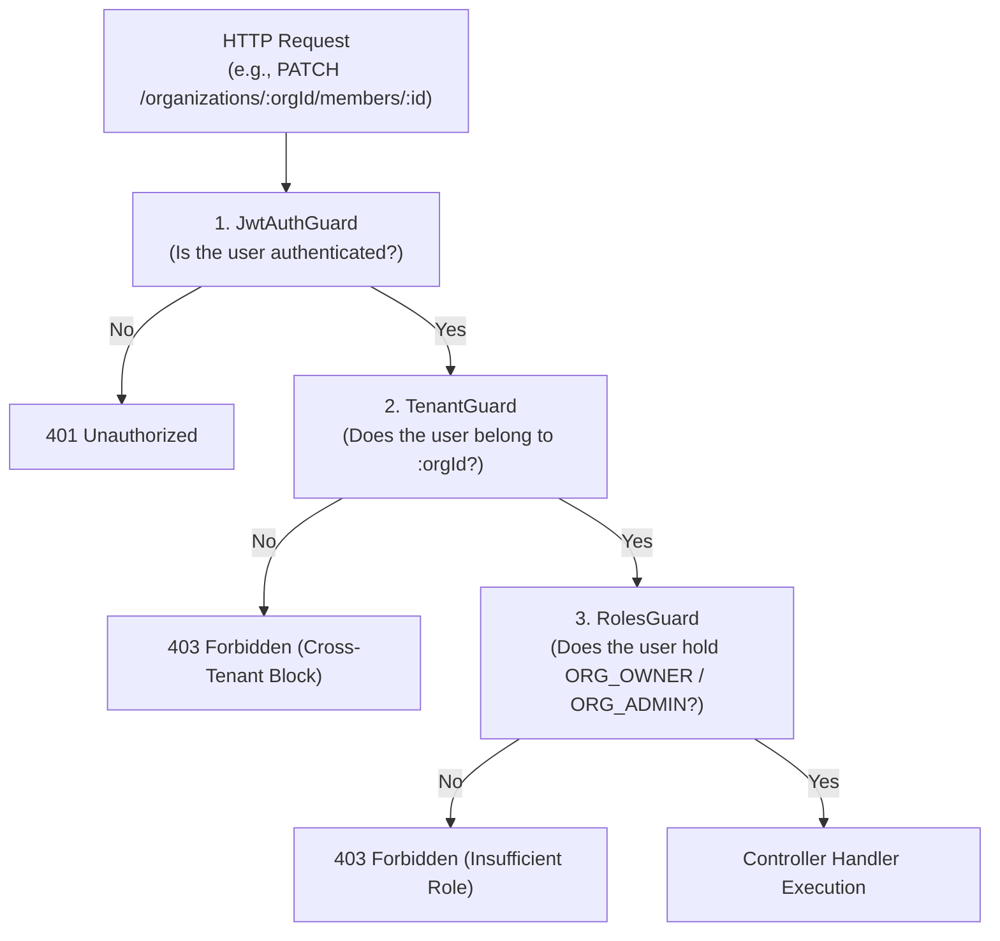
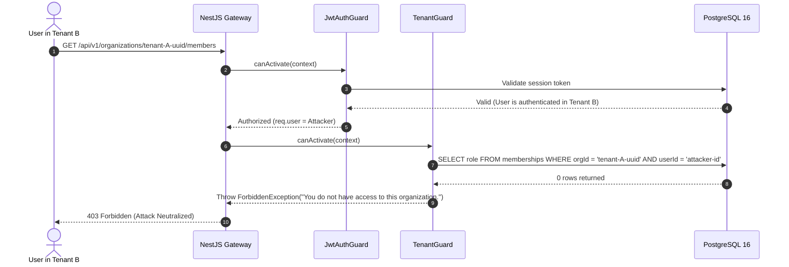

# Engineering Learning Note 05: Multi-Tenant Tenant Isolation & Resilient Session Authentication

**Topic:** Defense-in-Depth Multi-Tenancy, Cross-Tenant Attack Mitigation, Stateful Session Management vs. Pure Stateless JWTs, Cryptographic Token Hashing, and Sole-Owner Invariants  
**Application Context:** TeamFlow Multi-Tenant SaaS Project Management Platform (`apps/api`)  
**Target Audience:** Full-Stack Software Engineer (Preparation for Senior Engineering Roles & Technical Interviews)  
**Governing Standard:** [`AGENTS.md`](../../../AGENTS.md) Sections 1, 2, 3, 4, 6, 8, and 9

---

## 1. What Was Implemented

In Milestone 3 of TeamFlow, we implemented the core **Authentication and Multi-Tenant Isolation Engine**:

1. **Authentication Module (`apps/api/src/modules/auth`):**
   - **Password Security:** Password hashing and verification using `bcrypt` with cost factor 12 ([`PasswordService`](../../../apps/api/src/modules/auth/services/password.service.ts)).
   - **Cryptographic Token Lifecycle:** Secure token generation (`crypto.randomBytes(32)`) and SHA-256 database storage ([`TokenService`](../../../apps/api/src/modules/auth/services/token.service.ts)).
   - **Hybrid Stateful Session Management:** 15-minute JWT access tokens paired with persistent, database-backed `Session` records ([`AuthService`](../../../apps/api/src/modules/auth/services/auth.service.ts)), enabling instantaneous session revocation across all devices on password reset.
   - **Security-First Flows:** Registration, login, logout, password change, anti-enumeration password reset, email verification, and profile management.
   - **Defense-in-Depth Guards:** [`JwtAuthGuard`](../../../apps/api/src/common/guards/jwt-auth.guard.ts) extracting credentials from either the `Authorization: Bearer` header or signed/secure `HttpOnly` cookies.
2. **Organizations & Multi-Tenancy Module (`apps/api/src/modules/organizations`):**
   - **Tenant Scoping Engine:** [`TenantGuard`](../../../apps/api/src/common/guards/tenant.guard.ts) verifying that the authenticated user possesses an active `Membership` in the target organization, completely preventing cross-tenant data leakage.
   - **Role-Based Access Control (RBAC):** [`RolesGuard`](../../../apps/api/src/common/guards/roles.guard.ts) enforcing permission hierarchies (`ORG_OWNER`, `ORG_ADMIN`, `ORG_MEMBER`, `ORG_GUEST`).
   - **Business Invariant Protection:** Enforced the **Sole-Owner Invariant** (BR-010) in [`MembersService`](../../../apps/api/src/modules/organizations/services/members.service.ts), guaranteeing an organization cannot remove or demote its last remaining owner.
   - **Invitation Lifecycle:** 7-day cryptographically hashed invitations with recipient email verification and atomic acceptance transactions.
3. **Automated Verification:**
   - 34 passing unit tests covering session issuance, password hashing, sole-owner protection, role permissions, and cross-tenant attack rejection.

---

## 2. Why It Is Necessary

In modern SaaS development, **Broken Access Control** is the #1 vulnerability on the OWASP Top 10. Multi-tenant SaaS architectures face distinct security threats that cannot be resolved with generic authorization libraries.

### Critical Vulnerabilities Mitigated
1. **Insecure Direct Object Reference (IDOR) & Cross-Tenant Bleed:** In a multi-tenant platform, User A (Company 1) might manipulate request URLs to inspect `/organizations/company-2-id/projects`. If the backend only verifies *that the user is logged in* without checking *whether they belong to Company 2*, confidential proprietary data is leaked. [`TenantGuard`](../../../apps/api/src/common/guards/tenant.guard.ts) guarantees that every organization-scoped request is validated against the database membership table.
2. **The "Stateless JWT Revocation Dilemma":** Pure stateless JWTs cannot be invalidated before their expiration timestamp without maintaining a blacklist. If a user's laptop is stolen or their account is compromised, changing their password does not stop an attacker possessing a valid JWT from accessing the account. TeamFlow solves this using a **Hybrid Architecture**: the JWT contains a `sessionId` pointing to an active PostgreSQL `Session` row. Revoking the session or resetting the password deletes the database row, instantly invalidating the JWT.
3. **Database Read Leak Token Hijacking:** Storing raw password reset or invitation tokens in plaintext in the database means that a database backup leak allows attackers to take over any user account. Storing only the **SHA-256 hash** of the token ensures that even with direct database access, an attacker cannot compute the original token required to reset a password or accept an invitation.
4. **The "Orphaned Organization" Trap:** If an organization owner leaves or demotes themselves without transferring ownership to another member, the tenant account is permanently locked out from administrative settings. Our service layer strictly blocks the removal or demotion of an organization's sole owner.

---

## 3. The Underlying Technical Concepts

### 3.1 Hybrid Stateful Session Authentication
```text
┌─────────────────────────────────┐       ┌─────────────────────────────────┐
│     Pure Stateless JWTs         │       │ TeamFlow Hybrid Session Model   │
├─────────────────────────────────┼───────┼─────────────────────────────────┤
│ Fast (no database lookup)       │  VS   │ Ultra-fast JWT verification     │
│ CANNOT be instantly revoked     │       │ INSTANT revocation via DB check │
│ Bloated token payload           │       │ Lean payload: { sub, sessionId }│
│ Vulnerable during token lifetime│       │ Database tracks IP & User-Agent │
└─────────────────────────────────┘       └─────────────────────────────────┘
```
1. Upon login, TeamFlow generates a random 32-byte session token hash and writes a row to the `Session` table with an expiration timestamp (`expiresAt = now() + 7 days`).
2. A compact JWT access token is signed containing `sub: userId` and `sessionId: session.id` (`expiresIn = 15m`).
3. [`JwtAuthGuard`](../../../apps/api/src/common/guards/jwt-auth.guard.ts) verifies the cryptographic signature of the JWT, and confirms that `Session.id` still exists in PostgreSQL.
4. When a user logs out or clicks "Reset Password", `Session.deleteMany({ where: { userId } })` purges the sessions, immediately terminating access on all devices.

### 3.2 Multi-Tenant Guard Execution Chain



### 3.3 The Sole-Owner Invariant (BR-010)
An organization must always have **at least one active `ORG_OWNER`**.
```typescript
if (target.role === OrgRole.ORG_OWNER && newRole !== OrgRole.ORG_OWNER) {
  const ownerCount = await this.prisma.membership.count({
    where: { organizationId: orgId, role: OrgRole.ORG_OWNER },
  });

  if (ownerCount <= 1) {
    throw new BadRequestException('Cannot demote the sole organization owner.');
  }
}
```

---

## 4. How It Works Internally: Cross-Tenant Protection in Action



---

## 5. Senior Engineering Interview Questions & Answers

### Question 1: How do you solve the JWT revocation problem in production SaaS systems without storing every single API token in memory?
**Answer:**
> "Stateless JWTs cannot be revoked before their expiration date without maintaining a centralized revocation list, which defeats the purpose of being stateless. Storing every token in Redis introduces high memory overhead.
> In TeamFlow, we implement a **Hybrid Session Model**. The JWT carries a short expiration window (15 minutes) and contains a `sessionId` pointing to an indexed row in our `Session` table. During authentication, our `JwtAuthGuard` verifies the cryptographic signature and checks that the `sessionId` is active in the database. When a user logs out, resets their password, or is terminated by an administrator, we simply delete their session record from PostgreSQL. Subsequent requests immediately fail with `401 Unauthorized`. This provides the instant security control of stateful sessions with the distributed payload benefits of JWTs."

### Question 2: Why should password reset and invitation tokens be hashed in the database, and why should the password reset endpoint always return 200 OK?
**Answer:**
> "There are two critical security considerations here:
> 1. **Token Hashing:** If password reset or invitation tokens are stored in plaintext, an internal database compromise or read-only SQL injection vulnerability allows an attacker to steal the tokens and take over any user account. We generate high-entropy 32-byte tokens (`crypto.randomBytes(32)`), send the raw token to the user's email, and store only the **SHA-256 hash** in PostgreSQL.
> 2. **Anti-Enumeration Protection:** If an API endpoint `/forgot-password` returns `404 User Not Found` when an email does not exist, an attacker can use this endpoint to test lists of email addresses to discover registered customers. To prevent account enumeration, the endpoint must always return the exact same generic success message (`'If an account exists, a link has been dispatched'`), regardless of whether the email was found."

### Question 3: How do you design multi-tenant authorization to guarantee that developers cannot accidentally forget to scope queries by tenant ID?
**Answer:**
> "We enforce multi-tenancy through a Defense-in-Depth strategy across three layers:
> 1. **Route Gateway Layer:** Our `TenantGuard` intercepts requests containing `:orgId` parameters or `X-Organization-Id` headers. It queries the `Membership` table to verify that the authenticated user has an active membership in that organization. If unauthorized, it terminates the request with a `403 Forbidden` before the controller is reached.
> 2. **Request Context Layer:** `TenantGuard` extracts the verified organization ID and attaches it directly to `req.tenant` and `req.user.currentOrgId`.
> 3. **Service & Database Layer:** Service methods reject client-supplied tenant IDs in request bodies and bind database operations exclusively to the server-verified `organizationId` from the context. Furthermore, composite unique constraints at the database level (`UNIQUE (organizationId, key)`) ensure that data integrity is physically enforced by PostgreSQL."
