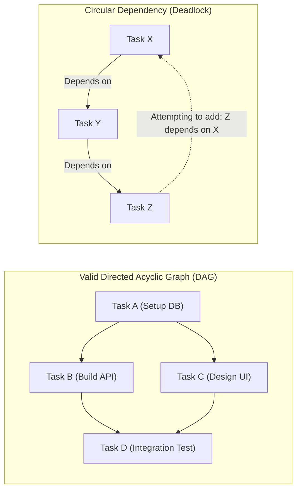
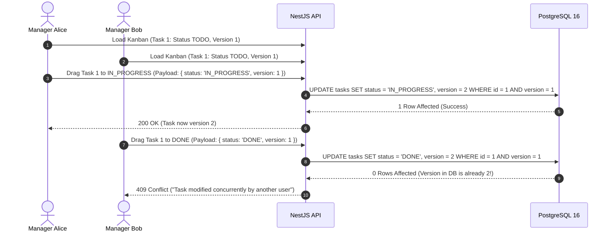

# Engineering Learning Note 06: Directed Acyclic Graphs (DAGs), Cycle Detection & Optimistic Concurrency Control (OCC)

**Topic:** Directed Acyclic Graphs, Topological Cycle Prevention, Optimistic Concurrency Control (OCC), Fractional String Indexing, and Cascading Multi-Tenant Soft-Deletes  
**Application Context:** TeamFlow Project & Task Management Engines (`apps/api/src/modules/projects`, `apps/api/src/modules/tasks`)  
**Target Audience:** Full-Stack Software Engineer (Preparation for Senior Engineering Roles & Technical Interviews)  
**Governing Standard:** [`AGENTS.md`](../../../AGENTS.md) Sections 1, 2, 3, 4, 6, 7, 8, and 9

---

## 1. What Was Implemented

In Milestone 4 of TeamFlow, we built the core **Project & Task Management Engines**:

1. **Projects Engine (`apps/api/src/modules/projects`):**
   - **Private by Default Scoping (Decision Q2):** Projects and their tasks are strictly invisible to non-members unless the user holds `ORG_OWNER` or `ORG_ADMIN` administrative privileges. Enforced via [`ProjectMemberGuard`](../../../apps/api/src/common/guards/project-member.guard.ts).
   - **Cascading Soft-Delete (TX-04):** Implemented in [`ProjectsService.delete`](../../../apps/api/src/modules/projects/services/projects.service.ts), atomically soft-deleting the project and all active child tasks within a single database transaction.
   - **Project Manager Invariant:** Guaranteed that an active project cannot demote or remove its sole `PROJECT_MANAGER`.
2. **Tasks & Kanban Engine (`apps/api/src/modules/tasks`):**
   - **Monotonic Task Identifiers:** Per-project monotonic task numbering (e.g., `APP-1`, `APP-2`) coupled with project keys.
   - **Strict Assignee Scoping (FR-041):** Verified that all task assignees are verified members of the parent project.
   - **Optimistic Concurrency Control (OCC):** Every task update and Kanban drag-and-drop operation enforces version checking (`WHERE id = :id AND version = :expectedVersion`), incrementing `version` atomically and rejecting stale concurrent writes with a deterministic `409 Conflict`.
   - **String-Based Fractional Indexing (Decision Q3):** Lexicographical midpoint calculation via [`FractionalIndexService`](../../../apps/api/src/modules/tasks/services/fractional-index.service.ts), enabling $O(1)$ single-row Kanban card moves without mass integer re-ranking.
   - **Single-Level Checklist Items (Decision Q4):** Implemented in [`SubtasksService`](../../../apps/api/src/modules/tasks/services/subtasks.service.ts), keeping checklists distinct from independent task dependencies.
   - **DAG Cycle Detection Algorithm:** Built [`CycleDetectionService`](../../../apps/api/src/modules/tasks/services/cycle-detection.service.ts) using Depth-First Search (DFS) graph reachability to prevent circular task dependencies ($A \to B \to A$ or transitive loops).

---

## 2. Why It Is Necessary

### Critical Problems Solved
1. **The Circular Dependency Deadlock:** If Task A depends on Task B (B must complete before A can start), and an engineer creates a dependency where Task B depends on Task A, neither task can ever be worked on. In a complex project with hundreds of tasks, transitive loops ($A \to B \to C \to D \to A$) can paralyze team workflows. Cycle detection mathematically guarantees the dependency graph remains a **Directed Acyclic Graph (DAG)** at all times.
2. **Lost Updates on Concurrent Kanban Moves:** When two managers reorder the same Kanban column simultaneously, traditional updates overwrite each other blindly. By attaching a monotonic `version` integer to every task, TeamFlow detects when card data was modified between reading and writing, rejecting stale client state with a clean `409 Conflict` and prompting a client-side optimistic rollback.
3. **Mass-Write Re-ranking Spikes:** In naive project management apps using integer ranking (`1, 2, 3...`), moving a card to the top of a 1,000-card column requires updating 999 other rows (`UPDATE tasks SET rank = rank + 1 WHERE rank >= 0`). This causes massive database write locks and floods WebSocket gateways. Fractional string indexing updates strictly **1 row** ($O(1)$ write complexity).

---

## 3. The Underlying Technical Concepts

### 3.1 Directed Acyclic Graphs (DAGs) and Cycle Detection
In graph theory, a **Directed Graph** consists of vertices (tasks) and directed edges (dependencies).
- An edge $(u \to v)$ indicates that Task $u$ depends on Task $v$ (Task $v$ is a prerequisite for Task $u$).
- A **Directed Acyclic Graph (DAG)** contains zero directed cycles.



#### The Reachability Cycle Detection Theorem
> **Theorem:** Adding a directed edge $(u \to v)$ creates a cycle if and only if there already exists a directed path from $v$ to $u$ ($v \leadsto u$) in the existing graph.

**Algorithm Implementation (Depth-First Search):**
1. Check base case: if $u = v$ (self-dependency), reject immediately ($O(1)$).
2. Fetch all existing active dependencies for the project.
3. Construct an in-memory adjacency list.
4. Run DFS starting from $v$: if traversal reaches $u$, abort and throw `409 Conflict`.
5. If the search terminates without finding $u$, the graph remains a DAG; insert the dependency edge safely.

### 3.2 Optimistic Concurrency Control (OCC) Architecture
Rather than taking heavy pessimistic table or row locks (`SELECT ... FOR UPDATE`), which kill read throughput on high-traffic boards, TeamFlow uses **Optimistic Concurrency Control**:



---

## 4. How It Works Internally: Fractional Indexing

### Base-62 Fractional Ordering Mechanics
- Keys are sorted lexicographically (e.g. `'0' < '9' < 'A' < 'Z' < 'a' < 'z'`).
- Initial card in column: `'a0'`.
- Appending after `'a0'`: `'a1'`.
- Moving a card between `'a0'` and `'a1'`: Midpoint is computed as `'a0V'` (`'V'` is the midpoint between ASCII `'0'` and `'z'`).
- Inserting between `'a0'` and `'a0V'`: Computes `'a0K'`.

```text
Position 0:   'a0'
Inserted:     'a0K'   <-- Midpoint between 'a0' and 'a0V'
Inserted:     'a0V'   <-- Midpoint between 'a0' and 'a1'
Position 1:   'a1'
```
This guarantees that **only the moved card is updated in the database**. The rest of the column remains untouched.

---

## 5. Senior Engineering Interview Questions & Answers

### Question 1: How do you detect and prevent dependency cycles in a task scheduling system?
**Answer:**
> "A task dependency hierarchy is modeled as a Directed Graph where an edge $(u \to v)$ represents that Task $u$ depends on Task $v$. To prevent deadlocks, the graph must remain a Directed Acyclic Graph (DAG) at all times.
> Before inserting a new dependency $(u \to v)$, we check whether $u$ is already reachable from $v$ ($v \leadsto u$) along existing edges. If $v$ can already reach $u$, adding $(u \to v)$ would complete a directed loop, creating a cycle.
> We implement this using Depth-First Search (DFS) or Breadth-First Search (BFS) starting from the proposed prerequisite $v$. If the traversal encounters $u$, we immediately abort the database transaction and throw a `409 Conflict`. If the search exhausts all reachable nodes without encountering $u$, the graph remains acyclic, and we safely commit the dependency."

### Question 2: Why choose Optimistic Concurrency Control (OCC) over Pessimistic Row Locking for Kanban board state management?
**Answer:**
> "Pessimistic Row Locking (`SELECT ... FOR UPDATE`) serializes access by acquiring exclusive write locks on rows or tables during reading. In a collaborative SaaS Kanban board where dozens of users are viewing and dragging cards simultaneously, pessimistic locks create high contention, database connection pool starvation, and potential deadlocks.
> Optimistic Concurrency Control assumes conflicts are relatively infrequent. We attach a `version INT` column to the `Task` entity. Read queries never lock rows. When an update occurs, the SQL query validates the version:
> `UPDATE tasks SET status = $1, version = version + 1 WHERE id = $2 AND version = $3`.
> If another user moved the card in the interim, the version has incremented, 0 rows are affected, and the application raises an immediate `409 Conflict`. The client simply rolls back its optimistic UI state and fetches the latest board snapshot. This maximizes API throughput and eliminates lock queues entirely."

### Question 3: How do you implement cascading soft-deletion in a multi-tenant relational database without leaving orphaned records?
**Answer:**
> "In a multi-tenant SaaS application, hard deleting records breaks historical audit trails, invoice references, and activity logs. Instead, we use soft-deletion by populating a `deletedAt TIMESTAMPTZ` column.
> However, soft-deleting a parent entity (such as a `Project`) does not automatically trigger database-level `ON DELETE CASCADE` foreign key actions because no rows are physically removed.
> To prevent orphaned active tasks from appearing in global search queries or analytics dashboards, we execute cascading soft-deletes within an explicit database transaction (`TX-04`):
> First, we set `deletedAt = NOW()` on the parent project. Within the same transaction, we execute an atomic batch update:
> `UPDATE tasks SET deletedAt = NOW() WHERE projectId = :id AND deletedAt IS NULL`.
> Both updates commit atomically to the Write-Ahead Log (WAL), ensuring the parent project and all child tasks transition to deleted state simultaneously."
